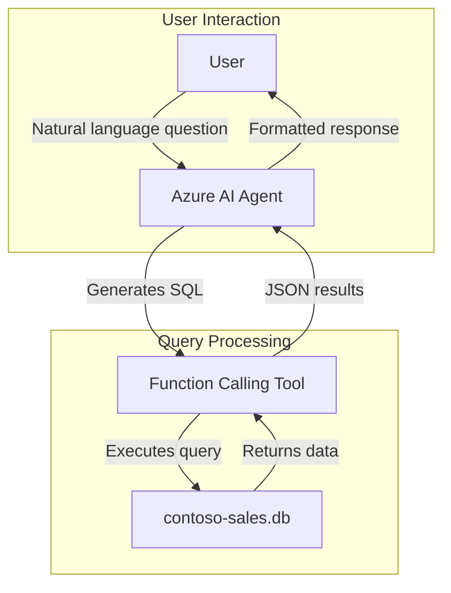
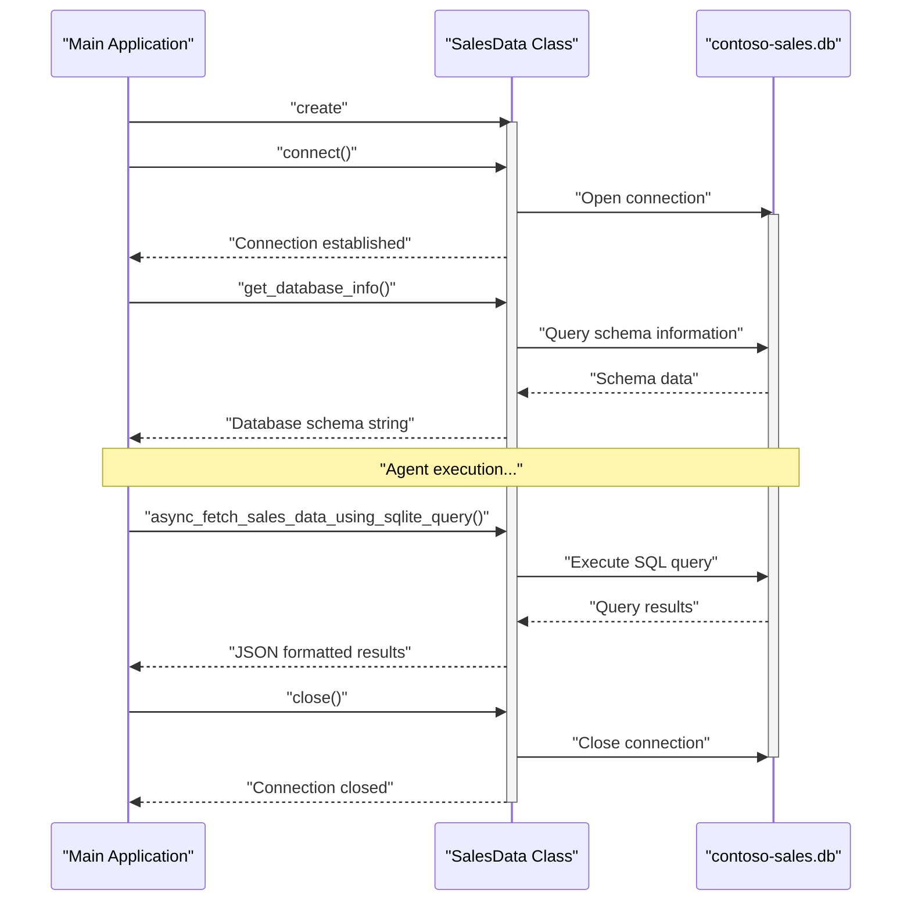
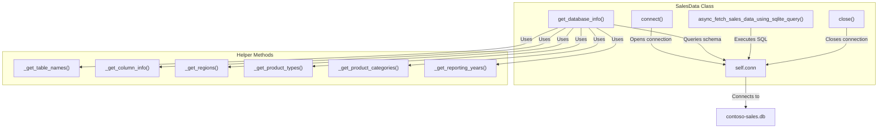
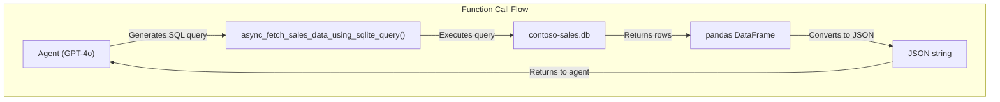
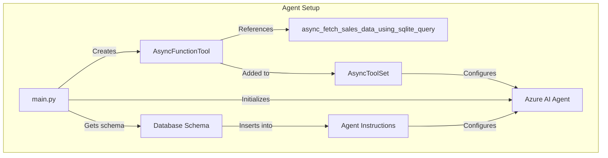

<!-- source: DeepWiki mcp.deepwiki.com · repo microsoft/build-your-first-agent-with-azure-ai-agent-service-workshop · page 4.1 SQLite Database Integration · fetched 2026-10-26 -->

# SQLite Database Integration

<details>
<summary>Relevant source files</summary>

The following files were used as context for generating this wiki page:

- [.gitignore](.gitignore)
- [docs/docs/lab-1-function_calling.md](docs/docs/lab-1-function_calling.md)
- [src/csharp/workshop/AgentWorkshop.Client/SalesData.cs](src/csharp/workshop/AgentWorkshop.Client/SalesData.cs)
- [src/python/workshop/main.py](src/python/workshop/main.py)
- [src/python/workshop/requirements.txt](src/python/workshop/requirements.txt)
- [src/python/workshop/sales_data.py](src/python/workshop/sales_data.py)
- [src/python/workshop/utilities.py](src/python/workshop/utilities.py)
- [src/shared/datasheet/contoso-tents-datasheet.pdf](src/shared/datasheet/contoso-tents-datasheet.pdf)

</details>


This document explains how the Contoso Sales Agent integrates with a SQLite database to provide real-time access to sales data. It covers the database connection process, schema information extraction, and the function calling mechanism that enables the agent to execute SQL queries.

For information about document grounding using vector search, see [File Search](#5).

## Overview

The SQLite database integration is a key component of the Function Calling capability in the Azure AI Agent Service workshop. It allows the agent to dynamically generate and execute SQL queries to answer user questions about Contoso's sales data.



Sources: [src/python/workshop/main.py:46-57](), [src/python/workshop/sales_data.py:103-129]()

## Database Structure

The SQLite database (`contoso-sales.db`) contains Contoso's sales data with information about products, regions, sales transactions, and other business metrics. The database schema is extracted during initialization and provided to the agent as part of its instructions.

The database includes the following key information:

| Element | Description |
|---------|-------------|
| Tables | sales_data |
| Regions | AFRICA, ASIA-PACIFIC, CHINA, EUROPE, LATIN AMERICA, MIDDLE EAST, NORTH AMERICA |
| Product Types | Various product types (tents, footwear, etc.) |
| Product Categories | Main product categories |
| Reporting Years | Years for which sales data is available |

Sources: [src/python/workshop/sales_data.py:76-101](), [src/csharp/workshop/AgentWorkshop.Client/SalesData.cs:29-68]()

## Database Connection Management

The application uses asynchronous database connections to efficiently interact with the SQLite database file. The connection is established during initialization and closed when the application terminates.



Sources: [src/python/workshop/sales_data.py:24-37](), [src/csharp/workshop/AgentWorkshop.Client/SalesData.cs:12-27]()

## Python Implementation

In the Python implementation, the SQLite database integration is handled by the `SalesData` class using the `aiosqlite` library for asynchronous database operations.

### Connection Setup

The database connection is established in the `connect()` method, which creates a read-only connection to the SQLite database file:



Sources: [src/python/workshop/sales_data.py:24-29](), [src/python/workshop/utilities.py:12-14]()

### Schema Extraction

The `get_database_info()` method retrieves the database schema information by querying table names, column information, and common query fields (regions, product types, categories, years):

```
Table {table_name} Schema: Columns: {column_names}
Regions: {regions}
Product Types: {product_types}
Product Categories: {product_categories}
Reporting Years: {reporting_years}
```

This schema information is included in the agent's instructions to help the LLM generate accurate SQL queries.

Sources: [src/python/workshop/sales_data.py:76-101](), [src/python/workshop/main.py:111-113]()

### Query Execution Function

The `async_fetch_sales_data_using_sqlite_query()` method is the core function that executes SQLite queries generated by the agent:



The function:
1. Takes an SQL query as input
2. Executes it against the SQLite database
3. Converts the results to a pandas DataFrame
4. Returns the data as a JSON string
5. Handles errors and returns error information when queries fail

Sources: [src/python/workshop/sales_data.py:103-129]()

## C# Implementation

The C# implementation follows a similar pattern but uses the `Microsoft.Data.Sqlite` library instead of `aiosqlite`:

### Connection Management

```csharp
connection = new SqliteConnection($"Data Source={databasePath};Mode=ReadOnly");
```

The connection is opened when needed and closed after each operation.

### Schema Extraction

The `GetDatabaseInfoAsync()` method in the C# implementation creates a similar schema string as the Python version.

### Query Execution Function

The `FetchSalesDataAsync()` method handles SQL query execution in the C# implementation:

```csharp
public async Task<string> FetchSalesDataAsync(string query)
```

This method executes the query and serializes the results as a JSON string to return to the agent.

Sources: [src/csharp/workshop/AgentWorkshop.Client/SalesData.cs:77-116]()

## Integration with Agent Functionality

The SQLite database integration is wired into the agent functionality through the function calling mechanism:



The key integration steps are:

1. The database schema is extracted during initialization
2. The schema is injected into the agent's instructions
3. The function tool is registered with the agent
4. When the agent needs to query data, it calls the registered function
5. Results are formatted according to the instructions (typically as Markdown tables)

Sources: [src/python/workshop/main.py:95-118](), [src/python/workshop/main.py:53-57]()

## Query Generation Process

When a user asks a question, the LLM (GPT-4o) dynamically generates an appropriate SQLite query based on:

1. The user's natural language question
2. The database schema provided in the instructions
3. The context about Contoso's business

For example:

| User Query | Generated SQL Query |
|------------|---------------------|
| "What are the sales by region?" | `SELECT region, SUM(revenue) AS total_revenue FROM sales_data GROUP BY region;` |
| "Show sales by category in Europe" | `SELECT main_category, SUM(revenue) AS total_revenue FROM sales_data WHERE region = 'EUROPE' GROUP BY main_category ORDER BY total_revenue DESC;` |

Sources: [docs/docs/lab-1-function_calling.md:222-233]()

## Result Processing

Query results are processed and returned to the user in a user-friendly format:

1. The function returns data as a JSON string
2. The agent (LLM) formats the data according to the instructions
3. For most queries, results are formatted as Markdown tables
4. Error handling is implemented for failed queries

Sources: [src/python/workshop/sales_data.py:116-129](), [docs/docs/lab-1-function_calling.md:211-221]()

## Security Considerations

The SQLite database is opened in read-only mode to prevent modifications:

```python
db_uri = f"file:{self.utilities.shared_files_path}/{DATA_BASE}?mode=ro"
```

This ensures that the agent can only read data but not modify the database structure or content.

Sources: [src/python/workshop/sales_data.py:25](), [src/csharp/workshop/AgentWorkshop.Client/SalesData.cs:21]()

---

