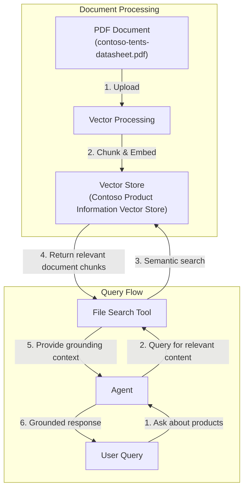
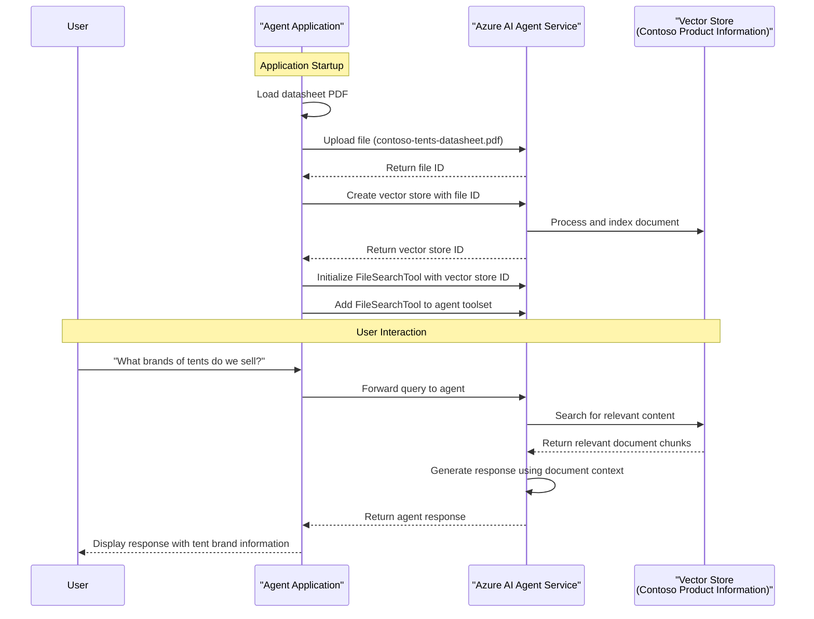

<!-- source: DeepWiki mcp.deepwiki.com · repo microsoft/build-your-first-agent-with-azure-ai-agent-service-workshop · page 5 File Search · fetched 2026-10-26 -->

# File Search

<details>
<summary>Relevant source files</summary>

The following files were used as context for generating this wiki page:

- [docs/docs/lab-2-file_search.md](docs/docs/lab-2-file_search.md)
- [docs/docs/lab-3-code_interpreter.md](docs/docs/lab-3-code_interpreter.md)
- [src/csharp/workshop/AgentWorkshop.Client/Lab2.cs](src/csharp/workshop/AgentWorkshop.Client/Lab2.cs)
- [src/csharp/workshop/AgentWorkshop.Client/Lab3.cs](src/csharp/workshop/AgentWorkshop.Client/Lab3.cs)

</details>


## Purpose and Scope

This document explains the File Search tool implementation in the Azure AI Agent Service workshop repository. File Search provides document grounding capabilities to the agent, enabling it to retrieve information from uploaded files using vector search technology. This feature extends the agent's knowledge beyond the database information covered in the [Function Calling](#4) section, allowing it to reference product documentation, specifications, and other unstructured data.

Sources: [docs/docs/lab-2-file_search.md:1-12]()

## Vector Store Concepts

The File Search tool relies on a vector store to enable efficient semantic searching of document content. A vector store is a specialized database that:

1. Stores numeric vector representations of text data (embeddings)
2. Optimizes for similarity searches to find content semantically related to a query
3. Facilitates RAG (Retrieval Augmented Generation) patterns by providing relevant context to the LLM

In the workshop's implementation, a vector store is created at runtime, and the product datasheet PDF file is processed and stored as embeddings for semantic retrieval.



Sources: [docs/docs/lab-2-file_search.md:9-12]()

## Implementation Details

### Component Architecture

The File Search implementation involves several interconnected components that work together to provide document grounding capabilities to the agent.

```mermaid
classDiagram
    class AgentTools {
        +FileSearchTool
        +FunctionCallingTool
        +CodeInterpreterTool
        +BingGroundingTool
    }
    
    class FileSearchTool {
        +vector_store_ids
        +search(query)
    }
    
    class VectorStore {
        +id
        +name
        +files
    }
    
    class Agent {
        +instructions
        +tools
        +respond_to_message()
    }
    
    Agent --> AgentTools : uses
    AgentTools *-- FileSearchTool : contains
    FileSearchTool --> VectorStore : references
    VectorStore --> "AgentFile" : contains
```

Sources: [docs/docs/lab-2-file_search.md:1-12](), [src/csharp/workshop/AgentWorkshop.Client/Lab2.cs:1-47]()

### Python Implementation

In the Python implementation, the File Search tool is enabled by:

1. Specifying the correct instructions file which includes File Search capabilities
2. Creating a vector store with the product datasheet
3. Initializing the FileSearchTool with the vector store ID
4. Adding the tool to the agent's toolset

The key code elements in Python are:

```
INSTRUCTIONS_FILE = "instructions/file_search.txt"
vector_store = await utilities.create_vector_store(
    project_client,
    files=[TENTS_DATA_SHEET_FILE],
    vector_store_name="Contoso Product Information Vector Store",
)
file_search_tool = FileSearchTool(vector_store_ids=[vector_store.id])
toolset.add(file_search_tool)
```

Sources: [docs/docs/lab-2-file_search.md:20-35]()

### C# Implementation

The C# implementation follows a similar pattern but uses class structures to organize the code:

1. The `Lab2` class inherits from the base `Lab` class
2. Override of `InstructionsFileName` to use the file search instructions
3. The `InitialiseLabAsync` method handles file upload and vector store creation
4. The `InitialiseToolResources` method configures the File Search tool with the vector store ID

The key methods in C# are:

- `InitialiseLabAsync`: Uploads the datasheet PDF and creates a vector store
- `InitialiseToolResources`: Configures the FileSearch tool with the vector store ID

Sources: [src/csharp/workshop/AgentWorkshop.Client/Lab2.cs:4-46]()

## Data Flow Process

### Document Ingestion and Retrieval Flow

This diagram illustrates the complete process from document upload to agent response using the File Search capability:



Sources: [docs/docs/lab-2-file_search.md:94-123](), [src/csharp/workshop/AgentWorkshop.Client/Lab2.cs:14-45]()

## Integration with Other Tools

File Search works alongside other tools in the Agent Toolset, building on the Function Calling capability from Lab 1 and serving as a foundation for the Code Interpreter in Lab 3.

```mermaid
flowchart LR
    subgraph "Agent Toolset"
        FT["FunctionCalling Tool<br>(Database Access)"]
        FS["FileSearch Tool<br>(Document Grounding)"]
        CI["CodeInterpreter Tool<br>(Visualization)"]
        BS["BingSearch Tool<br>(External Knowledge)"]
    end
    
    User --> Agent
    Agent --> "Agent Toolset"
    
    FT --> DB[(SQLite Database<br>Sales Data)]
    FS --> VS[(Vector Store<br>Product Information)]
    CI --> Charts[("Generated Charts<br>& Visualizations")]
    BS --> Web[("Internet<br>External Knowledge")]
    
    FS --> CI
    FT --> CI
```

Sources: [docs/docs/lab-2-file_search.md:107-130](), [docs/docs/lab-3-code_interpreter.md:105-116]()

## Usage Examples

The File Search functionality enables the agent to answer questions about product information that isn't stored in the transactional sales database. For example:

| User Query | Tool Used | Data Source | Response Information |
|------------|-----------|-------------|----------------------|
| "What brands of hiking shoes do we sell?" | None | N/A | No information available (not in database or documents) |
| "What brands of tents do we sell?" | File Search | Tents Data Sheet | List of tent brands from the data sheet |
| "What product type and categories are these brands associated with?" | File Search | Tents Data Sheet | Product types and categories for each brand |
| "What were the sales of AlpineGear in 2024 by region?" | Function Calling + File Search | Database + Data Sheet | Sales data filtered by the brand found in the data sheet |

This demonstrates how File Search grounds the agent with document knowledge, allowing it to provide more accurate and contextual responses by combining structured database information with unstructured document content.

Sources: [docs/docs/lab-2-file_search.md:106-147]()

## Technical Considerations

- The vector store is created each time the application starts in the workshop implementation. In a production environment, you would typically create the vector store once and reuse it.
- Vector stores can handle thousands of documents, making this approach scalable for large document collections.
- The implementation demonstrates the RAG (Retrieval Augmented Generation) pattern, where relevant document content is retrieved and provided to the LLM to ground its responses.
- The File Search tool works with the Azure AI Agent Service to provide semantic search capabilities without requiring direct vector math implementation.

Sources: [docs/docs/lab-2-file_search.md:9-12]()

---

