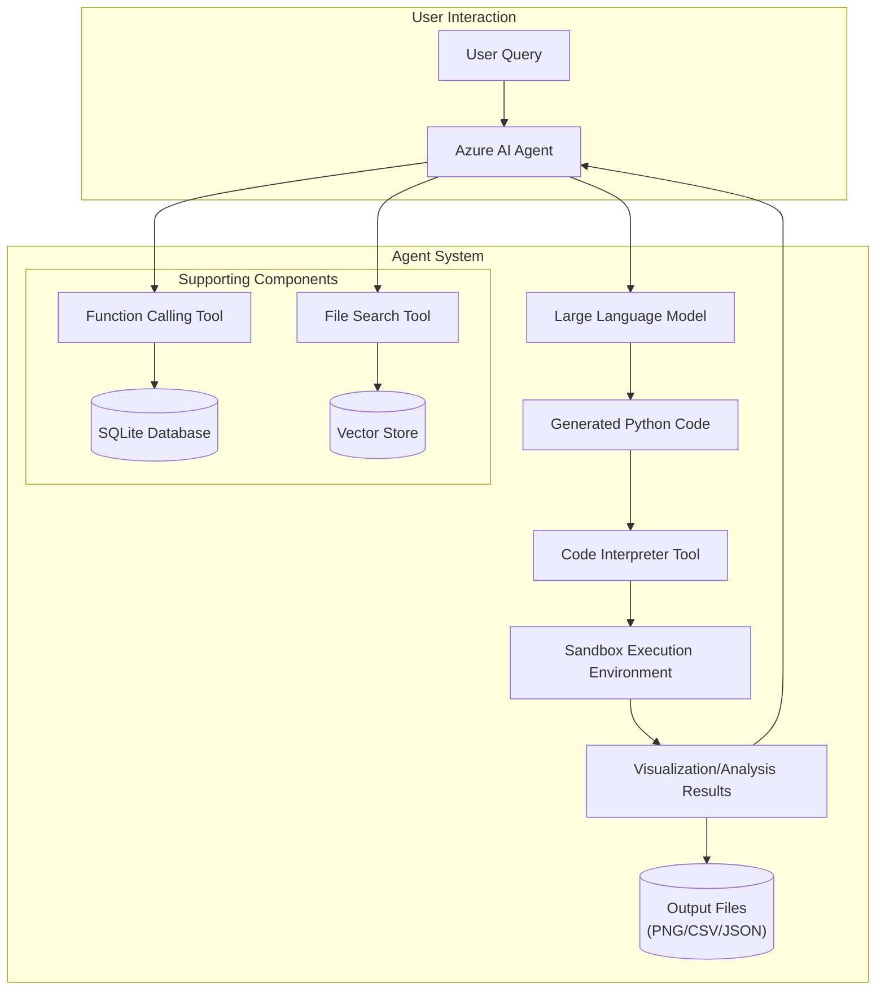
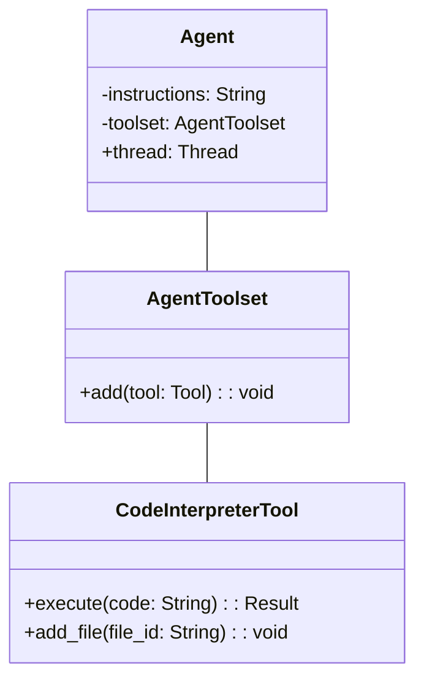
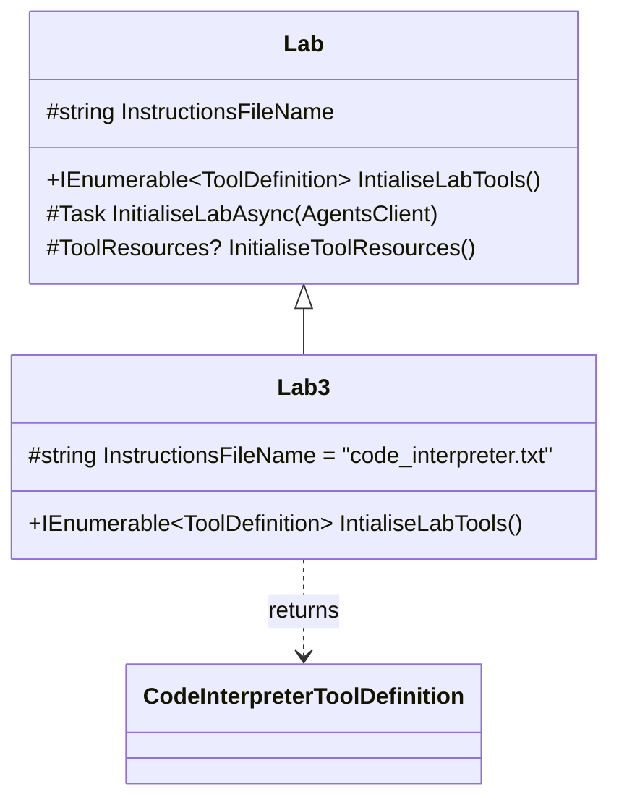
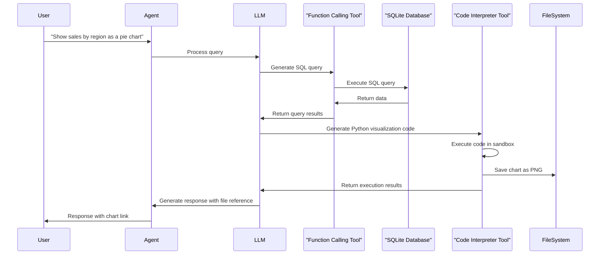

<!-- source: DeepWiki mcp.deepwiki.com · repo microsoft/build-your-first-agent-with-azure-ai-agent-service-workshop · page 6 Code Interpreter · fetched 2026-10-26 -->

# Code Interpreter

<details>
<summary>Relevant source files</summary>

The following files were used as context for generating this wiki page:

- [docs/docs/lab-2-file_search.md](docs/docs/lab-2-file_search.md)
- [docs/docs/lab-3-code_interpreter.md](docs/docs/lab-3-code_interpreter.md)
- [src/csharp/workshop/AgentWorkshop.Client/Lab2.cs](src/csharp/workshop/AgentWorkshop.Client/Lab2.cs)
- [src/csharp/workshop/AgentWorkshop.Client/Lab3.cs](src/csharp/workshop/AgentWorkshop.Client/Lab3.cs)

</details>


## Purpose and Scope

This document explains the Code Interpreter tool in the Azure AI Agent Service workshop. The Code Interpreter enables the agent to execute Python code for data analysis and visualization based on user queries. This capability builds upon the Function Calling ([Function Calling](#4)) and File Search ([File Search](#5)) features covered in previous sections.

## Overview

The Code Interpreter is an AI agent tool that allows the LLM to safely generate and execute Python code within a secure sandbox environment. It enables creation of charts and graphs, data analysis, and file export capabilities.



Sources: [docs/docs/lab-3-code_interpreter.md:1-10](). [src/csharp/workshop/AgentWorkshop.Client/Lab3.cs:1-11]()

## System Components

### Core Components of Code Interpreter

The Code Interpreter consists of the following key components:

1. **CodeInterpreterTool**: The main class that provides code execution capabilities to the agent
2. **Secure Sandbox Environment**: A restricted execution environment that ensures safe operation
3. **File Output System**: Mechanism for saving generated visualizations and data files



Sources: [docs/docs/lab-3-code_interpreter.md:11-67](). [src/csharp/workshop/AgentWorkshop.Client/Lab3.cs:1-11]()

## Implementation Details

### Python Implementation

In the Python implementation, the Code Interpreter is added to the agent by:

1. Setting the instructions file to "instructions/code_interpreter.txt"
2. Creating an instance of `CodeInterpreterTool`
3. Adding it to the agent's toolset

The relevant code for enabling Code Interpreter in Python:

```
INSTRUCTIONS_FILE = "instructions/code_interpreter.txt"

code_interpreter = CodeInterpreterTool()
toolset.add(code_interpreter)
```

Sources: [docs/docs/lab-3-code_interpreter.md:11-67]()

### C# Implementation

In the C# implementation, the Code Interpreter is encapsulated in the `Lab3` class:



The `Lab3` class:
1. Inherits from the base `Lab` class
2. Overrides the `InstructionsFileName` property to use "code_interpreter.txt"
3. Provides a `CodeInterpreterToolDefinition` in the `IntialiseLabTools` method

Sources: [src/csharp/workshop/AgentWorkshop.Client/Lab3.cs:1-11]()

## Execution Flow

When a user asks a question that requires data visualization or analysis, the Code Interpreter follows this sequence:



Sources: [docs/docs/lab-3-code_interpreter.md:90-117]()

## Capabilities

The Code Interpreter provides the following capabilities:

| Capability | Description | Example Use Case |
|------------|-------------|------------------|
| Data Visualization | Creates charts and graphs from data | Pie charts, bar charts, line graphs of sales data |
| Data Analysis | Performs computation and analysis | Calculating trends, aggregating statistics |
| File Export | Saves data in various formats | CSV, JSON exports of query results |
| Dynamic Code Generation | Generates Python code based on natural language | Converting a request for "sales by region" into visualization code |

Sources: [docs/docs/lab-3-code_interpreter.md:83-89](). [docs/docs/lab-3-code_interpreter.md:119-133]()

## Integration with Agent Instructions

The Code Interpreter functionality is defined in the agent instructions file. The relevant section in the instructions adds:

1. Visualization and Code Interpretation capabilities
2. Guidelines for creating charts with appropriate labels and titles
3. Instructions for exporting data in various formats

Key capabilities mentioned in the instructions include:
- Running LLM-generated Python code for visualizing data
- Creating charts and graphs in the user's language
- Exporting visualizations as PNG files and data as CSV files

Sources: [docs/docs/lab-3-code_interpreter.md:81-89]()

## File Output System

When the Code Interpreter generates visualizations or exports data:

1. Files are saved in the **shared/files** directory
2. The directory is created on first use if it doesn't exist
3. Generated files are accessible through VS Code or directly from the filesystem
4. File types include PNG for visualizations and CSV/JSON for data exports

Sources: [docs/docs/lab-3-code_interpreter.md:98-105]()

## Security Considerations

The Code Interpreter executes within a secure sandbox environment:

1. It runs on a restricted subset of Python to ensure safe execution
2. The execution environment is isolated from the host system
3. Only approved libraries and functions are available

This design ensures that LLM-generated code cannot perform harmful operations while still providing powerful data analysis and visualization capabilities.

Sources: [docs/docs/lab-3-code_interpreter.md:1-10]()

## Example Usage Scenarios

### Data Visualization

1. User asks: "Show sales by region as a pie chart"
2. Agent generates SQL query: `SELECT region, SUM(revenue) AS total_revenue FROM sales_data GROUP BY region`
3. Function Calling executes query against SQLite database
4. LLM generates Python visualization code
5. Code Interpreter executes code and saves chart as PNG
6. Agent provides link to the generated chart

### Data Export

1. User asks: "Download the sales by region data"
2. Agent generates SQL query to retrieve data
3. Function Calling executes query
4. LLM generates Python code to format and export data
5. Code Interpreter saves data as CSV file
6. Agent provides link to the generated file

Sources: [docs/docs/lab-3-code_interpreter.md:95-133]()

## Building Upon Code Interpreter

The Code Interpreter serves as a foundation for more advanced capabilities in subsequent labs:

1. **Multilingual Visualizations**: Adding support for different languages in charts ([Multilingual Support](#8))
2. **External Data Integration**: Combining data from Bing Search with visualizations ([Bing Search Integration](#7))

Sources: [docs/docs/lab-3-code_interpreter.md:33-67]()

## Summary

The Code Interpreter tool significantly enhances the agent's capabilities by enabling it to:

1. Execute Python code for complex data analysis
2. Generate visualizations based on natural language queries
3. Export data in various formats
4. Process and transform data programmatically

This creates a powerful tool for data analysis and visualization that builds upon the Function Calling and File Search capabilities, allowing users to interact with data through natural language.

---

