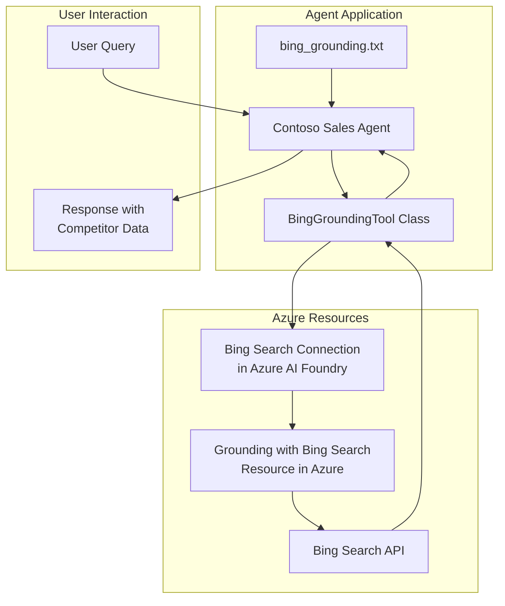
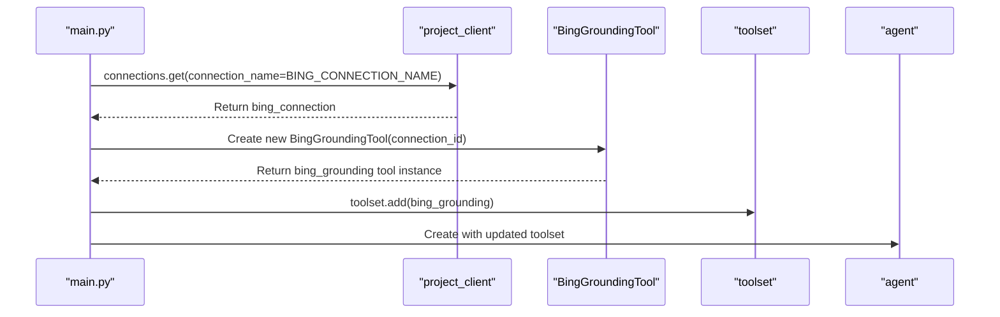
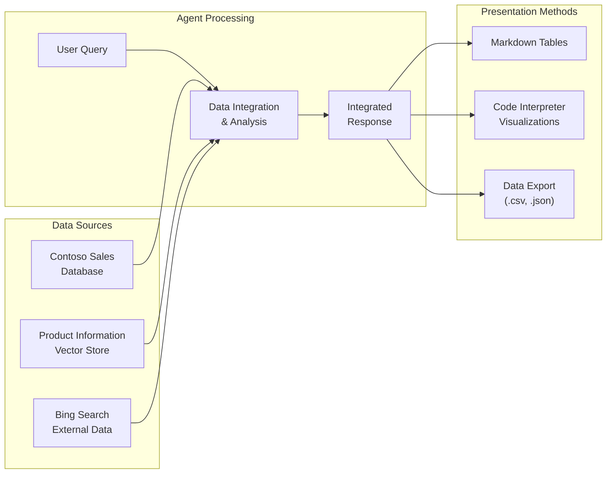
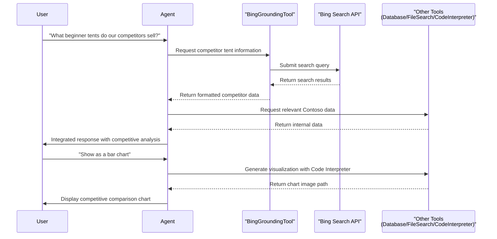

<!-- source: DeepWiki mcp.deepwiki.com · repo microsoft/build-your-first-agent-with-azure-ai-agent-service-workshop · page 7 Bing Search Integration · fetched 2026-10-26 -->

# Bing Search Integration

<details>
<summary>Relevant source files</summary>

The following files were used as context for generating this wiki page:

- [docs/docs/lab-4-bing_search.md](docs/docs/lab-4-bing_search.md)
- [src/shared/instructions/bing_grounding.txt](src/shared/instructions/bing_grounding.txt)

</details>


## Purpose and Scope

This document details the Bing Search integration component in the Azure AI Agent Service workshop. This feature enables the agent to access and incorporate real-time, external information from the web using Bing Search, providing users with competitive intelligence and market data.

The Bing Search integration specifically allows the Contoso Sales Agent to:
- Search for competitive products and pricing information
- Compare Contoso products with market alternatives
- Provide up-to-date industry information grounded in web data

For information about document grounding via file search capabilities, see [File Search](#5).

Sources: [docs/docs/lab-4-bing_search.md:3-11](). [src/shared/instructions/bing_grounding.txt:31-35]()

## System Architecture

The Bing Search integration is implemented through Azure's Grounding with Bing Search service, which connects to the agent through the Azure AI Foundry platform.



Sources: [docs/docs/lab-4-bing_search.md:13-55]()

## Resource Requirements

To implement Bing Search integration, the following Azure resources are required:

| Resource | Purpose | Provisioning Method |
|----------|---------|---------------------|
| Grounding with Bing Search Service | Provides API access to Bing Search | Azure Portal |
| Bing Search Connection | Links the Bing Search service to the Azure AI Foundry project | AI Foundry Portal |

Sources: [docs/docs/lab-4-bing_search.md:13-54]()

## Technical Implementation

The Bing Search integration is implemented through the following components:

1. **Grounding with Bing Search Resource** - An Azure resource that provides access to the Bing Search API
2. **Bing Search Connection** - A connection in Azure AI Foundry that links the agent to the Bing Search resource
3. **BingGroundingTool** - A tool class that is added to the agent's toolset

### Code Implementation

The core implementation involves adding the Bing Grounding tool to the agent's toolset:



In the Python implementation, the following code enables the Bing Search functionality:

```python
# Get the Bing connection from the project
bing_connection = await project_client.connections.get(connection_name=BING_CONNECTION_NAME)
# Create a Bing grounding tool instance
bing_grounding = BingGroundingTool(connection_id=bing_connection.id)
# Add the tool to the agent's toolset
toolset.add(bing_grounding)
```

The implementation also switches the agent's instructions to use the `bing_grounding.txt` instruction file:

```python
INSTRUCTIONS_FILE = "instructions/bing_grounding.txt"
```

Sources: [docs/docs/lab-4-bing_search.md:58-116]()

## Agent Instructions

The agent's instructions are defined in the `bing_grounding.txt` file, which provides specific guidelines for how the agent should use the Bing Search capability. Key constraints include:

1. **Limited Scope**: The agent can only search for information related to outdoor camping and sports gear
2. **Result Limits**: The agent is limited to returning no more than 3 search results
3. **Relevance**: Search results must be concise and directly relevant to the query
4. **Integration**: The agent is instructed to combine Bing Search data with internal data sources, including the sales database and product information vector store



Sources: [src/shared/instructions/bing_grounding.txt:31-35]()

## Integration with Other Tools

The Bing Search integration complements other agent capabilities:

| Tool | Integration with Bing Search |
|------|------------------------------|
| Function Calling (Database) | Combines competitor data from Bing with internal sales data |
| File Search | Merges product information from documents with market data from Bing |
| Code Interpreter | Creates visualizations comparing Contoso products with competitor products |

This integration allows the agent to provide comprehensive analyses that include both internal Contoso data and external market information.

Sources: [docs/docs/lab-4-bing_search.md:137-166](). [src/shared/instructions/bing_grounding.txt:1-59]()

## Query Flow and Processing

When a user submits a query that requires competitive intelligence:



Sources: [docs/docs/lab-4-bing_search.md:135-173]()

## Usage Examples

The Bing Search integration enables several key scenarios:

1. **Competitive Analysis**: Users can ask about competitor products and prices
   - Example: "What beginner tents do our competitors sell? Include prices."

2. **Comparative Visualization**: Users can visualize Contoso products against competitor offerings
   - Example: "Show as a bar chart"

3. **Price Comparison**: Users can find Contoso products comparable to competitor offerings
   - Example: "Show the tents we sell by region that are a similar price to our competitors beginner tents."

4. **Data Export**: Users can save competitive intelligence data for further analysis
   - Example: "Download the data as a human-readable JSON file"

Sources: [docs/docs/lab-4-bing_search.md:137-166]()

## Limitations and Considerations

When implementing Bing Search integration, be aware of these limitations:

1. **Service Availability**: The Grounding with Bing Search service may not be available in all Azure subscriptions
2. **Query Scope**: The agent is instructed to only answer queries related to outdoor camping and sports gear
3. **Result Limitations**: The agent will never return more than 3 search results for any Bing query
4. **Playground Testing**: When testing in the Azure AI Foundry playground, the agent will not have access to the local Contoso sales database

Sources: [docs/docs/lab-4-bing_search.md:5-7](). [src/shared/instructions/bing_grounding.txt:31-35]()

---

