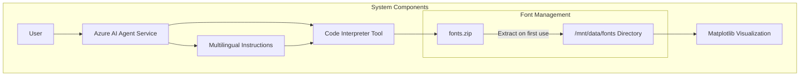
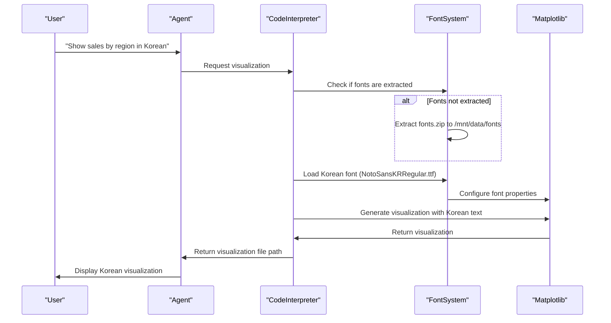
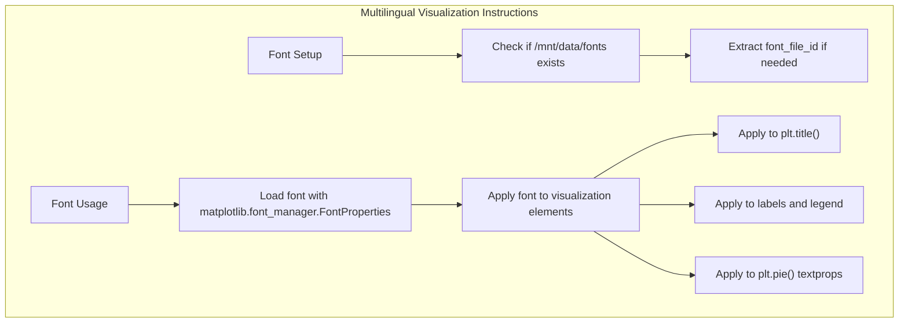

<!-- source: DeepWiki mcp.deepwiki.com · repo microsoft/build-your-first-agent-with-azure-ai-agent-service-workshop · page 8 Multilingual Support · fetched 2026-10-26 -->

# Multilingual Support

<details>
<summary>Relevant source files</summary>

The following files were used as context for generating this wiki page:

- [docs/docs/lab-5-multilingual.md](docs/docs/lab-5-multilingual.md)
- [docs/docs/media/sales_by_region_2022_pie_chart_korean.png](docs/docs/media/sales_by_region_2022_pie_chart_korean.png)
- [docs/docs/media/sales_by_region_pie_chart_korean_font.png](docs/docs/media/sales_by_region_pie_chart_korean_font.png)
- [src/csharp/workshop/AgentWorkshop.Client/Lab5.cs](src/csharp/workshop/AgentWorkshop.Client/Lab5.cs)
- [src/shared/fonts/fonts.zip](src/shared/fonts/fonts.zip)
- [src/shared/instructions/code_interpreter.txt](src/shared/instructions/code_interpreter.txt)
- [src/shared/instructions/code_interpreter_multilingual.txt](src/shared/instructions/code_interpreter_multilingual.txt)
- [src/shared/instructions/file_search.txt](src/shared/instructions/file_search.txt)
- [src/shared/instructions/function_calling.txt](src/shared/instructions/function_calling.txt)

</details>


This document explains how the Azure AI Agent Service supports multilingual visualizations in the Contoso Sales Agent workshop. The multilingual support system enables the agent to generate data visualizations with properly rendered non-Latin scripts such as Arabic, Korean, Hindi, and Japanese. Without this specialized font support, text in these languages would appear as boxes or question marks in visualizations.

## System Architecture

The multilingual support is implemented as an extension to the Code Interpreter tool, which is part of the agent's toolset. It uses custom fonts uploaded as a ZIP file and specialized instructions to guide the agent on how to use these fonts with matplotlib for multilingual text rendering.



Sources: [src/shared/instructions/code_interpreter_multilingual.txt](), [src/shared/fonts/fonts.zip](), [docs/docs/lab-5-multilingual.md]()

## Font Management

The Code Interpreter operates in a sandboxed Python environment that cannot download fonts directly from the internet. To support non-Latin scripts, the system packages several TrueType fonts in a ZIP file that is uploaded to the agent service during initialization.

### Available Fonts

| Language | Font File                   |
|----------|----------------------------|
| Arabic   | NotoSansArabicVariable.ttf |
| Hindi    | NotoSansDevanagariRegular.ttf |
| Korean   | NotoSansKRRegular.ttf      |
| Japanese | NotoSansJPRegular.ttf      |

The ZIP file is located at `src/shared/fonts/fonts.zip` and is uploaded to the agent service when the application starts. The Code Interpreter is then instructed to extract this ZIP file to the `/mnt/data/fonts` directory when it needs to create visualizations with non-Latin scripts.

Sources: [src/shared/instructions/code_interpreter_multilingual.txt:33-39](), [src/shared/fonts/fonts.zip]()

## Font Application Process

When a user requests a visualization in a non-Latin language, the following process occurs:



The Code Interpreter executes the following steps:

1. Checks if the `/mnt/data/fonts` directory exists
2. If not, extracts the font ZIP file to this directory
3. Loads the appropriate font based on the detected language
4. Applies the font to all text elements (titles, labels, legends)
5. Generates the visualization with properly rendered multilingual text

Sources: [src/shared/instructions/code_interpreter_multilingual.txt:33-50]()

## Multilingual Instructions

The agent's behavior for multilingual support is guided by specific instructions in the `code_interpreter_multilingual.txt` file. These instructions detail how to:

1. Set up the font environment
2. Load appropriate fonts for each language
3. Apply fonts to visualization elements
4. Handle translation of text



Sources: [src/shared/instructions/code_interpreter_multilingual.txt:27-50]()

## Implementation in Python and C#

The workshop provides implementations in both Python and C#:

### Python Implementation

In Python, multilingual support is enabled in `main.py` by:

1. Setting the instruction file to `code_interpreter_multilingual.txt`
2. Uploading the font package
3. Attaching the font package to the Code Interpreter tool

```python
INSTRUCTIONS_FILE = "instructions/code_interpreter_multilingual.txt"

font_file_info = await utilities.upload_file(project_client, utilities.shared_files_path / FONTS_ZIP)
code_interpreter.add_file(file_id=font_file_info.id)
```

Sources: [docs/docs/lab-5-multilingual.md:32-43]()

### C# Implementation

In C#, multilingual support is handled by the `Lab5.cs` class, which:

1. Specifies the multilingual instructions file
2. Uploads the font package during initialization
3. Attaches the font package to the Code Interpreter

The main implementation details are:

```csharp
// Set instructions file
protected override string InstructionsFileName => "code_interpreter_multilingual.txt";

// Upload fonts
protected override async Task InitialiseLabAsync(AgentsClient agentClient)
{
    fontFile = await agentClient.UploadFileAsync(
        File.OpenRead(Path.Combine(SharedPath, "fonts", "fonts.zip")),
        AgentFilePurpose.Agents,
        "fonts.zip"
    );
}

// Attach fonts to Code Interpreter
protected override ToolResources? InitialiseToolResources()
{
    var codeInterpreterToolResource = new CodeInterpreterToolResource();
    codeInterpreterToolResource.FileIds.Add(fontFile.Id);
    
    return new ToolResources
    {
        CodeInterpreter = codeInterpreterToolResource
    };
}
```

Sources: [src/csharp/workshop/AgentWorkshop.Client/Lab5.cs:7-49]()

## Matplotlib Integration

The Code Interpreter creates visualizations using matplotlib and applies the appropriate fonts using the following approach:

```python
# Example of how the Code Interpreter uses fonts in generated code
import os
import matplotlib.pyplot as plt
import matplotlib.font_manager as fm

# Check if fonts directory exists, extract if needed
if not os.path.exists("/mnt/data/fonts"):
    import zipfile
    with zipfile.ZipFile("/mnt/data/{font_file_id}", 'r') as zip_ref:
        zip_ref.extractall("/mnt/data/fonts")

# Load the Korean font
korean_font_path = "/mnt/data/fonts/fonts/NotoSansKRRegular.ttf"
korean_font_prop = fm.FontProperties(fname=korean_font_path)

# Apply font to visualization elements
plt.title("2022년 지역별 매출", fontproperties=korean_font_prop)
plt.pie(sizes, labels=labels, autopct='%1.1f%%', 
        textprops={'fontproperties': korean_font_prop})
```

This code is not directly visible in the repository but is generated by the Code Interpreter based on the instructions.

Sources: [src/shared/instructions/code_interpreter_multilingual.txt:33-50](), [docs/docs/lab-5-multilingual.md:111-129]()

## Usage and Testing

To test the multilingual support:

1. Start the agent application
2. Request data in a specific language:
   ```
   What were the sales by region for 2022 in Korean?
   ```
3. Ask for a visualization:
   ```
   Show as a pie chart
   ```

The agent will automatically detect the language requirement, load the appropriate font, and create a visualization with properly rendered Korean text.

### Troubleshooting

If visualizations show boxes or question marks instead of proper text:

1. Make sure the font ZIP file was properly uploaded
2. Check if the instruction file references the correct font paths
3. Use the following commands to debug:
   - `show code` - Displays the code generated for the last visualization
   - `list files mounted at /mnt/data` - Shows files uploaded to the Code Interpreter

Sources: [docs/docs/lab-5-multilingual.md:131-155]()

## Comparing Basic vs Multilingual Visualizations

When multilingual support is not enabled, visualizations containing non-Latin text will show boxes or question marks instead of proper characters. The multilingual support system ensures correct rendering of text in all supported languages.

| Feature | Without Multilingual Support | With Multilingual Support |
|---------|------------------------------|---------------------------|
| Text Rendering | Boxes or question marks for non-Latin scripts | Properly rendered text in multiple languages |
| Font Availability | Only default Latin fonts | Additional fonts for Arabic, Hindi, Korean, Japanese |
| Font Application | No specialized font handling | Automatic font selection and application |
| Translation | Can translate data but can't render properly | Translates and renders correctly |

Sources: [docs/docs/lab-5-multilingual.md:10-27](), [docs/docs/lab-5-multilingual.md:130-146]()

## Extending Multilingual Support

To add support for additional languages:

1. Add appropriate TrueType fonts to the `fonts.zip` file
2. Update the instructions in `code_interpreter_multilingual.txt` to include the new fonts
3. Ensure the Code Interpreter knows how to use these fonts for the new languages

This extensible approach allows for supporting virtually any language with the appropriate font files.

Sources: [src/shared/instructions/code_interpreter_multilingual.txt:33-47]()

---

