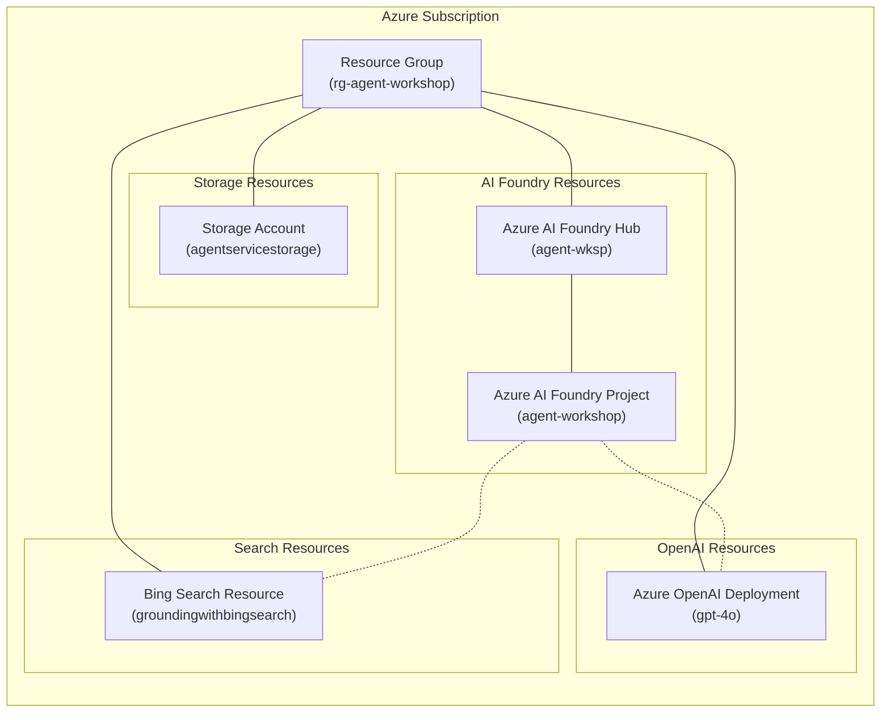
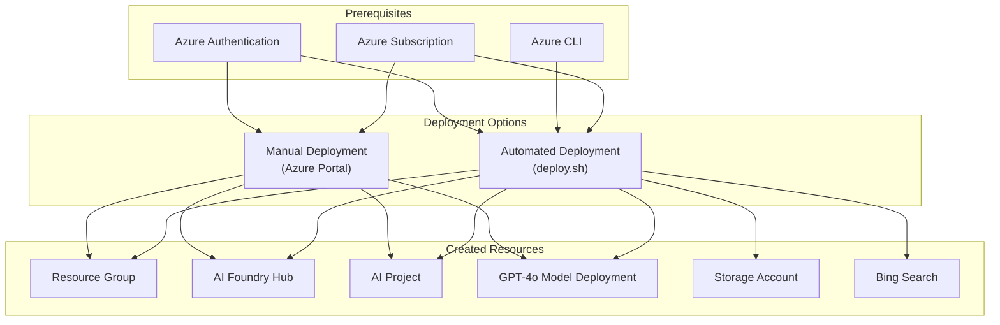
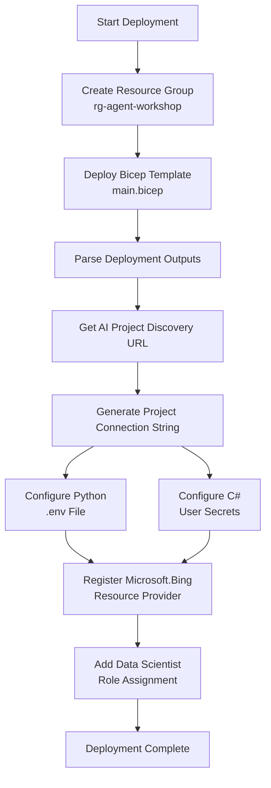
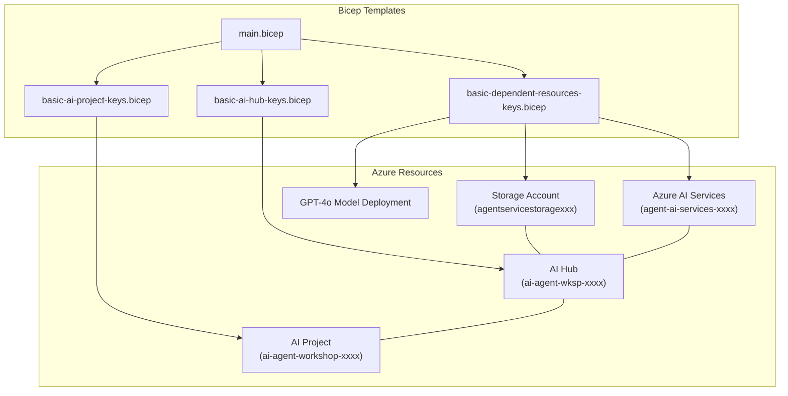
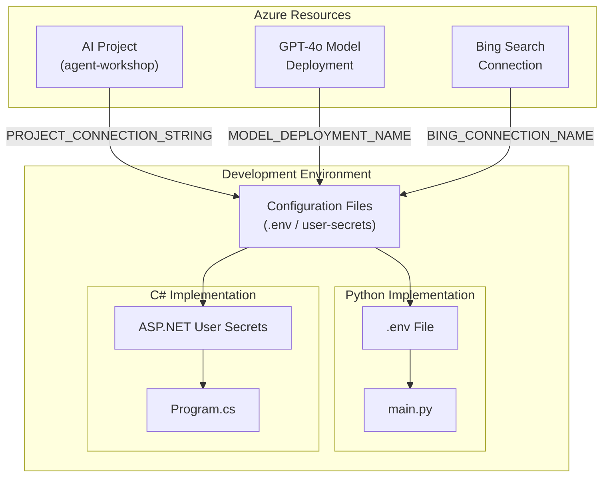

<!-- source: DeepWiki mcp.deepwiki.com · repo microsoft/build-your-first-agent-with-azure-ai-agent-service-workshop · page 9 Infrastructure and Deployment · fetched 2026-10-26 -->

# Infrastructure and Deployment

<details>
<summary>Relevant source files</summary>

The following files were used as context for generating this wiki page:

- [.vscode/launch.json](.vscode/launch.json)
- [docs/docs/includes/introduction-self-guided.md](docs/docs/includes/introduction-self-guided.md)
- [infra/deploy.sh](infra/deploy.sh)
- [infra/main.bicep](infra/main.bicep)

</details>


## Purpose and Scope

This document describes the infrastructure components required for the Azure AI Agent Service Workshop and outlines the deployment process for setting up the necessary Azure resources. It covers both automated and manual deployment methods, the architecture of the deployed resources, and how the deployment configures the workshop environment. 

For information about the repository structure and development environment setup, see [Development Environment](#2) and [Repository Structure](#2.1).

## Azure Resources Overview

The workshop requires several Azure resources to be deployed to enable the full functionality of the AI agent:



Sources: [infra/deploy.sh:5-15](), [docs/docs/includes/introduction-self-guided.md:84-89](), [infra/main.bicep:4-56]()

## Deployment Options

The workshop supports two deployment approaches: automated deployment using a provided script or manual deployment through the Azure portal.



Sources: [docs/docs/includes/introduction-self-guided.md:92-200]()

## Automated Deployment

The repository provides a bash script (`deploy.sh`) that automates the creation of all required Azure resources.

### Deployment Script Workflow



Sources: [infra/deploy.sh:1-117]()

### Key Components of the Deployment Script

The deployment script handles several important tasks:

1. **Creates a resource group** named `rg-agent-workshop` in the specified location (default: eastus2)
2. **Deploys Azure resources** using a Bicep template (`main.bicep`)
3. **Extracts deployment outputs** including the AI project name and resource group
4. **Retrieves the discovery URL** for the AI project
5. **Generates the project connection string** needed by the agent application
6. **Configures the development environment**:
   - For Python: Creates `.env` file
   - For C#: Sets user secrets
7. **Registers the Bing Search provider** for Bing Search grounding
8. **Sets up role assignments** for the authenticated user

Sources: [infra/deploy.sh:1-117]()

### Resource Parameters

The automated deployment creates resources with these default parameters:

| Resource | Parameter | Default Value |
|----------|-----------|---------------|
| Resource Group | Name | rg-agent-workshop |
| Resource Group | Location | eastus2 |
| AI Hub | Name | agent-wksp |
| AI Project | Name | agent-workshop |
| AI Project | Friendly Name | Agent-Service-Workshop |
| Storage Account | Name | agentservicestorage |
| AI Services | Name | agent-workshop |
| OpenAI Model | Name | gpt-4o |
| OpenAI Model | Capacity | 140K TPM |

Sources: [infra/deploy.sh:5-14](), [infra/main.bicep:4-56]()

## Bicep Template Architecture

The infrastructure is defined as code using Bicep templates. The main template (`main.bicep`) creates the core resources and modules for dependent resources.



Sources: [infra/main.bicep:64-129]()

## Manual Deployment Process

For users who prefer to deploy resources manually through the Azure portal, the following steps can be followed:

1. **Create an AI Foundry project**:
   - Navigate to the [Azure AI Foundry portal](https://ai.azure.com)
   - Create a new project named "agent-workshop"
   - Create a new hub named "agent-workshop-hub"

2. **Deploy the GPT-4o model**:
   - From the AI Foundry project, deploy the "gpt-4o" model
   - Use the Global Standard deployment type
   - Select model version "2024-08-06"
   - Set Tokens Per Minute limit to 140K

3. **Configure the workshop environment**:
   - Retrieve the project connection string from the project overview page
   - Configure the appropriate configuration files for Python or C#

Sources: [docs/docs/includes/introduction-self-guided.md:127-200]()

## Workshop Configuration After Deployment

After deployment, the workshop code needs to be configured to connect to the deployed Azure resources. The configuration process differs between Python and C#.

### Python Configuration

The automated deployment script generates a `.env` file in the `src/python/workshop/` directory with the following contents:

```
PROJECT_CONNECTION_STRING="<host_name>;<subscription_id>;<resource_group_name>;<ai_project_name>"
BING_CONNECTION_NAME="groundingwithbingsearch"
MODEL_DEPLOYMENT_NAME="gpt-4o"
```

For manual deployment, you need to copy the `.env.sample` file and update it with your project connection string.

Sources: [infra/deploy.sh:47-58](), [docs/docs/includes/introduction-self-guided.md:169-178]()

### C# Configuration

For C#, the configuration is stored using ASP.NET Core's Secret Manager:

1. **Connection String**: Stored as "ConnectionStrings:AiAgentService"
2. **Model Name**: Stored as "Azure:ModelName"

For manual deployment, you need to set these secrets using the `dotnet user-secrets` command.

Sources: [infra/deploy.sh:60-65](), [docs/docs/includes/introduction-self-guided.md:179-199]()

## Integration with Development Environment

The deployed infrastructure connects with the development environment through configuration files and settings:



Sources: [infra/deploy.sh:47-65](), [.vscode/launch.json:6-20]()

## Resource Requirements

The deployment requires the following Azure resource quotas:

- **GPT-4o Model**: 140K TPM quota in the Global Standard SKU
- **Azure Subscription**: Active subscription with permission to create resources
- **Resource Provider Registration**: Microsoft.Bing provider for Bing Search grounding

Sources: [docs/docs/includes/introduction-self-guided.md:90-91](), [infra/deploy.sh:79-101]()

## Deployment Permissions and Roles

The deployment script assigns the "Data Scientist" role to the authenticated user, which grants the necessary permissions to use the AI resources. This is done through the Azure CLI command:

```bash
az role assignment create --role "f6c7c914-8db3-469d-8ca1-694a8f32e121" \
                         --assignee-object-id "$objectId" \
                         --scope "subscriptions/$subId/resourceGroups/$RG_NAME" \
                         --assignee-principal-type 'User'
```

Sources: [infra/deploy.sh:103-115]()

---

