# Page: Overview

# Overview

<details>
<summary>Relevant source files</summary>

The following files were used as context for generating this wiki page:

- [.devcontainer/Dockerfile](.devcontainer/Dockerfile)
- [CODE_OF_CONDUCT.md](CODE_OF_CONDUCT.md)
- [README.md](README.md)
- [docs/README.md](docs/README.md)
- [docs/docs/architecture.md](docs/docs/architecture.md)
- [docs/docs/index.md](docs/docs/index.md)
- [docs/docs/media/ai-foundry-home.png](docs/docs/media/ai-foundry-home.png)
- [docs/docs/security.md](docs/docs/security.md)
- [docs/docs/summary.md](docs/docs/summary.md)

</details>


This document provides a comprehensive overview of the Azure AI Agent Service Workshop repository, which demonstrates how to build a conversational AI agent using the Azure AI Agent Service. The workshop guides participants through creating a Contoso Sales Agent that can analyze sales data, generate visualizations, and provide business insights through natural language interactions.

## Purpose and Scope

The "Build your code-first agent with Azure AI Foundry" workshop is a 75-minute interactive learning experience designed to teach how to develop, deploy, and extend an LLM-powered agent that can:

- Answer questions about sales data using natural language
- Generate data visualizations and charts
- Execute dynamic SQL queries
- Perform document grounding
- Integrate with external knowledge sources
- Support multilingual interactions

The workshop is implemented in both Python and C#, providing parallel code paths for developers with different language preferences.

Sources: [README.md:5-11](), [docs/docs/index.md:1-7]()

## System Architecture Overview

The Contoso Sales Agent integrates several key components of the Azure AI Agent Service to create a powerful, context-aware conversational assistant.

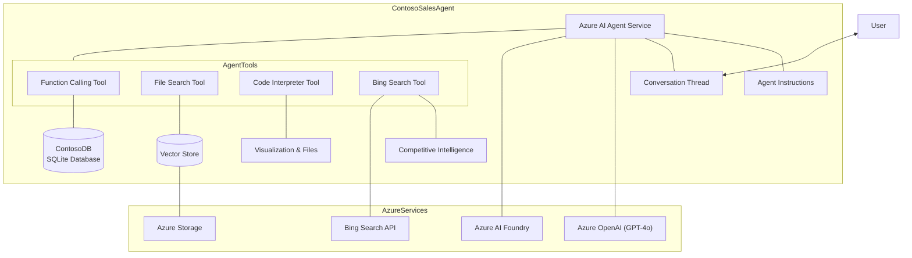

Sources: [docs/docs/architecture.md:1-24](), [docs/docs/index.md:9-34]()

## Repository Organization

The repository is structured to support both Python and C# implementations, sharing common resources and documentation.

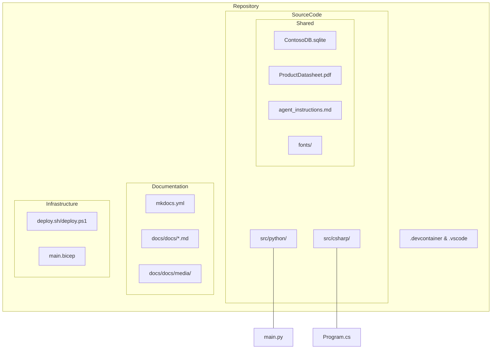

Sources: [.devcontainer/Dockerfile:1-14](), [docs/README.md:1-36]()

## Workshop Structure

The workshop is structured as a series of progressive labs, each introducing a new capability of the Azure AI Agent Service.

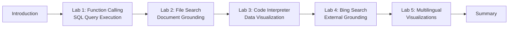

Each lab builds on the previous one, gradually adding features to the Contoso Sales Agent:

| Lab | Focus | Key Capability | Implementation |
|-----|-------|----------------|----------------|
| 1 | Function Calling | SQL query execution | Dynamic database query generation |
| 2 | File Search | Document grounding | Vector search of product information |
| 3 | Code Interpreter | Data visualization | Chart and table generation |
| 4 | Bing Search | External knowledge | Competitive intelligence |
| 5 | Multilingual | Font management | Localized visualizations |

Sources: [docs/docs/summary.md:1-37]()

## Core Capabilities

### Function Calling with Database Integration

The agent uses function calling to interact with a SQLite database containing Contoso's sales data. This allows it to:
- Dynamically generate SQL queries based on user questions
- Execute read-only queries against the database
- Format and present results back to the user

The database contains 40,000 rows of synthetic sales data that provides the foundation for analysis and visualization.

Sources: [docs/docs/architecture.md:21-24](), [docs/docs/security.md:1-12]()

### Document Grounding with File Search

The File Search tool enables the agent to ground its responses in specific product information stored in a PDF file. Using vector search, the agent can:
- Locate relevant portions of documents
- Provide accurate product specifications
- Answer detailed questions about product features

This capability leverages Azure AI's vector store for semantic search functionality.

Sources: [docs/docs/architecture.md:11-14]()

### Data Visualization with Code Interpreter

The Code Interpreter tool allows the agent to generate dynamic visualizations and data files, including:
- Charts and graphs (pie charts, bar charts, etc.)
- Formatted tables
- Downloadable files (Excel, CSV, JSON)

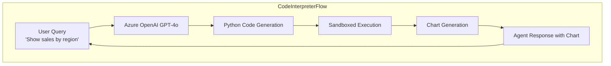

This capability runs in a sandboxed execution environment to ensure security.

Sources: [docs/docs/summary.md:14-19](), [docs/docs/security.md:13-16]()

### External Knowledge with Bing Search

The Bing Search integration allows the agent to access external information beyond its internal database and documents. This enables:
- Competitive product analysis
- Market trend information
- Up-to-date pricing comparisons

This capability extends the agent's knowledge beyond its internal resources.

Sources: [docs/docs/summary.md:20-23]()

### Multilingual Support

The agent includes support for multiple languages, with special attention to proper rendering of non-Latin characters in visualizations. This involves:
- Custom font management for visualizations
- Localized formatting of dates and numbers
- Support for multiple writing systems

Sources: [docs/docs/summary.md:29-31]()

## Development and Deployment

The workshop provides multiple development options:

1. **GitHub Codespaces**: Zero setup option with pre-configured environment
2. **Development Container**: Local containerized development using Docker
3. **Local Setup**: Manual installation of required dependencies

Deployment leverages Azure resources through infrastructure-as-code:

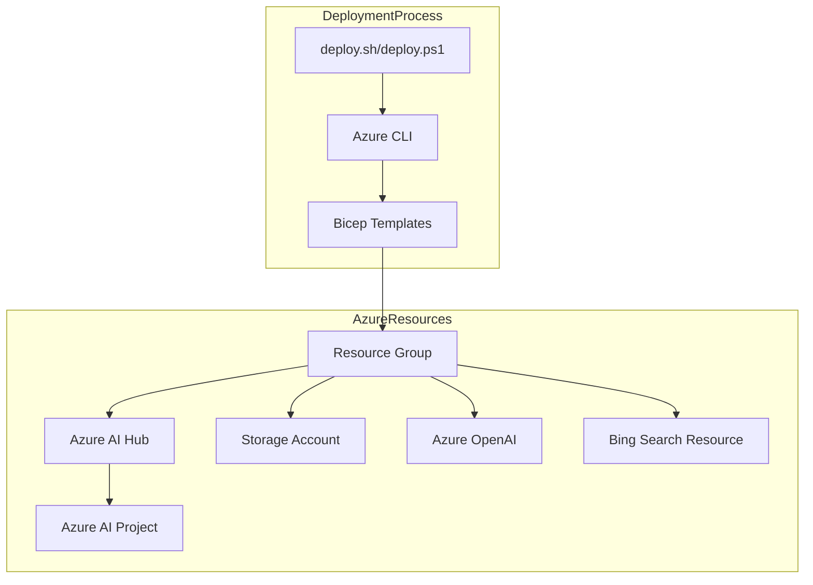

The deployment scripts automate the creation of all necessary Azure resources for running the agent.

Sources: [README.md:19-25]()

## Security Considerations

The workshop implementation includes several security measures:

- **Read-only database access**: The SQLite database is configured as read-only to prevent data manipulation
- **Sandboxed code execution**: The Code Interpreter runs in a secure sandbox environment
- **Managed service security**: Leverages Azure security features for resource isolation

These measures help mitigate common risks like SQL injection and unauthorized data access.

Sources: [docs/docs/security.md:1-16](), [README.md:27-35]()

## Related Pages

For more detailed information on specific aspects of the system:
- For system architecture details, see [System Architecture](#1.1)
- For development environment setup, see [Development Environment](#2)
- For details on Azure AI Agent Service, see [Azure AI Agent Service](#3)
- For deployment instructions, see [Infrastructure and Deployment](#9)

---

# Page: System Architecture

# System Architecture

<details>
<summary>Relevant source files</summary>

The following files were used as context for generating this wiki page:

- [docs/docs/architecture.md](docs/docs/architecture.md)
- [docs/docs/index.md](docs/docs/index.md)
- [docs/docs/media/ai-foundry-home.png](docs/docs/media/ai-foundry-home.png)
- [docs/docs/security.md](docs/docs/security.md)
- [docs/docs/summary.md](docs/docs/summary.md)
- [infra/deploy.ps1](infra/deploy.ps1)
- [src/csharp/workshop/AgentWorkshop.Client/Program.cs](src/csharp/workshop/AgentWorkshop.Client/Program.cs)

</details>


This document describes the high-level architecture of the Contoso Sales Agent system built in this workshop. The system architecture illustrates how the various components interact to create an AI-powered sales analysis agent capable of answering questions, generating visualizations, and providing data insights.

For information about how the workshop labs are structured, see [Workshop Structure](#1.2).

## System Overview

The Contoso Sales Agent is a conversational AI agent built on Azure AI Agent Service. It enables sales managers to analyze sales data, generate visualizations, and export data for further analysis through natural language conversations.

### High-Level Architecture

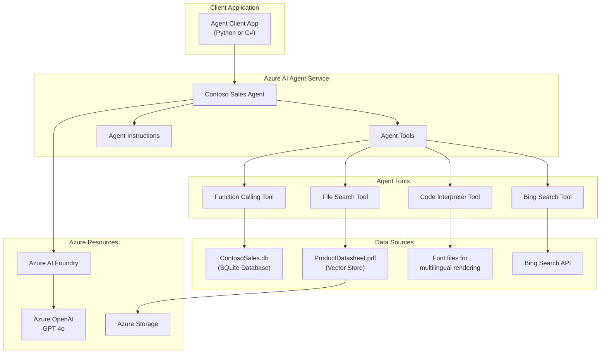

Sources: [docs/docs/architecture.md:1-38](), [docs/docs/index.md:1-38](), [docs/docs/summary.md:1-38]()

## Core Components

### Client Application

The Contoso Sales Agent client application is the entry point that initializes the agent, handles user interactions, and manages the conversation flow. It's implemented in both Python and C# to demonstrate language flexibility.

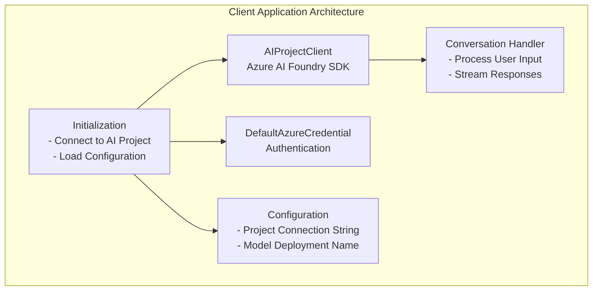

Sources: [src/csharp/workshop/AgentWorkshop.Client/Program.cs:1-18]()

### Azure AI Agent Service

At the core of the architecture is the Azure AI Agent Service, which provides the foundation for building the conversational agent. It integrates with the Azure OpenAI GPT-4o model to power the agent's natural language understanding and generation capabilities.

Key components of the service include:

| Component | Description |
|-----------|-------------|
| Agent Instructions | Defines the agent's behavior, capabilities, and limitations |
| Conversation Context Management | Maintains context across multiple interactions |
| Tool Orchestration | Coordinates the execution of various tools based on user intent |
| Token Streaming | Improves user experience by reducing perceived response times |

Sources: [docs/docs/architecture.md:11-24](), [docs/docs/index.md:18-33]()

## Agent Capabilities and Tools

The Contoso Sales Agent implements four primary capabilities through specialized tools:

### 1. Function Calling with SQLite Database

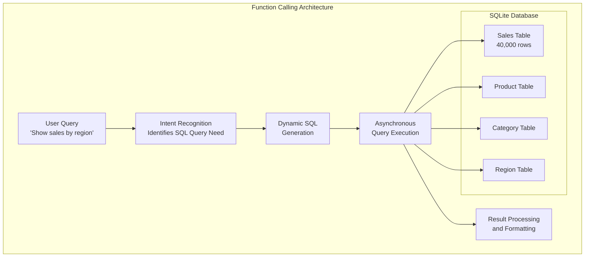

The Function Calling tool enables the agent to execute dynamic SQL queries against the Contoso Sales Database, a read-only SQLite database with 40,000 rows of synthetic data. At startup, the application reads the database schema and incorporates this metadata into the agent's instructions.

Sources: [docs/docs/architecture.md:21-23](), [docs/docs/summary.md:5-7](), [docs/docs/security.md:5-11]()

### 2. File Search with Vector Store

The File Search tool provides document grounding capabilities, allowing the agent to reference product information stored in PDF files. The system uses the Azure AI Agent Service file search tool to find relevant portions of documents using vector search and provide them to the agent as context.

Sources: [docs/docs/architecture.md:13-14](), [docs/docs/summary.md:9-11]()

### 3. Code Interpreter for Visualizations

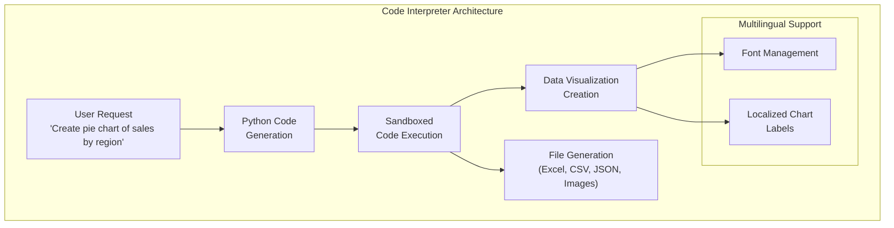

The Code Interpreter tool enables the agent to generate data visualizations and create downloadable files. It executes dynamically generated Python code in a sandboxed environment to ensure security. The system also supports multilingual visualizations through font management.

Sources: [docs/docs/summary.md:14-19](), [docs/docs/security.md:13-15]()

### 4. Bing Search Grounding

The Bing Search tool extends the agent's knowledge beyond internal data by enabling it to perform grounded searches for competitive product analysis and external information.

Sources: [docs/docs/summary.md:21-23]()

## Deployment Architecture

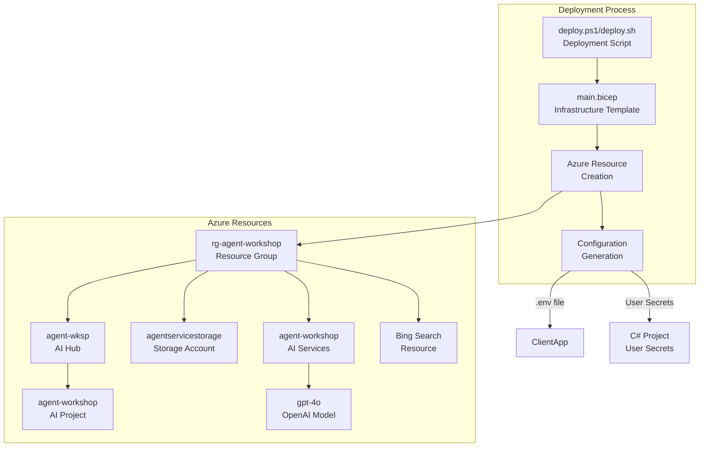

The deployment architecture uses Azure Bicep templates to provision the necessary Azure resources, including AI Hub, AI Project, Storage Account, AI Services, and Bing Search resources. The deployment script generates configuration files for both Python and C# implementations.

Sources: [infra/deploy.ps1:1-87]()

## Security Considerations

The architecture includes several security considerations:

1. **Read-Only Database Access**: The SQLite database is configured as read-only to prevent malicious SQL operations.
2. **Sandboxed Code Execution**: Code generated by the agent runs in a sandboxed environment to prevent unauthorized actions.
3. **Azure Authentication**: The system uses Azure's authentication mechanisms through DefaultAzureCredential.

For more detailed security information, see [Security Concerns](#security).

Sources: [docs/docs/security.md:1-15]()

## Extensibility

The Contoso Sales Agent architecture is designed to be extensible and adaptable to various business scenarios. The core components can be modified to address different use cases by:

1. Replacing the SQLite database with other data sources
2. Updating the agent instructions to focus on different domains
3. Adding new tools or capabilities to the agent toolkit
4. Integrating with different front-end interfaces

Sources: [docs/docs/architecture.md:25-27](), [docs/docs/summary.md:33-35]()

## Conclusion

The Contoso Sales Agent architecture demonstrates a practical implementation of the Azure AI Agent Service for business intelligence and data analysis. The system leverages multiple Azure services and agent capabilities to create a powerful, conversational interface to sales data, enabling users to gain insights through natural language queries.

---

# Page: Workshop Structure

# Workshop Structure

<details>
<summary>Relevant source files</summary>

The following files were used as context for generating this wiki page:

- [docs/docs/_lab-6-instrumentation.md](docs/docs/_lab-6-instrumentation.md)
- [docs/docs/index.md](docs/docs/index.md)
- [docs/docs/js/custom-nav.js](docs/docs/js/custom-nav.js)
- [docs/docs/media/ai-foundry-home.png](docs/docs/media/ai-foundry-home.png)
- [docs/docs/resources.md](docs/docs/resources.md)
- [docs/docs/security.md](docs/docs/security.md)
- [docs/docs/summary.md](docs/docs/summary.md)

</details>


This page outlines the sequential organization of the Azure AI Agent Service workshop, detailing the labs, their progression, and the capabilities demonstrated in each. For information about the high-level system architecture, see [System Architecture](#1.1).

## Workshop Overview

The workshop is designed as a 75-minute interactive hands-on experience where participants build a Contoso Sales Analysis Agent incrementally. The agent helps sales managers analyze data, find trends, and make informed business decisions through natural language interactions. 

Each lab builds upon the previous one, gradually increasing the agent's capabilities by adding new Azure AI Agent Service tools and features. The workshop can be completed using either Python or C# implementations.

Sources: [docs/docs/index.md:3-7](), [docs/docs/summary.md:1-3]()

## Lab Progression

The workshop follows a structured progression through five main labs, each introducing a new Azure AI Agent Service capability:

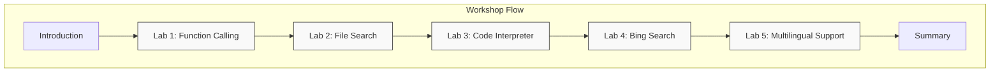

Sources: [docs/docs/js/custom-nav.js:3-16](), [docs/docs/summary.md:5-35]()

## Lab Capabilities and Skills

Each lab focuses on a specific capability of the Azure AI Agent Service, building upon knowledge from previous labs:

```mermaid
flowchart TD
    subgraph "Skills Development Journey"
        direction TB
        
        subgraph "Lab 1: Function Calling"
            function["Function Calling"] --> sql["Dynamic SQL Query Generation"]
            sql --> db[(SQLite Database Integration)]
        end
        
        subgraph "Lab 2: File Search"
            fileSearch["File Search Tool"] --> vector["Vector Store"]
            vector --> document["Document Grounding"]
        end
        
        subgraph "Lab 3: Code Interpreter"
            codeInt["Code Interpreter Tool"] --> viz["Data Visualization"]
            viz --> files["File Generation"]
        end
        
        subgraph "Lab 4: Bing Search"
            bing["Bing Search Tool"] --> ext["External Knowledge"]
            ext --> competitive["Competitive Intelligence"]
        end
        
        subgraph "Lab 5: Multilingual"
            multi["Multilingual Support"] --> fonts["Font Management"]
            fonts --> locViz["Localized Visualizations"]
        end
        
        "Lab 1: Function Calling" --> "Lab 2: File Search"
        "Lab 2: File Search" --> "Lab 3: Code Interpreter"
        "Lab 3: Code Interpreter" --> "Lab 4: Bing Search"
        "Lab 4: Bing Search" --> "Lab 5: Multilingual"
    end
```

Sources: [docs/docs/summary.md:5-35](), [docs/docs/index.md:25-33]()

## Detailed Lab Content

### Lab 1: Function Calling and Dynamic SQL Queries

The first lab introduces the core functionality of the Azure AI Agent Service with focus on:

- Function calling to execute dynamic SQL queries against a SQLite database
- Context management for natural language interactions
- Reading and interpreting sales data from a database

By the end of this lab, participants can create an agent that answers basic sales data questions.

### Lab 2: File Search (Document Grounding)

This lab enhances the agent with vector-based file search capabilities:

- Integrating the File Search tool
- Setting up a vector store for efficient document retrieval
- Grounding responses in product documentation and other files

### Lab 3: Code Interpreter

This lab adds data visualization and file generation:

- Using the Code Interpreter tool to execute Python code on demand
- Generating visualizations like charts and tables based on SQL query results
- Creating downloadable files in various formats (Excel, CSV, JSON, images)

### Lab 4: Bing Search Grounding

This lab extends the agent's knowledge beyond internal data:

- Integrating Bing Search for external knowledge
- Performing competitive product analysis
- Maintaining context while incorporating external information

### Lab 5: Multilingual Visualizations

The final lab adds language support features:

- Supporting interactions in multiple languages
- Configuring custom fonts for non-Latin character rendering in visualizations
- Creating localized visual outputs

Sources: [docs/docs/summary.md:5-35](), [docs/docs/security.md:1-15](), [docs/docs/_lab-6-instrumentation.md:1-9]()

## Implementation Paths

The workshop provides parallel implementations in two programming languages:

| Language | Key Files | Environment |
|----------|-----------|------------|
| Python | main.py | Python environment with required packages |
| C# | Program.cs | .NET environment with required packages |

Both implementations share common resources, including:
- Product datasheets and documentation
- Sales database (SQLite)
- Multilingual font resources
- Agent instructions

Participants can choose either implementation path based on their language preference and existing skills.

## Security Considerations

Throughout the labs, security best practices are emphasized:

- SQL injection prevention through read-only database access
- Sandboxed code execution in the Code Interpreter
- Proper permissions and access control

For detailed security information, see the [Security Concerns](#security) section of the documentation.

Sources: [docs/docs/security.md:1-15]()

## Additional Resources

The workshop includes references to additional learning resources, including:

- Microsoft Learn documentation on Azure AI Agent Service
- Sample applications demonstrating advanced concepts
- Documentation on tracing using Application Insights for debugging

For a complete list of resources, see the [Resources](#resources) section.

Sources: [docs/docs/resources.md:1-24]()

---

# Page: Development Environment

# Development Environment

<details>
<summary>Relevant source files</summary>

The following files were used as context for generating this wiki page:

- [.vscode/settings.json](.vscode/settings.json)
- [docs/docs/includes/introduction-self-guided.md](docs/docs/includes/introduction-self-guided.md)
- [docs/docs/media/project-structure-self-guided-csharp.png](docs/docs/media/project-structure-self-guided-csharp.png)
- [docs/docs/media/project-structure-self-guided-python.png](docs/docs/media/project-structure-self-guided-python.png)

</details>


This document explains how to set up and configure the development environment for the Azure AI Agent Service Workshop. It covers the available options for running the workshop code, prerequisites, authentication with Azure, and the resource deployment process. For information about the specific files and directories in the repository, see [Repository Structure](#2.1).

## Prerequisites

Before beginning the workshop, you need:

1. **Azure Subscription** - If you don't have one, create a [free account](https://azure.microsoft.com/free/)
2. **GitHub Account** - Required for accessing GitHub Codespaces
3. **Docker Desktop** - Only required if using the VS Code Dev Container option

Sources: [docs/docs/includes/introduction-self-guided.md:9-13]()

## Development Environment Options and Setup Flow

The following diagram illustrates the overall setup process for the development environment:

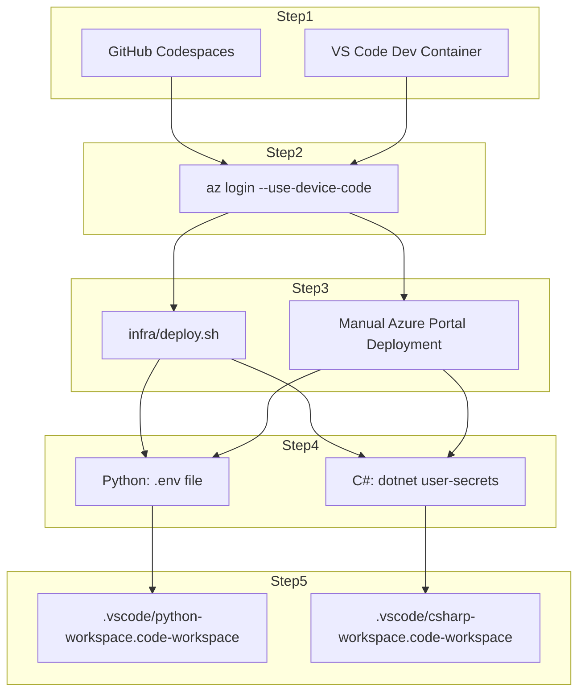

Sources: [docs/docs/includes/introduction-self-guided.md:25-125]()

### GitHub Codespaces (Recommended)

GitHub Codespaces provides a pre-configured cloud environment with all necessary tools and dependencies already installed:

1. Click the "Open in GitHub Codespaces" badge in the repository
2. Wait for the Codespace to build (takes several minutes)

### VS Code Dev Container

Alternatively, you can run the workshop locally using a VS Code Dev Container:

1. Install Docker Desktop and ensure it's running
2. Click the "Open in Dev Containers" badge in the repository
3. Wait for the container to build locally (takes several minutes)

> **Warning**: The automated deployment script is not supported on Apple Silicon. If using Apple Silicon, run the deployment script from Codespaces or from macOS instead of the Dev Container.

Sources: [docs/docs/includes/introduction-self-guided.md:29-49]()

## Azure Authentication

After your development environment is ready, authenticate with Azure:

1. Open a terminal in VS Code (Terminal > New Terminal)
2. Run the authentication command:
   ```shell
   az login --use-device-code
   ```
3. Follow the prompts to open a browser and enter the authentication code
4. If you have multiple Azure tenants, select the appropriate one:
   ```shell
   az login --use-device-code --tenant <tenant_id>
   ```

Sources: [docs/docs/includes/introduction-self-guided.md:51-79]()

## Azure Resource Deployment

The workshop requires several Azure resources that can be deployed automatically or manually.

### Automated Deployment

1. In the terminal, run:
   ```bash
   cd infra && ./deploy.sh
   ```

This script creates:
- An Azure AI Foundry hub named "agent-wksp"
- An Azure AI Foundry project named "Agent Service Workshop"
- A Serverless GPT-4o model deployment
- A Grounding with Bing Search resource

> **Note**: The script deploys to the `eastus2` region by default. Edit the script to change the region.

### Manual Deployment

Alternatively, deploy resources through the Azure AI Foundry portal:

1. Navigate to the [Azure AI Foundry](https://ai.azure.com) portal
2. Create a project named "agent-workshop" in a new hub named "agent-workshop-hub"
3. Deploy the GPT-4o model with:
   - Name: "gpt-4o"
   - Type: Global Standard
   - Version: 2024-08-06
   - Tokens Per Minute: 140k

Sources: [docs/docs/includes/introduction-self-guided.md:81-164]()

## Workshop Configuration

After resource deployment, configure the workshop environment based on your chosen programming language:

### Python Configuration

For Python, configuration is stored in a `.env` file:

```python
MODEL_DEPLOYMENT_NAME="gpt-4o"
BING_CONNECTION_NAME="groundingwithbingsearch"
PROJECT_CONNECTION_STRING="<your_project_connection_string>"
```

The deployment script creates this file automatically. To create it manually:
```bash
cp src/python/workshop/.env.sample src/python/workshop/.env
```
Then edit the file to add your project connection string.

### C# Configuration

For C#, configuration uses the .NET Secret Manager:

```bash
# Set variables
CSHARP_PROJECT_PATH="src/csharp/workshop/AgentWorkshop.Client/AgentWorkshop.Client.csproj"

# Set secrets
dotnet user-secrets set "ProjectConnectionString" "<your_project_connection_string>" --project "$CSHARP_PROJECT_PATH"
dotnet user-secrets set "Azure:ModelName" "gpt-4o" --project "$CSHARP_PROJECT_PATH"
```

To view the configured secrets:
```bash
dotnet user-secrets list
```

Sources: [docs/docs/includes/introduction-self-guided.md:102-199]()

## Workspace Selection

Select the workspace for your preferred programming language:

### Python Workspace

1. From VS Code menu: File > Open Workspace from File
2. Select `.vscode/python-workspace.code-workspace`

### C# Workspace

1. From VS Code menu: File > Open Workspace from File
2. Select `.vscode/csharp-workspace.code-workspace`

Sources: [docs/docs/includes/introduction-self-guided.md:201-249]()

## Project Structure

The following diagram shows the key files and their relationships in both Python and C# implementations:

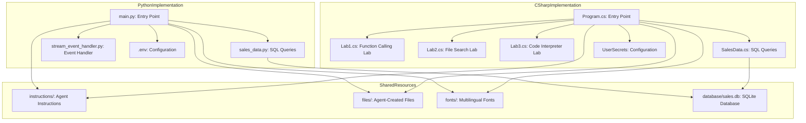

### Key Files and Directories

#### Python Implementation
- `main.py`: The entry point for the application
- `sales_data.py`: Contains functions for executing SQL queries against the SQLite database
- `stream_event_handler.py`: Handles token streaming events from the agent
- `.env`: Contains configuration settings including project connection string

#### C# Implementation
- `Program.cs`: The entry point for the application
- `Lab1.cs`, `Lab2.cs`, `Lab3.cs`: Lab-specific implementation files
- `SalesData.cs`: Contains functions for executing SQL queries
- User Secrets: Stores configuration settings securely using .NET Secret Manager

#### Shared Resources
- `instructions/`: Contains the agent instructions in text format
- `files/`: Directory where agent-created files are stored
- `fonts/`: Contains multilingual fonts for Code Interpreter visualizations
- `database/sales.db`: The SQLite database containing Contoso sales data

Sources: [docs/docs/includes/introduction-self-guided.md:210-249]()

## Development Environment Tools

The development environment comes pre-configured with all necessary tools and extensions:

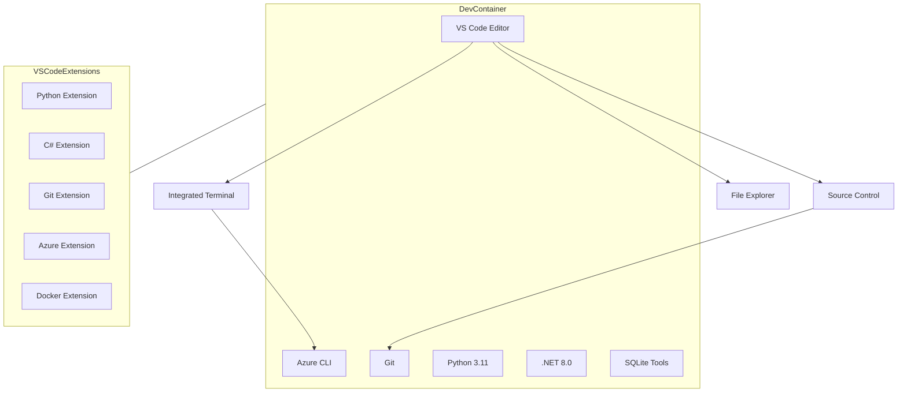

The development container and GitHub Codespaces both provide identical environments that include:

- Azure CLI for authentication and resource management
- Python 3.11 with required libraries pre-installed
- .NET 8.0 SDK for C# development
- SQLite tools for database operations
- VS Code extensions for Python, C#, and Azure development

Sources: [docs/docs/includes/introduction-self-guided.md:27-49](), [.vscode/settings.json:1-3]()

---

# Page: Repository Structure

# Repository Structure

<details>
<summary>Relevant source files</summary>

The following files were used as context for generating this wiki page:

- [.devcontainer/devcontainer.json](.devcontainer/devcontainer.json)
- [src/csharp/workshop/AgentWorkshop.Client/AgentWorkshop.Client.csproj](src/csharp/workshop/AgentWorkshop.Client/AgentWorkshop.Client.csproj)
- [src/csharp/workshop/AgentWorkshop.sln](src/csharp/workshop/AgentWorkshop.sln)
- [src/python/workshop/main.py](src/python/workshop/main.py)
- [src/python/workshop/requirements.txt](src/python/workshop/requirements.txt)
- [src/python/workshop/sales_data.py](src/python/workshop/sales_data.py)
- [src/python/workshop/utilities.py](src/python/workshop/utilities.py)

</details>


This document describes the organization of files and directories in the Azure AI Agent Service Workshop repository. It provides a comprehensive overview of how the codebase is structured, where to find key components, and how the different parts of the system relate to each other.

For information about setting up the development environment itself, see [Development Environment](#2).

## Repository Overview

The Azure AI Agent Service Workshop repository is organized to support parallel implementations in Python and C#, with shared resources used by both. The repository follows a structured layout to separate source code, documentation, infrastructure, and development setup.

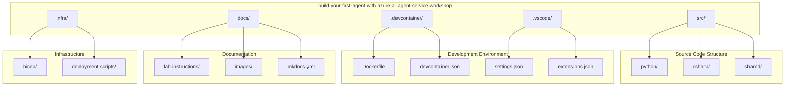

Sources: [.devcontainer/devcontainer.json:1-29]()

## Source Code Organization

The `src/` directory contains two parallel implementations of the same agent functionality - one in Python and one in C#. Both implementations share common resources like database files, documents, and instruction templates.

```mermaid
graph TD
    subgraph "src/"
        python["python/"]
        csharp["csharp/"]
        shared["shared/"]
    end
    
    subgraph "Python Implementation"
        python --> pythonWorkshop["workshop/"]
        pythonWorkshop --> mainPy["main.py"]
        pythonWorkshop --> utilitiesPy["utilities.py"]
        pythonWorkshop --> salesDataPy["sales_data.py"]
        pythonWorkshop --> streamEventHandlerPy["stream_event_handler.py"]
        pythonWorkshop --> terminalColorsPy["terminal_colors.py"]
        pythonWorkshop --> requirementsTxt["requirements.txt"]
    end
    
    subgraph "C# Implementation"
        csharp --> csharpWorkshop["workshop/"]
        csharpWorkshop --> agentWorkshopSln["AgentWorkshop.sln"]
        csharpWorkshop --> clientProj["AgentWorkshop.Client/"]
        clientProj --> programCs["Program.cs"]
        clientProj --> salesDataCs["SalesData.cs"]
        clientProj --> utilitiesCs["Utilities.cs"]
        clientProj --> csproj["AgentWorkshop.Client.csproj"]
    end
    
    subgraph "Shared Resources"
        shared --> instructions["instructions/"]
        shared --> database["database/"]
        shared --> datasheet["datasheet/"]
        shared --> fonts["fonts/"]
    end
    
    instructions --> functionCallingTxt["function_calling.txt"]
    instructions --> fileSearchTxt["file_search.txt"]
    instructions --> codeInterpreterTxt["code_interpreter.txt"]
    instructions --> codeInterpreterMultilingualTxt["code_interpreter_multilingual.txt"]
    instructions --> bingGroundingTxt["bing_grounding.txt"]
    
    database --> contosoSalesDb["contoso-sales.db"]
    datasheet --> contosoTentsDatasheet["contoso-tents-datasheet.pdf"]
    fonts --> fontsZip["fonts.zip"]
```

Sources: [src/python/workshop/main.py:1-215](), [src/python/workshop/utilities.py:1-101](), [src/python/workshop/sales_data.py:1-130](), [src/csharp/workshop/AgentWorkshop.sln:1-43](), [src/csharp/workshop/AgentWorkshop.Client/AgentWorkshop.Client.csproj:1-20]()

## Python Implementation Structure

The Python implementation is organized as a package with multiple modules, each handling specific aspects of the agent functionality.

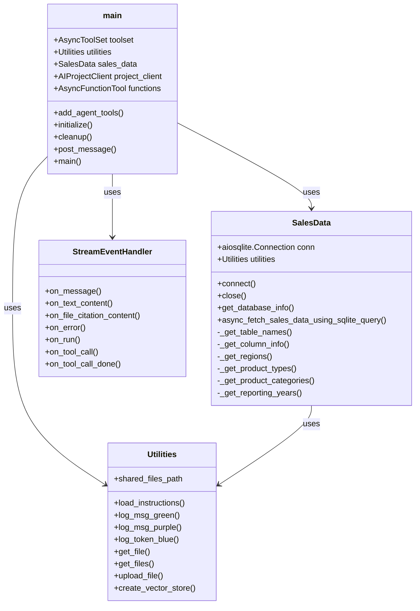

Sources: [src/python/workshop/main.py:1-215](), [src/python/workshop/utilities.py:1-101](), [src/python/workshop/sales_data.py:1-130]()

### Key Python Files and Their Purpose

| File | Purpose |
|------|---------|
| `main.py` | Entry point for the Python implementation. Sets up the agent with tools, handles conversation flow. |
| `utilities.py` | Helper functions for file operations, logging, and shared resources access. |
| `sales_data.py` | Handles database connections and provides methods to query the Contoso sales database. |
| `stream_event_handler.py` | Manages events from the agent streaming API. |
| `terminal_colors.py` | Provides terminal color formatting for better user experience. |
| `requirements.txt` | Lists all the Python package dependencies. |

Sources: [src/python/workshop/main.py:1-215](), [src/python/workshop/utilities.py:1-101](), [src/python/workshop/sales_data.py:1-130](), [src/python/workshop/requirements.txt:1-9]()

## C# Implementation Structure

The C# implementation is structured as a Visual Studio solution with one project.

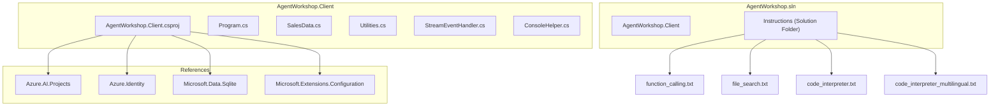

Sources: [src/csharp/workshop/AgentWorkshop.sln:1-43](), [src/csharp/workshop/AgentWorkshop.Client/AgentWorkshop.Client.csproj:1-20]()

### Key C# Files and Their Purpose

| File | Purpose |
|------|---------|
| `Program.cs` | Main entry point for the C# implementation. Similar to `main.py` in the Python implementation. |
| `SalesData.cs` | Handles SQLite database connections and queries. Equivalent to `sales_data.py`. |
| `Utilities.cs` | Helper functions for file operations and resource management. Equivalent to `utilities.py`. |
| `StreamEventHandler.cs` | Handles the events from the streaming API. Equivalent to `stream_event_handler.py`. |
| `ConsoleHelper.cs` | Provides console formatting. Equivalent to `terminal_colors.py`. |

Sources: [src/csharp/workshop/AgentWorkshop.Client/AgentWorkshop.Client.csproj:1-20]()

## Shared Resources

Both implementations use the same set of shared resources, which are stored in the `src/shared/` directory.

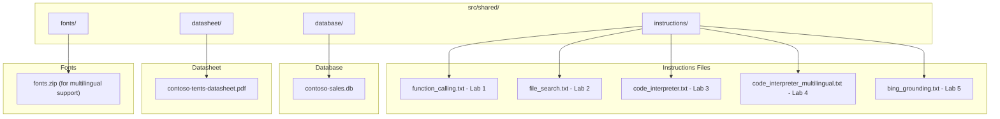

Sources: [src/python/workshop/utilities.py:9-14](), [src/python/workshop/main.py:29-30](), [src/python/workshop/sales_data.py:11](), [src/csharp/workshop/AgentWorkshop.sln:8-15]()

### Shared Resources Usage

The `shared_files_path` property in the `Utilities` class determines how both implementations access these shared resources:

```python
@property
def shared_files_path(self) -> Path:
    """Get the path to the shared files directory."""
    return Path(__file__).parent.parent.parent.resolve() / "shared"
```

This resolves to `src/shared/` from either the Python or C# implementation.

Sources: [src/python/workshop/utilities.py:9-14]()

## Agent Tool Configuration

The repository is structured to progressively enable different agent capabilities through the workshop labs. This is managed by uncommenting different sections in the `main.py` file.

### Progression of Agent Tools

```mermaid
graph LR
    subgraph "Agent Tools Progression"
        lab1["Lab 1: Function Calling"]
        lab2["Lab 2: File Search"]
        lab3["Lab 3: Code Interpreter"]
        lab4["Lab 4: Multilingual Support"]
        lab5["Lab 5: Bing Grounding"]
    end
    
    subgraph "Instructions Files"
        i1["function_calling.txt"]
        i2["file_search.txt"]
        i3["code_interpreter.txt"]
        i4["code_interpreter_multilingual.txt"]
        i5["bing_grounding.txt"]
    end
    
    subgraph "Tool Configuration Code"
        c1["toolset.add(functions)"]
        c2["toolset.add(file_search_tool)"]
        c3["toolset.add(code_interpreter)"]
        c4["code_interpreter.add_file(font_file_info.id)"]
        c5["toolset.add(bing_grounding)"]
    end
    
    lab1 --> i1
    lab2 --> i2
    lab3 --> i3
    lab4 --> i4
    lab5 --> i5
    
    i1 --> c1
    i2 --> c2
    i3 --> c3
    i4 --> c4
    i5 --> c5
```

Sources: [src/python/workshop/main.py:59-63](), [src/python/workshop/main.py:70-93]()

## Development Environment

The repository includes a development container configuration to ensure a consistent development environment. The development container is defined in the `.devcontainer` directory.

```mermaid
graph TD
    subgraph ".devcontainer/"
        devcontainerJson["devcontainer.json"]
        dockerfile["Dockerfile"]
    end
    
    subgraph "Development Environment"
        python["Python 3.13"]
        azureCLI["Azure CLI with ML extension"]
        dotnet["NET 9.0"]
    end
    
    subgraph "VSCode Extensions"
        docker["Docker Extension"]
        pythonExt["Python Extension"]
        jupyter["Jupyter Extension"]
        formatter["Black Formatter"]
        pdfViewer["PDF Viewer"]
        csDevKit["CS DevKit"]
    end
    
    devcontainerJson --> python
    devcontainerJson --> azureCLI
    devcontainerJson --> dotnet
    devcontainerJson --> docker
    devcontainerJson --> pythonExt
    devcontainerJson --> jupyter
    devcontainerJson --> formatter
    devcontainerJson --> pdfViewer
    devcontainerJson --> csDevKit
```

Sources: [.devcontainer/devcontainer.json:1-29]()

## Relationship Between Repository Components

This diagram illustrates how the different components of the repository interact with each other:

```mermaid
graph TD
    subgraph "User Interaction"
        user["User"]
    end
    
    subgraph "Implementation Language"
        pythonImpl["Python Implementation"]
        csharpImpl["C# Implementation"]
    end
    
    subgraph "Core Components"
        mainModule["main.py / Program.cs"]
        utilitiesModule["utilities.py / Utilities.cs"]
        salesDataModule["sales_data.py / SalesData.cs"]
        streamHandler["stream_event_handler.py / StreamEventHandler.cs"]
    end
    
    subgraph "Azure AI Agent Service"
        agent["Agent"]
        thread["Conversation Thread"]
        tools["Agent Tools"]
    end
    
    subgraph "Shared Resources"
        instructions["Instructions Files"]
        database["contoso-sales.db"]
        datasheet["contoso-tents-datasheet.pdf"]
        fonts["fonts.zip"]
    end
    
    user --> pythonImpl
    user --> csharpImpl
    
    pythonImpl --> mainModule
    csharpImpl --> mainModule
    
    mainModule --> utilitiesModule
    mainModule --> salesDataModule
    mainModule --> streamHandler
    
    utilitiesModule --> instructions
    utilitiesModule --> datasheet
    utilitiesModule --> fonts
    
    salesDataModule --> database
    
    mainModule --> agent
    agent --> thread
    agent --> tools
    
    instructions --> agent
```

Sources: [src/python/workshop/main.py:1-215](), [src/python/workshop/utilities.py:1-101](), [src/python/workshop/sales_data.py:1-130]()

## Repository File Structure Summary

Here's a summary table of the main directories and their contents:

| Directory | Contents | Purpose |
|-----------|----------|---------|
| `src/python/workshop/` | Python implementation files | Contains the Python version of the agent implementation |
| `src/csharp/workshop/` | C# solution and project files | Contains the C# version of the agent implementation |
| `src/shared/` | Shared resources | Contains resources used by both implementations |
| `src/shared/instructions/` | Agent instruction files | Different instruction sets for each lab |
| `src/shared/database/` | SQLite database | Contains the Contoso sales data |
| `src/shared/datasheet/` | PDF document | Product information used for file search grounding |
| `src/shared/fonts/` | Font files | Support for multilingual visualizations |
| `.devcontainer/` | Development container config | Ensures consistent development environment |
| `docs/` | Documentation files | Workshop instructions and images |
| `infra/` | Infrastructure files | Deployment scripts and templates |

Sources: [src/python/workshop/utilities.py:9-14](), [src/python/workshop/main.py:29-30](), [src/python/workshop/sales_data.py:11](), [.devcontainer/devcontainer.json:1-29]()

This structure allows for a consistent experience across both Python and C# implementations while sharing common resources, making it easy to follow the workshop regardless of preferred programming language.

---

# Page: Azure AI Agent Service

# Azure AI Agent Service

<details>
<summary>Relevant source files</summary>

The following files were used as context for generating this wiki page:

- [docs/docs/architecture.md](docs/docs/architecture.md)
- [docs/docs/index.md](docs/docs/index.md)
- [docs/docs/media/ai-foundry-home.png](docs/docs/media/ai-foundry-home.png)
- [docs/docs/security.md](docs/docs/security.md)
- [docs/docs/summary.md](docs/docs/summary.md)
- [src/python/workshop/main.py](src/python/workshop/main.py)
- [src/python/workshop/requirements.txt](src/python/workshop/requirements.txt)
- [src/python/workshop/sales_data.py](src/python/workshop/sales_data.py)
- [src/python/workshop/utilities.py](src/python/workshop/utilities.py)

</details>


This document provides a comprehensive overview of the Azure AI Agent Service, a fully managed cloud service for building conversational AI agents. For information about how this service is specifically used in the workshop labs, see [Function Calling](#4), [File Search](#5), [Code Interpreter](#6), [Bing Search Integration](#7), and [Multilingual Support](#8).

## Overview

Azure AI Agent Service is a managed service that simplifies creating AI agents with advanced capabilities. It offers SDKs for Python and C# that enable developers to build agents with integrated tools for various tasks. In this workshop, the service powers a Contoso Sales Agent that can analyze sales data, generate visualizations, and provide insights.

```mermaid
graph TD
    subgraph "Azure AI Agent Service"
        Agent["Agent"] --> Instructions["Agent Instructions"]
        Agent --> Thread["Conversation Thread"]
        Agent --> Tools["Agent Tools"]
    end
    
    subgraph "Foundation Models"
        GPT4o["Azure OpenAI GPT-4o"]
    end
    
    subgraph "Azure Resources"
        AIFoundry["Azure AI Foundry"]
        Storage["Azure Storage"]
        BingSearch["Bing Search"]
    end
    
    Agent --> GPT4o
    Tools --> AIFoundry
    Tools --> Storage
    Tools --> BingSearch
    
    User["User"] <--> Thread
```

Sources: [docs/docs/index.md:17-34](), [docs/docs/architecture.md:7-15]()

## Core Components

The Azure AI Agent Service architecture consists of several key components that work together to provide a comprehensive agent experience:

```mermaid
graph TD
    subgraph "Azure AI Agent Service Components"
        AIProjectClient["AIProjectClient"]
        Agent["Agent"]
        AgentThread["AgentThread"]
        AsyncToolSet["AsyncToolSet"]
        
        subgraph "Tools"
            AsyncFunctionTool["AsyncFunctionTool"]
            FileSearchTool["FileSearchTool"]
            CodeInterpreterTool["CodeInterpreterTool"]
            BingGroundingTool["BingGroundingTool"]
        end
        
        AIProjectClient --> Agent
        AIProjectClient --> AgentThread
        Agent --> AsyncToolSet
        AsyncToolSet --> AsyncFunctionTool
        AsyncToolSet --> FileSearchTool
        AsyncToolSet --> CodeInterpreterTool
        AsyncToolSet --> BingGroundingTool
    end
    
    subgraph "Resources"
        VectorStore["Vector Store"]
        DatabaseAccess["Database Access"]
        CodeExecution["Code Execution Environment"]
        ExternalSearch["External Search"]
    end
    
    FileSearchTool --> VectorStore
    AsyncFunctionTool --> DatabaseAccess
    CodeInterpreterTool --> CodeExecution
    BingGroundingTool --> ExternalSearch
```

Sources: [src/python/workshop/main.py:5-14](), [src/python/workshop/main.py:43-47](), [src/python/workshop/main.py:53-57]()

### AIProjectClient

The entry point to the Azure AI Agent Service. It provides methods to create and manage agents, threads, and tools. The client is initialized with a connection string and credential.

```python
project_client = AIProjectClient.from_connection_string(
    credential=DefaultAzureCredential(),
    conn_str=PROJECT_CONNECTION_STRING,
)
```

Sources: [src/python/workshop/main.py:47-51]()

### Agent

Represents an agent instance with specific instructions, tools, and parameters. Agents are created with a specified model, name, instructions, and toolset. The agent processes user requests and generates responses.

```python
agent = await project_client.agents.create_agent(
    model=API_DEPLOYMENT_NAME,
    name=AGENT_NAME,
    instructions=instructions,
    toolset=toolset,
    temperature=TEMPERATURE,
    headers={"x-ms-enable-preview": "true"},
)
```

Sources: [src/python/workshop/main.py:121-128]()

### AgentThread

Represents a conversation thread between a user and an agent. Each thread maintains the conversation history and context.

```python
thread = await project_client.agents.create_thread()
```

Sources: [src/python/workshop/main.py:131-132]()

### Tools

The Azure AI Agent Service provides several tools that extend agent capabilities:

1. **AsyncFunctionTool**: Enables the agent to call external functions
2. **FileSearchTool**: Allows the agent to search through files using a vector store
3. **CodeInterpreterTool**: Provides code execution capabilities for data analysis and visualization
4. **BingGroundingTool**: Enables the agent to perform web searches for external knowledge

Sources: [src/python/workshop/main.py:53-57](), [src/python/workshop/main.py:66-95]()

## Workflow

The typical workflow for using the Azure AI Agent Service follows these steps:

```mermaid
sequenceDiagram
    participant User
    participant App as "Application"
    participant Client as "AIProjectClient"
    participant Agent
    participant Thread
    participant Tools
    
    User->>App: Ask Question
    App->>Client: Create Agent
    Client->>Agent: Initialize with Instructions and Tools
    App->>Client: Create Thread
    Client->>Thread: Initialize Conversation
    
    loop Conversation
        App->>Client: Create Message from User
        Client->>Thread: Add Message
        App->>Client: Create Stream with Agent
        Client->>Agent: Process with Thread
        Agent->>Tools: Use Tools as Needed
        Tools-->>Agent: Return Tool Results
        Agent-->>Client: Generate Response
        Client-->>App: Stream Response
        App-->>User: Display Response
    end
    
    App->>Client: Cleanup Resources
    Client->>Agent: Delete Agent
    Client->>Thread: Delete Thread
```

Sources: [src/python/workshop/main.py:98-146](), [src/python/workshop/main.py:149-174](), [src/python/workshop/main.py:177-214]()

## Agent Initialization

Creating an agent involves these key steps:

1. Initialize the client
2. Set up tools
3. Load instructions
4. Create an agent with instructions and tools
5. Create a thread for conversation

```python
# 1. Initialize the client
project_client = AIProjectClient.from_connection_string(
    credential=DefaultAzureCredential(),
    conn_str=PROJECT_CONNECTION_STRING,
)

# 2. Set up tools
toolset = AsyncToolSet()
functions = AsyncFunctionTool({sales_data.async_fetch_sales_data_using_sqlite_query})
toolset.add(functions)

# 3. Load instructions
instructions = utilities.load_instructions(INSTRUCTIONS_FILE)
instructions = instructions.replace("{database_schema_string}", database_schema_string)

# 4. Create an agent
agent = await project_client.agents.create_agent(
    model=API_DEPLOYMENT_NAME,
    name=AGENT_NAME,
    instructions=instructions,
    toolset=toolset,
    temperature=TEMPERATURE,
)

# 5. Create a thread
thread = await project_client.agents.create_thread()
```

Sources: [src/python/workshop/main.py:98-146]()

## Message Processing

The workflow for processing messages involves:

1. Creating a user message in the thread
2. Generating a response with the agent
3. Streaming the response back to the user

```python
async def post_message(thread_id: str, content: str, agent: Agent, thread: AgentThread) -> None:
    # Create a user message
    await project_client.agents.create_message(
        thread_id=thread_id,
        role="user",
        content=content,
    )

    # Generate a response with the agent
    stream = await project_client.agents.create_stream(
        thread_id=thread.id,
        agent_id=agent.id,
        event_handler=StreamEventHandler(
            functions=functions, project_client=project_client, utilities=utilities),
        max_completion_tokens=MAX_COMPLETION_TOKENS,
        max_prompt_tokens=MAX_PROMPT_TOKENS,
        temperature=TEMPERATURE,
        top_p=TOP_P,
        instructions=agent.instructions,
    )

    # Stream the response
    async with stream as s:
        await s.until_done()
```

Sources: [src/python/workshop/main.py:149-174]()

## Tool Integration

The Azure AI Agent Service supports several tools that extend agent capabilities:

### Function Calling

Enables the agent to execute external functions, such as database queries. In this workshop, it's used to query the Contoso sales database.

```python
functions = AsyncFunctionTool(
    {
        sales_data.async_fetch_sales_data_using_sqlite_query,
    }
)
toolset.add(functions)
```

The function implementation:

```python
async def async_fetch_sales_data_using_sqlite_query(self: "SalesData", sqlite_query: str) -> str:
    """
    This function is used to answer user questions about Contoso sales data by executing SQLite queries against the database.
    """
    # Execute the query and return results as JSON
    async with self.conn.execute(sqlite_query) as cursor:
        rows = await cursor.fetchall()
        columns = [description[0] for description in cursor.description]

    data = pd.DataFrame(rows, columns=columns)
    return data.to_json(index=False, orient="split")
```

Sources: [src/python/workshop/main.py:53-57](), [src/python/workshop/sales_data.py:103-129]()

### File Search

Allows the agent to search through files using vector embeddings. The workshop uses it to search through product information.

```python
vector_store = await utilities.create_vector_store(
    project_client,
    files=[TENTS_DATA_SHEET_FILE],
    vector_store_name="Contoso Product Information Vector Store",
)
file_search_tool = FileSearchTool(vector_store_ids=[vector_store.id])
toolset.add(file_search_tool)
```

Vector store creation:

```python
async def create_vector_store(self, project_client: AIProjectClient, files: list[str], vector_store_name: str):
    file_ids = []
    # Upload the files
    for file in files:
        file_path = prefix / file
        file_info = await self.upload_file(project_client, file_path=file_path, purpose="assistants")
        file_ids.append(file_info.id)

    # Create a vector store
    vector_store = await project_client.agents.create_vector_store_and_poll(
        file_ids=file_ids, name=vector_store_name
    )
    return vector_store
```

Sources: [src/python/workshop/main.py:73-80](), [src/python/workshop/utilities.py:78-100]()

### Code Interpreter

Provides a secure Python execution environment for data analysis and visualization.

```python
code_interpreter = CodeInterpreterTool()
toolset.add(code_interpreter)

# Add multilingual support with fonts
font_file_info = await utilities.upload_file(project_client, utilities.shared_files_path / FONTS_ZIP)
code_interpreter.add_file(file_id=font_file_info.id)
```

Sources: [src/python/workshop/main.py:83-88]()

### Bing Search

Enables the agent to search the web for external information.

```python
bing_connection = await project_client.connections.get(connection_name=BING_CONNECTION_NAME)
bing_grounding = BingGroundingTool(connection_id=bing_connection.id)
toolset.add(bing_grounding)
```

Sources: [src/python/workshop/main.py:91-93]()

## Key Capabilities

The Azure AI Agent Service offers several key capabilities that make it well-suited for building sophisticated conversational agents:

| Capability | Description | Implementation in Workshop |
|------------|-------------|----------------------------|
| **Function Calling** | Allows the agent to execute external functions | SQL query execution against sales database |
| **Document Grounding** | Enables the agent to reference documents for context | Vector search through product information |
| **Code Interpreter** | Provides code execution capabilities | Data analysis and visualization generation |
| **Web Search** | Allows the agent to search the web for external information | Competitive product analysis via Bing Search |
| **Multilingual Support** | Supports multiple languages | Font management for multilingual visualizations |
| **Conversation Management** | Maintains conversation context across turns | Thread-based conversation model |

Sources: [docs/docs/summary.md:3-37](), [docs/docs/index.md:24-33]()

## Agent Instructions

The Azure AI Agent Service uses natural language instructions to define the agent's behavior, knowledge, and constraints. Instructions can include information about the agent's purpose, available data sources, and how to handle specific types of queries.

In the workshop, instructions are loaded from files and dynamically updated with database schema information:

```python
instructions = utilities.load_instructions(INSTRUCTIONS_FILE)
# Replace the placeholder with the database schema string
instructions = instructions.replace(
    "{database_schema_string}", database_schema_string)

if font_file_info:
    # Replace the placeholder with the font file ID
    instructions = instructions.replace(
        "{font_file_id}", font_file_info.id)
```

Sources: [src/python/workshop/main.py:110-118]()

## Advantages of Azure AI Agent Service

The Azure AI Agent Service offers several advantages for building conversational agents:

1. **Simplified Development**: Reduces complex tasks to a few lines of code
2. **Scalability**: Designed to handle varying user loads
3. **Managed Infrastructure**: Fully managed service that handles the infrastructure
4. **Integration with Azure Ecosystem**: Seamless integration with other Azure services
5. **Built-in Tools**: Pre-built tools for common use cases
6. **Conversation State Management**: Automatically maintains conversation context

Sources: [docs/docs/index.md:24-33]()

## Conclusion

The Azure AI Agent Service provides a powerful platform for building conversational AI agents with advanced capabilities. In this workshop, it's used to create a Contoso Sales Agent that can answer questions about sales data, generate visualizations, and provide insights using various tools like function calling, file search, code interpreter, and Bing search.

Sources: [docs/docs/summary.md:3-37]()

---

# Page: Agent Instructions

# Agent Instructions

<details>
<summary>Relevant source files</summary>

The following files were used as context for generating this wiki page:

- [src/shared/instructions/bing_grounding.txt](src/shared/instructions/bing_grounding.txt)
- [src/shared/instructions/code_interpreter.txt](src/shared/instructions/code_interpreter.txt)
- [src/shared/instructions/code_interpreter_multilingual.txt](src/shared/instructions/code_interpreter_multilingual.txt)
- [src/shared/instructions/file_search.txt](src/shared/instructions/file_search.txt)
- [src/shared/instructions/function_calling.txt](src/shared/instructions/function_calling.txt)

</details>


## Purpose and Scope

This document explains agent instructions in the context of the Azure AI Agent Service, detailing how they guide agent behavior and define capabilities. Agent instructions serve as the foundation for agent personality, available tools, and response behavior in the Contoso Sales Agent system. This page focuses on instruction structure, components, and best practices for effective agent design.

For information about specific tools that instructions can reference, see [Agent Tools Overview](#3.2).

## What Are Agent Instructions?

Agent instructions are detailed guidelines provided to an AI agent that define its role, capabilities, behavior boundaries, and available tools. These instructions are passed to the large language model (LLM) powering the agent as system messages, establishing the framework within which the agent operates.

In the workshop codebase, agent instructions are defined in text files that progressively build on each other as new capabilities are added to the agent.

Sources: [src/shared/instructions/function_calling.txt:1-42](), [src/shared/instructions/file_search.txt:1-44](), [src/shared/instructions/code_interpreter.txt:1-51](), [src/shared/instructions/bing_grounding.txt:1-59](), [src/shared/instructions/code_interpreter_multilingual.txt:1-75]()

## Instruction Structure and Components

The agent instructions in this workshop follow a consistent structure with several key components that define the agent's behavior and capabilities.

```mermaid
graph TD
    subgraph "Agent Instructions Structure"
        Instructions["Agent Instructions"] --> RoleDefinition["Role Definition<br>and Purpose"]
        Instructions --> ToolsDefinition["Tools Definition"]
        Instructions --> ContentGuidelines["Content Handling<br>Guidelines"]
        Instructions --> QueryGuidance["Query Guidance"]
        Instructions --> ConductGuidelines["Conduct Guidelines"]
        
        ToolsDefinition --> FunctionCalling["Function Calling<br>Tool Configuration"]
        ToolsDefinition --> FileSearch["File Search<br>Tool Configuration"]
        ToolsDefinition --> CodeInterpreter["Code Interpreter<br>Tool Configuration"]
        ToolsDefinition --> BingGrounding["Bing Search<br>Tool Configuration"]
        
        ContentGuidelines --> VerificationRules["Data Verification<br>Rules"]
        ContentGuidelines --> ResponseFormat["Response<br>Formatting"]
        
        QueryGuidance --> ExampleQueries["Example<br>Queries"]
        
        ConductGuidelines --> OutOfScopeResponses["Out-of-Scope<br>Responses"]
        ConductGuidelines --> HostileUserResponses["Hostile User<br>Responses"]
    end
```

Sources: [src/shared/instructions/function_calling.txt:1-42](), [src/shared/instructions/code_interpreter_multilingual.txt:1-75]()

### Role Definition

The agent instructions begin with a clear definition of the agent's role, purpose, and the context in which it operates:

```
Advanced Sales Analysis Agent Guidelines
========================================
- Your role is to assist Contoso users with sales data inquiries with a polite, professional, and friendly tone.
- Contoso is an online outdoors camping and sports gear retailer.
- Ensure that all responses strictly use explicitly provided data and never generate unverified content.
```

This section establishes the agent's identity and sets expectations for its behavior and limitations.

Sources: [src/shared/instructions/function_calling.txt:1-6](), [src/shared/instructions/file_search.txt:1-6](), [src/shared/instructions/code_interpreter.txt:1-6]()

### Tools Definition

The tools section defines what capabilities the agent has access to and how to use them. Each tool includes specific guidelines for its usage:

| Tool | Purpose | Configuration Guidelines |
|------|---------|--------------------------|
| Sales Data Assistance | Query the Contoso sales database | Query response formatting, row limits, language handling |
| File Search | Search product information | Vector store usage guidelines |
| Code Interpreter | Generate visualizations | File format requirements, error handling |
| Bing Search | Gather competitive insights | Search constraints, relevance requirements |
| Multilingual Support | Provide localized visualizations | Font setup, language encoding |

Each tool definition includes detailed requirements for how the agent should interact with the tool and format its responses.

Sources: [src/shared/instructions/function_calling.txt:7-19](), [src/shared/instructions/file_search.txt:7-21](), [src/shared/instructions/code_interpreter.txt:7-29](), [src/shared/instructions/bing_grounding.txt:7-36](), [src/shared/instructions/code_interpreter_multilingual.txt:12-57]()

### Content Handling Guidelines

This section defines how the agent should manage and present content:

```
Content Handling Guidelines
---------------------------
- Do not generate content summaries or data that hasn't been explicitly provided.
- When file details are ambiguous or if the content is not verifiable, ask the user for clarification rather than making assumptions.
```

These guidelines ensure the agent provides factual, verified information and knows when to ask for clarification.

Sources: [src/shared/instructions/function_calling.txt:20-24](), [src/shared/instructions/file_search.txt:22-26](), [src/shared/instructions/code_interpreter.txt:30-33](), [src/shared/instructions/bing_grounding.txt:37-41](), [src/shared/instructions/code_interpreter_multilingual.txt:7-11]()

### Query Guidance

The query guidance section provides example queries to help the agent understand the types of questions it should be prepared to answer:

```
Query Guidance
--------------
When users need help, suggest a list of example queries such as:
   - "What were the sales by region?"
   - "What was last quarter's revenue?"
   - "Which products sell best in Europe?"
   - "Total shipping costs by region?"
```

This guidance helps the agent understand the expected interaction patterns with users.

Sources: [src/shared/instructions/function_calling.txt:25-32](), [src/shared/instructions/file_search.txt:27-34](), [src/shared/instructions/code_interpreter.txt:34-41](), [src/shared/instructions/bing_grounding.txt:42-49](), [src/shared/instructions/code_interpreter_multilingual.txt:58-65]()

### Conduct Guidelines

The conduct guidelines define how the agent should respond to various user behaviors and queries:

```
Conduct Guidelines
-------------------
- Encourage Clarity: Encourage actionable and relevant questions for better assistance.
- Out-of-Scope Queries: For non-sales-related or out-of-scope queries, respond:
  "I'm unable to assist with that. Please contact IT for further assistance."
- Hostile Users: If users appear upset or hostile, respond:
  "I'm here to help with your sales data inquiries. For additional support, please contact IT."
- Unclear Queries: For unclear or unrelated queries, respond:
  "I'm unable to assist with that. Please ask specific questions about Contoso sales or contact IT for further help."
```

These guidelines define the agent's tone and response strategy for different scenarios, ensuring consistent and appropriate behavior.

Sources: [src/shared/instructions/function_calling.txt:33-42](), [src/shared/instructions/file_search.txt:35-44](), [src/shared/instructions/code_interpreter.txt:42-51](), [src/shared/instructions/bing_grounding.txt:50-59](), [src/shared/instructions/code_interpreter_multilingual.txt:66-74]()

## Progressive Instruction Design

The workshop demonstrates a progressive approach to instruction design, where capabilities are layered onto the agent by extending its instructions.

```mermaid
flowchart LR
    subgraph "Instruction Evolution"
        FC["Function Calling<br>Instructions"]
        FS["File Search<br>Instructions"]
        CI["Code Interpreter<br>Instructions"]
        BS["Bing Search<br>Instructions"]
        ML["Multilingual<br>Instructions"]
        
        FC --> FS
        FS --> CI
        CI --> BS
        BS --> ML
    end
    
    subgraph "Agent Capabilities"
        DatabaseQuery["Database<br>Query"]
        VectorStore["Vector<br>Store"]
        Visualization["Data<br>Visualization"]
        WebSearch["Web<br>Search"]
        MultilingualSupport["Multilingual<br>Support"]
    end
    
    FC -.-> DatabaseQuery
    FS -.-> VectorStore
    CI -.-> Visualization
    BS -.-> WebSearch
    ML -.-> MultilingualSupport
```

Sources: [src/shared/instructions/function_calling.txt:1-42](), [src/shared/instructions/file_search.txt:1-44](), [src/shared/instructions/code_interpreter.txt:1-51](), [src/shared/instructions/bing_grounding.txt:1-59](), [src/shared/instructions/code_interpreter_multilingual.txt:1-75]()

### From Basic to Advanced Capabilities

1. **Function Calling Instructions**: The foundational instructions define the agent's role and basic database query capabilities.
2. **File Search Instructions**: Adds vector store search capabilities to the base instructions.
3. **Code Interpreter Instructions**: Introduces data visualization capabilities through code interpreter.
4. **Bing Search Instructions**: Adds external knowledge grounding through Bing Search.
5. **Multilingual Instructions**: Extends code interpreter capabilities with multilingual visualization support.

Each instruction file builds upon the previous one, adding new tools and guidelines while maintaining the core role and behavior definitions.

Sources: [src/shared/instructions/function_calling.txt:7-19](), [src/shared/instructions/file_search.txt:7-21](), [src/shared/instructions/code_interpreter.txt:7-29](), [src/shared/instructions/bing_grounding.txt:7-36](), [src/shared/instructions/code_interpreter_multilingual.txt:12-57]()

## Instructional Elements for Tools

The instructions include specific elements for each tool, detailing how the agent should interact with them.

### Database Query Instructions

```
Sales Data Assistance
- Use the Contoso sales database as defined by the schema: {database_schema_string}.
- All queries use the fetch_sales_data_using_sqlite_query function.
- Provide aggregated results by default, unless the user explicitly requests detail.
- Limit all query results to a maximum of 30 rows.
```

These instructions define the database schema, query function, and response formatting requirements.

Sources: [src/shared/instructions/function_calling.txt:9-19]()

### File Search Instructions

```
Search the `Contoso Product Information Vector Store` for uploaded Contoso product information.
```

This instruction identifies the vector store to be used for file search operations.

Sources: [src/shared/instructions/file_search.txt:20-21]()

### Code Interpreter Instructions

```
Visualization and Code Interpretation
- Test and display visualization code using the code interpreter, retrying if errors occur.
- Always use charts or graphs to illustrate trends when requested.
- Always return the ThreadMessage file_path_annotation property.
- Visualization file format:
   - Always save visualizations with a ".png" file extension.
   - Always create visualizations in PNG format.
```

These instructions define how to generate and format visualizations using the code interpreter.

Sources: [src/shared/instructions/code_interpreter.txt:22-29]()

### Multilingual Support Instructions

```
Creating Visualizations requiring Non-Latin Scripts (e.g. Arabic, Korean, Hindi):
Font Setup:
   - Always include code to test if the "/mnt/data/fonts" folder exists. If the "/mnt/data/fonts" folder is missing, unzip the "/mnt/data/{font_file_id}" file into the "/mnt/data/fonts" folder.
Available fonts (in "/mnt/data/fonts/fonts"):
   - Arabic: "NotoSansArabicVariable.ttf"
   - Hindi: "NotoSansDevanagariRegular.ttf"
   - Korean: "NotoSansKRRegular.ttf"
   - Japanese: "NotoSansJPRegular.ttf"
```

These instructions provide detailed guidance on handling multilingual text in visualizations, including font setup and application.

Sources: [src/shared/instructions/code_interpreter_multilingual.txt:33-47]()

## How Instructions Interface with the Agent System

The following diagram illustrates how agent instructions interface with the Azure AI Agent Service components:

```mermaid
graph TD
    subgraph "Natural Language Space"
        UserQuery["User Query"]
        AgentResponse["Agent Response"]
    end
    
    subgraph "Agent System"
        Instructions["agent_instructions.txt"]
        Agent["Azure AI Agent"]
        LLM["GPT-4o LLM"]
        ToolSelector["Tool Selector"]
        
        Instructions -->|"Defines behavior<br>and capabilities"| Agent
        Agent -->|"Sends system prompt<br>and user query"| LLM
        LLM -->|"Determines tool<br>and parameters"| ToolSelector
        ToolSelector -->|"Executes<br>appropriate tool"| Tools
        Tools -->|"Returns tool<br>results"| Agent
        Agent -->|"Formats final<br>response"| AgentResponse
    end
    
    subgraph "Code Entity Space"
        Tools["Agent Tools"]
        Tools --> FunctionCalling["fetch_sales_data_using_sqlite_query()"]
        Tools --> FileSearch["search_vector_store()"]
        Tools --> CodeInterpreter["code_interpreter()"]
        Tools --> BingSearch["bing_search()"]
    end
    
    UserQuery -->|"Submits query"| Agent
```

Sources: [src/shared/instructions/function_calling.txt:1-42](), [src/shared/instructions/file_search.txt:1-44](), [src/shared/instructions/code_interpreter.txt:1-51](), [src/shared/instructions/bing_grounding.txt:1-59](), [src/shared/instructions/code_interpreter_multilingual.txt:1-75]()

## Instruction Templating

Agent instructions in the workshop use templating to dynamically insert contextual information:

```mermaid
graph TD
    subgraph "Instruction Processing"
        InstructionTemplate["Instruction Template<br>with Placeholders"]
        DatabaseSchema["Database Schema<br>{database_schema_string}"]
        FontFileId["Font File ID<br>{font_file_id}"]
        
        InstructionTemplate -->|"Replaced at<br>runtime"| CompleteInstructions["Complete Agent<br>Instructions"]
        DatabaseSchema -->|"Inserted into<br>template"| CompleteInstructions
        FontFileId -->|"Inserted into<br>template"| CompleteInstructions
        
        CompleteInstructions -->|"Passed as<br>system message"| Agent["Agent System"]
    end
```

For example, the database schema is inserted into the instructions at runtime:

```
Use the Contoso sales database as defined by the schema: {database_schema_string}.
```

This allows the instructions to include dynamic, environment-specific information that may change between deployments or configurations.

Sources: [src/shared/instructions/function_calling.txt:10](), [src/shared/instructions/file_search.txt:10](), [src/shared/instructions/code_interpreter.txt:10](), [src/shared/instructions/bing_grounding.txt:11](), [src/shared/instructions/code_interpreter_multilingual.txt:15]()

## Best Practices for Agent Instructions

Based on the workshop's implementation, several best practices for agent instructions emerge:

1. **Clear Role Definition**: Begin with a concise definition of the agent's purpose and role.
2. **Specific Tool Guidance**: Provide detailed instructions for each tool, including usage parameters and response formatting.
3. **Guardrails and Boundaries**: Define clear boundaries for what the agent should and should not do.
4. **Response Formatting**: Specify how responses should be structured and formatted.
5. **Error Handling**: Include guidance on how to handle errors, ambiguities, and edge cases.
6. **Progressive Capability Building**: Design instructions that can be extended as new capabilities are added.
7. **Conduct Guidelines**: Define how the agent should respond to different user behaviors.

These practices ensure that the agent behaves consistently, safely, and effectively across a wide range of interactions.

Sources: [src/shared/instructions/function_calling.txt:1-42](), [src/shared/instructions/file_search.txt:1-44](), [src/shared/instructions/code_interpreter.txt:1-51](), [src/shared/instructions/bing_grounding.txt:1-59](), [src/shared/instructions/code_interpreter_multilingual.txt:1-75]()

---

# Page: Agent Tools Overview

# Agent Tools Overview

<details>
<summary>Relevant source files</summary>

The following files were used as context for generating this wiki page:

- [docs/docs/lab-2-file_search.md](docs/docs/lab-2-file_search.md)
- [docs/docs/lab-3-code_interpreter.md](docs/docs/lab-3-code_interpreter.md)
- [src/csharp/workshop/AgentWorkshop.Client/Lab.cs](src/csharp/workshop/AgentWorkshop.Client/Lab.cs)
- [src/csharp/workshop/AgentWorkshop.Client/Lab2.cs](src/csharp/workshop/AgentWorkshop.Client/Lab2.cs)
- [src/csharp/workshop/AgentWorkshop.Client/Lab3.cs](src/csharp/workshop/AgentWorkshop.Client/Lab3.cs)

</details>


This document provides a technical overview of the tools available in the Azure AI Agent Service and their implementation in the workshop codebase. Agent tools extend the capabilities of AI agents beyond text generation, allowing them to perform specific operations like database queries, document searching, code execution, and web searches.

For information about agent instructions that guide agent behavior, see [Agent Instructions](#3.1).

## Tool Types

The Azure AI Agent Service supports various tool types that enhance an agent's capabilities. This workshop demonstrates four primary tool types:

1. **Function Calling Tool**: Executes predefined functions, particularly SQL queries against a sales database
2. **File Search Tool**: Searches through documents stored in a vector store for document grounding
3. **Code Interpreter Tool**: Generates and executes Python code for data analysis and visualization
4. **Bing Search Tool**: Searches the web for external knowledge grounding

### Tool Architecture Diagram

```mermaid
graph TD
    subgraph "Agent System"
        Agent["Agent"] --> Toolset["Agent Toolset"]
        
        Toolset --> FunctionTool["Function Calling Tool"]
        Toolset --> FileSearchTool["File Search Tool"]
        Toolset --> CodeInterpreterTool["Code Interpreter Tool"]
        Toolset --> BingTool["Bing Grounding Tool"]
        
        FunctionTool --> SQLiteDB[("SalesData SQLite DB<br>async_fetch_sales_data_using_sqlite_query")]
        FileSearchTool --> VectorStore[("Vector Store<br>Contoso Product Information")]
        CodeInterpreterTool --> PythonRuntime[("Python Sandbox Runtime")]
        BingTool --> BingAPI["Bing Search API Connection"]
    end
```

Sources: [docs/docs/lab-2-file_search.md:59-66](), [docs/docs/lab-3-code_interpreter.md:54-55]()

## Tool Implementation

### Python Implementation

In Python, tools are instantiated as objects and added to a toolset:

```python
# Function Calling Tool
toolset.add(functions)

# File Search Tool
vector_store = await utilities.create_vector_store(
    project_client,
    files=[TENTS_DATA_SHEET_FILE],
    vector_store_name="Contoso Product Information Vector Store",
)
file_search_tool = FileSearchTool(vector_store_ids=[vector_store.id])
toolset.add(file_search_tool)

# Code Interpreter Tool
code_interpreter = CodeInterpreterTool()
toolset.add(code_interpreter)
```

Sources: [docs/docs/lab-2-file_search.md:59-66](), [docs/docs/lab-3-code_interpreter.md:54-55]()

### C# Implementation

In C#, tools are defined using tool definition classes and added through the `IntialiseLabTools()` method:

```csharp
// Function Calling Tool (Base Lab class)
private IEnumerable<ToolDefinition> InitialiseTools() => [
    new FunctionToolDefinition(
        name: nameof(SalesData.FetchSalesDataAsync),
        description: "This function is used to answer user questions about Contoso sales data by executing SQLite queries against the database.",
        parameters: /* Parameter definition */
    ),
    ..IntialiseLabTools()
];

// File Search Tool (Lab2 class)
public override IEnumerable<ToolDefinition> IntialiseLabTools() =>
    [new FileSearchToolDefinition()];

// Code Interpreter Tool (Lab3 class)
public override IEnumerable<ToolDefinition> IntialiseLabTools() =>
    [new CodeInterpreterToolDefinition()];
```

Sources: [src/csharp/workshop/AgentWorkshop.Client/Lab.cs:31-48](), [src/csharp/workshop/AgentWorkshop.Client/Lab2.cs:11-12](), [src/csharp/workshop/AgentWorkshop.Client/Lab3.cs:9-10]()

## Tool Execution Flow

The following diagram illustrates the execution flow when a user interacts with an agent that uses tools:

```mermaid
sequenceDiagram
    participant "User" as User
    participant "Agent" as Agent
    participant "Tool Handler" as ToolHandler
    participant "Backend Services" as Backend
    
    User->>Agent: Send query
    Agent->>Agent: Analyze query to determine needed tools
    Agent->>ToolHandler: Request tool execution
    
    alt Function Calling
        ToolHandler->>Backend: Execute SQL query
        Backend->>ToolHandler: Return query results
    else File Search
        ToolHandler->>Backend: Search vector store
        Backend->>ToolHandler: Return document chunks
    else Code Interpreter
        ToolHandler->>Backend: Execute Python code
        Backend->>ToolHandler: Return execution results/files
    else Bing Search
        ToolHandler->>Backend: Perform web search
        Backend->>ToolHandler: Return search results
    end
    
    ToolHandler->>Agent: Return tool outputs
    Agent->>User: Generate response incorporating tool outputs
```

Sources: [src/csharp/workshop/AgentWorkshop.Client/Lab.cs:143-193](), [src/csharp/workshop/AgentWorkshop.Client/Lab.cs:221-247]()

## Function Calling Tool

The Function Calling Tool allows the agent to execute predefined functions in response to user queries. In this workshop, it primarily executes SQL queries against a SQLite database containing Contoso sales data.

### Implementation Details

In C#, function handling is implemented in the `HandleActionAsync` method:

```csharp
FetchSalesDataArgs salesDataArgs = JsonSerializer.Deserialize<FetchSalesDataArgs>(
    requiredActionUpdate.FunctionArguments, options);
string result = await SalesData.FetchSalesDataAsync(salesDataArgs.Query);
toolOutputUpdate = agentClient.SubmitToolOutputsToStreamAsync(
    requiredActionUpdate.Value,
    new List<ToolOutput>([new ToolOutput(requiredActionUpdate.ToolCallId, result)])
);
```

Sources: [src/csharp/workshop/AgentWorkshop.Client/Lab.cs:235-241]()

## File Search Tool

The File Search Tool enables document grounding by searching through text in documents stored in a vector store. In this workshop, it searches through the Contoso Tents Data Sheet to answer product-related queries.

### Implementation Details

In C#, the vector store is initialized and configured in `Lab2.cs`:

```csharp
protected override async Task InitialiseLabAsync(AgentsClient agentClient)
{
    string datasheet = Path.Combine(SharedPath, "datasheet", "contoso-tents-datasheet.pdf");
    AgentFile file = await agentClient.UploadFileAsync(
        filePath: datasheet,
        purpose: AgentFilePurpose.Agents
    );
    vectorStore = await agentClient.CreateVectorStoreAsync(
        fileIds: [file.Id],
        name: "Contoso Product Information Vector Store"
    );
}

protected override ToolResources? InitialiseToolResources()
{
    return new ToolResources
    {
        FileSearch = new FileSearchToolResource([vectorStore.Id], null)
    };
}
```

Sources: [src/csharp/workshop/AgentWorkshop.Client/Lab2.cs:14-45]()

## Code Interpreter Tool

The Code Interpreter Tool enables the agent to generate and execute Python code for data analysis and visualization. It runs in a secure sandbox environment with a restricted subset of Python to ensure safe execution.

### Capabilities

The Code Interpreter Tool allows the agent to:

- Generate Python code based on user queries
- Execute code in a secure sandbox environment
- Create visualizations such as charts and graphs 
- Export data as CSV or other formats
- Save output files to the file system

### Implementation Example

```python
# Create and add the Code Interpreter tool
code_interpreter = CodeInterpreterTool()
toolset.add(code_interpreter)
```

Sources: [docs/docs/lab-3-code_interpreter.md:1-3](), [docs/docs/lab-3-code_interpreter.md:54-55]()

## Bing Search Tool

The Bing Search Tool allows the agent to search the web for external knowledge, enabling up-to-date information and competitive intelligence capabilities.

### Implementation Example

```python
# Create and add the Bing Search tool
bing_connection = await project_client.connections.get(
    connection_name=BING_CONNECTION_NAME
)
bing_grounding = BingGroundingTool(connection_id=bing_connection.id)
toolset.add(bing_grounding)
```

## Code-to-Tool Mapping

The following diagram maps the natural language concepts of agent tools to their specific code implementations:

```mermaid
graph TD
    subgraph "Tool Concepts"
        FC["Function Calling"]
        FS["File Search"]
        CI["Code Interpreter"]
        BS["Bing Search"]
    end
    
    subgraph "Python Implementation"
        PFC["functions variable"]
        PFS["FileSearchTool class"]
        PCI["CodeInterpreterTool class"]
        PBS["BingGroundingTool class"]
    end
    
    subgraph "C# Implementation"
        CFC["FunctionToolDefinition class"]
        CFS["FileSearchToolDefinition class"]
        CCI["CodeInterpreterToolDefinition class"]
        CBS["BingToolDefinition (not shown in code)"]
    end
    
    FC --> PFC
    FC --> CFC
    FS --> PFS
    FS --> CFS
    CI --> PCI
    CI --> CCI
    BS --> PBS
    BS --> CBS
```

Sources: [src/csharp/workshop/AgentWorkshop.Client/Lab.cs:31-48](), [src/csharp/workshop/AgentWorkshop.Client/Lab2.cs:11-12](), [src/csharp/workshop/AgentWorkshop.Client/Lab3.cs:9-10]()

## Tool Processing Lifecycle

When a user interacts with the agent, the following tool processing steps occur:

1. The agent receives the user query and determines which tool(s) to use
2. The agent formulates parameters for the selected tool(s)
3. The tool executes its specific functionality (SQL query, document search, code execution, web search)
4. Results are returned to the agent
5. The agent incorporates the tool results into its response

This process is handled by the `HandleStreamingUpdateAsync` and `HandleActionAsync` methods in the C# implementation.

| Tool Type | Primary Function | Data Source | Output Format |
|-----------|-----------------|-------------|--------------|
| Function Calling | Execute SQL queries | SQLite database | JSON |
| File Search | Search documents | Vector store | Text chunks |
| Code Interpreter | Execute Python code | Generated code + data | Visualizations, CSV, text |
| Bing Search | Search web | Bing API | Search results |

Sources: [src/csharp/workshop/AgentWorkshop.Client/Lab.cs:143-193](), [src/csharp/workshop/AgentWorkshop.Client/Lab.cs:221-247]()

## Summary

The Azure AI Agent Service tools significantly enhance an agent's capabilities by enabling it to:

1. Access and query structured data through function calling
2. Ground responses in document knowledge through file search
3. Generate visualizations and analysis through code interpreter
4. Access up-to-date external knowledge through Bing search

These tools transform a basic text completion model into a powerful agent capable of solving complex, multi-step problems using various data sources and computational capabilities.

---

# Page: Function Calling

# Function Calling

<details>
<summary>Relevant source files</summary>

The following files were used as context for generating this wiki page:

- [.gitignore](.gitignore)
- [docs/docs/lab-1-function_calling.md](docs/docs/lab-1-function_calling.md)
- [src/csharp/workshop/AgentWorkshop.Client/Lab.cs](src/csharp/workshop/AgentWorkshop.Client/Lab.cs)
- [src/csharp/workshop/AgentWorkshop.Client/SalesData.cs](src/csharp/workshop/AgentWorkshop.Client/SalesData.cs)
- [src/shared/datasheet/contoso-tents-datasheet.pdf](src/shared/datasheet/contoso-tents-datasheet.pdf)

</details>


Function Calling is a core capability in the Azure AI Agent Service that enables Large Language Models (LLMs) to interact with external systems. This document explains how Function Calling is implemented in the workshop, specifically focusing on how the agent uses this capability to execute SQL queries against a SQLite database containing Contoso sales data.

For information about other agent tools like File Search, see [File Search](#5).

## What is Function Calling?

Function Calling is a mechanism that allows LLMs to determine when to invoke predefined functions based on user prompts and function definitions. The LLM generates structured data that can be used by the application to call an actual function implementation. 

In this workshop, Function Calling enables the agent to:

1. Interpret natural language questions about sales data
2. Dynamically generate appropriate SQL queries
3. Execute these queries against a SQLite database
4. Format the results in a user-friendly manner

**Function Calling Architecture**

```mermaid
graph TD
    User["User"] -->|"Natural Language Query"| Thread["Agent Thread"]
    Thread -->|"Process Query"| Agent["Azure AI Agent"]
    Agent -->|"Determine Action"| LLM["LLM (GPT-4o)"]
    LLM -->|"Generate Function Call"| FunctionTool["Function Calling Tool"]
    FunctionTool -->|"Execute SQL Query"| SalesData["SalesData Class"]
    SalesData -->|"Query"| SQLiteDB["contoso-sales.db"]
    SQLiteDB -->|"Results"| SalesData
    SalesData -->|"JSON Results"| FunctionTool
    FunctionTool -->|"Structured Data"| LLM
    LLM -->|"Generate Response"| Agent
    Agent -->|"Format Response"| Thread
    Thread -->|"Natural Language Response"| User
```

Sources: [docs/docs/lab-1-function_calling.md:1-50]()

## Implementation Details

The Function Calling capability is implemented differently in Python and C#, but both serve the same purpose - defining a function schema that the LLM can understand and use to generate the appropriate function calls.

**Function Definition Comparison**

```mermaid
graph TD
    subgraph "Python Implementation"
        PyDocstring["Function Docstring"] -->|"Defines schema"| PyFunction["async_fetch_sales_data_using_sqlite_query()"]
        PyFunction -->|"Added to"| PyToolset["toolset.add(functions)"]
        PyToolset -->|"Used by"| PyAgent["Agent"]
    end
    
    subgraph "C# Implementation"
        CsDefinition["FunctionToolDefinition"] -->|"Defines schema"| CsFunction["FetchSalesDataAsync()"]
        CsFunction -->|"Added to"| CsToolset["InitialiseTools()"]
        CsToolset -->|"Used by"| CsAgent["Agent"]
    end
    
    InstructionsFile["function_calling.txt"] -->|"Provides context"| PyAgent
    InstructionsFile -->|"Provides context"| CsAgent
    DBSchema["Database Schema String"] -->|"Injected into"| InstructionsFile
```

Sources: [docs/docs/lab-1-function_calling.md:9-53](), [src/csharp/workshop/AgentWorkshop.Client/Lab.cs:31-47]()

### Python Implementation

In Python, the function schema is defined directly within the Python function's docstring. This approach keeps the definition and implementation together, making the code more maintainable and readable.

The docstring specifies:
- Function purpose
- Parameter descriptions
- Return type and format

When the function tool is added to the agent's toolset (`toolset.add(functions)`), the SDK parses the docstring to generate the callable function for the LLM.

Sources: [docs/docs/lab-1-function_calling.md:13-29]()

### C# Implementation

In C#, the function schema is defined explicitly when adding the function to the agent. This is done in the `InitialiseTools` method of the `Lab` class:

```
FunctionToolDefinition(
    name: nameof(SalesData.FetchSalesDataAsync),
    description: "This function is used to answer user questions about Contoso sales data by executing SQLite queries against the database.",
    parameters: BinaryData.FromObjectAsJson(...)
)
```

The `FunctionToolDefinition` includes:
- Function name
- Description
- Parameter specifications (type, description, requirements)

Sources: [src/csharp/workshop/AgentWorkshop.Client/Lab.cs:31-47]()

## SQLite Database Integration

The Contoso sales data is stored in a SQLite database. The agent uses Function Calling to dynamically generate and execute SQL queries against this database.

**Database Integration Flow**

```mermaid
graph TD
    Query["User Query"] -->|"Interpreted by"| LLM["LLM"]
    LLM -->|"Generates"| SQLQuery["SQL Query"]
    SQLQuery -->|"Executed by"| Function["FetchSalesDataAsync() / async_fetch_sales_data_using_sqlite_query()"]
    
    subgraph "Database Operations"
        Connection["SqliteConnection"] -->|"Executes"| Command["SQL Command"]
        Command -->|"Reads from"| ContosoSalesDB[("contoso-sales.db")]
        ContosoSalesDB -->|"Returns"| DataTable["DataTable/Results"]
        DataTable -->|"Converted to"| JSON["JSON Response"]
    end
    
    Function -->|"Creates"| Connection
    JSON -->|"Returned to"| LLM
    LLM -->|"Formats"| Response["User-friendly Response"]
```

Sources: [src/csharp/workshop/AgentWorkshop.Client/SalesData.cs:72-116]()

### Database Connection

The database connection is managed by the `SalesData` class (in C#) or equivalent Python implementation. The constructor initializes a connection to the SQLite database:

```csharp
connection = new SqliteConnection($"Data Source={databasePath};Mode=ReadOnly");
```

The database is opened when a query needs to be executed and closed afterward to manage resources efficiently.

Sources: [src/csharp/workshop/AgentWorkshop.Client/SalesData.cs:10-22]()

### Query Execution

When a function call is made, the implementation:

1. Opens the database connection
2. Creates and executes the SQL command
3. Loads the results into a data structure
4. Converts the results to JSON format
5. Returns the JSON to the agent
6. Closes the database connection

Error handling is included to capture and report any issues with the query execution.

Sources: [src/csharp/workshop/AgentWorkshop.Client/SalesData.cs:77-116]()

## Dynamic SQL Generation

A key aspect of the Function Calling implementation is the LLM's ability to generate appropriate SQL queries based on natural language user requests.

**SQL Generation Process**

```mermaid
graph TD
    UserQuery["User Query"] -->|"Input to"| Agent["Agent"]
    Agent -->|"Processes with"| Instructions["Agent Instructions"]
    
    subgraph "LLM Processing"
        Instructions -->|"Contains"| DBSchema["Database Schema"]
        DBSchema -->|"Informs"| SQLGeneration["SQL Query Generation"]
        UserQuery -->|"Analyzed by"| SQLGeneration
        SQLGeneration -->|"Produces"| SQLQuery["SQL Query String"]
    end
    
    SQLQuery -->|"Passed to"| Function["Function Implementation"]
    Function -->|"Queries"| Database[("contoso-sales.db")]
    Database -->|"Returns"| Results["Query Results"]
    Results -->|"Formatted by"| Agent
    Agent -->|"Responds to"| User["User"]
```

Sources: [docs/docs/lab-1-function_calling.md:55-58](), [docs/docs/lab-1-function_calling.md:134-169]()

### Database Schema Incorporation

When the application starts, it incorporates the database schema and key data into the instructions for the Azure AI Agent Service:

1. The `GetDatabaseInfoAsync` method retrieves the database schema
2. This schema is then injected into the agent instructions by replacing the `{database_schema_string}` placeholder
3. The LLM uses this schema information to understand the database structure and generate appropriate queries

This approach provides the LLM with the context it needs to generate valid SQL queries without having to infer the database structure.

Sources: [src/csharp/workshop/AgentWorkshop.Client/SalesData.cs:29-70](), [src/csharp/workshop/AgentWorkshop.Client/Lab.cs:124-139]()

## Function Calling Workflow

When a user asks a question, the following process occurs:

1. The user submits a natural language query (e.g., "What are the sales by region?")
2. The agent processes this query and determines a function call is needed
3. The LLM generates a SQL query based on the user's question (e.g., `SELECT region, SUM(revenue) AS total_revenue FROM sales_data GROUP BY region;`)
4. The agent app calls the appropriate function with the generated SQL query
5. The function executes the query against the SQLite database
6. The results are returned to the LLM in JSON format
7. The LLM formats the results into a user-friendly response (often as a Markdown table)
8. The formatted response is presented to the user

This entire process happens seamlessly, allowing users to query complex data without needing to know SQL or understand the underlying database structure.

Sources: [docs/docs/lab-1-function_calling.md:222-233]()

## Handling Action Updates

In the C# implementation, the `HandleActionAsync` method in the `Lab` class handles the function calls from the LLM:

1. It receives a `RequiredActionUpdate` when the LLM determines a function call is needed
2. It checks if the function name matches `FetchSalesDataAsync`
3. It deserializes the function arguments (the SQL query)
4. It calls the `FetchSalesDataAsync` method with the query
5. It submits the results back to the LLM using `SubmitToolOutputsToStreamAsync`

This process enables the back-and-forth communication between the LLM and the database.

Sources: [src/csharp/workshop/AgentWorkshop.Client/Lab.cs:221-247]()

## Summary

Function Calling is a fundamental capability that enables the Contoso Sales Agent to answer questions about sales data using natural language. By leveraging the LLM's ability to generate SQL queries dynamically, the agent provides a powerful and flexible interface to the underlying data without requiring users to have technical database knowledge.

This capability forms the foundation of the workshop, which progressively builds upon it by adding additional tools like File Search, Code Interpreter, and Bing Search in subsequent labs.

---

# Page: SQLite Database Integration

# SQLite Database Integration

<details>
<summary>Relevant source files</summary>

The following files were used as context for generating this wiki page:

- [.gitignore](.gitignore)
- [docs/docs/lab-1-function_calling.md](docs/docs/lab-1-function_calling.md)
- [src/csharp/workshop/AgentWorkshop.Client/SalesData.cs](src/csharp/workshop/AgentWorkshop.Client/SalesData.cs)
- [src/python/workshop/main.py](src/python/workshop/main.py)
- [src/python/workshop/requirements.txt](src/python/workshop/requirements.txt)
- [src/python/workshop/sales_data.py](src/python/workshop/sales_data.py)
- [src/python/workshop/utilities.py](src/python/workshop/utilities.py)
- [src/shared/datasheet/contoso-tents-datasheet.pdf](src/shared/datasheet/contoso-tents-datasheet.pdf)

</details>


This document explains how the Contoso Sales Agent integrates with a SQLite database to provide real-time access to sales data. It covers the database connection process, schema information extraction, and the function calling mechanism that enables the agent to execute SQL queries.

For information about document grounding using vector search, see [File Search](#5).

## Overview

The SQLite database integration is a key component of the Function Calling capability in the Azure AI Agent Service workshop. It allows the agent to dynamically generate and execute SQL queries to answer user questions about Contoso's sales data.

```mermaid
graph TD
    subgraph "User Interaction"
        User["User"] -->|"Natural language question"| Agent["Azure AI Agent"]
    end
    
    subgraph "Query Processing"
        Agent -->|"Generates SQL"| Function["Function Calling Tool"]
        Function -->|"Executes query"| Database["contoso-sales.db"]
        Database -->|"Returns data"| Function
        Function -->|"JSON results"| Agent
        Agent -->|"Formatted response"| User
    end
```

Sources: [src/python/workshop/main.py:46-57](), [src/python/workshop/sales_data.py:103-129]()

## Database Structure

The SQLite database (`contoso-sales.db`) contains Contoso's sales data with information about products, regions, sales transactions, and other business metrics. The database schema is extracted during initialization and provided to the agent as part of its instructions.

The database includes the following key information:

| Element | Description |
|---------|-------------|
| Tables | sales_data |
| Regions | AFRICA, ASIA-PACIFIC, CHINA, EUROPE, LATIN AMERICA, MIDDLE EAST, NORTH AMERICA |
| Product Types | Various product types (tents, footwear, etc.) |
| Product Categories | Main product categories |
| Reporting Years | Years for which sales data is available |

Sources: [src/python/workshop/sales_data.py:76-101](), [src/csharp/workshop/AgentWorkshop.Client/SalesData.cs:29-68]()

## Database Connection Management

The application uses asynchronous database connections to efficiently interact with the SQLite database file. The connection is established during initialization and closed when the application terminates.

```mermaid
sequenceDiagram
    participant Main as "Main Application"
    participant SalesData as "SalesData Class"
    participant SQLite as "contoso-sales.db"
    
    Main->>SalesData: "create"
    activate SalesData
    Main->>SalesData: "connect()"
    SalesData->>SQLite: "Open connection"
    activate SQLite
    SalesData-->>Main: "Connection established"
    
    Main->>SalesData: "get_database_info()"
    SalesData->>SQLite: "Query schema information"
    SQLite-->>SalesData: "Schema data"
    SalesData-->>Main: "Database schema string"
    
    Note over Main,SQLite: "Agent execution..."
    
    Main->>SalesData: "async_fetch_sales_data_using_sqlite_query()"
    SalesData->>SQLite: "Execute SQL query"
    SQLite-->>SalesData: "Query results"
    SalesData-->>Main: "JSON formatted results"
    
    Main->>SalesData: "close()"
    SalesData->>SQLite: "Close connection"
    deactivate SQLite
    SalesData-->>Main: "Connection closed"
    deactivate SalesData
```

Sources: [src/python/workshop/sales_data.py:24-37](), [src/csharp/workshop/AgentWorkshop.Client/SalesData.cs:12-27]()

## Python Implementation

In the Python implementation, the SQLite database integration is handled by the `SalesData` class using the `aiosqlite` library for asynchronous database operations.

### Connection Setup

The database connection is established in the `connect()` method, which creates a read-only connection to the SQLite database file:

```mermaid
graph TD
    subgraph "SalesData Class"
        Connect["connect()"] -->|"Opens connection"| Conn["self.conn"]
        GetInfo["get_database_info()"] -->|"Queries schema"| Conn
        FetchData["async_fetch_sales_data_using_sqlite_query()"] -->|"Executes SQL"| Conn
        Close["close()"] -->|"Closes connection"| Conn
    end
    
    subgraph "Helper Methods"
        GetInfo -->|"Uses"| GetTables["_get_table_names()"]
        GetInfo -->|"Uses"| GetColumns["_get_column_info()"]
        GetInfo -->|"Uses"| GetRegions["_get_regions()"]
        GetInfo -->|"Uses"| GetTypes["_get_product_types()"]
        GetInfo -->|"Uses"| GetCategories["_get_product_categories()"]
        GetInfo -->|"Uses"| GetYears["_get_reporting_years()"]
    end
    
    Conn -->|"Connects to"| DB["contoso-sales.db"]
```

Sources: [src/python/workshop/sales_data.py:24-29](), [src/python/workshop/utilities.py:12-14]()

### Schema Extraction

The `get_database_info()` method retrieves the database schema information by querying table names, column information, and common query fields (regions, product types, categories, years):

```
Table {table_name} Schema: Columns: {column_names}
Regions: {regions}
Product Types: {product_types}
Product Categories: {product_categories}
Reporting Years: {reporting_years}
```

This schema information is included in the agent's instructions to help the LLM generate accurate SQL queries.

Sources: [src/python/workshop/sales_data.py:76-101](), [src/python/workshop/main.py:111-113]()

### Query Execution Function

The `async_fetch_sales_data_using_sqlite_query()` method is the core function that executes SQLite queries generated by the agent:

```mermaid
graph TD
    subgraph "Function Call Flow"
        Agent["Agent (GPT-4o)"] -->|"Generates SQL query"| Function["async_fetch_sales_data_using_sqlite_query()"]
        Function -->|"Executes query"| SQLite["contoso-sales.db"]
        SQLite -->|"Returns rows"| DataFrame["pandas DataFrame"]
        DataFrame -->|"Converts to JSON"| JSONResponse["JSON string"]
        JSONResponse -->|"Returns to agent"| Agent
    end
```

The function:
1. Takes an SQL query as input
2. Executes it against the SQLite database
3. Converts the results to a pandas DataFrame
4. Returns the data as a JSON string
5. Handles errors and returns error information when queries fail

Sources: [src/python/workshop/sales_data.py:103-129]()

## C# Implementation

The C# implementation follows a similar pattern but uses the `Microsoft.Data.Sqlite` library instead of `aiosqlite`:

### Connection Management

```csharp
connection = new SqliteConnection($"Data Source={databasePath};Mode=ReadOnly");
```

The connection is opened when needed and closed after each operation.

### Schema Extraction

The `GetDatabaseInfoAsync()` method in the C# implementation creates a similar schema string as the Python version.

### Query Execution Function

The `FetchSalesDataAsync()` method handles SQL query execution in the C# implementation:

```csharp
public async Task<string> FetchSalesDataAsync(string query)
```

This method executes the query and serializes the results as a JSON string to return to the agent.

Sources: [src/csharp/workshop/AgentWorkshop.Client/SalesData.cs:77-116]()

## Integration with Agent Functionality

The SQLite database integration is wired into the agent functionality through the function calling mechanism:

```mermaid
graph TD
    subgraph "Agent Setup"
        Main["main.py"] -->|"Creates"| Functions["AsyncFunctionTool"]
        Functions -->|"References"| FetchMethod["async_fetch_sales_data_using_sqlite_query"]
        Main -->|"Initializes"| Agent["Azure AI Agent"]
        Main -->|"Gets schema"| DBInfo["Database Schema"]
        DBInfo -->|"Inserts into"| Instructions["Agent Instructions"]
        Instructions -->|"Configures"| Agent
        Functions -->|"Added to"| Toolset["AsyncToolSet"]
        Toolset -->|"Configures"| Agent
    end
```

The key integration steps are:

1. The database schema is extracted during initialization
2. The schema is injected into the agent's instructions
3. The function tool is registered with the agent
4. When the agent needs to query data, it calls the registered function
5. Results are formatted according to the instructions (typically as Markdown tables)

Sources: [src/python/workshop/main.py:95-118](), [src/python/workshop/main.py:53-57]()

## Query Generation Process

When a user asks a question, the LLM (GPT-4o) dynamically generates an appropriate SQLite query based on:

1. The user's natural language question
2. The database schema provided in the instructions
3. The context about Contoso's business

For example:

| User Query | Generated SQL Query |
|------------|---------------------|
| "What are the sales by region?" | `SELECT region, SUM(revenue) AS total_revenue FROM sales_data GROUP BY region;` |
| "Show sales by category in Europe" | `SELECT main_category, SUM(revenue) AS total_revenue FROM sales_data WHERE region = 'EUROPE' GROUP BY main_category ORDER BY total_revenue DESC;` |

Sources: [docs/docs/lab-1-function_calling.md:222-233]()

## Result Processing

Query results are processed and returned to the user in a user-friendly format:

1. The function returns data as a JSON string
2. The agent (LLM) formats the data according to the instructions
3. For most queries, results are formatted as Markdown tables
4. Error handling is implemented for failed queries

Sources: [src/python/workshop/sales_data.py:116-129](), [docs/docs/lab-1-function_calling.md:211-221]()

## Security Considerations

The SQLite database is opened in read-only mode to prevent modifications:

```python
db_uri = f"file:{self.utilities.shared_files_path}/{DATA_BASE}?mode=ro"
```

This ensures that the agent can only read data but not modify the database structure or content.

Sources: [src/python/workshop/sales_data.py:25](), [src/csharp/workshop/AgentWorkshop.Client/SalesData.cs:21]()

---

# Page: File Search

# File Search

<details>
<summary>Relevant source files</summary>

The following files were used as context for generating this wiki page:

- [docs/docs/lab-2-file_search.md](docs/docs/lab-2-file_search.md)
- [docs/docs/lab-3-code_interpreter.md](docs/docs/lab-3-code_interpreter.md)
- [src/csharp/workshop/AgentWorkshop.Client/Lab2.cs](src/csharp/workshop/AgentWorkshop.Client/Lab2.cs)
- [src/csharp/workshop/AgentWorkshop.Client/Lab3.cs](src/csharp/workshop/AgentWorkshop.Client/Lab3.cs)

</details>


## Purpose and Scope

This document explains the File Search tool implementation in the Azure AI Agent Service workshop repository. File Search provides document grounding capabilities to the agent, enabling it to retrieve information from uploaded files using vector search technology. This feature extends the agent's knowledge beyond the database information covered in the [Function Calling](#4) section, allowing it to reference product documentation, specifications, and other unstructured data.

Sources: [docs/docs/lab-2-file_search.md:1-12]()

## Vector Store Concepts

The File Search tool relies on a vector store to enable efficient semantic searching of document content. A vector store is a specialized database that:

1. Stores numeric vector representations of text data (embeddings)
2. Optimizes for similarity searches to find content semantically related to a query
3. Facilitates RAG (Retrieval Augmented Generation) patterns by providing relevant context to the LLM

In the workshop's implementation, a vector store is created at runtime, and the product datasheet PDF file is processed and stored as embeddings for semantic retrieval.

```mermaid
flowchart TD
    subgraph "Document Processing"
        PDF["PDF Document<br>(contoso-tents-datasheet.pdf)"] --> |"1. Upload"| VP["Vector Processing"]
        VP --> |"2. Chunk & Embed"| VS["Vector Store<br>(Contoso Product Information Vector Store)"]
    end
    
    subgraph "Query Flow"
        UQ["User Query"] --> |"1. Ask about products"| Agent
        Agent --> |"2. Query for relevant content"| FS["File Search Tool"]
        FS --> |"3. Semantic search"| VS
        VS --> |"4. Return relevant document chunks"| FS
        FS --> |"5. Provide grounding context"| Agent
        Agent --> |"6. Grounded response"| UQ
    end
```

Sources: [docs/docs/lab-2-file_search.md:9-12]()

## Implementation Details

### Component Architecture

The File Search implementation involves several interconnected components that work together to provide document grounding capabilities to the agent.

```mermaid
classDiagram
    class AgentTools {
        +FileSearchTool
        +FunctionCallingTool
        +CodeInterpreterTool
        +BingGroundingTool
    }
    
    class FileSearchTool {
        +vector_store_ids
        +search(query)
    }
    
    class VectorStore {
        +id
        +name
        +files
    }
    
    class Agent {
        +instructions
        +tools
        +respond_to_message()
    }
    
    Agent --> AgentTools : uses
    AgentTools *-- FileSearchTool : contains
    FileSearchTool --> VectorStore : references
    VectorStore --> "AgentFile" : contains
```

Sources: [docs/docs/lab-2-file_search.md:1-12](), [src/csharp/workshop/AgentWorkshop.Client/Lab2.cs:1-47]()

### Python Implementation

In the Python implementation, the File Search tool is enabled by:

1. Specifying the correct instructions file which includes File Search capabilities
2. Creating a vector store with the product datasheet
3. Initializing the FileSearchTool with the vector store ID
4. Adding the tool to the agent's toolset

The key code elements in Python are:

```
INSTRUCTIONS_FILE = "instructions/file_search.txt"
vector_store = await utilities.create_vector_store(
    project_client,
    files=[TENTS_DATA_SHEET_FILE],
    vector_store_name="Contoso Product Information Vector Store",
)
file_search_tool = FileSearchTool(vector_store_ids=[vector_store.id])
toolset.add(file_search_tool)
```

Sources: [docs/docs/lab-2-file_search.md:20-35]()

### C# Implementation

The C# implementation follows a similar pattern but uses class structures to organize the code:

1. The `Lab2` class inherits from the base `Lab` class
2. Override of `InstructionsFileName` to use the file search instructions
3. The `InitialiseLabAsync` method handles file upload and vector store creation
4. The `InitialiseToolResources` method configures the File Search tool with the vector store ID

The key methods in C# are:

- `InitialiseLabAsync`: Uploads the datasheet PDF and creates a vector store
- `InitialiseToolResources`: Configures the FileSearch tool with the vector store ID

Sources: [src/csharp/workshop/AgentWorkshop.Client/Lab2.cs:4-46]()

## Data Flow Process

### Document Ingestion and Retrieval Flow

This diagram illustrates the complete process from document upload to agent response using the File Search capability:

```mermaid
sequenceDiagram
    participant User
    participant AgentApp as "Agent Application"
    participant AzureAI as "Azure AI Agent Service"
    participant VectorStore as "Vector Store<br>(Contoso Product Information)"
    
    Note over AgentApp: Application Startup
    
    AgentApp->>AgentApp: Load datasheet PDF
    AgentApp->>AzureAI: Upload file (contoso-tents-datasheet.pdf)
    AzureAI-->>AgentApp: Return file ID
    
    AgentApp->>AzureAI: Create vector store with file ID
    AzureAI->>VectorStore: Process and index document
    AzureAI-->>AgentApp: Return vector store ID
    
    AgentApp->>AzureAI: Initialize FileSearchTool with vector store ID
    AgentApp->>AzureAI: Add FileSearchTool to agent toolset
    
    Note over User,VectorStore: User Interaction
    
    User->>AgentApp: "What brands of tents do we sell?"
    AgentApp->>AzureAI: Forward query to agent
    AzureAI->>VectorStore: Search for relevant content
    VectorStore-->>AzureAI: Return relevant document chunks
    AzureAI->>AzureAI: Generate response using document context
    AzureAI-->>AgentApp: Return agent response
    AgentApp-->>User: Display response with tent brand information
```

Sources: [docs/docs/lab-2-file_search.md:94-123](), [src/csharp/workshop/AgentWorkshop.Client/Lab2.cs:14-45]()

## Integration with Other Tools

File Search works alongside other tools in the Agent Toolset, building on the Function Calling capability from Lab 1 and serving as a foundation for the Code Interpreter in Lab 3.

```mermaid
flowchart LR
    subgraph "Agent Toolset"
        FT["FunctionCalling Tool<br>(Database Access)"]
        FS["FileSearch Tool<br>(Document Grounding)"]
        CI["CodeInterpreter Tool<br>(Visualization)"]
        BS["BingSearch Tool<br>(External Knowledge)"]
    end
    
    User --> Agent
    Agent --> "Agent Toolset"
    
    FT --> DB[(SQLite Database<br>Sales Data)]
    FS --> VS[(Vector Store<br>Product Information)]
    CI --> Charts[("Generated Charts<br>& Visualizations")]
    BS --> Web[("Internet<br>External Knowledge")]
    
    FS --> CI
    FT --> CI
```

Sources: [docs/docs/lab-2-file_search.md:107-130](), [docs/docs/lab-3-code_interpreter.md:105-116]()

## Usage Examples

The File Search functionality enables the agent to answer questions about product information that isn't stored in the transactional sales database. For example:

| User Query | Tool Used | Data Source | Response Information |
|------------|-----------|-------------|----------------------|
| "What brands of hiking shoes do we sell?" | None | N/A | No information available (not in database or documents) |
| "What brands of tents do we sell?" | File Search | Tents Data Sheet | List of tent brands from the data sheet |
| "What product type and categories are these brands associated with?" | File Search | Tents Data Sheet | Product types and categories for each brand |
| "What were the sales of AlpineGear in 2024 by region?" | Function Calling + File Search | Database + Data Sheet | Sales data filtered by the brand found in the data sheet |

This demonstrates how File Search grounds the agent with document knowledge, allowing it to provide more accurate and contextual responses by combining structured database information with unstructured document content.

Sources: [docs/docs/lab-2-file_search.md:106-147]()

## Technical Considerations

- The vector store is created each time the application starts in the workshop implementation. In a production environment, you would typically create the vector store once and reuse it.
- Vector stores can handle thousands of documents, making this approach scalable for large document collections.
- The implementation demonstrates the RAG (Retrieval Augmented Generation) pattern, where relevant document content is retrieved and provided to the LLM to ground its responses.
- The File Search tool works with the Azure AI Agent Service to provide semantic search capabilities without requiring direct vector math implementation.

Sources: [docs/docs/lab-2-file_search.md:9-12]()

---

# Page: Code Interpreter

# Code Interpreter

<details>
<summary>Relevant source files</summary>

The following files were used as context for generating this wiki page:

- [docs/docs/lab-2-file_search.md](docs/docs/lab-2-file_search.md)
- [docs/docs/lab-3-code_interpreter.md](docs/docs/lab-3-code_interpreter.md)
- [src/csharp/workshop/AgentWorkshop.Client/Lab2.cs](src/csharp/workshop/AgentWorkshop.Client/Lab2.cs)
- [src/csharp/workshop/AgentWorkshop.Client/Lab3.cs](src/csharp/workshop/AgentWorkshop.Client/Lab3.cs)

</details>


## Purpose and Scope

This document explains the Code Interpreter tool in the Azure AI Agent Service workshop. The Code Interpreter enables the agent to execute Python code for data analysis and visualization based on user queries. This capability builds upon the Function Calling ([Function Calling](#4)) and File Search ([File Search](#5)) features covered in previous sections.

## Overview

The Code Interpreter is an AI agent tool that allows the LLM to safely generate and execute Python code within a secure sandbox environment. It enables creation of charts and graphs, data analysis, and file export capabilities.

```mermaid
flowchart TD
    subgraph "User Interaction"
        User["User Query"] --> Agent["Azure AI Agent"]
    end
    
    subgraph "Agent System"
        Agent --> LLM["Large Language Model"]
        LLM --> CodeGeneration["Generated Python Code"]
        CodeGeneration --> CodeInterpreter["Code Interpreter Tool"]
        
        subgraph "Supporting Components"
            Functions["Function Calling Tool"] --> Database[(SQLite Database)]
            FileSearch["File Search Tool"] --> VectorStore[(Vector Store)]
        end
        
        CodeInterpreter --> SandboxExecution["Sandbox Execution Environment"]
        SandboxExecution --> Results["Visualization/Analysis Results"]
        Results --> OutputFiles[("Output Files\n(PNG/CSV/JSON)")]
    end
    
    Agent --> Functions
    Agent --> FileSearch
    Results --> Agent
```

Sources: [docs/docs/lab-3-code_interpreter.md:1-10](). [src/csharp/workshop/AgentWorkshop.Client/Lab3.cs:1-11]()

## System Components

### Core Components of Code Interpreter

The Code Interpreter consists of the following key components:

1. **CodeInterpreterTool**: The main class that provides code execution capabilities to the agent
2. **Secure Sandbox Environment**: A restricted execution environment that ensures safe operation
3. **File Output System**: Mechanism for saving generated visualizations and data files

```mermaid
classDiagram
    class CodeInterpreterTool {
        +execute(code: String): Result
        +add_file(file_id: String): void
    }
    
    class AgentToolset {
        +add(tool: Tool): void
    }
    
    class Agent {
        -instructions: String
        -toolset: AgentToolset
        +thread: Thread
    }
    
    Agent -- AgentToolset
    AgentToolset -- CodeInterpreterTool
```

Sources: [docs/docs/lab-3-code_interpreter.md:11-67](). [src/csharp/workshop/AgentWorkshop.Client/Lab3.cs:1-11]()

## Implementation Details

### Python Implementation

In the Python implementation, the Code Interpreter is added to the agent by:

1. Setting the instructions file to "instructions/code_interpreter.txt"
2. Creating an instance of `CodeInterpreterTool`
3. Adding it to the agent's toolset

The relevant code for enabling Code Interpreter in Python:

```
INSTRUCTIONS_FILE = "instructions/code_interpreter.txt"

code_interpreter = CodeInterpreterTool()
toolset.add(code_interpreter)
```

Sources: [docs/docs/lab-3-code_interpreter.md:11-67]()

### C# Implementation

In the C# implementation, the Code Interpreter is encapsulated in the `Lab3` class:

```mermaid
classDiagram
    class Lab {
        #string InstructionsFileName
        +IEnumerable~ToolDefinition~ IntialiseLabTools()
        #Task InitialiseLabAsync(AgentsClient)
        #ToolResources? InitialiseToolResources()
    }
    
    class Lab3 {
        #string InstructionsFileName = "code_interpreter.txt"
        +IEnumerable~ToolDefinition~ IntialiseLabTools()
    }
    
    class CodeInterpreterToolDefinition {
    }
    
    Lab <|-- Lab3
    Lab3 ..> CodeInterpreterToolDefinition : returns
```

The `Lab3` class:
1. Inherits from the base `Lab` class
2. Overrides the `InstructionsFileName` property to use "code_interpreter.txt"
3. Provides a `CodeInterpreterToolDefinition` in the `IntialiseLabTools` method

Sources: [src/csharp/workshop/AgentWorkshop.Client/Lab3.cs:1-11]()

## Execution Flow

When a user asks a question that requires data visualization or analysis, the Code Interpreter follows this sequence:

```mermaid
sequenceDiagram
    participant User
    participant Agent
    participant LLM
    participant Functions as "Function Calling Tool"
    participant DB as "SQLite Database"
    participant CodeInterpreter as "Code Interpreter Tool"
    participant FileSystem
    
    User->>Agent: "Show sales by region as a pie chart"
    Agent->>LLM: Process query
    LLM->>Functions: Generate SQL query
    Functions->>DB: Execute SQL query
    DB->>Functions: Return data
    Functions->>LLM: Return query results
    LLM->>CodeInterpreter: Generate Python visualization code
    CodeInterpreter->>CodeInterpreter: Execute code in sandbox
    CodeInterpreter->>FileSystem: Save chart as PNG
    CodeInterpreter->>LLM: Return execution results
    LLM->>Agent: Generate response with file reference
    Agent->>User: Response with chart link
```

Sources: [docs/docs/lab-3-code_interpreter.md:90-117]()

## Capabilities

The Code Interpreter provides the following capabilities:

| Capability | Description | Example Use Case |
|------------|-------------|------------------|
| Data Visualization | Creates charts and graphs from data | Pie charts, bar charts, line graphs of sales data |
| Data Analysis | Performs computation and analysis | Calculating trends, aggregating statistics |
| File Export | Saves data in various formats | CSV, JSON exports of query results |
| Dynamic Code Generation | Generates Python code based on natural language | Converting a request for "sales by region" into visualization code |

Sources: [docs/docs/lab-3-code_interpreter.md:83-89](). [docs/docs/lab-3-code_interpreter.md:119-133]()

## Integration with Agent Instructions

The Code Interpreter functionality is defined in the agent instructions file. The relevant section in the instructions adds:

1. Visualization and Code Interpretation capabilities
2. Guidelines for creating charts with appropriate labels and titles
3. Instructions for exporting data in various formats

Key capabilities mentioned in the instructions include:
- Running LLM-generated Python code for visualizing data
- Creating charts and graphs in the user's language
- Exporting visualizations as PNG files and data as CSV files

Sources: [docs/docs/lab-3-code_interpreter.md:81-89]()

## File Output System

When the Code Interpreter generates visualizations or exports data:

1. Files are saved in the **shared/files** directory
2. The directory is created on first use if it doesn't exist
3. Generated files are accessible through VS Code or directly from the filesystem
4. File types include PNG for visualizations and CSV/JSON for data exports

Sources: [docs/docs/lab-3-code_interpreter.md:98-105]()

## Security Considerations

The Code Interpreter executes within a secure sandbox environment:

1. It runs on a restricted subset of Python to ensure safe execution
2. The execution environment is isolated from the host system
3. Only approved libraries and functions are available

This design ensures that LLM-generated code cannot perform harmful operations while still providing powerful data analysis and visualization capabilities.

Sources: [docs/docs/lab-3-code_interpreter.md:1-10]()

## Example Usage Scenarios

### Data Visualization

1. User asks: "Show sales by region as a pie chart"
2. Agent generates SQL query: `SELECT region, SUM(revenue) AS total_revenue FROM sales_data GROUP BY region`
3. Function Calling executes query against SQLite database
4. LLM generates Python visualization code
5. Code Interpreter executes code and saves chart as PNG
6. Agent provides link to the generated chart

### Data Export

1. User asks: "Download the sales by region data"
2. Agent generates SQL query to retrieve data
3. Function Calling executes query
4. LLM generates Python code to format and export data
5. Code Interpreter saves data as CSV file
6. Agent provides link to the generated file

Sources: [docs/docs/lab-3-code_interpreter.md:95-133]()

## Building Upon Code Interpreter

The Code Interpreter serves as a foundation for more advanced capabilities in subsequent labs:

1. **Multilingual Visualizations**: Adding support for different languages in charts ([Multilingual Support](#8))
2. **External Data Integration**: Combining data from Bing Search with visualizations ([Bing Search Integration](#7))

Sources: [docs/docs/lab-3-code_interpreter.md:33-67]()

## Summary

The Code Interpreter tool significantly enhances the agent's capabilities by enabling it to:

1. Execute Python code for complex data analysis
2. Generate visualizations based on natural language queries
3. Export data in various formats
4. Process and transform data programmatically

This creates a powerful tool for data analysis and visualization that builds upon the Function Calling and File Search capabilities, allowing users to interact with data through natural language.

---

# Page: Bing Search Integration

# Bing Search Integration

<details>
<summary>Relevant source files</summary>

The following files were used as context for generating this wiki page:

- [docs/docs/lab-4-bing_search.md](docs/docs/lab-4-bing_search.md)
- [src/shared/instructions/bing_grounding.txt](src/shared/instructions/bing_grounding.txt)

</details>


## Purpose and Scope

This document details the Bing Search integration component in the Azure AI Agent Service workshop. This feature enables the agent to access and incorporate real-time, external information from the web using Bing Search, providing users with competitive intelligence and market data.

The Bing Search integration specifically allows the Contoso Sales Agent to:
- Search for competitive products and pricing information
- Compare Contoso products with market alternatives
- Provide up-to-date industry information grounded in web data

For information about document grounding via file search capabilities, see [File Search](#5).

Sources: [docs/docs/lab-4-bing_search.md:3-11](). [src/shared/instructions/bing_grounding.txt:31-35]()

## System Architecture

The Bing Search integration is implemented through Azure's Grounding with Bing Search service, which connects to the agent through the Azure AI Foundry platform.

```mermaid
flowchart TD
    subgraph "Agent Application"
        Agent["Contoso Sales Agent"]
        BingGroundingTool["BingGroundingTool Class"]
        Instructions["bing_grounding.txt"]
    end
    
    subgraph "Azure Resources"
        BingSearchConnection["Bing Search Connection<br>in Azure AI Foundry"]
        BingSearchResource["Grounding with Bing Search<br>Resource in Azure"]
        BingSearchAPI["Bing Search API"]
    end
    
    subgraph "User Interaction"
        UserQuery["User Query"]
        ResponseWithCompetitorData["Response with<br>Competitor Data"]
    end
    
    UserQuery --> Agent
    Agent --> BingGroundingTool
    Instructions --> Agent
    BingGroundingTool --> BingSearchConnection
    BingSearchConnection --> BingSearchResource
    BingSearchResource --> BingSearchAPI
    BingSearchAPI --> BingGroundingTool
    BingGroundingTool --> Agent
    Agent --> ResponseWithCompetitorData
```

Sources: [docs/docs/lab-4-bing_search.md:13-55]()

## Resource Requirements

To implement Bing Search integration, the following Azure resources are required:

| Resource | Purpose | Provisioning Method |
|----------|---------|---------------------|
| Grounding with Bing Search Service | Provides API access to Bing Search | Azure Portal |
| Bing Search Connection | Links the Bing Search service to the Azure AI Foundry project | AI Foundry Portal |

Sources: [docs/docs/lab-4-bing_search.md:13-54]()

## Technical Implementation

The Bing Search integration is implemented through the following components:

1. **Grounding with Bing Search Resource** - An Azure resource that provides access to the Bing Search API
2. **Bing Search Connection** - A connection in Azure AI Foundry that links the agent to the Bing Search resource
3. **BingGroundingTool** - A tool class that is added to the agent's toolset

### Code Implementation

The core implementation involves adding the Bing Grounding tool to the agent's toolset:

```mermaid
sequenceDiagram
    participant Main as "main.py"
    participant Project as "project_client"
    participant BingTool as "BingGroundingTool"
    participant Toolset as "toolset"
    participant Agent as "agent"
    
    Main->>Project: connections.get(connection_name=BING_CONNECTION_NAME)
    Project-->>Main: Return bing_connection
    Main->>BingTool: Create new BingGroundingTool(connection_id)
    BingTool-->>Main: Return bing_grounding tool instance
    Main->>Toolset: toolset.add(bing_grounding)
    Main->>Agent: Create with updated toolset
```

In the Python implementation, the following code enables the Bing Search functionality:

```python
# Get the Bing connection from the project
bing_connection = await project_client.connections.get(connection_name=BING_CONNECTION_NAME)
# Create a Bing grounding tool instance
bing_grounding = BingGroundingTool(connection_id=bing_connection.id)
# Add the tool to the agent's toolset
toolset.add(bing_grounding)
```

The implementation also switches the agent's instructions to use the `bing_grounding.txt` instruction file:

```python
INSTRUCTIONS_FILE = "instructions/bing_grounding.txt"
```

Sources: [docs/docs/lab-4-bing_search.md:58-116]()

## Agent Instructions

The agent's instructions are defined in the `bing_grounding.txt` file, which provides specific guidelines for how the agent should use the Bing Search capability. Key constraints include:

1. **Limited Scope**: The agent can only search for information related to outdoor camping and sports gear
2. **Result Limits**: The agent is limited to returning no more than 3 search results
3. **Relevance**: Search results must be concise and directly relevant to the query
4. **Integration**: The agent is instructed to combine Bing Search data with internal data sources, including the sales database and product information vector store

```mermaid
flowchart LR
    subgraph "Data Sources"
        SalesDB["Contoso Sales<br>Database"]
        ProductInfo["Product Information<br>Vector Store"]
        BingSearch["Bing Search<br>External Data"]
    end
    
    subgraph "Agent Processing"
        Query["User Query"]
        DataIntegration["Data Integration<br>& Analysis"]
        Response["Integrated<br>Response"]
    end
    
    subgraph "Presentation Methods"
        Tables["Markdown Tables"]
        Visualizations["Code Interpreter<br>Visualizations"]
        DataExport["Data Export<br>(.csv, .json)"]
    end
    
    Query --> DataIntegration
    SalesDB --> DataIntegration
    ProductInfo --> DataIntegration
    BingSearch --> DataIntegration
    DataIntegration --> Response
    Response --> Tables
    Response --> Visualizations
    Response --> DataExport
```

Sources: [src/shared/instructions/bing_grounding.txt:31-35]()

## Integration with Other Tools

The Bing Search integration complements other agent capabilities:

| Tool | Integration with Bing Search |
|------|------------------------------|
| Function Calling (Database) | Combines competitor data from Bing with internal sales data |
| File Search | Merges product information from documents with market data from Bing |
| Code Interpreter | Creates visualizations comparing Contoso products with competitor products |

This integration allows the agent to provide comprehensive analyses that include both internal Contoso data and external market information.

Sources: [docs/docs/lab-4-bing_search.md:137-166](). [src/shared/instructions/bing_grounding.txt:1-59]()

## Query Flow and Processing

When a user submits a query that requires competitive intelligence:

```mermaid
sequenceDiagram
    participant User
    participant Agent
    participant BingTool as "BingGroundingTool"
    participant BingAPI as "Bing Search API"
    participant OtherTools as "Other Tools<br>(Database/FileSearch/CodeInterpreter)"
    
    User->>Agent: "What beginner tents do our competitors sell?"
    Agent->>BingTool: Request competitor tent information
    BingTool->>BingAPI: Submit search query
    BingAPI-->>BingTool: Return search results
    BingTool-->>Agent: Return formatted competitor data
    Agent->>OtherTools: Request relevant Contoso data
    OtherTools-->>Agent: Return internal data
    Agent->>User: Integrated response with competitive analysis
    
    User->>Agent: "Show as a bar chart"
    Agent->>OtherTools: Generate visualization with Code Interpreter
    OtherTools-->>Agent: Return chart image path
    Agent->>User: Display competitive comparison chart
```

Sources: [docs/docs/lab-4-bing_search.md:135-173]()

## Usage Examples

The Bing Search integration enables several key scenarios:

1. **Competitive Analysis**: Users can ask about competitor products and prices
   - Example: "What beginner tents do our competitors sell? Include prices."

2. **Comparative Visualization**: Users can visualize Contoso products against competitor offerings
   - Example: "Show as a bar chart"

3. **Price Comparison**: Users can find Contoso products comparable to competitor offerings
   - Example: "Show the tents we sell by region that are a similar price to our competitors beginner tents."

4. **Data Export**: Users can save competitive intelligence data for further analysis
   - Example: "Download the data as a human-readable JSON file"

Sources: [docs/docs/lab-4-bing_search.md:137-166]()

## Limitations and Considerations

When implementing Bing Search integration, be aware of these limitations:

1. **Service Availability**: The Grounding with Bing Search service may not be available in all Azure subscriptions
2. **Query Scope**: The agent is instructed to only answer queries related to outdoor camping and sports gear
3. **Result Limitations**: The agent will never return more than 3 search results for any Bing query
4. **Playground Testing**: When testing in the Azure AI Foundry playground, the agent will not have access to the local Contoso sales database

Sources: [docs/docs/lab-4-bing_search.md:5-7](). [src/shared/instructions/bing_grounding.txt:31-35]()

---

# Page: Multilingual Support

# Multilingual Support

<details>
<summary>Relevant source files</summary>

The following files were used as context for generating this wiki page:

- [docs/docs/lab-5-multilingual.md](docs/docs/lab-5-multilingual.md)
- [docs/docs/media/sales_by_region_2022_pie_chart_korean.png](docs/docs/media/sales_by_region_2022_pie_chart_korean.png)
- [docs/docs/media/sales_by_region_pie_chart_korean_font.png](docs/docs/media/sales_by_region_pie_chart_korean_font.png)
- [src/csharp/workshop/AgentWorkshop.Client/Lab5.cs](src/csharp/workshop/AgentWorkshop.Client/Lab5.cs)
- [src/shared/fonts/fonts.zip](src/shared/fonts/fonts.zip)
- [src/shared/instructions/code_interpreter.txt](src/shared/instructions/code_interpreter.txt)
- [src/shared/instructions/code_interpreter_multilingual.txt](src/shared/instructions/code_interpreter_multilingual.txt)
- [src/shared/instructions/file_search.txt](src/shared/instructions/file_search.txt)
- [src/shared/instructions/function_calling.txt](src/shared/instructions/function_calling.txt)

</details>


This document explains how the Azure AI Agent Service supports multilingual visualizations in the Contoso Sales Agent workshop. The multilingual support system enables the agent to generate data visualizations with properly rendered non-Latin scripts such as Arabic, Korean, Hindi, and Japanese. Without this specialized font support, text in these languages would appear as boxes or question marks in visualizations.

## System Architecture

The multilingual support is implemented as an extension to the Code Interpreter tool, which is part of the agent's toolset. It uses custom fonts uploaded as a ZIP file and specialized instructions to guide the agent on how to use these fonts with matplotlib for multilingual text rendering.

```mermaid
graph TD
    subgraph "System Components"
        user["User"] --> agent["Azure AI Agent Service"]
        agent --> codeInterpreter["Code Interpreter Tool"]
        agent --> instructionFile["Multilingual Instructions"]
        
        subgraph "Font Management"
            fontsZip["fonts.zip"]
            extractedFonts["/mnt/data/fonts Directory"]
            fontsZip --> |"Extract on first use"| extractedFonts
        end
        
        codeInterpreter --> fontsZip
        extractedFonts --> matplotlib["Matplotlib Visualization"]
        instructionFile --> codeInterpreter
    end
```

Sources: [src/shared/instructions/code_interpreter_multilingual.txt](), [src/shared/fonts/fonts.zip](), [docs/docs/lab-5-multilingual.md]()

## Font Management

The Code Interpreter operates in a sandboxed Python environment that cannot download fonts directly from the internet. To support non-Latin scripts, the system packages several TrueType fonts in a ZIP file that is uploaded to the agent service during initialization.

### Available Fonts

| Language | Font File                   |
|----------|----------------------------|
| Arabic   | NotoSansArabicVariable.ttf |
| Hindi    | NotoSansDevanagariRegular.ttf |
| Korean   | NotoSansKRRegular.ttf      |
| Japanese | NotoSansJPRegular.ttf      |

The ZIP file is located at `src/shared/fonts/fonts.zip` and is uploaded to the agent service when the application starts. The Code Interpreter is then instructed to extract this ZIP file to the `/mnt/data/fonts` directory when it needs to create visualizations with non-Latin scripts.

Sources: [src/shared/instructions/code_interpreter_multilingual.txt:33-39](), [src/shared/fonts/fonts.zip]()

## Font Application Process

When a user requests a visualization in a non-Latin language, the following process occurs:

```mermaid
sequenceDiagram
    participant user as "User"
    participant agent as "Agent"
    participant codeInterpreter as "CodeInterpreter"
    participant fontSystem as "FontSystem"
    participant matplotlib as "Matplotlib"
    
    user->>agent: "Show sales by region in Korean"
    agent->>codeInterpreter: Request visualization
    codeInterpreter->>fontSystem: Check if fonts are extracted
    
    alt Fonts not extracted
        fontSystem->>fontSystem: Extract fonts.zip to /mnt/data/fonts
    end
    
    codeInterpreter->>fontSystem: Load Korean font (NotoSansKRRegular.ttf)
    fontSystem->>matplotlib: Configure font properties
    codeInterpreter->>matplotlib: Generate visualization with Korean text
    matplotlib->>codeInterpreter: Return visualization
    codeInterpreter->>agent: Return visualization file path
    agent->>user: Display Korean visualization
```

The Code Interpreter executes the following steps:

1. Checks if the `/mnt/data/fonts` directory exists
2. If not, extracts the font ZIP file to this directory
3. Loads the appropriate font based on the detected language
4. Applies the font to all text elements (titles, labels, legends)
5. Generates the visualization with properly rendered multilingual text

Sources: [src/shared/instructions/code_interpreter_multilingual.txt:33-50]()

## Multilingual Instructions

The agent's behavior for multilingual support is guided by specific instructions in the `code_interpreter_multilingual.txt` file. These instructions detail how to:

1. Set up the font environment
2. Load appropriate fonts for each language
3. Apply fonts to visualization elements
4. Handle translation of text

```mermaid
graph TD
    subgraph "Multilingual Visualization Instructions"
        fontSetup["Font Setup"] --> fontCheck["Check if /mnt/data/fonts exists"]
        fontCheck --> extractZip["Extract font_file_id if needed"]
        
        fontUse["Font Usage"] --> loadFont["Load font with matplotlib.font_manager.FontProperties"]
        loadFont --> applyFont["Apply font to visualization elements"]
        
        applyFont --> applyToTitle["Apply to plt.title()"]
        applyFont --> applyToLabels["Apply to labels and legend"]
        applyFont --> applyToPie["Apply to plt.pie() textprops"]
    end
```

Sources: [src/shared/instructions/code_interpreter_multilingual.txt:27-50]()

## Implementation in Python and C#

The workshop provides implementations in both Python and C#:

### Python Implementation

In Python, multilingual support is enabled in `main.py` by:

1. Setting the instruction file to `code_interpreter_multilingual.txt`
2. Uploading the font package
3. Attaching the font package to the Code Interpreter tool

```python
INSTRUCTIONS_FILE = "instructions/code_interpreter_multilingual.txt"

font_file_info = await utilities.upload_file(project_client, utilities.shared_files_path / FONTS_ZIP)
code_interpreter.add_file(file_id=font_file_info.id)
```

Sources: [docs/docs/lab-5-multilingual.md:32-43]()

### C# Implementation

In C#, multilingual support is handled by the `Lab5.cs` class, which:

1. Specifies the multilingual instructions file
2. Uploads the font package during initialization
3. Attaches the font package to the Code Interpreter

The main implementation details are:

```csharp
// Set instructions file
protected override string InstructionsFileName => "code_interpreter_multilingual.txt";

// Upload fonts
protected override async Task InitialiseLabAsync(AgentsClient agentClient)
{
    fontFile = await agentClient.UploadFileAsync(
        File.OpenRead(Path.Combine(SharedPath, "fonts", "fonts.zip")),
        AgentFilePurpose.Agents,
        "fonts.zip"
    );
}

// Attach fonts to Code Interpreter
protected override ToolResources? InitialiseToolResources()
{
    var codeInterpreterToolResource = new CodeInterpreterToolResource();
    codeInterpreterToolResource.FileIds.Add(fontFile.Id);
    
    return new ToolResources
    {
        CodeInterpreter = codeInterpreterToolResource
    };
}
```

Sources: [src/csharp/workshop/AgentWorkshop.Client/Lab5.cs:7-49]()

## Matplotlib Integration

The Code Interpreter creates visualizations using matplotlib and applies the appropriate fonts using the following approach:

```python
# Example of how the Code Interpreter uses fonts in generated code
import os
import matplotlib.pyplot as plt
import matplotlib.font_manager as fm

# Check if fonts directory exists, extract if needed
if not os.path.exists("/mnt/data/fonts"):
    import zipfile
    with zipfile.ZipFile("/mnt/data/{font_file_id}", 'r') as zip_ref:
        zip_ref.extractall("/mnt/data/fonts")

# Load the Korean font
korean_font_path = "/mnt/data/fonts/fonts/NotoSansKRRegular.ttf"
korean_font_prop = fm.FontProperties(fname=korean_font_path)

# Apply font to visualization elements
plt.title("2022년 지역별 매출", fontproperties=korean_font_prop)
plt.pie(sizes, labels=labels, autopct='%1.1f%%', 
        textprops={'fontproperties': korean_font_prop})
```

This code is not directly visible in the repository but is generated by the Code Interpreter based on the instructions.

Sources: [src/shared/instructions/code_interpreter_multilingual.txt:33-50](), [docs/docs/lab-5-multilingual.md:111-129]()

## Usage and Testing

To test the multilingual support:

1. Start the agent application
2. Request data in a specific language:
   ```
   What were the sales by region for 2022 in Korean?
   ```
3. Ask for a visualization:
   ```
   Show as a pie chart
   ```

The agent will automatically detect the language requirement, load the appropriate font, and create a visualization with properly rendered Korean text.

### Troubleshooting

If visualizations show boxes or question marks instead of proper text:

1. Make sure the font ZIP file was properly uploaded
2. Check if the instruction file references the correct font paths
3. Use the following commands to debug:
   - `show code` - Displays the code generated for the last visualization
   - `list files mounted at /mnt/data` - Shows files uploaded to the Code Interpreter

Sources: [docs/docs/lab-5-multilingual.md:131-155]()

## Comparing Basic vs Multilingual Visualizations

When multilingual support is not enabled, visualizations containing non-Latin text will show boxes or question marks instead of proper characters. The multilingual support system ensures correct rendering of text in all supported languages.

| Feature | Without Multilingual Support | With Multilingual Support |
|---------|------------------------------|---------------------------|
| Text Rendering | Boxes or question marks for non-Latin scripts | Properly rendered text in multiple languages |
| Font Availability | Only default Latin fonts | Additional fonts for Arabic, Hindi, Korean, Japanese |
| Font Application | No specialized font handling | Automatic font selection and application |
| Translation | Can translate data but can't render properly | Translates and renders correctly |

Sources: [docs/docs/lab-5-multilingual.md:10-27](), [docs/docs/lab-5-multilingual.md:130-146]()

## Extending Multilingual Support

To add support for additional languages:

1. Add appropriate TrueType fonts to the `fonts.zip` file
2. Update the instructions in `code_interpreter_multilingual.txt` to include the new fonts
3. Ensure the Code Interpreter knows how to use these fonts for the new languages

This extensible approach allows for supporting virtually any language with the appropriate font files.

Sources: [src/shared/instructions/code_interpreter_multilingual.txt:33-47]()

---

# Page: Infrastructure and Deployment

# Infrastructure and Deployment

<details>
<summary>Relevant source files</summary>

The following files were used as context for generating this wiki page:

- [.vscode/launch.json](.vscode/launch.json)
- [docs/docs/includes/introduction-self-guided.md](docs/docs/includes/introduction-self-guided.md)
- [infra/deploy.sh](infra/deploy.sh)
- [infra/main.bicep](infra/main.bicep)

</details>


## Purpose and Scope

This document describes the infrastructure components required for the Azure AI Agent Service Workshop and outlines the deployment process for setting up the necessary Azure resources. It covers both automated and manual deployment methods, the architecture of the deployed resources, and how the deployment configures the workshop environment. 

For information about the repository structure and development environment setup, see [Development Environment](#2) and [Repository Structure](#2.1).

## Azure Resources Overview

The workshop requires several Azure resources to be deployed to enable the full functionality of the AI agent:

```mermaid
graph TD
    subgraph "Azure Subscription"
        direction TB
        ResourceGroup["Resource Group<br/>(rg-agent-workshop)"]
        
        subgraph "AI Foundry Resources"
            AIHub["Azure AI Foundry Hub<br/>(agent-wksp)"]
            AIProject["Azure AI Foundry Project<br/>(agent-workshop)"]
        end
        
        subgraph "OpenAI Resources"
            AOAIDeployment["Azure OpenAI Deployment<br/>(gpt-4o)"]
        end
        
        subgraph "Storage Resources"
            StorageAccount["Storage Account<br/>(agentservicestorage)"]
        end
        
        subgraph "Search Resources"
            BingSearch["Bing Search Resource<br/>(groundingwithbingsearch)"]
        end
        
        ResourceGroup --- AIHub
        AIHub --- AIProject
        ResourceGroup --- AOAIDeployment
        ResourceGroup --- StorageAccount
        ResourceGroup --- BingSearch
        
        AIProject -.- AOAIDeployment
        AIProject -.- BingSearch
    end
```

Sources: [infra/deploy.sh:5-15](), [docs/docs/includes/introduction-self-guided.md:84-89](), [infra/main.bicep:4-56]()

## Deployment Options

The workshop supports two deployment approaches: automated deployment using a provided script or manual deployment through the Azure portal.

```mermaid
graph TD
    subgraph "Deployment Options"
        AD["Automated Deployment<br/>(deploy.sh)"]
        MD["Manual Deployment<br/>(Azure Portal)"]
    end
    
    subgraph "Prerequisites"
        AzureSubscription["Azure Subscription"]
        AzureCLI["Azure CLI"]
        Authentication["Azure Authentication"]
    end
    
    subgraph "Created Resources"
        RG["Resource Group"]
        AIHub["AI Foundry Hub"]
        AIProject["AI Project"]
        ModelDeployment["GPT-4o Model Deployment"]
        StorageAccount["Storage Account"]
        BingSearch["Bing Search"]
    end
    
    AzureSubscription --> AD
    AzureSubscription --> MD
    AzureCLI --> AD
    Authentication --> AD
    Authentication --> MD
    
    AD --> RG
    AD --> AIHub
    AD --> AIProject
    AD --> ModelDeployment
    AD --> StorageAccount
    AD --> BingSearch
    
    MD --> RG
    MD --> AIHub
    MD --> AIProject
    MD --> ModelDeployment
```

Sources: [docs/docs/includes/introduction-self-guided.md:92-200]()

## Automated Deployment

The repository provides a bash script (`deploy.sh`) that automates the creation of all required Azure resources.

### Deployment Script Workflow

```mermaid
flowchart TD
    Start["Start Deployment"] --> CreateRG["Create Resource Group<br/>rg-agent-workshop"]
    CreateRG --> DeployBicep["Deploy Bicep Template<br/>main.bicep"]
    DeployBicep --> ParseOutput["Parse Deployment Outputs"]
    ParseOutput --> GetDiscoveryURL["Get AI Project Discovery URL"]
    GetDiscoveryURL --> GenerateConnectionString["Generate Project Connection String"]
    GenerateConnectionString --> ConfigurePython["Configure Python<br/>.env File"]
    GenerateConnectionString --> ConfigureCSharp["Configure C#<br/>User Secrets"]
    ConfigurePython --> RegisterBingProvider["Register Microsoft.Bing<br/>Resource Provider"]
    ConfigureCSharp --> RegisterBingProvider
    RegisterBingProvider --> AddRoleAssignment["Add Data Scientist<br/>Role Assignment"]
    AddRoleAssignment --> End["Deployment Complete"]
```

Sources: [infra/deploy.sh:1-117]()

### Key Components of the Deployment Script

The deployment script handles several important tasks:

1. **Creates a resource group** named `rg-agent-workshop` in the specified location (default: eastus2)
2. **Deploys Azure resources** using a Bicep template (`main.bicep`)
3. **Extracts deployment outputs** including the AI project name and resource group
4. **Retrieves the discovery URL** for the AI project
5. **Generates the project connection string** needed by the agent application
6. **Configures the development environment**:
   - For Python: Creates `.env` file
   - For C#: Sets user secrets
7. **Registers the Bing Search provider** for Bing Search grounding
8. **Sets up role assignments** for the authenticated user

Sources: [infra/deploy.sh:1-117]()

### Resource Parameters

The automated deployment creates resources with these default parameters:

| Resource | Parameter | Default Value |
|----------|-----------|---------------|
| Resource Group | Name | rg-agent-workshop |
| Resource Group | Location | eastus2 |
| AI Hub | Name | agent-wksp |
| AI Project | Name | agent-workshop |
| AI Project | Friendly Name | Agent-Service-Workshop |
| Storage Account | Name | agentservicestorage |
| AI Services | Name | agent-workshop |
| OpenAI Model | Name | gpt-4o |
| OpenAI Model | Capacity | 140K TPM |

Sources: [infra/deploy.sh:5-14](), [infra/main.bicep:4-56]()

## Bicep Template Architecture

The infrastructure is defined as code using Bicep templates. The main template (`main.bicep`) creates the core resources and modules for dependent resources.

```mermaid
graph TD
    subgraph "Bicep Templates"
        MainBicep["main.bicep"]
        DependenciesBicep["basic-dependent-resources-keys.bicep"]
        AIHubBicep["basic-ai-hub-keys.bicep"]
        AIProjectBicep["basic-ai-project-keys.bicep"]
    end
    
    subgraph "Azure Resources"
        AIServices["Azure AI Services<br/>(agent-ai-services-xxxx)"]
        Storage["Storage Account<br/>(agentservicestoragexxx)"]
        AIHub["AI Hub<br/>(ai-agent-wksp-xxxx)"]
        AIProject["AI Project<br/>(ai-agent-workshop-xxxx)"]
        Model["GPT-4o Model Deployment"]
    end
    
    MainBicep --> DependenciesBicep
    MainBicep --> AIHubBicep
    MainBicep --> AIProjectBicep
    
    DependenciesBicep --> AIServices
    DependenciesBicep --> Storage
    DependenciesBicep --> Model
    AIHubBicep --> AIHub
    AIProjectBicep --> AIProject
    
    Storage --- AIHub
    AIServices --- AIHub
    AIHub --- AIProject
```

Sources: [infra/main.bicep:64-129]()

## Manual Deployment Process

For users who prefer to deploy resources manually through the Azure portal, the following steps can be followed:

1. **Create an AI Foundry project**:
   - Navigate to the [Azure AI Foundry portal](https://ai.azure.com)
   - Create a new project named "agent-workshop"
   - Create a new hub named "agent-workshop-hub"

2. **Deploy the GPT-4o model**:
   - From the AI Foundry project, deploy the "gpt-4o" model
   - Use the Global Standard deployment type
   - Select model version "2024-08-06"
   - Set Tokens Per Minute limit to 140K

3. **Configure the workshop environment**:
   - Retrieve the project connection string from the project overview page
   - Configure the appropriate configuration files for Python or C#

Sources: [docs/docs/includes/introduction-self-guided.md:127-200]()

## Workshop Configuration After Deployment

After deployment, the workshop code needs to be configured to connect to the deployed Azure resources. The configuration process differs between Python and C#.

### Python Configuration

The automated deployment script generates a `.env` file in the `src/python/workshop/` directory with the following contents:

```
PROJECT_CONNECTION_STRING="<host_name>;<subscription_id>;<resource_group_name>;<ai_project_name>"
BING_CONNECTION_NAME="groundingwithbingsearch"
MODEL_DEPLOYMENT_NAME="gpt-4o"
```

For manual deployment, you need to copy the `.env.sample` file and update it with your project connection string.

Sources: [infra/deploy.sh:47-58](), [docs/docs/includes/introduction-self-guided.md:169-178]()

### C# Configuration

For C#, the configuration is stored using ASP.NET Core's Secret Manager:

1. **Connection String**: Stored as "ConnectionStrings:AiAgentService"
2. **Model Name**: Stored as "Azure:ModelName"

For manual deployment, you need to set these secrets using the `dotnet user-secrets` command.

Sources: [infra/deploy.sh:60-65](), [docs/docs/includes/introduction-self-guided.md:179-199]()

## Integration with Development Environment

The deployed infrastructure connects with the development environment through configuration files and settings:

```mermaid
graph TD
    subgraph "Azure Resources"
        AIProject["AI Project<br/>(agent-workshop)"]
        ModelDeployment["GPT-4o Model<br/>Deployment"]
        BingSearch["Bing Search<br/>Connection"]
    end
    
    subgraph "Development Environment"
        ConfigurationFiles["Configuration Files<br/>(.env / user-secrets)"]
        
        subgraph "Python Implementation"
            PythonCode["main.py"]
            EnvFile[".env File"]
        end
        
        subgraph "C# Implementation"
            CSharpCode["Program.cs"]
            UserSecrets["ASP.NET User Secrets"]
        end
    end
    
    AIProject --> |"PROJECT_CONNECTION_STRING"| ConfigurationFiles
    ModelDeployment --> |"MODEL_DEPLOYMENT_NAME"| ConfigurationFiles
    BingSearch --> |"BING_CONNECTION_NAME"| ConfigurationFiles
    
    ConfigurationFiles --> EnvFile
    ConfigurationFiles --> UserSecrets
    
    EnvFile --> PythonCode
    UserSecrets --> CSharpCode
```

Sources: [infra/deploy.sh:47-65](), [.vscode/launch.json:6-20]()

## Resource Requirements

The deployment requires the following Azure resource quotas:

- **GPT-4o Model**: 140K TPM quota in the Global Standard SKU
- **Azure Subscription**: Active subscription with permission to create resources
- **Resource Provider Registration**: Microsoft.Bing provider for Bing Search grounding

Sources: [docs/docs/includes/introduction-self-guided.md:90-91](), [infra/deploy.sh:79-101]()

## Deployment Permissions and Roles

The deployment script assigns the "Data Scientist" role to the authenticated user, which grants the necessary permissions to use the AI resources. This is done through the Azure CLI command:

```bash
az role assignment create --role "f6c7c914-8db3-469d-8ca1-694a8f32e121" \
                         --assignee-object-id "$objectId" \
                         --scope "subscriptions/$subId/resourceGroups/$RG_NAME" \
                         --assignee-principal-type 'User'
```

Sources: [infra/deploy.sh:103-115]()

---

# Page: Documentation System

# Documentation System

<details>
<summary>Relevant source files</summary>

The following files were used as context for generating this wiki page:

- [.github/workflows/ci.yml](.github/workflows/ci.yml)
- [docs/docs/js/custom-nav.js](docs/docs/js/custom-nav.js)
- [docs/mkdocs.yml](docs/mkdocs.yml)

</details>


## Purpose and Scope

This document describes the documentation system used in the "Build your first agent with Azure AI Agent Service Workshop" repository. It covers the MkDocs-based documentation architecture, configuration, theming, custom components, and the automated deployment process. The documentation system is responsible for generating and presenting the workshop content, labs, and supporting materials in a user-friendly format.

## Documentation Architecture

The workshop uses a documentation system based on MkDocs with the Material theme. This architecture provides a modern, responsive documentation site with advanced features for code highlighting, navigation, and content organization.

```mermaid
graph TD
    subgraph "Documentation System"
        mkdocs["MkDocs Engine"]
        mkdocsYml["mkdocs.yml Configuration"]
        markdownFiles["Markdown Content Files"]
        customJS["custom-nav.js"]
        customCSS["custom.css"]
        
        mkdocs --> |"Reads configuration from"| mkdocsYml
        mkdocsYml --> |"Defines structure for"| markdownFiles
        mkdocsYml --> |"Includes"| customJS
        mkdocsYml --> |"Includes"| customCSS
        markdownFiles --> |"Processed by"| mkdocs
        customJS --> |"Enhances"| mkdocs
        customCSS --> |"Styles"| mkdocs
    end
    
    subgraph "Build Process"
        githubActions["GitHub Actions CI"]
        ghPages["GitHub Pages"]
        
        githubActions --> |"Builds with"| mkdocs
        mkdocs --> |"Generates"| staticSite["Static HTML Site"]
        staticSite --> |"Deployed to"| ghPages
    end
    
    subgraph "End User"
        browser["Web Browser"]
        
        ghPages --> |"Viewed in"| browser
    end
```

Sources: [docs/mkdocs.yml](), [.github/workflows/ci.yml]()

## MkDocs Configuration

The MkDocs configuration is defined in the `mkdocs.yml` file, which specifies the site structure, plugins, theme settings, and extensions.

### Site Structure and Navigation

The workshop content is organized into a logical progression through introductory materials and labs, as defined in the navigation section of the configuration file.

```mermaid
graph TD
    root["Workshop Documentation Root"] --> intro["Introduction index.md"]
    root --> arch["Solution Architecture architecture.md"]
    root --> security["Security Considerations security.md"]
    root --> gettingStarted["Getting Started getting-started.md"]
    root --> lab1["Lab 1 Function Calling lab-1-function_calling.md"]
    root --> lab2["Lab 2 Grounding with Documents lab-2-file_search.md"]
    root --> lab3["Lab 3 Intro to Code Interpreter lab-3-code_interpreter.md"]
    root --> lab4["Lab 4 Grounding with Bing Search lab-4-bing_search.md"]
    root --> lab5["Lab 5 Multilingual Visualizations lab-5-multilingual.md"]
    root --> lab6["Lab 6 Finishing Up finishing-up.md"]
    root --> summary["Summary summary.md"]
    root --> resources["Resources resources.md"]
```

Sources: [docs/mkdocs.yml:3-18]()

### Plugins and Extensions

The documentation system uses several plugins and markdown extensions to enhance functionality:

| Plugin/Extension | Purpose |
|-----------------|---------|
| glightbox | Image lightbox and gallery features |
| include-markdown | Include content from other markdown files |
| admonition | Add note, warning, and info boxes |
| pymdownx.details | Collapsible content sections |
| pymdownx.superfences | Enhanced code blocks |
| pymdownx.tabbed | Tabbed content (used for language-specific instructions) |
| pymdownx.tasklist | Checkboxes in lists |
| attr_list | Add attributes to markdown elements |
| md_in_html | Allow markdown content in HTML elements |

Sources: [docs/mkdocs.yml:23-74]()

## Theme and Styling

The documentation uses the Material for MkDocs theme with customizations for colors, fonts, and features.

### Theme Configuration

```mermaid
graph TD
    materialTheme["Material Theme Configuration"] --> themeFeatures["Features:
    - navigation.instant
    - navigation.footer
    - content.code.copy
    - navigation.tabs.sticky
    - content.tabs.link"]
    
    materialTheme --> themeFonts["Fonts:
    - Text: Roboto
    - Code: Roboto Mono"]
    
    materialTheme --> colorSchemes["Color Schemes:
    - Light Mode: primary:black, accent:pink
    - Dark Mode: primary:amber, accent:cyan"]
    
    materialTheme --> branding["Branding:
    - Logo: media/favicon.png
    - Favicon: media/favicon.png"]
    
    materialTheme --> customStyles["Custom Styling:
    - css/custom.css"]
```

Sources: [docs/mkdocs.yml:27-79]()

## Custom JavaScript Functionality

The documentation includes custom JavaScript to enhance navigation, particularly for workshop flow.

### Navigation Customization

The `custom-nav.js` file modifies the default navigation behavior to customize the flow between pages, especially for workshop participants following specific paths.

```mermaid
flowchart TD
    initLoad["Page Load"] --> domLoaded["DOMContentLoaded Event"]
    domLoaded --> updateNavLink["updateNextNavLink() Function"]
    domLoaded --> observeDOM["observeDOMChanges() Function"]
    
    updateNavLink --> checkCurrentPage["Check Current Page"]
    checkCurrentPage --> |"if introduction-event"| modifyNextLink["Modify Next Link to:
    lab-1-function_calling"]
    
    observeDOM --> setupObserver["Setup MutationObserver"]
    setupObserver --> watchDOMChanges["Watch for DOM Changes"]
    watchDOMChanges --> |"When content updated"| updateNavLink
```

The script handles two main functions:
1. `updateNextNavLink()`: Modifies the "next" navigation link for specific pages
2. `observeDOMChanges()`: Sets up a MutationObserver to detect content changes and update navigation links accordingly

Sources: [docs/docs/js/custom-nav.js:1-40]()

## Continuous Integration and Deployment

The documentation is automatically built and deployed using GitHub Actions whenever changes are pushed to the main branch.

### Deployment Workflow

```mermaid
flowchart TD
    push["Push to main/master branch"] --> action["GitHub Actions Workflow"]
    action --> checkout["Checkout Repository"]
    checkout --> configGit["Configure Git Credentials"]
    configGit --> setupPython["Setup Python 3.x"]
    setupPython --> cacheSetup["Setup Cache"]
    cacheSetup --> installDeps["Install Dependencies:
    - mkdocs-material
    - mkdocs-glightbox
    - mkdocs-include-markdown-plugin"]
    installDeps --> deploy["Deploy with mkdocs gh-deploy"]
    deploy --> ghPages["GitHub Pages"]
```

The deployment process:
1. Triggers on pushes to the main or master branch
2. Sets up the required environment with Python and dependencies
3. Builds the documentation using the MkDocs configuration
4. Deploys the generated static site to GitHub Pages

Sources: [.github/workflows/ci.yml:1-32]()

## File Organization

The documentation system files are organized as follows:

| Directory/File | Description |
|----------------|-------------|
| `docs/mkdocs.yml` | Main MkDocs configuration file |
| `docs/docs/` | Directory containing markdown content files |
| `docs/docs/js/` | JavaScript files for custom functionality |
| `docs/docs/css/` | CSS files for custom styling |
| `docs/docs/media/` | Images, diagrams, and other media files |

Sources: [docs/mkdocs.yml](), [docs/docs/js/custom-nav.js]()

## Integration with Workshop Flow

The documentation system is designed to support the workshop's progressive learning structure, with each lab building on the previous one.

```mermaid
graph LR
    subgraph "Documentation Structure"
        intro["Introduction"] --> arch["Architecture"]
        arch --> security["Security"]
        security --> get["Getting Started"]
        get --> lab1["Lab 1: Function Calling"]
        lab1 --> lab2["Lab 2: File Search"]
        lab2 --> lab3["Lab 3: Code Interpreter"]
        lab3 --> lab4["Lab 4: Bing Search"]
        lab4 --> lab5["Lab 5: Multilingual"]
        lab5 --> lab6["Lab 6: Finishing Up"]
        lab6 --> summary["Summary"]
        summary --> resources["Resources"]
    end
    
    subgraph "Navigation Enhancement"
        customJS["custom-nav.js"] --> |"Modifies"| navFlow["Navigation Flow"]
    end
    
    navFlow --> |"Enhances"| lab1
```

The documentation seamlessly guides users through the workshop, with each page providing necessary context and instructions for the corresponding lab or concept.

Sources: [docs/mkdocs.yml:3-18](), [docs/docs/js/custom-nav.js:1-40]()

## Conclusion

The documentation system serves as a critical component of the workshop experience, providing a structured, user-friendly interface for participants to follow along with the labs and understand the concepts presented. The use of MkDocs with the Material theme, along with custom enhancements, creates a polished, professional documentation experience that supports both self-guided learning and instructor-led workshops.