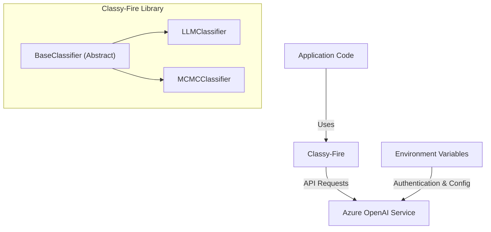
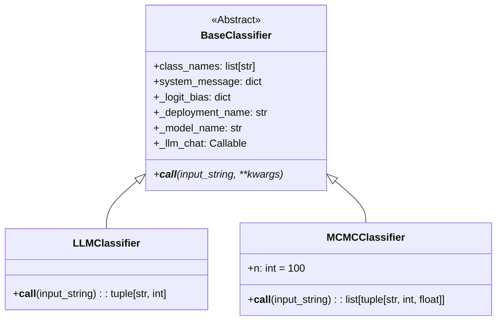
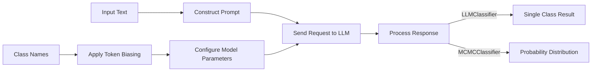

<!-- source: DeepWiki mcp.deepwiki.com · repo microsoft/classy-fire · page 1 Overview · fetched 2026-10-26 -->

# Overview

Relevant source files

The following files were used as context for generating this wiki page:

- [LICENSE](LICENSE)
- [README.md](README.md)
- [SUPPORT.md](SUPPORT.md)
- [pyproject.toml](pyproject.toml)

This document provides an introduction to classy-fire, a lightweight yet powerful library for multiclass text classification using Large Language Models (LLMs). Classy-fire offers an elegant approach to classification tasks by leveraging LLMs through strategic prompt engineering and parameter tuning, without requiring labeled training data.

For installation instructions, see [Installation](#1.1).  
For a quick example of how to use the library, see [Quick Start](#1.2).

## What is classy-fire?

Classy-fire is a text classification library that leverages Azure OpenAI's LLM APIs to classify text inputs into predefined categories. The library provides optimized parameter tuning and prompting strategies to ensure efficient and accurate classifications without the need for fine-tuning the underlying model.

Sources: [README.md:1-3](), [pyproject.toml:5-11]()

## Key Features

Classy-fire addresses common challenges in LLM-based classification:

- **Deterministic Classification**: Provides consistent, reliable outputs for the same input
- **Token Biasing**: Maps class names to tokens and applies a strong probability bias for accurate classification
- **No Training Required**: Works out-of-the-box with predefined classes
- **Flexible Classification Options**: Choose between deterministic (single best answer) or probabilistic (distribution of confidence across classes) classification
- **Efficient Inference**: Optimized for faster response times by generating single token outputs
- **Customizable Context**: Support for task descriptions and few-shot examples to improve accuracy

Sources: [README.md:4-11](), [README.md:55-59]()

## Classification Framework

Classy-fire provides two main classifiers built on a common foundation:

- **BaseClassifier**: Abstract class that handles token biasing and prompt construction
- **LLMClassifier**: Deterministic classifier that returns the single most likely class
- **MCMCClassifier**: Probabilistic classifier that returns a distribution of confidence across all classes

Sources: [README.md:19-34](), [README.md:68-70]()

## Classification Process

The classification process in classy-fire involves several key steps:

1. **Input Processing**: The text to be classified is formatted into a prompt
2. **Token Biasing**: Class names are mapped to tokens with enhanced probabilities
3. **LLM Inference**: The system queries the LLM with optimized parameters
4. **Output Processing**: Results are processed to provide either a single classification or probability distribution

Sources: [README.md:60-70]()

## Technical Foundation

Classy-fire operates on a principled mathematical foundation:

Given an input string $x_i$ and a set of $k$ classes $C=(C_1, ..., C_k)$, classy-fire determines:

$argmax_j Pr[x_i \in C_j | C, \Theta]$

Where $\Theta$ represents the knowledge encoded in the language model.

- **LLMClassifier**: Deterministically selects the class with the highest probability by setting temperature to 0
- **MCMCClassifier**: Estimates the full posterior distribution over classes using a Markov Chain Monte Carlo approach

Sources: [README.md:61-70]()

## Performance

Preliminary evaluation on the tweet_eval dataset shows promising results, with classy-fire achieving competitive performance against state-of-the-art methods:

| Metric | Score |
|--------|-------|
| Accuracy | 0.83 |
| Macro Avg F1 | 0.74 |
| Weighted Avg F1 | 0.82 |

For detailed evaluation information and metrics, see [Evaluation](#5).

Sources: [README.md:72-87]()

## System Requirements

Classy-fire requires:

- Python 3.7+
- Azure OpenAI Service credentials
- Environment variables for authentication

See the [Installation](#1.1) page for detailed setup instructions.

Sources: [README.md:37-51](), [pyproject.toml:18-24]()

## License

Classy-fire is available under the MIT License.

Sources: [LICENSE:1-22]()

---

