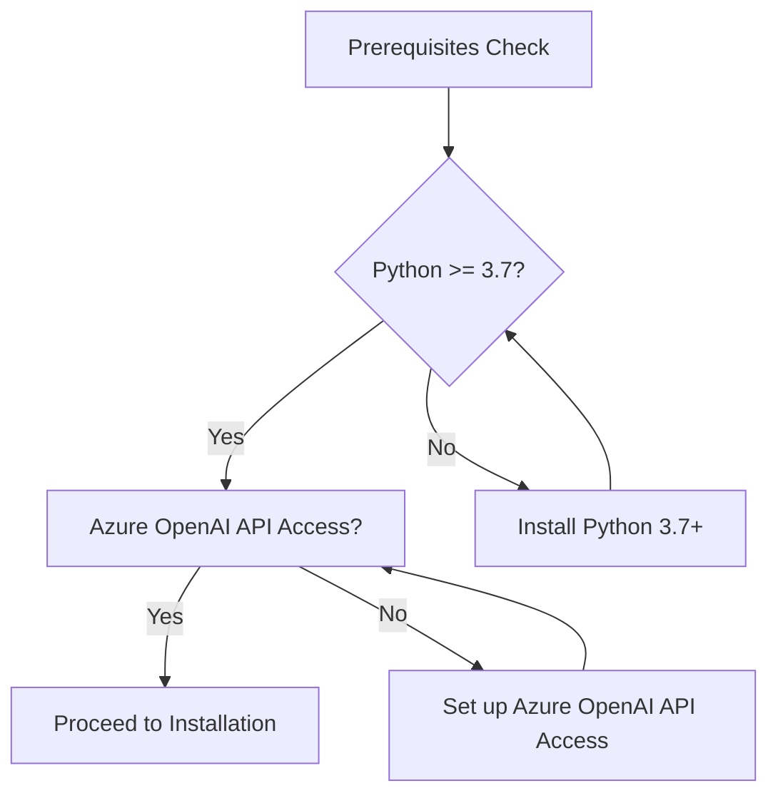
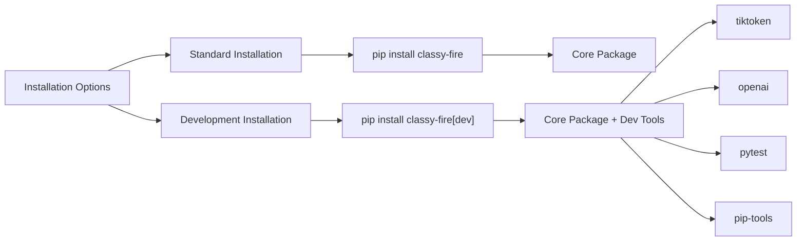
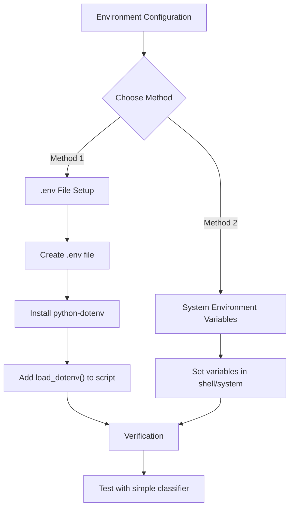
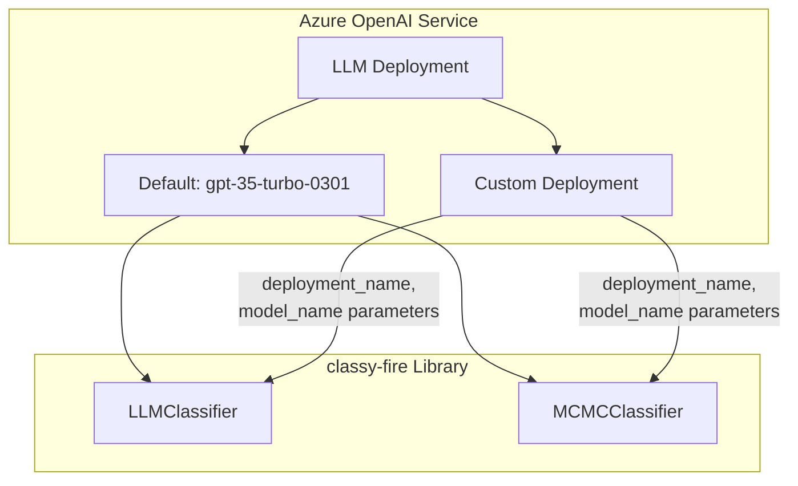

<!-- source: DeepWiki mcp.deepwiki.com · repo microsoft/classy-fire · page 1.1 Installation · fetched 2026-10-26 -->

# Installation

<details>
<summary>Relevant source files</summary>

The following files were used as context for generating this wiki page:

- [LICENSE](LICENSE)
- [README.md](README.md)
- [SUPPORT.md](SUPPORT.md)
- [pyproject.toml](pyproject.toml)

</details>


This page provides instructions for installing the classy-fire library and configuring the necessary environment variables to access Azure OpenAI services. For information about how to use the library after installation, see [Quick Start](#1.2).

## Prerequisites

Before installing classy-fire, ensure you meet the following requirements:

- Python 3.7 or higher
- Access to Azure OpenAI API service (or OpenAI API)
- Appropriate authentication credentials



Sources: [pyproject.toml:21-21](), [README.md:37-38]()

## Installation Methods

### Standard Installation

The simplest way to install classy-fire is using pip:

```bash
pip install classy-fire
```

This will install the core package with minimal dependencies.

### Development Installation

For development purposes or to run the evaluation examples, install with additional dependencies:

```bash
pip install classy-fire[dev]
```

This installs additional packages such as tiktoken, openai, pytest, and pip-tools.



Sources: [README.md:16-18](), [pyproject.toml:24-24]()

## Environment Configuration

classy-fire requires several environment variables to authenticate with Azure OpenAI service. Set up the following variables:

| Environment Variable | Description | Example Value |
|---------------------|-------------|---------------|
| `OPENAI_API_BASE` | Azure OpenAI endpoint URL | https://your-resource-name.openai.azure.com/ |
| `OPENAI_API_VERSION` | API version to use | 2023-05-15 |
| `OPENAI_API_TYPE` | Type of API (azure or openai) | azure |
| `OPENAI_API_KEY` | Your API authentication key | sk-... |

### Setting Up Environment Variables

#### Method 1: Using a .env file (Recommended)

1. Create a file named `.env` in your project directory
2. Add the following content, replacing the placeholders with your actual values:

```
OPENAI_API_BASE=https://<endpoint>/
OPENAI_API_VERSION=2023-05-15
OPENAI_API_TYPE=azure  # or openai
OPENAI_API_KEY=<private key guid>
```

3. Install the python-dotenv package:

```bash
pip install python-dotenv
```

4. Load the environment variables in your Python script:

```python
from dotenv import load_dotenv
load_dotenv()
```

#### Method 2: Setting Environment Variables Directly

You can also set environment variables directly in your system:

```bash
# Linux/macOS
export OPENAI_API_BASE=https://<endpoint>/
export OPENAI_API_VERSION=2023-05-15
export OPENAI_API_TYPE=azure
export OPENAI_API_KEY=<private key guid>

# Windows (Command Prompt)
set OPENAI_API_BASE=https://<endpoint>/
set OPENAI_API_VERSION=2023-05-15
set OPENAI_API_TYPE=azure
set OPENAI_API_KEY=<private key guid>

# Windows (PowerShell)
$env:OPENAI_API_BASE = "https://<endpoint>/"
$env:OPENAI_API_VERSION = "2023-05-15"
$env:OPENAI_API_TYPE = "azure"
$env:OPENAI_API_KEY = "<private key guid>"
```



Sources: [README.md:38-51]()

## Model Deployment Configuration

By default, classy-fire expects an Azure OpenAI deployment of GPT-3.5 Turbo with the name `gpt-35-turbo-0301`. If your deployment has a different name, you will need to specify it when creating a classifier:

```python
classifier = LLMClassifier(
    class_names=["Banana", "Watermelon", "Apple", "Grape"],
    deployment_name="your-deployment-name",
    model_name="your-model-name"
)
```



Sources: [README.md:37-38]()

## Verifying Installation

To verify that classy-fire is installed correctly and can access the Azure OpenAI API, run a simple test:

```python
from classy_fire import LLMClassifier
from dotenv import load_dotenv
import os

# Load environment variables from .env file
load_dotenv()

# Check if environment variables are set
required_vars = ['OPENAI_API_BASE', 'OPENAI_API_VERSION', 'OPENAI_API_TYPE', 'OPENAI_API_KEY']
missing_vars = [var for var in required_vars if not os.getenv(var)]
if missing_vars:
    print(f"Error: Missing environment variables: {', '.join(missing_vars)}")
    exit(1)

# Create a simple classifier
try:
    classifier = LLMClassifier(["Red", "Blue", "Green"])
    result = classifier("The sky on a clear day")
    print(f"Classification result: {result}")
    print("Installation verified successfully!")
except Exception as e:
    print(f"Error during verification: {e}")
```

If the script runs without errors and returns a classification result, your installation is correctly set up.

Sources: [README.md:19-35]()

## Troubleshooting

### Common Issues

| Issue | Possible Solution |
|-------|-------------------|
| Missing environment variables | Ensure all required variables are set in your .env file or system environment |
| Authentication errors | Check that your OPENAI_API_KEY is correct and not expired |
| Module not found errors | Verify installation with `pip list \| grep classy-fire` |
| Deployment not found | Ensure your Azure OpenAI model is deployed and the deployment name matches what you're using |

If you encounter persistent issues, check the [project GitHub repository](https://github.com/microsoft/classy-fire) or create an issue for support.

Sources: [README.md:37-51](), [SUPPORT.md:1-13]()

---

