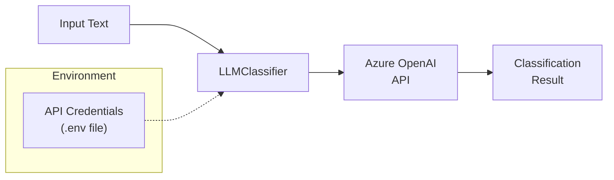
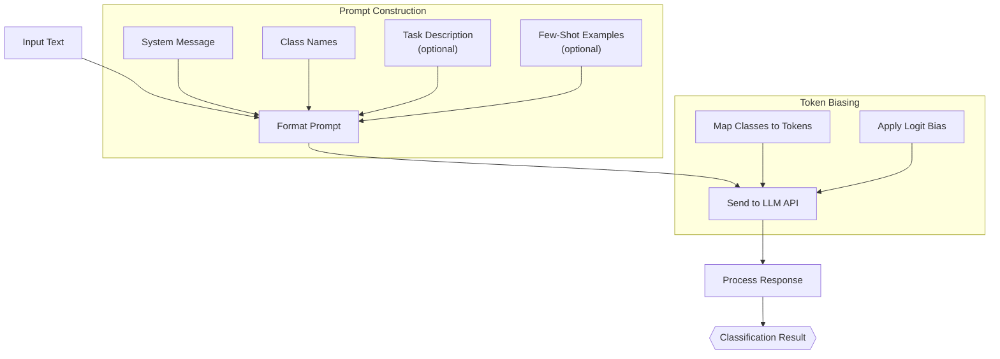

<!-- source: DeepWiki mcp.deepwiki.com · repo microsoft/classy-fire · page 1.2 Quick Start · fetched 2026-10-26 -->

# Quick Start

<details>
<summary>Relevant source files</summary>

The following files were used as context for generating this wiki page:

- [LICENSE](LICENSE)
- [README.md](README.md)
- [SUPPORT.md](SUPPORT.md)
- [examples/fruits.py](examples/fruits.py)

</details>


This guide provides a rapid introduction to using the Classy-Fire library for text classification. It covers the essential steps to get you up and running quickly with basic classification tasks. For more detailed information about the classification framework, see [Classification Framework](#2).

## Prerequisites

Before using Classy-Fire, you need to set up your Azure OpenAI service credentials. The library requires the following environment variables:

```
OPENAI_API_BASE=https://<endpoint>/
OPENAI_API_VERSION=2023-05-15
OPENAI_API_TYPE=azure  # or openai
OPENAI_API_KEY=<private key guid>
```

The simplest way to set these up is by creating a `.env` file in your project directory and loading it in your script:

```python
from dotenv import load_dotenv
load_dotenv()  # Load environment variables from .env file
```

Sources: [README.md:37-51]()

## Installation

Install Classy-Fire using pip:

```bash
pip install classy-fire
```

You'll also need to install the python-dotenv package to load environment variables:

```bash
pip install python-dotenv
```

Sources: [README.md:16-18]()

## Basic Classification with LLMClassifier

The `LLMClassifier` provides deterministic classification, returning a single best match from your defined classes.

```python
from dotenv import load_dotenv
from classy_fire import LLMClassifier

# Load environment variables
load_dotenv()

# Initialize the classifier with your classes
classifier = LLMClassifier(["Banana", "Watermelon", "Apple", "Grape"])

# Classify a text
result = classifier("Has an elongated shape")
print(result)
# Output: ('Banana', 0)  # (class_name, class_id)
```

In this example, the classifier correctly identifies "Banana" as the fruit with an elongated shape.

Sources: [README.md:22-28](), [examples/fruits.py:13-21]()

## Basic Classification Workflow

Here's a diagram showing the basic workflow of text classification with Classy-Fire:



Sources: [README.md:37-51](), [examples/fruits.py:13-21]()

## Probabilistic Classification with MCMCClassifier

For cases where you need to understand the distribution of probabilities across different classes, use the `MCMCClassifier`:

```python
from dotenv import load_dotenv
from classy_fire import MCMCClassifier

# Load environment variables
load_dotenv()

# Initialize the MCMC classifier
mcmc_classifier = MCMCClassifier(["Banana", "Watermelon", "Apple", "Grape"])

# Classify a text and get probability distribution
result = mcmc_classifier("Has an oval or spherical shape")
print(result)
# Output: [('Banana', 0, 0.0), ('Watermelon', 1, 0.02), ('Apple', 2, 0.81), ('Grape', 3, 0.17)]
# Format: [(class_name, class_id, probability), ...]
```

The output is a list of tuples, each containing:
- Class name
- Class ID (index)
- Probability value

In this example, "Apple" has the highest probability (0.81) of matching the description "Has an oval or spherical shape".

Sources: [README.md:30-33](), [examples/fruits.py:23-31]()

## Classifier Comparison

```mermaid
classDiagram
    class "BaseClassifier" {
        <<Abstract>>
        +class_names: list[str]
        +__call__(input_string)
    }
    
    class "LLMClassifier" {
        +__call__(input_string): tuple[str, int]
    }
    
    class "MCMCClassifier" {
        +n: int = 100
        +__call__(input_string): list[tuple[str, int, float]]
    }
    
    "BaseClassifier" <|-- "LLMClassifier"
    "BaseClassifier" <|-- "MCMCClassifier"
    
    note for "LLMClassifier" "Returns a single best class\nwith deterministic results"
    note for "MCMCClassifier" "Returns probability distribution\nacross all classes"
```

Sources: [README.md:20-33](), [examples/fruits.py:13-31]()

## Using Additional Parameters

Both classifiers accept optional parameters to improve classification performance:

```python
# Add a task description and few-shot examples
classifier = LLMClassifier(
    class_names=["Banana", "Watermelon", "Apple", "Grape"],
    task_description="Classify fruits based on their physical description.",
    few_shot_examples="""
    Input: Red and round with a stem at the top.
    Output: Apple
    
    Input: Green on the outside, red on the inside, and has black seeds.
    Output: Watermelon
    """
)
```

The `task_description` parameter provides context about the classification task, while `few_shot_examples` helps ground the model with example inputs and outputs.

Sources: [README.md:55-58]()

## Classification Process



Sources: [README.md:61-70]()

## Next Steps

Now that you have the basics, you might want to explore:

- [Base Classifier](#2.1) - Understanding the core classification interface
- [Prompt Engineering](#3.1) - How to craft effective prompts for better results
- [Token Biasing](#3.2) - How Classy-Fire optimizes classification accuracy
- [Usage Examples](#4) - More complex classification examples

For a complete evaluation of the classification performance, see [Evaluation](#5).

Sources: [README.md:72-87]()

---

