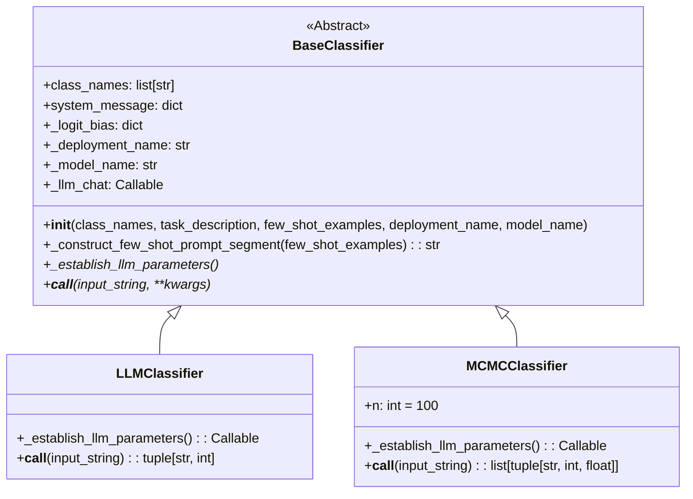
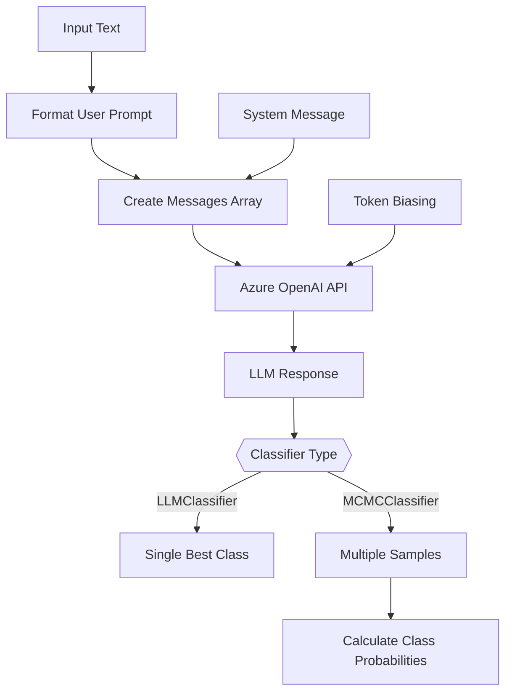
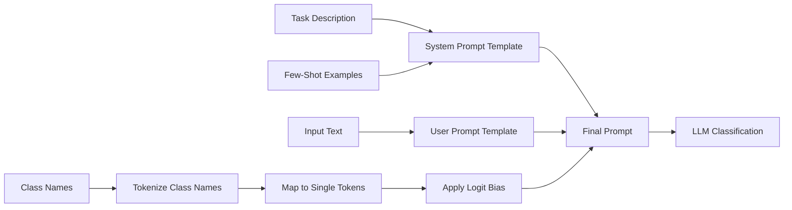
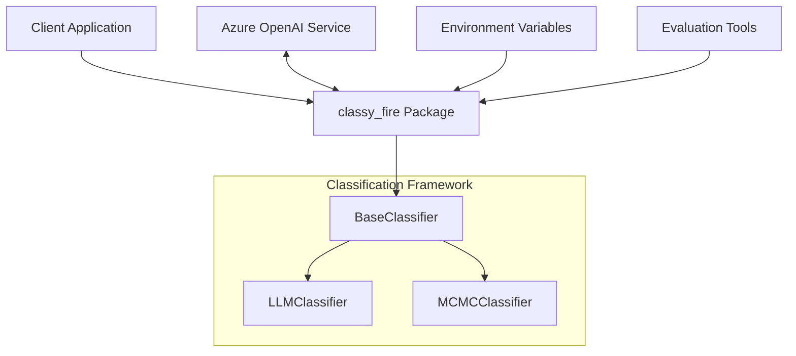

<!-- source: DeepWiki mcp.deepwiki.com · repo microsoft/classy-fire · page 2 Classification Framework · fetched 2026-10-26 -->

# Classification Framework

<details>
<summary>Relevant source files</summary>

The following files were used as context for generating this wiki page:

- [LICENSE](LICENSE)
- [README.md](README.md)
- [SUPPORT.md](SUPPORT.md)
- [classy_fire/__init__.py](classy_fire/__init__.py)
- [classy_fire/base_classifier.py](classy_fire/base_classifier.py)

</details>


## Purpose and Scope

The Classification Framework is the core architecture that powers the Classy-Fire library. This document describes the overall design of the classification system, including the component hierarchy, classification workflow, and the relationships between different classifiers. For specific details about individual classifiers, see [Base Classifier](#2.1), [LLM Classifier](#2.2), and [MCMC Classifier](#2.3).

Sources: [README.md:60-70](), [classy_fire/base_classifier.py:10-21]()

## Classification Framework Architecture

The Classification Framework is designed around an inheritance-based architecture that allows for multiple classification strategies while sharing common functionality. It leverages Large Language Models (LLMs) to perform text classification by using sophisticated token biasing and prompt engineering techniques.



Sources: [classy_fire/base_classifier.py:10-95](), [classy_fire/__init__.py:1-2]()

## Key Components

The Classification Framework consists of three main components:

1. **BaseClassifier**: An abstract base class that implements common functionality such as prompt construction, token biasing, and communication with the LLM API.

2. **LLMClassifier**: A concrete implementation that provides deterministic classification results, returning a single best class and its corresponding index.

3. **MCMCClassifier**: A concrete implementation that uses Markov Chain Monte Carlo to estimate probability distributions across all possible classes.

Sources: [README.md:20-34](), [classy_fire/base_classifier.py:10-21]()

## Classification Workflow

The classification process follows these steps:



The framework processes input text through the following stages:

1. **Input Formatting**: The user input is formatted according to the predefined prompt template.
2. **Message Construction**: System and user messages are combined to create the final prompt.
3. **API Call**: The formatted messages are sent to the Azure OpenAI API.
4. **Response Processing**: The response is parsed to extract the classification result.
5. **Output Generation**: Depending on the classifier type, either a single best class or probability distribution is returned.

Sources: [classy_fire/base_classifier.py:33-95](), [README.md:60-70]()

## Prompt Engineering and Token Biasing

The Classification Framework uses two key techniques to improve classification accuracy:



1. **Prompt Engineering**: The system uses carefully crafted prompts that include:
   - A base system prompt that instructs the model to select from specific options
   - Task description that provides context about the classification task
   - Optional few-shot examples to demonstrate expected behavior
   - A user prompt template that formats the input text

2. **Token Biasing**: The framework applies a logit bias to increase the probability of the model generating valid class IDs:
   - Class names are mapped to numerical identifiers (0, 1, 2, etc.)
   - These identifiers are mapped to single tokens in the model's vocabulary
   - A high logit bias is applied to these tokens to ensure the model selects from the predefined classes

Sources: [classy_fire/base_classifier.py:23-87](), [README.md:68-69]()

## Comparison of Classifiers

| Feature | LLMClassifier | MCMCClassifier |
|---------|---------------|----------------|
| **Return Type** | Tuple of (class_name, class_index) | List of tuples (class_name, class_index, probability) |
| **Determinism** | Deterministic (temperature=0) | Probabilistic |
| **Use Case** | When a single best class is needed | When understanding uncertainty or class distribution is important |
| **Performance** | Faster (single API call) | Slower (multiple samples) |
| **Configuration** | Minimal | Configurable sample size (n parameter) |

Sources: [README.md:20-34](), [README.md:68-70]()

## Configuration Options

The BaseClassifier (and by extension, both LLMClassifier and MCMCClassifier) accepts the following parameters during initialization:

- **class_names**: List of strings representing the possible classification categories
- **task_description**: Optional string providing context for the classification task
- **few_shot_examples**: Optional string containing example inputs and their expected classifications
- **deployment_name**: Name of the Azure OpenAI deployment (default: "gpt-35-turbo-0301")
- **model_name**: Name of the model to use (default: "gpt-3.5-turbo")

Example configuration:

```python
# Basic configuration
classifier = LLMClassifier(["Banana", "Watermelon", "Apple", "Grape"])

# Advanced configuration with task description and few-shot examples
classifier = LLMClassifier(
    class_names=["Positive", "Negative", "Neutral"],
    task_description="Classify the sentiment of customer feedback.",
    few_shot_examples="Input: The service was excellent!\nResponse: 0\n\nInput: I hate this product.\nResponse: 1",
    deployment_name="gpt-4",
    model_name="gpt-4"
)
```

Sources: [classy_fire/base_classifier.py:33-49](), [README.md:55-58]()

## Mathematical Foundation

The Classification Framework is based on the following formal definition:

Given a string instance $x_i$ and a set of $k$ classes provided as strings, $C=(C_1, ..., C_k)$, Classy-Fire determines:

$argmax_j Pr[x_i \in C_j | C, \Theta]$

Where $\Theta$ represents the parameters (knowledge of the world) of the language model.

The LLMClassifier implements this by deterministically selecting the class with the highest probability, while the MCMCClassifier estimates the entire probability distribution across all classes.

Sources: [README.md:60-70]()

## Environment Requirements

The Classification Framework requires the following environment variables to be set for connecting to the Azure OpenAI Service:

- `OPENAI_API_BASE`: The Azure OpenAI endpoint URL
- `OPENAI_API_VERSION`: The API version (e.g., "2023-05-15")
- `OPENAI_API_TYPE`: "azure" or "openai"
- `OPENAI_API_KEY`: The API key for authentication

Sources: [README.md:37-51](), [classy_fire/base_classifier.py:75-80]()

## Integration with Other Components



The Classification Framework serves as the foundation for the entire Classy-Fire library. It interfaces with:

1. **Client Applications**: Applications that need text classification capabilities
2. **Azure OpenAI Service**: The underlying LLM provider
3. **Evaluation Tools**: Tools for assessing classifier performance

Sources: [README.md:1-19](), [classy_fire/__init__.py:1-2]()

---

