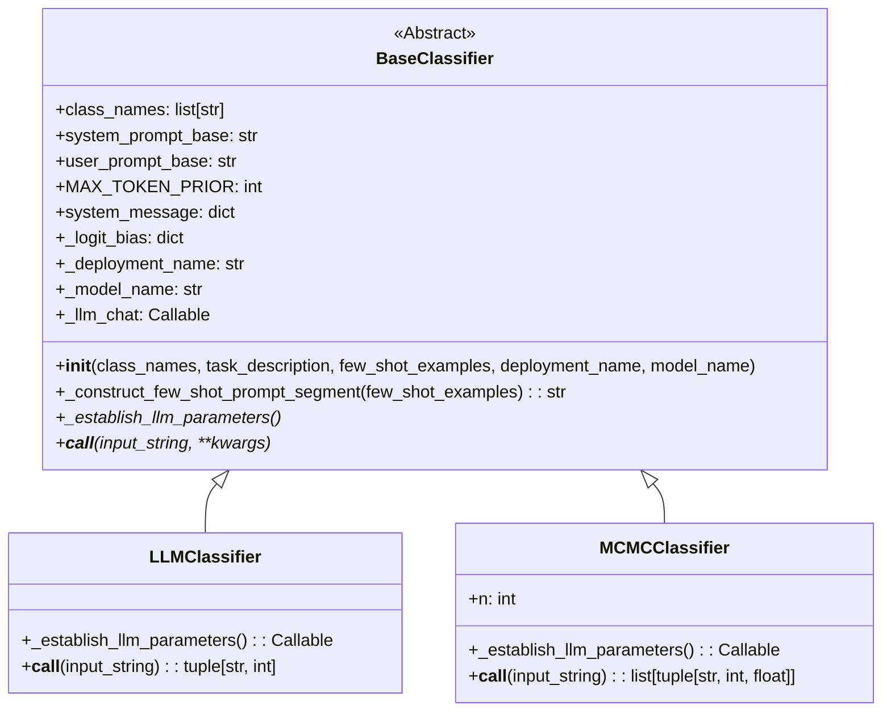
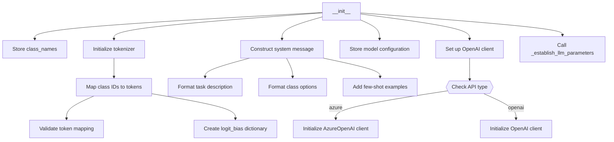
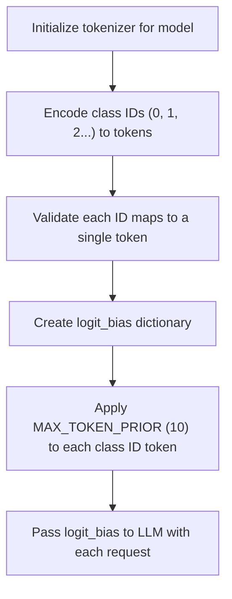
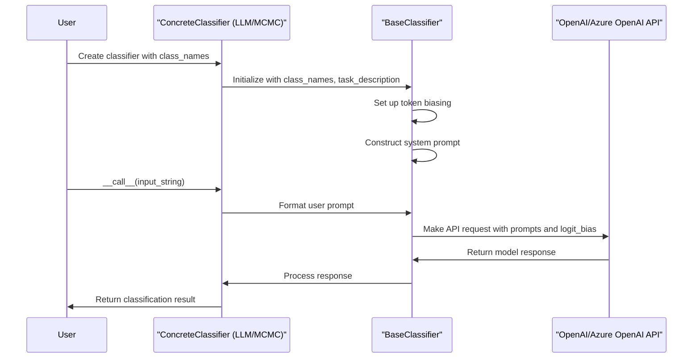

<!-- source: DeepWiki mcp.deepwiki.com · repo microsoft/classy-fire · page 2.1 Base Classifier · fetched 2026-10-26 -->

# Base Classifier

<details>
<summary>Relevant source files</summary>

The following files were used as context for generating this wiki page:

- [classy_fire/base_classifier.py](classy_fire/base_classifier.py)

</details>


## Purpose

This document details the BaseClassifier abstract class, which serves as the foundation for all classifiers in the classy-fire library. The BaseClassifier provides core functionality for LLM-based classification, including prompt engineering, token biasing, and the interface for classifier implementations. For specific implementations, see [LLM Classifier](#2.2) and [MCMC Classifier](#2.3).

## Class Overview

BaseClassifier is an abstract base class that defines the common structure and behavior for all classifiers in the system. It handles the construction of prompts, management of class names, and configuration of the underlying LLM.



Sources: [classy_fire/base_classifier.py:10-96]()

## Initialization Process

The BaseClassifier initialization process sets up the essential components needed for classification:



Sources: [classy_fire/base_classifier.py:34-80]()

## Key Components

### Prompt Construction

The BaseClassifier builds structured prompts for the LLM using a template-based approach. This standardizes the format across different classification tasks.

#### System Prompt

The system prompt provides context and instructions to the LLM. It contains:

1. Task description (context)
2. Available class options
3. Few-shot examples (if provided)

```
You are an AI assistant. Select for the following human input the most related item from 
the following set of <options> and leveraging information given in <context>. Respond with the number corresponding to the selected option.
<context>
{context_string}
</context>
<options>
{options_string}
</options>
{few_shot_prompt_segment}
###
```

#### User Prompt

The user prompt wraps the input text to be classified:

```
<Input>
{user_prompt}
</Input>
Response: 
```

Sources: [classy_fire/base_classifier.py:25-32]()

### Token Biasing

Token biasing is a technique to influence the LLM's output probabilities. The BaseClassifier uses this to increase the likelihood that the model will respond with a valid class ID number.

The process works as follows:



This ensures that the model's responses are constrained to the valid set of class identifiers.

Sources: [classy_fire/base_classifier.py:50-71]()

### Few-Shot Examples

The BaseClassifier supports few-shot learning through examples provided during initialization. These examples demonstrate the expected input-output behavior for the classifier.

```python
@staticmethod
def _construct_few_shot_prompt_segment(few_shot_examples: str) -> str:
    if len(few_shot_examples) > 0:
        return f"Here are some examples of how to respond:\n{few_shot_examples}\n"
    else:
        return ""
```

Few-shot examples should be formatted as a string demonstrating input-output pairs.

Sources: [classy_fire/base_classifier.py:82-87]()

## Abstract Methods

BaseClassifier defines two abstract methods that must be implemented by subclasses:

| Method | Purpose | Signature |
|--------|---------|-----------|
| `_establish_llm_parameters` | Configure the LLM API parameters | `() -> Callable[[list[Dict[str, str]]], Any]` |
| `__call__` | Process an input string and return classification results | `(input_string: str, **kwargs) -> Any` |

These methods allow different classifier implementations to customize how they interact with the LLM and process its responses.

Sources: [classy_fire/base_classifier.py:89-95]()

## Usage Flow

The following diagram illustrates how BaseClassifier is used in a typical classification flow:



Sources: [classy_fire/base_classifier.py:10-96]()

## Client Configuration

The BaseClassifier automatically determines which OpenAI client to initialize based on the environment variables:

```python
if os.environ["OPENAI_API_TYPE"] == "azure":
    self.client = AzureOpenAI(
        api_key = os.environ["OPENAI_API_KEY"],
        api_version = os.environ["OPENAI_API_VERSION"],
        azure_endpoint = os.environ["OPENAI_API_BASE"]
    )
else:
    self.client = OpenAI(api_key = os.environ["OPENAI_API_KEY"])
```

Required environment variables:
- `OPENAI_API_TYPE`: "azure" or "openai"
- `OPENAI_API_KEY`: Your API key
- For Azure:
  - `OPENAI_API_VERSION`: API version
  - `OPENAI_API_BASE`: Azure endpoint URL

Sources: [classy_fire/base_classifier.py:75-80]()

## Implementation Considerations

When extending the BaseClassifier:

1. The `_establish_llm_parameters` method should return a callable that handles communication with the LLM API.
2. The `__call__` method should implement the classification logic and return results in a format appropriate for the specific classifier type.
3. Subclasses should leverage the prompt engineering and token biasing mechanisms provided by the base class.

For concrete implementations, refer to [LLM Classifier](#2.2) and [MCMC Classifier](#2.3).

---

