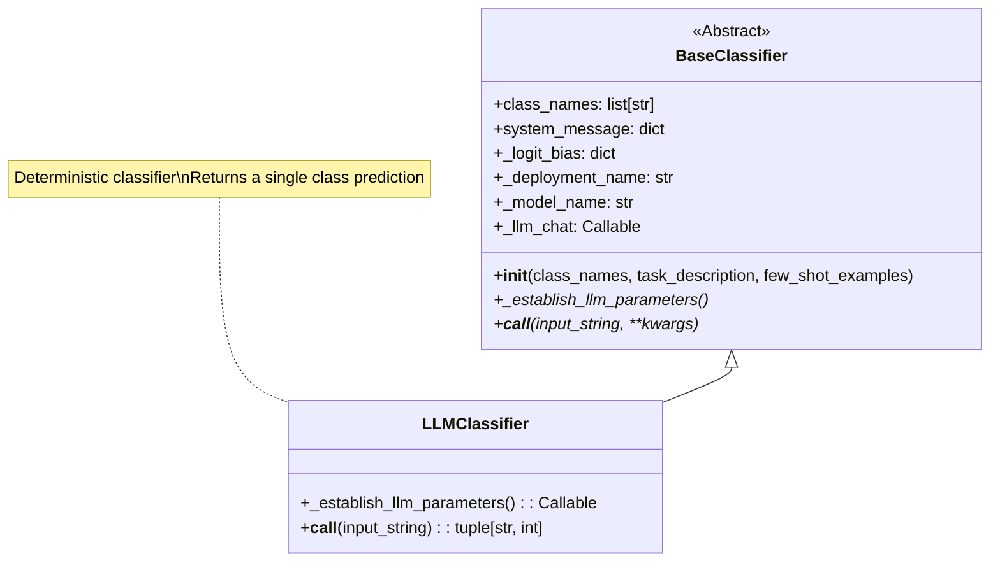
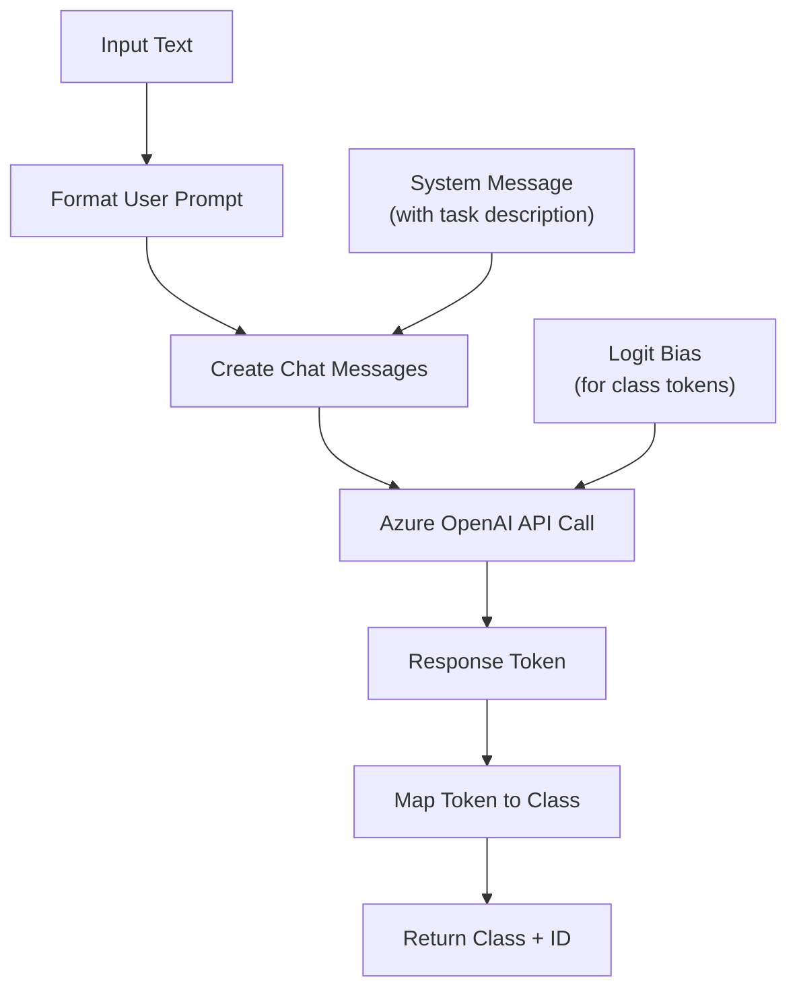
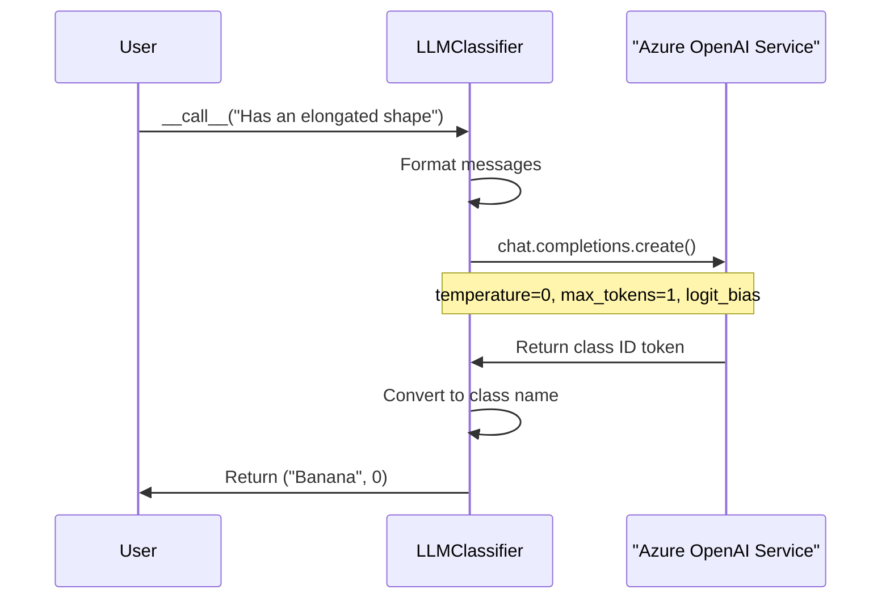
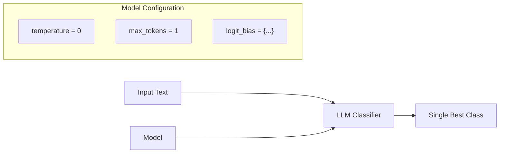
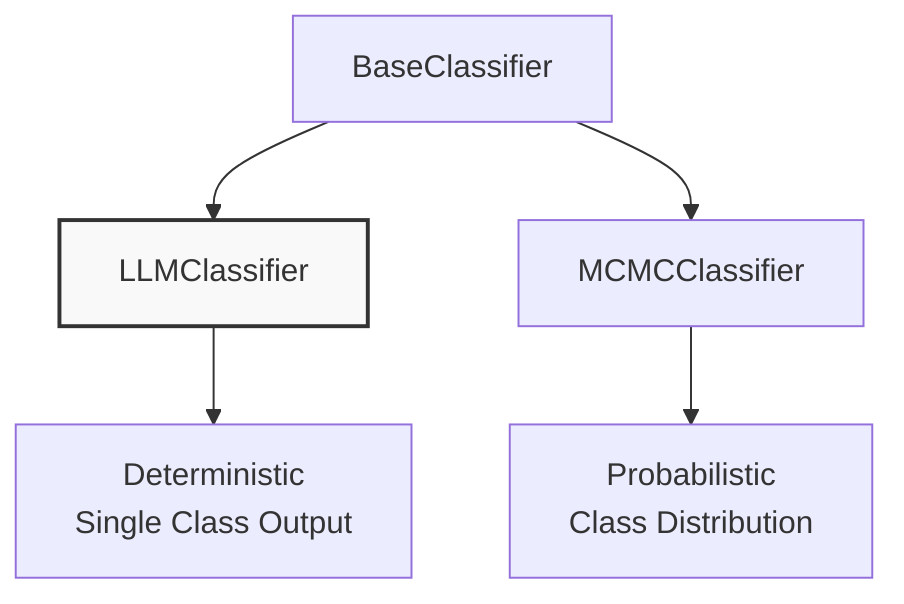

<!-- source: DeepWiki mcp.deepwiki.com · repo microsoft/classy-fire · page 2.2 LLM Classifier · fetched 2026-10-26 -->

# LLM Classifier

<details>
<summary>Relevant source files</summary>

The following files were used as context for generating this wiki page:

- [LICENSE](LICENSE)
- [README.md](README.md)
- [SUPPORT.md](SUPPORT.md)
- [classy_fire/llm_classifier.py](classy_fire/llm_classifier.py)

</details>


The LLM Classifier is a deterministic classifier that leverages Azure OpenAI's Large Language Models to categorize text inputs into predefined classes. This document explains how the LLM Classifier works, its implementation, and how to use it effectively. For probabilistic classification that provides distributions over classes, see [MCMC Classifier](#2.3).

## Overview

The LLM Classifier is a core component of the classy-fire framework that implements deterministic classification - given a text input, it returns a single best-matching class from a set of predefined options. It works by carefully configuring an LLM to output only valid class identifiers using token biasing techniques.



Sources: [classy_fire/llm_classifier.py:8-48](), [README.md:22-28]()

## Basic Usage

The LLM Classifier is easy to set up and use with just a few lines of code:

```python
from classy_fire import LLMClassifier

# Initialize with the class names
classifier = LLMClassifier(["Banana", "Watermelon", "Apple", "Grape"])

# Classify a text
result = classifier("Has an elongated shape")
print(result)
# Output: ('Banana', 0)
```

The classifier returns a tuple containing the predicted class name (string) and its corresponding index (integer) in the class_names list.

Sources: [README.md:22-28](), [classy_fire/llm_classifier.py:32-48]()

## Classification Process

The following diagram illustrates how the LLM Classifier processes an input text to produce a classification result:



Sources: [classy_fire/llm_classifier.py:32-48]()

## Implementation Details

The LLM Classifier inherits from the BaseClassifier class and implements two key methods:

1. `_establish_llm_parameters()`: Configures the LLM with optimal parameters for classification
2. `__call__()`: Processes the input text and returns a classification

### Key Parameter Configuration

The LLM Classifier uses carefully chosen parameters to ensure reliable classifications:

| Parameter | Value | Purpose |
|-----------|-------|---------|
| temperature | 0 | Ensures deterministic outputs |
| max_tokens | 1 | Forces the model to generate only a single token |
| logit_bias | Dictionary | Increases probability of valid class tokens |

Sources: [classy_fire/llm_classifier.py:21-30]()

### Classification Flow

When you call the classifier with an input string, the following happens:

1. The system message (containing task description and class options) and user message (containing the input text) are combined
2. The combined prompt is sent to the Azure OpenAI API with the configured parameters
3. The response token is parsed to extract the class ID
4. The corresponding class name and ID are returned as a tuple



Sources: [classy_fire/llm_classifier.py:32-48]()

## Deterministic Classification

The LLM Classifier is designed to be deterministic, meaning it will always return the same result for the same input, making it reliable for production systems. This is achieved by:

1. Setting temperature to 0, eliminating randomness in the LLM's output
2. Using logit bias to heavily weight the model toward outputting only valid class identifiers
3. Restricting the output to a single token that corresponds to a class ID



Sources: [classy_fire/llm_classifier.py:21-30](), [README.md:67-69]()

## When to Use LLM Classifier

The LLM Classifier is ideal when:

- You need a single, confident classification rather than a distribution
- You want consistent, reproducible results
- Your application requires quick, deterministic decisions
- You need to integrate with systems that expect a definitive answer

For cases where understanding the model's uncertainty is important, consider using the [MCMC Classifier](#2.3) instead.

Sources: [README.md:67-70]()

## Advanced Configuration

The LLM Classifier can be customized with additional parameters:

```python
classifier = LLMClassifier(
    class_names=["Banana", "Watermelon", "Apple", "Grape"],
    task_description="Classify fruits based on their descriptions",
    few_shot_examples="Input: Yellow and curved\nOutput: 0\n\nInput: Red and round\nOutput: 2",
    deployment_name="your-deployment-name",
    model_name="your-model-name"
)
```

| Parameter | Description |
|-----------|-------------|
| class_names | List of class names for classification |
| task_description | Provides context for the classification task |
| few_shot_examples | Example input-output pairs to guide the model |
| deployment_name | Azure OpenAI deployment name |
| model_name | The model to use (default: gpt-35-turbo-0301) |

Sources: [README.md:55-59](), [classy_fire/llm_classifier.py:8-19]()

## Implementation Code

The core implementation of the LLM Classifier is straightforward:

```python
def _establish_llm_parameters(self) -> Callable[[list[Dict[str, str]]], Any]:
    def _llm_chat(messages: list[Dict[str, str]]):
        return self.client.chat.completions.create(
                messages = messages,
                model = self._deplyment_name,
                temperature = 0,
                max_tokens = 1,
                logit_bias = self._logit_bias
            )
    return _llm_chat

def __call__(self, input_string: str, **kwargs) -> Any:
    """
    The function takes a string and returns a tuple containing the classified class name (string) and corresponding class id (int).
    param input_string: The string to classify.
    """
    response = self._llm_chat(
        [
            self.system_message,
            {
             "role": "user",
             "content": self.user_prompt_base.format(user_prompt=input_string)
            },
        ]
    )
    predicted_class_id = int(response.choices[0].message.content)

    return self.class_names[predicted_class_id], predicted_class_id
```

Sources: [classy_fire/llm_classifier.py:21-48]()

## Environment Setup

The LLM Classifier requires Azure OpenAI credentials to be configured as environment variables:

```
OPENAI_API_BASE=https://<endpoint>/
OPENAI_API_VERSION=2023-05-15
OPENAI_API_TYPE=azure
OPENAI_API_KEY=<private key guid>
```

You can set these by creating a `.env` file and loading it with `python-dotenv` or setting them directly in your environment.

Sources: [README.md:37-51]()

## Related Components

The LLM Classifier is one of two classifier implementations in classy-fire:



For probabilistic classification with uncertainty estimates, see the [MCMC Classifier](#2.3) documentation.

Sources: [README.md:22-34](), [README.md:67-70]()

---

