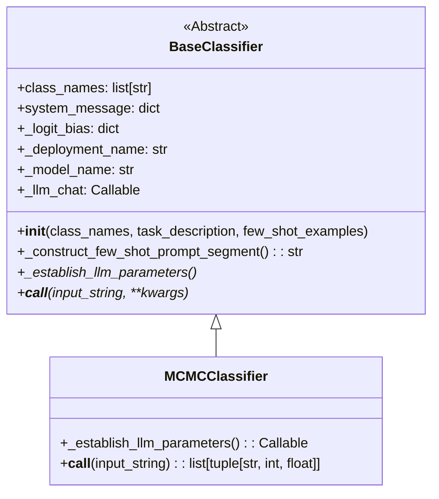
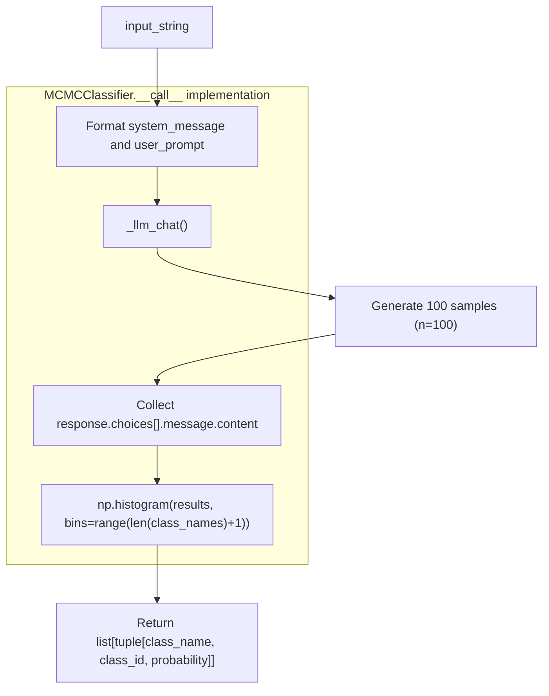
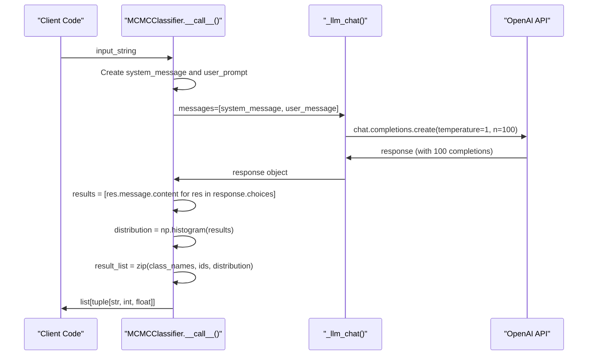

<!-- source: DeepWiki mcp.deepwiki.com · repo microsoft/classy-fire · page 2.3 MCMC Classifier · fetched 2026-10-26 -->

# MCMC Classifier

<details>
<summary>Relevant source files</summary>

The following files were used as context for generating this wiki page:

- [LICENSE](LICENSE)
- [README.md](README.md)
- [SUPPORT.md](SUPPORT.md)
- [classy_fire/mcmc_classifier.py](classy_fire/mcmc_classifier.py)

</details>


The MCMCClassifier is a specialized classification component in the Classy-Fire library that implements a Markov Chain Monte Carlo approach for estimating probability distributions across classification options. Unlike the deterministic [LLM Classifier](#2.2) which returns a single best class, MCMCClassifier provides the full posterior probability distribution over all available classes.

## Overview

The MCMCClassifier extends the BaseClassifier to provide probabilistic outputs rather than deterministic ones, enabling users to understand the model's uncertainty and confidence levels across all possible classification options.



Sources: [classy_fire/mcmc_classifier.py:7-18](), [README.md:22-24]()

## Implementation Details

The MCMCClassifier implementation consists of two key methods that override the BaseClassifier functionality:

1. `_establish_llm_parameters()`: Configures the LLM with temperature=1 and n=100 to generate multiple diverse samples
2. `__call__()`: Processes the input, collects multiple responses, and calculates the probability distribution using numpy's histogram function



Sources: [classy_fire/mcmc_classifier.py:20-49]()

The key configuration parameters that differentiate MCMCClassifier from LLMClassifier are:

1. **Temperature=1**: While LLMClassifier uses temperature=0 for deterministic responses, MCMCClassifier uses temperature=1 to allow for sampling from the model's full probability distribution.

2. **n=100**: The classifier requests 100 completions simultaneously, leveraging the OpenAI API's batch sampling parameter for efficient sampling.

3. **Distribution Calculation**: After collecting all responses, it uses numpy's histogram function to calculate the frequency distribution:
   ```python
   distribution = np.histogram(results, bins=range(len(self.class_names)+1), density=True)[0]
   ```

## Working Mechanism

The MCMCClassifier operates through this sequence:



Sources: [classy_fire/mcmc_classifier.py:32-49]()

When the client calls the classifier with an input string:
1. The same careful prompt construction occurs as with BaseClassifier
2. A request is sent to the OpenAI API with temperature=1 and n=100
3. 100 different responses are collected from the API
4. A histogram is calculated to determine the frequency distribution
5. The result is returned as a list of (class_name, class_id, probability) tuples

## Usage Example

Here's how to initialize and use the MCMCClassifier:

```python
from classy_fire import MCMCClassifier

# Initialize classifier with class names
mcmc_classifier = MCMCClassifier(
    class_names=["Banana", "Watermelon", "Apple", "Grape"],
    task_description="Classify fruits based on their descriptions",
    few_shot_examples="Description: Yellow and curved\nClass: Banana\n\nDescription: Red and round\nClass: Apple"
)

# Classify a text and get probability distribution
result = mcmc_classifier("Has an oval or spherical shape")
print(result)
# Output: [('Banana', 0, 0.0), ('Watermelon', 1, 0.02), ('Apple', 2, 0.81), ('Grape', 3, 0.17)]
```

Sources: [README.md:30-33]()

The output provides a probability distribution across all classes, showing the model is 81% confident the description matches an Apple, with 17% probability for Grape, and 2% for Watermelon.

## Practical Applications

The MCMCClassifier is particularly valuable in scenarios where:

1. **Uncertainty Quantification**: When you need to measure the model's confidence level
2. **Threshold-Based Decision Making**: For implementing confidence thresholds before taking actions
3. **Ambiguity Detection**: When handling potentially ambiguous inputs
4. **Edge Case Analysis**: For identifying where the model is uncertain between multiple classes

Example of threshold-based application:

```python
# Implement confidence threshold for action
result = mcmc_classifier("Red and juicy")
highest_prob_class = max(result, key=lambda x: x[2])
class_name, class_id, confidence = highest_prob_class

if confidence > 0.8:
    # High confidence - take automatic action
    process_fruit(class_name)
else:
    # Low confidence - require human review
    queue_for_review(input_text, result)
```

## Comparison with LLMClassifier

| Feature | LLMClassifier | MCMCClassifier |
|---------|---------------|----------------|
| Return type | `tuple[str, int]` | `list[tuple[str, int, float]]` |
| Temperature | 0 | 1 |
| API parameter n | 1 | 100 |
| Primary method | Argmax selection | Distribution estimation |
| Compute efficiency | Higher (single prediction) | Lower (multiple samples) |
| API cost | Lower | Higher (100x more tokens) |

Sources: [classy_fire/mcmc_classifier.py:20-30](), [README.md:69-70]()

## When to Use

- Use **LLMClassifier** when you need a deterministic, single best answer classification
- Use **MCMCClassifier** when:
  - You need to understand model uncertainty
  - You want to implement confidence thresholds
  - You're analyzing model behavior on ambiguous cases
  - You need to detect low-confidence predictions for human review

The MCMCClassifier provides richer information at the cost of increased API usage (100 completions vs. 1) and slightly longer processing time.

---

