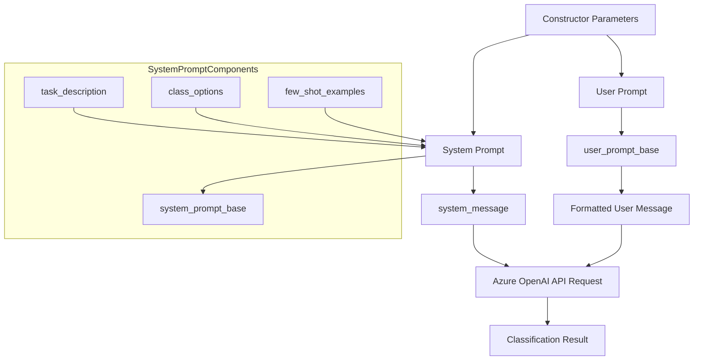
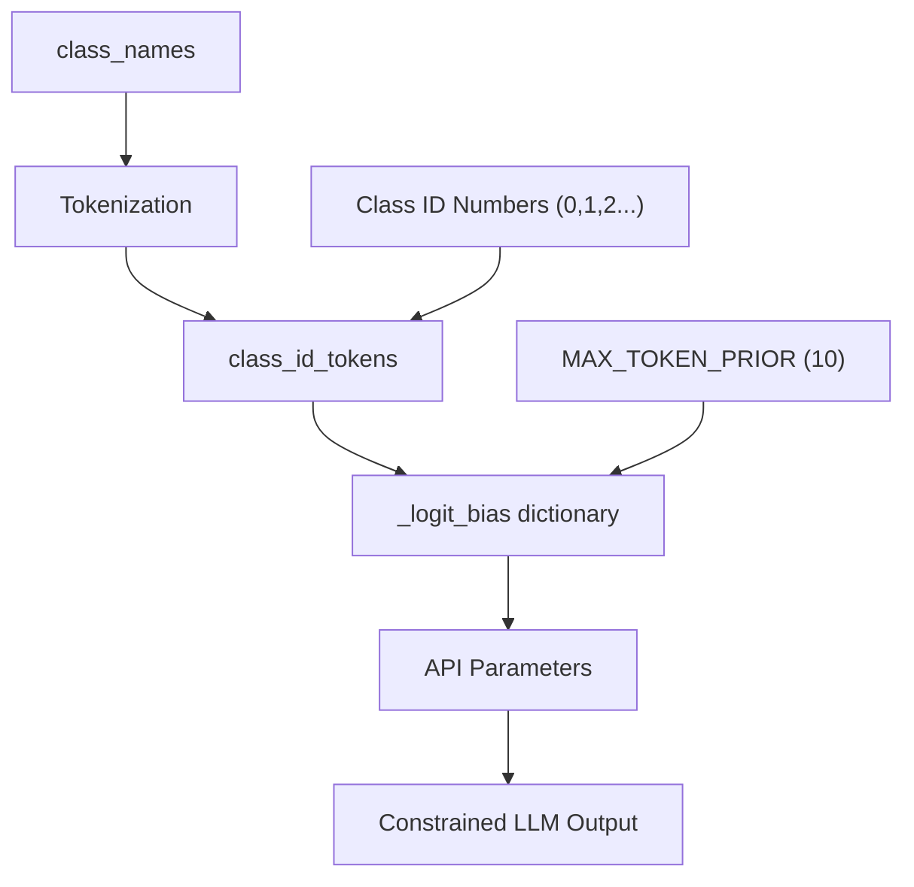
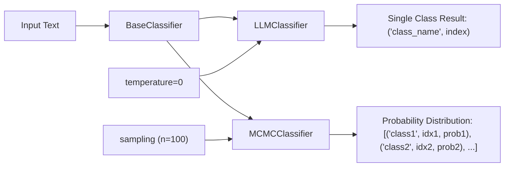

<!-- source: DeepWiki mcp.deepwiki.com · repo microsoft/classy-fire · page 3 Advanced Topics · fetched 2026-10-26 -->

# Advanced Topics

<details>
<summary>Relevant source files</summary>

The following files were used as context for generating this wiki page:

- [LICENSE](LICENSE)
- [README.md](README.md)
- [SUPPORT.md](SUPPORT.md)
- [classy_fire/base_classifier.py](classy_fire/base_classifier.py)

</details>


This page covers advanced aspects of the Classy-Fire library that enable its efficient and accurate classification capabilities. Here we explore the underlying mechanisms that make the classification framework effective, particularly focusing on prompt engineering strategies and token biasing techniques.

For basic usage information, see [Overview](#1) and [Quick Start](#1.2). For details about the specific classifier implementations, see [Classification Framework](#2).

## Understanding the Prompt Architecture

Prompt engineering is fundamental to Classy-Fire's effectiveness. The library constructs specialized prompts that guide the LLM to produce consistent, reliable classification outputs.

### Prompt Construction Flow



Sources: [base_classifier.py:25-33](), [base_classifier.py:55-66]()

### System Prompt Anatomy

The system prompt in Classy-Fire is carefully structured to maximize classification accuracy:

```
You are an AI assistant. Select for the following human input the most related item from 
the following set of <options> and leveraging information given in <context>. Respond with the number corresponding to the selected option.
<context>
{context_string}
</context>
<options>
{options_string}
</options>
{few_shot_prompt_segment}
###
```

Key components:
- **Role definition**: Sets the model as an assistant with a specific task
- **Task instruction**: Explicitly requests selection from options and numeric response
- **Context section**: Contains the `task_description` parameter
- **Options section**: Lists all class names with their numeric indices
- **Few-shot examples**: Optional examples demonstrating expected input/output patterns
- **Delimiter**: The `###` separates the system prompt from user inputs

Sources: [base_classifier.py:25-31]()

### User Prompt Format

For each classification request, the user input is formatted as:

```
<Input>
{user_prompt}
</Input>
Response: 
```

This structured format:
- Clearly delineates the input text being classified
- Provides a consistent prefix for the model's response
- Helps maintain the expected response format

Sources: [base_classifier.py:32]()

## Token Biasing Technique

Token biasing is a critical technique that improves classification accuracy by manipulating the probability of specific tokens in the model's output.

### How Token Biasing Works



Sources: [base_classifier.py:49-71](), [README.md:68-69]()

### Token Biasing Implementation

The token biasing process involves several key steps:

1. Each class is assigned a numeric identifier (0, 1, 2, etc.)
2. The `tiktoken` tokenizer encodes each numeric identifier into a token
3. A logit bias dictionary is created, mapping each class token to a high prior value (10)
4. This dictionary is passed to the Azure OpenAI API, boosting the probability of generating valid class identifiers

The code implementation:

```python
# Create tokenizer for the specified model
tokenizer = tiktoken.encoding_for_model(model_name)

# Encode each class index (0, 1, 2...) as tokens
class_id_tokens = [tokenizer.encode(str(i)) for i in range(len(class_names))]

# Ensure each class ID maps to exactly one token
assert all(len(token_list) == 1 for token_list in class_id_tokens)

# Create the logit bias dictionary
self._logit_bias = {
    token_list[0]: BaseClassifier.MAX_TOKEN_PRIOR
    for token_list in class_id_tokens
}
```

This technique ensures that:
- The model's response is constrained to the set of valid class identifiers
- Invalid or out-of-distribution outputs are highly unlikely
- Classification is efficient, requiring only a single token to be generated

Sources: [base_classifier.py:49-71](), [README.md:68]()

## Deterministic vs. Probabilistic Classification

Classy-Fire provides two classification approaches with different use cases and output characteristics.



Sources: [README.md:22-33](), [README.md:68-70]()

### Deterministic Classification (LLMClassifier)

The `LLMClassifier` provides deterministic classification results:

- **Implementation**: Sets temperature=0 to disable randomness
- **Behavior**: Returns the class with highest probability according to the model
- **Output format**: Tuple of `(class_name, class_index)`
- **Use case**: When consistent, reproducible results are needed

### Probabilistic Classification (MCMCClassifier)

The `MCMCClassifier` uses a Markov Chain Monte Carlo approach:

- **Implementation**: Generates multiple samples (default n=100) for the same input
- **Behavior**: Counts frequency of each class in the samples to estimate probabilities
- **Output format**: List of tuples `[(class_name, class_index, probability), ...]`
- **Use case**: When uncertainty information is valuable for decision-making

Example output difference:
```python
# Deterministic (single best answer)
result = llm_classifier("Has an oval or spherical shape")
print(result)  # ('Apple', 2)

# Probabilistic (distribution over classes)
result = mcmc_classifier("Has an oval or spherical shape")
print(result)  # [('Banana', 0, 0.0), ('Watermelon', 1, 0.02), ('Apple', 2, 0.81), ('Grape', 3, 0.17)]
```

Sources: [README.md:22-33](), [README.md:68-70]()

## Advanced Parameter Tuning

### Task Description Parameter

The `task_description` parameter provides context to guide the model's understanding:

- **Purpose**: Provides domain knowledge and classification criteria
- **Location**: Inserted into the `<context>` section of the system prompt
- **Examples**:
  - Fruit classification: "Classify fruits based on their physical characteristics like shape, color, and texture."
  - Sentiment analysis: "Determine whether text expresses positive, negative, or neutral sentiment, focusing on emotional tone."

Effective task descriptions should:
- Be concise but informative
- Define boundaries between classes
- Specify what characteristics are relevant for classification

Sources: [base_classifier.py:37](), [base_classifier.py:57-59]()

### Few-Shot Examples Parameter

Few-shot examples demonstrate to the model how to handle specific inputs:

- **Purpose**: Show expected input-output pairs to guide the model
- **Format**: Formatted as `<Input>...\n</Input>\nResponse: X` sequences
- **Implementation**: Converted to a prompt segment by `_construct_few_shot_prompt_segment`

Example of effective few-shot examples:
```
<Input>
This fruit is yellow and elongated.
</Input>
Response: 0

<Input>
This fruit is small, round, and purple.
</Input>
Response: 3
```

Few-shot examples are particularly useful for:
- Handling edge cases
- Illustrating boundary conditions between similar classes
- Demonstrating format expectations

Sources: [base_classifier.py:38](), [base_classifier.py:82-87]()

## Performance Optimization

### Token Efficiency

Classy-Fire is designed to be token-efficient:

- **Single-token response**: Classification results require only one token to generate
- **Reused system prompt**: System message is created once during initialization
- **Minimal API calls**: Classification requires only one API call (LLMClassifier) or batched requests (MCMCClassifier)

This token efficiency translates to:
- Lower API costs
- Faster classification responses
- Simplified result parsing

Sources: [README.md:68](), [base_classifier.py:52-54]()

### Sampling Parameters for MCMCClassifier

The MCMCClassifier can be tuned by adjusting the `n` parameter:

| n Value | Precision | Token Usage | Use Case |
|---------|-----------|-------------|----------|
| 10-20   | Low       | Low         | Quick estimation, limited budget |
| 50-100  | Medium    | Medium      | Balance of accuracy and cost (default) |
| 200+    | High      | High        | High-precision probability estimates |

The `n` parameter leverages the OpenAI API's batch generation capability, making multiple samples cost-effective.

Sources: [README.md:70]()

## Best Practices and Recommendations

1. **Choose descriptive class names**: Class names should be intuitive and semantically distinct.

2. **Limit the number of classes**: While theoretically the system could handle many classes, 2-20 classes typically work best.

3. **Test different prompting strategies**: Experiment with different task descriptions and few-shot examples.

4. **Use domain-specific context**: Include relevant domain terminology in your task description.

5. **Balance MCMCClassifier sample size**: Start with the default n=100 and adjust based on your precision needs.

6. **Evaluate systematically**: Benchmark your classifier against representative examples.

Sources: [README.md:87-90]()

## Known Limitations

1. **Class count constraints**: Each class ID must map to a single token, which may limit the maximum number of classes.

2. **Environment dependency**: Requires properly configured Azure OpenAI service credentials.

3. **Model dependency**: Performance is tied to the capabilities of the underlying language model.

4. **Classification scope**: Best suited for classifying text into discrete categories rather than regression tasks.

Sources: [base_classifier.py:52-54](), [README.md:37-51]()

---

