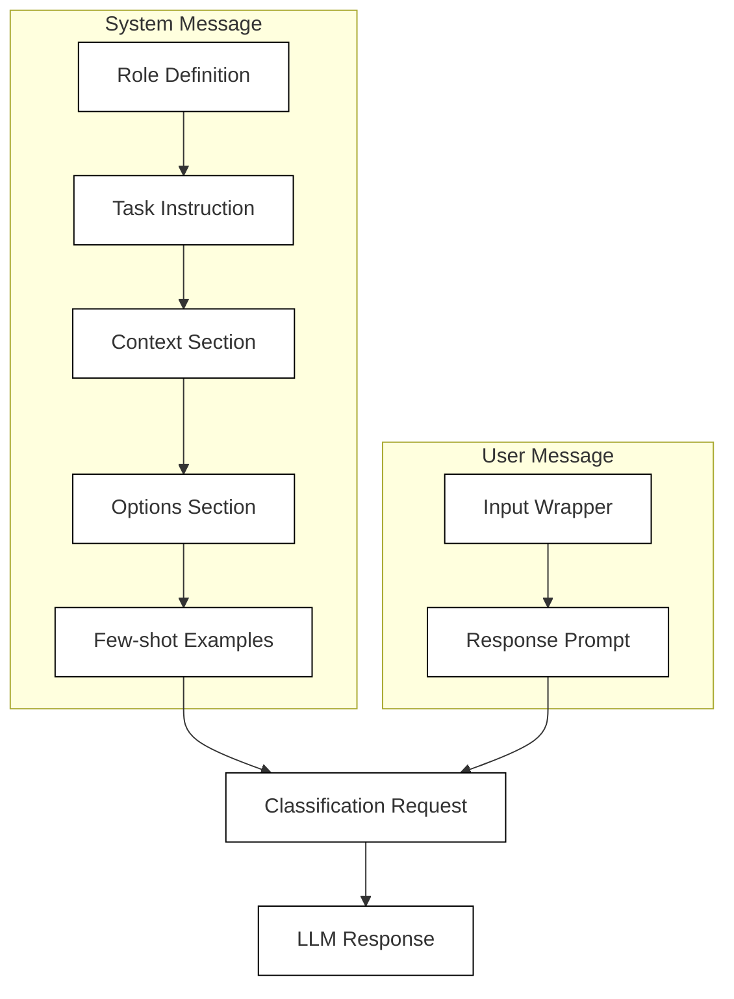
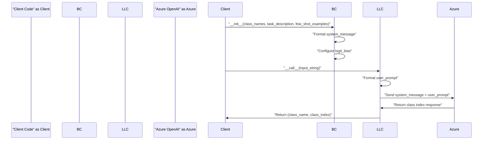
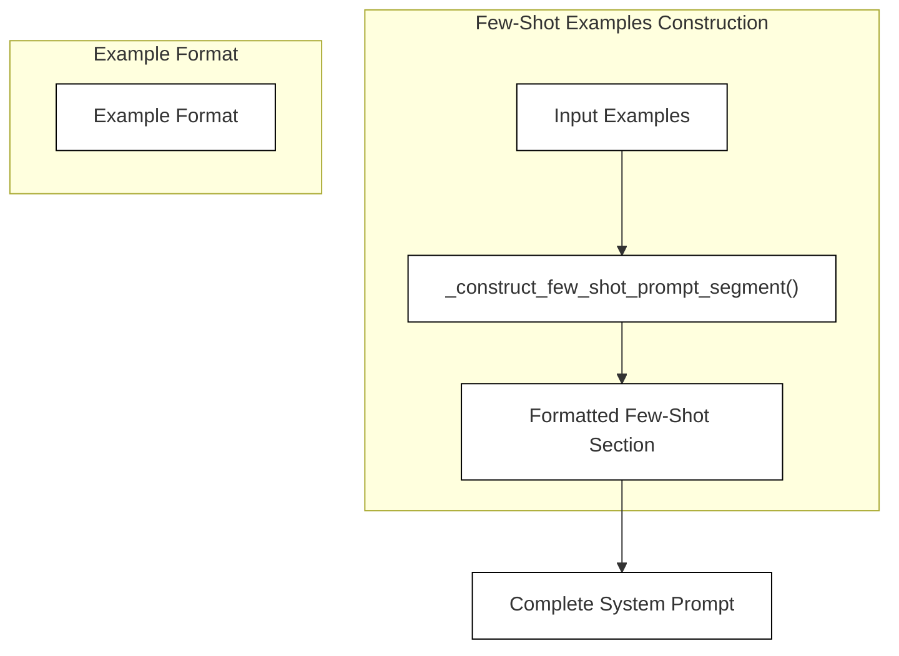
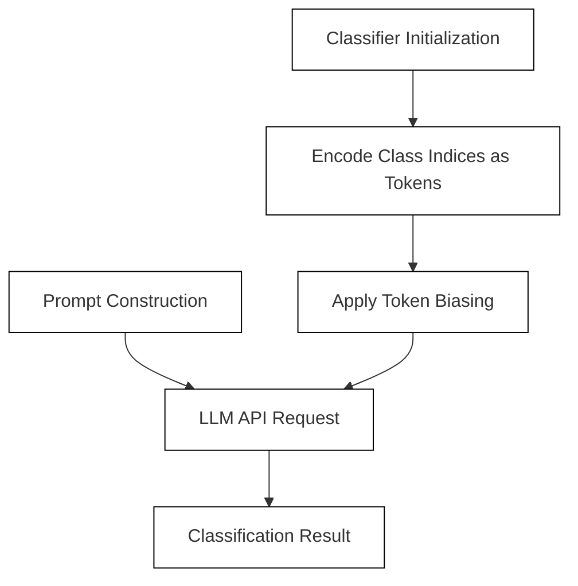

<!-- source: DeepWiki mcp.deepwiki.com · repo microsoft/classy-fire · page 3.1 Prompt Engineering · fetched 2026-10-26 -->

# Prompt Engineering

<details>
<summary>Relevant source files</summary>

The following files were used as context for generating this wiki page:

- [LICENSE](LICENSE)
- [README.md](README.md)
- [SUPPORT.md](SUPPORT.md)
- [classy_fire/base_classifier.py](classy_fire/base_classifier.py)

</details>


## Purpose and Scope

This document provides a comprehensive guide to prompt engineering within the classy-fire library. It covers the structure of prompts, how to customize them effectively, and best practices for optimizing classification performance. For information about token biasing techniques, see [Token Biasing](#3.2).

Sources: [README.md:55-63](), [classy_fire/base_classifier.py:25-32]()

## Prompt Structure Overview

The classy-fire library uses a carefully designed prompt structure to guide the LLM in performing text classification tasks. The prompt consists of two main components: the system message and the user message, which work together to frame the classification task.

### Prompt Components Diagram



Sources: [classy_fire/base_classifier.py:25-32](), [classy_fire/base_classifier.py:55-67]()

## System Prompt Structure

The system prompt is constructed using a template defined in `BaseClassifier.system_prompt_base`. It contains several key elements that guide the model:

```
You are an AI assistant. Select for the following human input the most related item from 
the following set of <options> and leveraging information given in <context>. Respond with the number corresponding to the selected option.
<context>
{context_string}
</context>
<options>
{options_string}
</options>
{few_shot_prompt_segment}
###
```

### System Prompt Element Breakdown

| Element | Purpose | Source Parameter |
|---------|---------|------------------|
| Role Definition | Establishes the model's role as an AI assistant | Hardcoded |
| Task Instruction | Directs the model to select from options and respond with a number | Hardcoded |
| Context Section | Provides task-specific information to guide classification | `task_description` parameter |
| Options Section | Lists the available class options with their numeric indices | Generated from `class_names` parameter |
| Few-shot Examples | Optional examples demonstrating expected behavior | `few_shot_examples` parameter |
| Delimiter | Separates the system instructions from user input | Hardcoded |

Sources: [classy_fire/base_classifier.py:25-32](), [classy_fire/base_classifier.py:55-67]()

## User Prompt Structure

The user prompt is simpler and wraps the input text to be classified:

```
<Input>
{user_prompt}
</Input>
Response: 
```

This structure clearly delineates the input text and prompts the model to provide a response.

Sources: [classy_fire/base_classifier.py:32]()

## Prompt Construction Process



Sources: [classy_fire/base_classifier.py:34-87](), [README.md:20-28]()

## Customizing Prompts

The classy-fire library allows for customization of prompts through several parameters during classifier initialization:

### Task Description

The `task_description` parameter allows you to provide context and instructions for the classification task. This is inserted into the `<context>` section of the system prompt.

#### Best Practices for Task Descriptions:

1. **Be specific about the domain**: Include relevant context about the type of data being classified
2. **Define class boundaries**: Explain what distinguishes one class from another
3. **Provide classification criteria**: List the features or attributes that determine class membership
4. **Keep it concise but complete**: Include necessary information without overwhelming the model

Example task description for fruit classification:
```
Classify descriptions of fruits based on their physical characteristics, taste, and typical uses. 
Consider attributes like shape, color, texture, sweetness, and whether they're typically eaten raw or cooked.
```

Sources: [README.md:55-58](), [classy_fire/base_classifier.py:43-44]()

### Few-Shot Examples

The `few_shot_examples` parameter allows you to provide example inputs and their expected classifications. This demonstrates the desired classification behavior to the model.



#### Best Practices for Few-Shot Examples:

1. **Cover edge cases**: Include examples that demonstrate boundary conditions
2. **Represent all classes**: Provide at least one example for each class
3. **Use balanced examples**: Avoid biasing the model with too many examples of one class
4. **Format consistently**: Follow a consistent structure for all examples
5. **Use challenging examples**: Include cases that might be difficult to classify

Example few-shot examples for fruit classification:
```
Input: Round, red or green, crunchy, sweet but sometimes tart
Response: 2

Input: Yellow, curved, soft when ripe, sweet
Response: 0

Input: Large, oval or round, juicy, sweet, red inside with black seeds
Response: 1

Input: Small, round, purple or green, sweet-tart, grows in clusters
Response: 3
```

Sources: [classy_fire/base_classifier.py:82-87](), [README.md:55-58]()

## Prompt Engineering and Token Biasing Integration

A key feature of classy-fire is the integration of prompt engineering with token biasing to enhance classification accuracy. This approach helps ensure the model responds with valid class indices.



The system:
1. Encodes class indices as tokens using the model's tokenizer
2. Applies a biasing factor (`MAX_TOKEN_PRIOR`) to these tokens
3. Combines this with the constructed prompt
4. Ensures the model responds with one of the valid class indices

Sources: [classy_fire/base_classifier.py:49-54](), [classy_fire/base_classifier.py:68-71](), [README.md:68-70]()

## Practical Examples

### Basic Classification Example

```python
from classy_fire import LLMClassifier

# Simple classifier with only class names
classifier = LLMClassifier(["Banana", "Watermelon", "Apple", "Grape"])

# Classify a simple input
result = classifier("Has an elongated shape")
print(result)  # ('Banana', 0)
```

### Enhanced Classification with Task Description

```python
from classy_fire import LLMClassifier

# Add task description for better context
task_description = """
Classify fruits based on their physical characteristics.
Consider shape, size, color, and texture in your classification.
"""

classifier = LLMClassifier(
    ["Banana", "Watermelon", "Apple", "Grape"],
    task_description=task_description
)

result = classifier("Round and crunchy with a stem")
print(result)  # ('Apple', 2)
```

### Classification with Few-Shot Examples

```python
from classy_fire import LLMClassifier

task_description = "Classify fruits based on their characteristics."

few_shot_examples = """
Input: Yellow curved fruit with a soft texture
Response: 0

Input: Large green oval fruit with watery red flesh
Response: 1

Input: Round red or green fruit with a core containing seeds
Response: 2
"""

classifier = LLMClassifier(
    ["Banana", "Watermelon", "Apple", "Grape"],
    task_description=task_description,
    few_shot_examples=few_shot_examples
)

result = classifier("Small purple fruit that grows in bunches")
print(result)  # ('Grape', 3)
```

Sources: [README.md:20-33]()

## Best Practices Summary

| Aspect | Recommendation |
|--------|----------------|
| Task Description | Be specific, define boundaries, provide criteria, be concise |
| Few-Shot Examples | Cover edge cases, represent all classes, use balanced examples, format consistently |
| Class Names | Use clear, distinct names that don't overlap semantically |
| Input Formatting | Structure inputs consistently between training and inference |
| Number of Classes | Keep under the model's context window limits |
| Biasing Strength | Use default `MAX_TOKEN_PRIOR` unless you have specific reasons to adjust |

Sources: [classy_fire/base_classifier.py:23-95](), [README.md:55-70]()

## Common Pitfalls to Avoid

1. **Ambiguous class definitions**: Ensure classes have clear, non-overlapping definitions
2. **Inconsistent example formatting**: Maintain the same structure across all examples
3. **Overloading the context**: Keep task descriptions focused and relevant
4. **Ignoring edge cases**: Include examples that cover boundary situations
5. **Class imbalance in examples**: Provide a balanced set of examples across classes

Sources: [README.md:4-10](), [README.md:89-90]()

---

