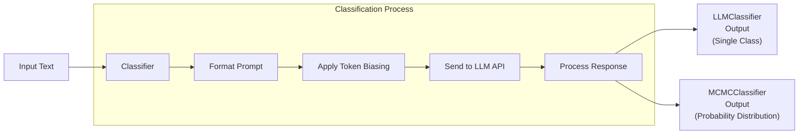
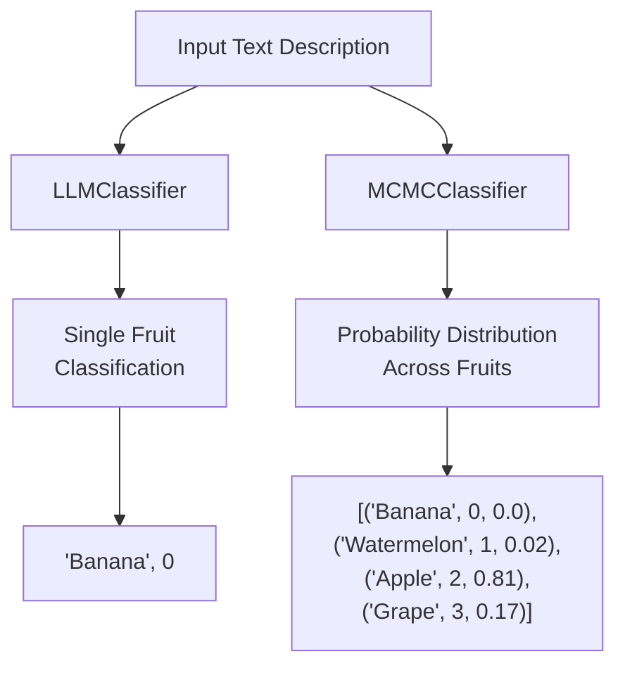
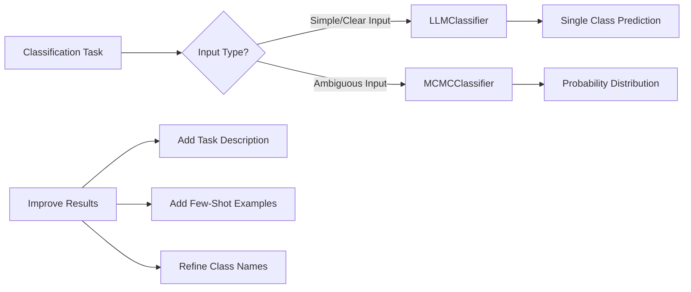

<!-- source: DeepWiki mcp.deepwiki.com · repo microsoft/classy-fire · page 4 Usage Examples · fetched 2026-10-26 -->

# Usage Examples

<details>
<summary>Relevant source files</summary>

The following files were used as context for generating this wiki page:

- [LICENSE](LICENSE)
- [README.md](README.md)
- [SUPPORT.md](SUPPORT.md)
- [examples/fruits.py](examples/fruits.py)

</details>


This page provides practical examples of how to use the classy-fire library for various text classification tasks. The examples demonstrate both the `LLMClassifier` for deterministic classification and the `MCMCClassifier` for probabilistic classification. For an overview of the classification framework and its components, see [Classification Framework](#2).

## Basic Usage Examples

The following examples demonstrate the basic usage of the classy-fire library classifiers. These examples assume you have already set up your environment variables as described in the [Installation](#1.1) page.

### Simple LLMClassifier Example

The simplest way to use classy-fire is with the `LLMClassifier` class, which performs deterministic classification by returning the most likely class for a given input text:

```python
from classy_fire import LLMClassifier

# Initialize the classifier with a list of class names
classifier = LLMClassifier(["Banana", "Watermelon", "Apple", "Grape"])

# Classify a text input
result = classifier("Has an elongated shape")
print(result)
# Output: ('Banana', 0)
```

The output is a tuple containing the predicted class name and its corresponding index in the class list.

Sources: [README.md:19-28](), [examples/fruits.py:13-21]()

### MCMCClassifier Example

The `MCMCClassifier` provides probabilistic classification, returning probabilities for each class:

```python
from classy_fire import MCMCClassifier

# Initialize the classifier with a list of class names
mcmc_classifier = MCMCClassifier(["Banana", "Watermelon", "Apple", "Grape"])

# Classify a text input
result = mcmc_classifier("Has an oval or spherical shape")
print(result)
# Output: [('Banana', 0, 0.0), ('Watermelon', 1, 0.02), ('Apple', 2, 0.81), ('Grape', 3, 0.17)]
```

The output is a list of tuples, each containing a class name, its index, and the estimated probability.

Sources: [README.md:30-34](), [examples/fruits.py:23-31]()

## Classifier Workflow

The following diagram illustrates the classification process flow for both types of classifiers:



Sources: [README.md:60-70](), [examples/fruits.py:13-31]()

## Advanced Usage Examples

The classifiers can be customized with additional parameters to improve classification accuracy and provide more context.

### Using Task Descriptions

Adding a task description helps the model understand the classification context:

```python
from classy_fire import LLMClassifier

# Add a task description to provide context
classifier = LLMClassifier(
    class_names=["Banana", "Watermelon", "Apple", "Grape"],
    task_description="Classify the given text into one of the fruit categories based on the description of physical characteristics."
)

result = classifier("Has a red or green skin with white flesh inside")
print(result)
# Output: ('Watermelon', 1)
```

Sources: [README.md:55-58]()

### Using Few-Shot Examples

Few-shot examples can significantly improve the classification performance by providing the model with examples of the expected behavior:

```python
from classy_fire import LLMClassifier

# Add few-shot examples to guide the model
few_shot_examples = """
Input: Yellow fruit with a curved shape
Output: Banana

Input: Large fruit with green rind and red flesh
Output: Watermelon
"""

classifier = LLMClassifier(
    class_names=["Banana", "Watermelon", "Apple", "Grape"],
    task_description="Classify fruits based on their descriptions.",
    few_shot_examples=few_shot_examples
)

result = classifier("Small fruit that grows in bunches")
print(result)
# Output: ('Grape', 3)
```

Sources: [README.md:55-58]()

### Customizing Model Parameters

You can specify which Azure OpenAI deployment and model to use:

```python
from classy_fire import LLMClassifier

classifier = LLMClassifier(
    class_names=["Banana", "Watermelon", "Apple", "Grape"],
    deployment_name="gpt-4",
    model_name="gpt-4-1106-preview"
)
```

Sources: [README.md:38]()

## Comparison of Classifiers

The following diagram illustrates the main differences between the two classifier types provided by classy-fire:

```mermaid
classDiagram
    class "BaseClassifier" {
        <<Abstract>>
        +class_names
        +system_message
        +_logit_bias
        +_deployment_name
        +_model_name
        +_llm_chat
    }
    
    class "LLMClassifier" {
        __call__(input_string) tuple[str, int]
    }
    
    class "MCMCClassifier" {
        +n: int = 100
        __call__(input_string) list[tuple[str, int, float]]
    }
    
    BaseClassifier <|-- LLMClassifier
    BaseClassifier <|-- MCMCClassifier
    
    note for LLMClassifier "Returns a single class prediction"
    note for MCMCClassifier "Returns probability distribution across classes"
```

Sources: [README.md:60-70]()

## Real-World Examples

### Fruit Classification Example

This example demonstrates a complete fruit classification implementation:



For a complete implementation of the fruit classification example, see the examples directory in the repository. The example demonstrates:

1. Setting up both classifier types with fruit class names
2. Classifying a fruit based on its description
3. Interpreting the results from each classifier type

Sources: [examples/fruits.py:1-32]()

### Tweet Emotion Classification

The classy-fire library can be used to classify the emotions expressed in tweets. As mentioned in the README, preliminary experiments on the [tweet_eval dataset](https://huggingface.co/datasets/tweet_eval/viewer/emotion/train) showed promising results:

```python
from classy_fire import LLMClassifier

# Define emotion classes
emotion_classifier = LLMClassifier(
    class_names=["anger", "joy", "optimism", "sadness"],
    task_description="Classify the emotional tone of the given tweet."
)

# Example tweets
tweets = [
    "I can't believe they canceled my favorite show! This is ridiculous!",
    "Just got promoted at work! Best day ever!",
    "Things will get better, we just need to keep pushing forward.",
    "Missing my old friends. Those were simpler times."
]

# Classify each tweet
for tweet in tweets:
    emotion, idx = emotion_classifier(tweet)
    print(f"Tweet: {tweet}\nEmotion: {emotion}\n")
```

The evaluation results showed impressive performance:

| Emotion   | Precision | Recall | F1-score | Support |
|-----------|-----------|--------|----------|---------|
| anger     | 0.97      | 0.81   | 0.88     | 42      |
| joy       | 0.74      | 0.92   | 0.82     | 25      |
| optimism  | 1.00      | 0.25   | 0.40     | 8       |
| sadness   | 0.75      | 1.00   | 0.86     | 21      |
| accuracy  |           |        | 0.83     | 96      |
| macro avg | 0.87      | 0.74   | 0.74     | 96      |
| weighted avg | 0.87   | 0.83   | 0.82     | 96      |

For more details on the evaluation, see the [Evaluation](#5) page.

Sources: [README.md:72-87]()

## Best Practices

When using classy-fire for your classification tasks, consider the following best practices:

1. **Class Names**: Choose clear, distinctive class names that don't overlap conceptually.
   
2. **Task Description**: Provide a clear and specific task description that explains the classification context.
   
3. **Few-Shot Examples**: Include representative examples for each class to guide the model, especially for nuanced classifications.

4. **Classifier Selection**:
   - Use `LLMClassifier` when you need a definitive answer 
   - Use `MCMCClassifier` when you need to understand the model's confidence or when dealing with ambiguous cases

5. **Environment Setup**: Ensure your Azure OpenAI API credentials are properly configured before running the classifiers.



Sources: [README.md:55-70]()

---

