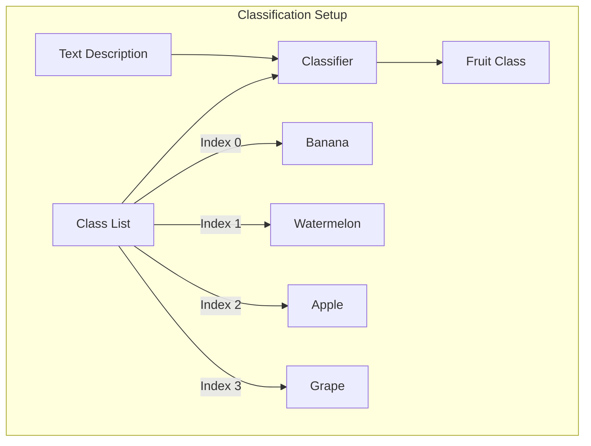
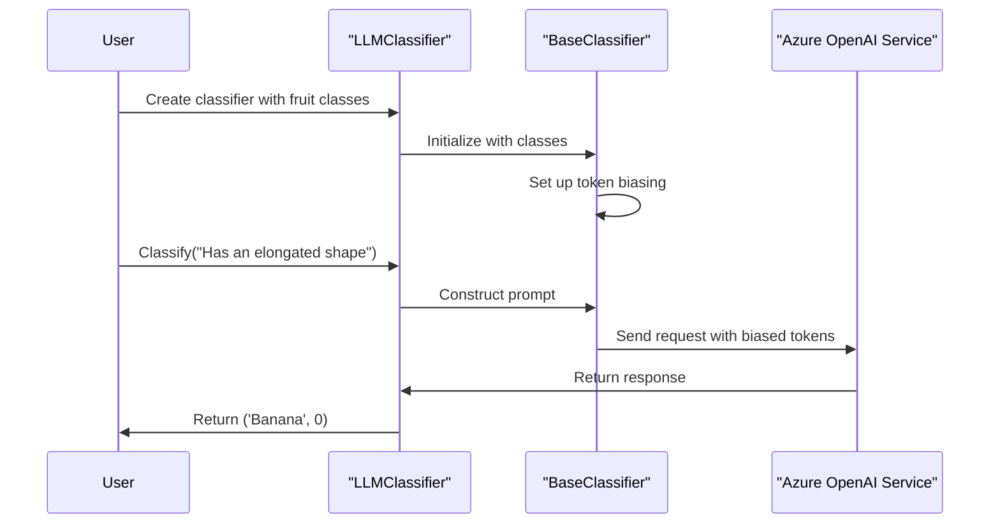
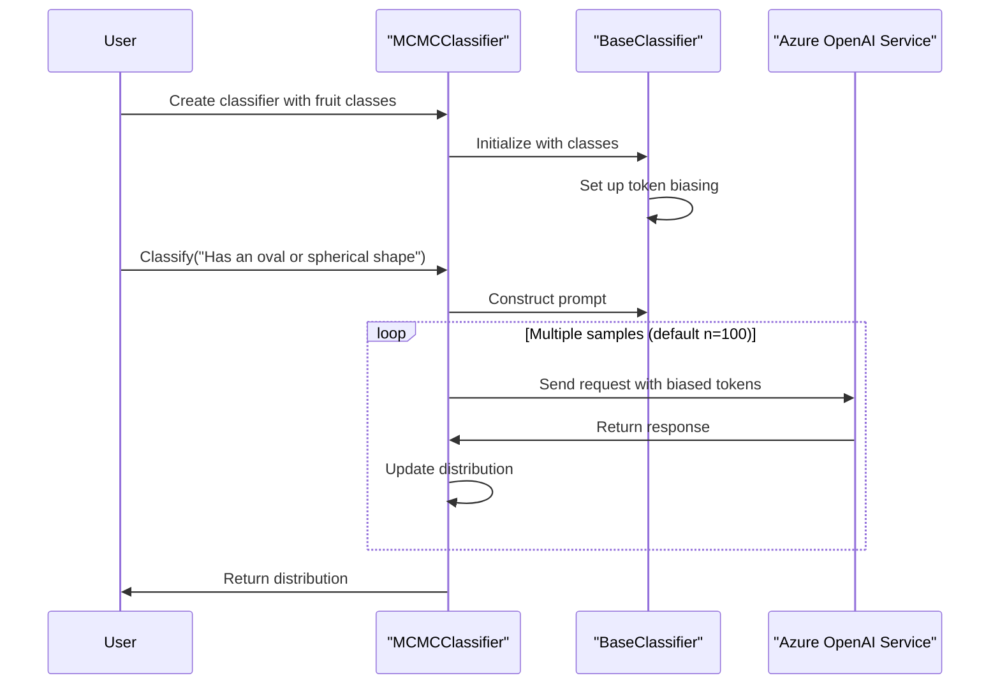
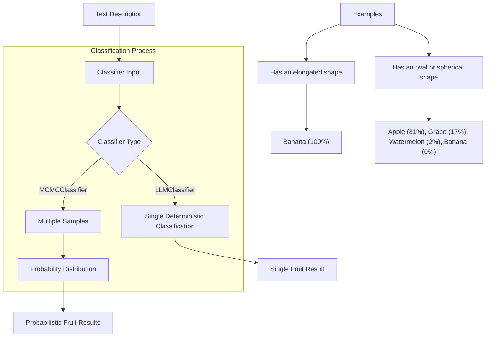
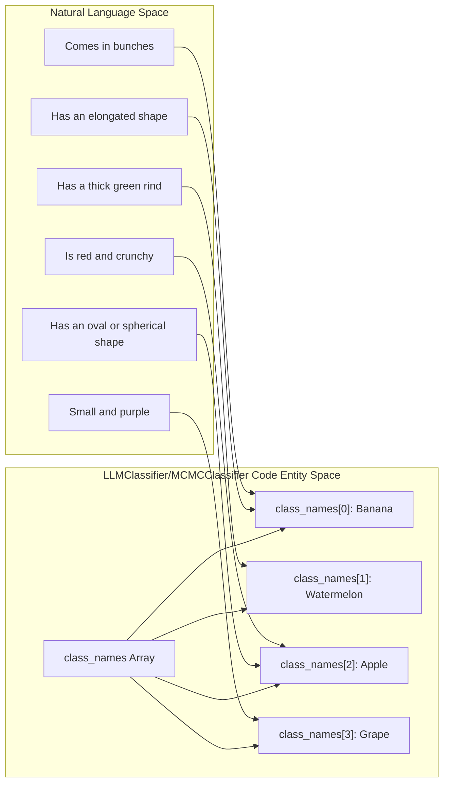
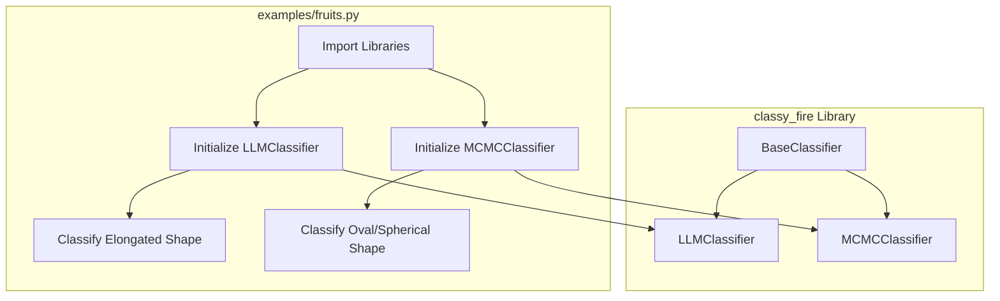

<!-- source: DeepWiki mcp.deepwiki.com · repo microsoft/classy-fire · page 4.1 Fruit Classification · fetched 2026-10-26 -->

# Fruit Classification

<details>
<summary>Relevant source files</summary>

The following files were used as context for generating this wiki page:

- [examples/fruits.py](examples/fruits.py)

</details>


## Purpose and Scope

This page demonstrates how to use the classy-fire library for classifying text descriptions of fruits. It walks through the examples in the fruits.py file and explains how to use both deterministic and probabilistic classification approaches. For information about classifying emotions in tweets, see [Tweet Emotion Classification](#4.2).

## Overview

The fruit classification example is a simple demonstration that shows how to classify text descriptions into fruit categories using both the LLMClassifier and MCMCClassifier. This example serves as an easy-to-understand introduction to text classification with the classy-fire library.

Sources: [examples/fruits.py:1-32]()

## Classification Setup

The example defines four fruit classes:
- Banana
- Watermelon
- Apple
- Grape

These classes are used by both classifier types to categorize textual descriptions of fruits.



Sources: [examples/fruits.py:15-15](), [examples/fruits.py:25-25]()

## Using LLMClassifier

The LLMClassifier provides deterministic classification, returning a single best-matching fruit class for a given description.

### Implementation

```python
from classy_fire.llm_classifier import LLMClassifier

llm_classifier = LLMClassifier(["Banana", "Watermelon", "Apple", "Grape"])

result = llm_classifier("Has an elongated shape")
print(result)
# Output: ('Banana', 0)
```

### How It Works

When the LLMClassifier is initialized with the fruit classes, it creates a system with token biasing to ensure the model returns one of the specified classes. The classifier returns a tuple containing the class name and its index in the class list.



Sources: [examples/fruits.py:13-21]()

## Using MCMCClassifier

The MCMCClassifier provides probabilistic classification, returning a probability distribution across all possible fruit classes.

### Implementation

```python
from classy_fire.mcmc_classifier import MCMCClassifier

mcmc_classifier = MCMCClassifier(["Banana", "Watermelon", "Apple", "Grape"])

result = mcmc_classifier("Has an oval or spherical shape")
print(result)
# Output: [('Banana', 0, 0.0), ('Watermelon', 1, 0.02), ('Apple', 2, 0.81), ('Grape', 3, 0.17)]
```

### How It Works

The MCMCClassifier uses a Monte Carlo Markov Chain approach to sample the model multiple times and create a probability distribution across all possible fruit classes. The result is a list of tuples, each containing the class name, its index, and the estimated probability.



Sources: [examples/fruits.py:23-31]()

## Classification Flow

The following diagram illustrates how the text description flows through the classification system to determine the fruit class.



Sources: [examples/fruits.py:15-31]()

## Natural Language to Fruit Class Mapping

This diagram illustrates how descriptive text about fruits maps to the fruit classes in the classification system:



Sources: [examples/fruits.py:15-15](), [examples/fruits.py:25-25]()

## Code Structure

The following diagram shows how the fruit classification example code is structured within the classy-fire library:



Sources: [examples/fruits.py:13-31]()

## Example Results Table

Here's a comparison of the results from both classifiers:

| Input Description | Classifier Type | Result |
|-------------------|-----------------|--------|
| "Has an elongated shape" | LLMClassifier | ('Banana', 0) |
| "Has an oval or spherical shape" | MCMCClassifier | [('Banana', 0, 0.0), ('Watermelon', 1, 0.02), ('Apple', 2, 0.81), ('Grape', 3, 0.17)] |

Sources: [examples/fruits.py:17-21](), [examples/fruits.py:27-31]()

## Additional Usage Tips

1. **Input Descriptions**: The more detailed and specific your description, the more accurate the classification will be.
2. **Choosing a Classifier**:
   - Use `LLMClassifier` when you need a single definitive answer
   - Use `MCMCClassifier` when you want to understand the probability distribution and uncertainty
3. **Class Names**: The order of class names in the initialization array determines their indices in the results.
4. **Classification Parameters**: Both classifiers inherit parameters from `BaseClassifier`, such as `task_description` and `few_shot_examples`, which can be used to improve classification accuracy. For more information on these parameters, see [Base Classifier](#2.1).

Sources: [examples/fruits.py:15-15](), [examples/fruits.py:25-25]()

## Summary

The fruits.py example demonstrates a simple yet effective way to classify text descriptions into predefined fruit categories using both deterministic and probabilistic approaches. This example showcases the core functionality of the classy-fire library and can serve as a template for more complex classification tasks.

---

