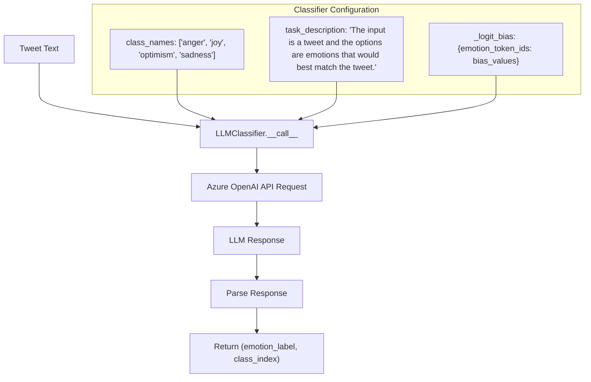
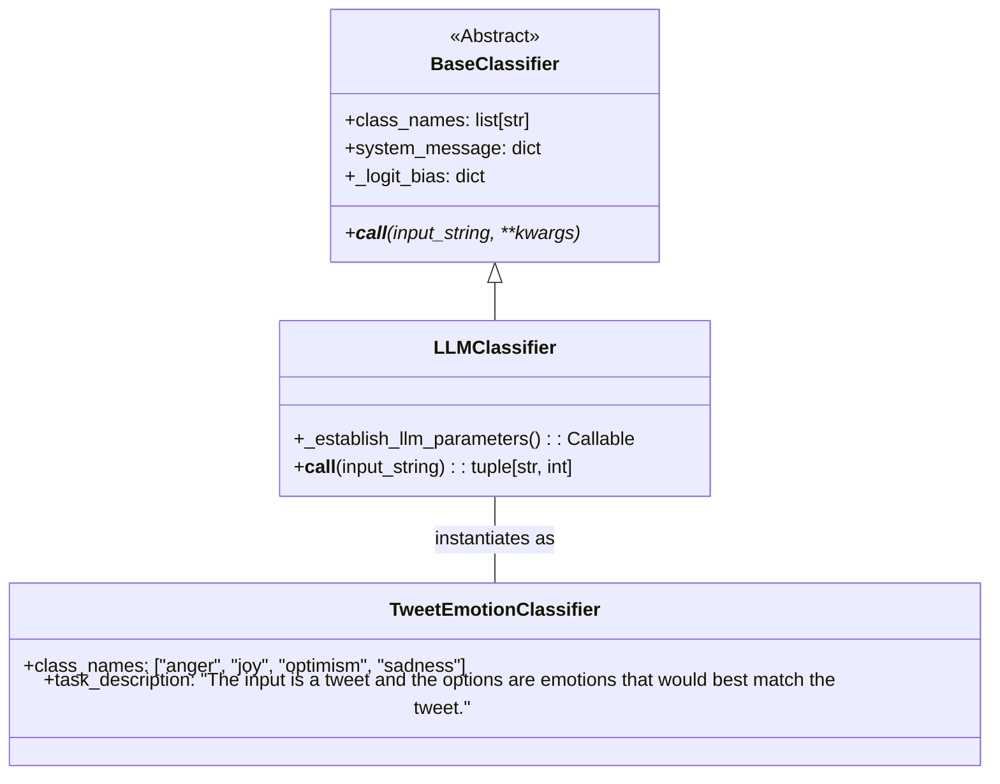
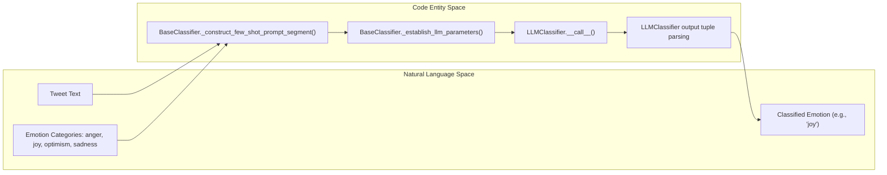
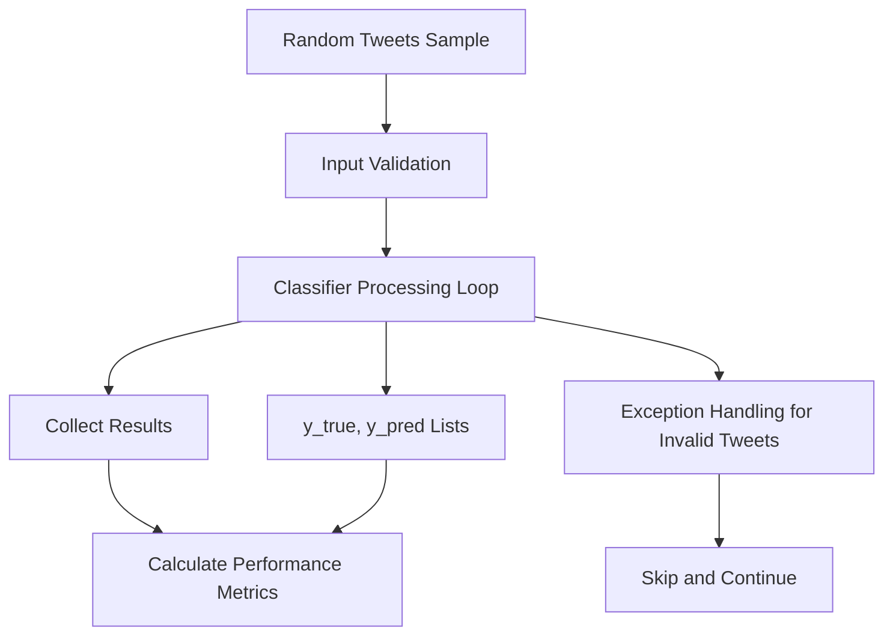

<!-- source: DeepWiki mcp.deepwiki.com · repo microsoft/classy-fire · page 4.2 Tweet Emotion Classification · fetched 2026-10-26 -->

# Tweet Emotion Classification

<details>
<summary>Relevant source files</summary>

The following files were used as context for generating this wiki page:

- [LICENSE](LICENSE)
- [README.md](README.md)
- [SUPPORT.md](SUPPORT.md)
- [evaluate.ipynb](evaluate.ipynb)

</details>


This page documents how to use the Classy-Fire library for classifying tweets by emotional content. The implementation showcases how to apply Classy-Fire's classification framework to analyze emotional sentiments in social media text, specifically tweets.

For general classification concepts, see [Classification Framework](#2). For understanding probabilistic classifications, see [MCMC Classifier](#2.3).

## Overview

Tweet emotion classification uses Classy-Fire's classifiers to categorize tweets into distinct emotional categories without requiring custom model training. As demonstrated in the evaluation notebook, this approach achieves competitive performance compared to specialized models.

## Implementation

The Classy-Fire framework can be used to classify tweets into emotional categories by configuring the `LLMClassifier` or `MCMCClassifier` with appropriate emotion class labels and task description. The implementation uses the tweet_eval dataset from Hugging Face for evaluation.

Diagram: Tweet Emotion Classification Architecture



Sources: [evaluate.ipynb:85-101]()

## Classifier Setup

The tweet emotion classifier is initialized with emotion classes and a task description to guide the language model:



Sources: [evaluate.ipynb:85-101]()

## Classification Process

The process of classifying a tweet involves several key steps that transform raw tweet text into an emotional classification:



Sources: [evaluate.ipynb:85-101](), [README.md:61-70]()

## Example Usage

The evaluation notebook demonstrates how to classify tweets for emotional content:

1. Initialize with emotion classes and task description
2. Call the classifier with tweet text
3. Receive a tuple containing the emotion label and its class index

Example classifications from the evaluation notebook:
- "That is the funniest thing I have ever heard!" → ('joy', 1)
- "I miss you!" → ('sadness', 3)

Sources: [evaluate.ipynb:120-142]()

For batch processing multiple tweets:



Sources: [evaluate.ipynb:180-191]()

## Performance Evaluation

The tweet emotion classifier has been evaluated on a sample from the tweet_eval dataset with the following results:

| Emotion   | Precision | Recall | F1-score | Support |
|-----------|-----------|--------|----------|---------|
| anger     | 0.97      | 0.81   | 0.88     | 42      |
| joy       | 0.74      | 0.92   | 0.82     | 25      |
| optimism  | 1.00      | 0.25   | 0.40     | 8       |
| sadness   | 0.75      | 1.00   | 0.86     | 21      |
|           |           |        |          |         |
| accuracy  |           |        | 0.83     | 96      |
| macro avg | 0.87      | 0.74   | 0.74     | 96      |
| weighted avg | 0.87   | 0.83   | 0.82     | 96      |

According to the evaluation documentation, these results are competitive with or exceed state-of-the-art approaches on the Hugging Face leaderboard for the tweet_eval emotion task.

Sources: [evaluate.ipynb:196-220](), [README.md:72-86]()

## Limitations and Considerations

The implementation has several limitations to be aware of:

1. **Content Restrictions**: Some tweets containing offensive language may be rejected by the underlying LLM, as demonstrated in the evaluation output:

   ```
   The following input failed: My mother-in-law, in a fit of #rage, referred to someone as a 'yo-yo'.\n#yoyo #motherinlaw #amirite #fitofrage
   The following input failed: 2Chainz my nigga 😊
   ```

2. **Class Imbalance**: Performance varies by emotion class, with 'optimism' showing high precision (1.00) but low recall (0.25) in testing.

3. **API Dependency**: Classification quality and performance depend on the specific Azure OpenAI model and deployment used.

Sources: [evaluate.ipynb:153-169]()

## Integration with Classy-Fire

The tweet emotion classification approach demonstrates how Classy-Fire's general-purpose classification framework can be applied to specific domains with minimal configuration. By leveraging the token biasing and prompt engineering capabilities of the base classifiers, we can achieve high-quality results for specialized classification tasks.

For more information on:
- Token biasing technique, see [Token Biasing](#3.2)
- Configuring prompts for classification, see [Prompt Engineering](#3.1)
- Using the probabilistic classifier for emotion distribution, see [MCMC Classifier](#2.3)

Sources: [README.md:61-70](), [evaluate.ipynb:85-101]()

---

