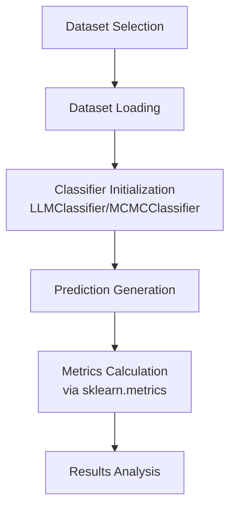
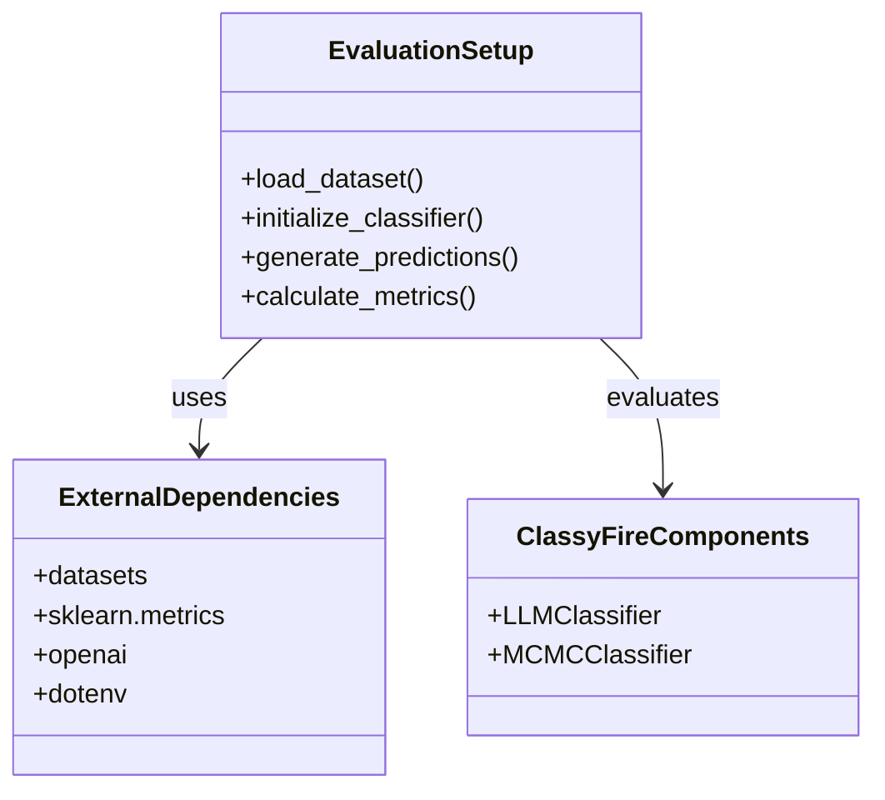
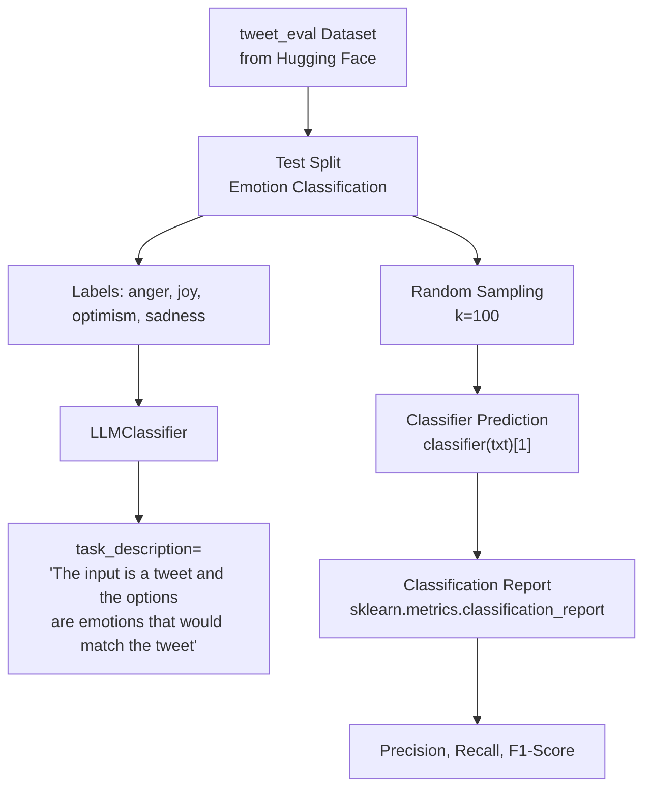
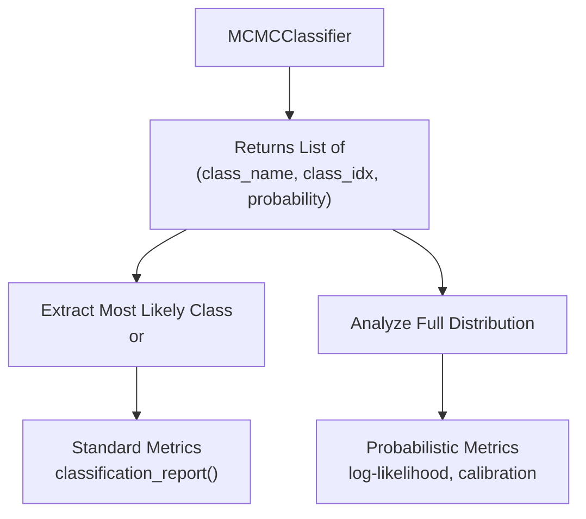

<!-- source: DeepWiki mcp.deepwiki.com · repo microsoft/classy-fire · page 5 Evaluation · fetched 2026-10-26 -->

# Evaluation

<details>
<summary>Relevant source files</summary>

The following files were used as context for generating this wiki page:

- [LICENSE](LICENSE)
- [README.md](README.md)
- [SUPPORT.md](SUPPORT.md)
- [evaluate.ipynb](evaluate.ipynb)

</details>


This document covers the methodology and implementation details for evaluating classifiers created with the Classy-Fire library. It explains how to measure classification performance, interpret evaluation results, and implement evaluation workflows for both `LLMClassifier` and `MCMCClassifier`.

## Evaluation Workflow

The evaluation process in Classy-Fire follows a standard machine learning assessment workflow, connecting the classification output to quantitative performance metrics.

### Evaluation Process Overview



Sources: [evaluate.ipynb:84-191](), [README.md:73-87]()

## Setting Up an Evaluation Environment

To evaluate Classy-Fire classifiers, you'll need to prepare the following components:

1. **Dataset**: A labeled dataset with text inputs and ground-truth class labels
2. **Classifier**: A properly configured `LLMClassifier` or `MCMCClassifier`
3. **Metrics**: Evaluation metrics from scikit-learn or similar library
4. **Environment Variables**: Azure OpenAI API credentials for the classifier

The standard evaluation setup follows this pattern:



Sources: [evaluate.ipynb:1-86]()

### Required Dependencies

To run evaluations, you'll need to install these packages:

```
pip install datasets scikit-learn openai python-dotenv
```

### Sample Evaluation Code Structure

The core evaluation workflow typically involves:

1. Loading environment variables and datasets
2. Initializing a classifier
3. Running predictions on test data
4. Calculating performance metrics

```python
# Step 1: Setup environment and load dataset
from datasets import load_dataset
from classy_fire import LLMClassifier
from sklearn.metrics import classification_report
from dotenv import load_dotenv
import random

load_dotenv()  # Load API credentials
dataset = load_dataset("dataset_name")  # Load labeled dataset
test_set = dataset["test"]  # Get test split

# Step 2: Initialize classifier
classifier = LLMClassifier(
    test_set.features["label"].names,
    task_description="Classification task description"
)

# Step 3: Generate predictions
y_true, y_pred = [], []
for sample in random.choices(test_set, k=100):  # Evaluate on 100 random samples
    text, true_label = sample["text"], sample["label"]
    pred_label = classifier(text)[1]  # Index 1 contains class index
    y_true.append(true_label)
    y_pred.append(pred_label)

# Step 4: Calculate metrics
print(classification_report(
    y_true, 
    y_pred, 
    target_names=test_set.features["label"].names
))
```

Sources: [evaluate.ipynb:85-220]()

## Case Study: Tweet Emotion Classification

The `evaluate.ipynb` notebook demonstrates evaluation on the Tweet Emotion Classification task, which serves as a reference implementation for Classy-Fire evaluation.

### Dataset and Classifier Configuration



Sources: [evaluate.ipynb:84-102](), [evaluate.ipynb:180-191]()

### Evaluation Implementation

The implementation involves:

1. Loading the "tweet_eval" dataset with "emotion" configuration
2. Creating an `LLMClassifier` with the dataset's label names
3. Sampling test data and generating predictions
4. Handling OpenAI API errors with try/except blocks
5. Calculating classification metrics using scikit-learn

```python
# Sample 100 tweets from test set with fixed random seed
random.seed(42)
for smpl in random.choices(ds, k=100):
    txt, y = smpl['text'], smpl['label']
    try:
        yhat = classifier(txt)[1]
    except InvalidRequestError:
        print(f'The following input failed: {txt}')
        continue
    y_true.append(y)
    y_pred.append(yhat)
```

Sources: [evaluate.ipynb:180-191]()

### Evaluation Results

The Tweet Emotion Classification evaluation yielded the following results:

| Class | Precision | Recall | F1-score | Support |
|-------|-----------|--------|----------|---------|
| anger | 0.97 | 0.81 | 0.88 | 42 |
| joy | 0.74 | 0.92 | 0.82 | 25 |
| optimism | 1.00 | 0.25 | 0.40 | 8 |
| sadness | 0.75 | 1.00 | 0.86 | 21 |
| | | | | |
| accuracy | | | 0.83 | 96 |
| macro avg | 0.87 | 0.74 | 0.74 | 96 |
| weighted avg | 0.87 | 0.83 | 0.82 | 96 |

According to the README, these results reportedly exceed state-of-the-art performance on this dataset according to the Hugging Face leaderboard.

Sources: [README.md:73-87](), [evaluate.ipynb:217-228]()

## Interpreting Evaluation Metrics

When analyzing Classy-Fire classifier performance, consider these evaluation metrics:

| Metric | Description | Interpretation |
|--------|-------------|----------------|
| Precision | True positives / (True positives + False positives) | How many of the predicted class instances are correct |
| Recall | True positives / (True positives + False negatives) | How many of the actual class instances were identified |
| F1-score | 2 × (Precision × Recall) / (Precision + Recall) | Harmonic mean of precision and recall |
| Support | Number of actual occurrences of the class | Dataset class distribution |
| Accuracy | (True positives + True negatives) / Total instances | Overall correctness across all classes |

### Key Performance Patterns

The Tweet Emotion Classification results reveal important patterns:

1. **High precision, lower recall** (e.g., optimism at 1.00/0.25): The classifier is conservative in assigning this class, but accurate when it does
2. **Lower precision, high recall** (e.g., sadness at 0.75/1.00): The classifier identifies most instances of this class but may overpredict it
3. **Balanced precision/recall** (e.g., anger at 0.97/0.81): The classifier performs well overall on this class

Sources: [evaluate.ipynb:217-220]()

## Evaluating MCMCClassifier

For evaluating `MCMCClassifier`, which returns probability distributions instead of single predictions, you need to adapt the standard evaluation process:



Sources: [README.md:30-33](), [README.md:70]()

### Sample MCMCClassifier Evaluation Code

```python
from classy_fire import MCMCClassifier

mcmc_classifier = MCMCClassifier(
    test_set.features["label"].names,
    task_description="Classification task description"
)

# For deterministic evaluation (using most likely class)
y_true, y_pred = [], []
for sample in test_samples:
    distribution = mcmc_classifier(sample["text"])
    # Sort by probability (descending) and take the highest
    top_class = sorted(distribution, key=lambda x: x[2], reverse=True)[0]
    y_true.append(sample["label"])
    y_pred.append(top_class[1])  # Class index

# For probabilistic evaluation
y_true, y_distributions = [], []
for sample in test_samples:
    distribution = mcmc_classifier(sample["text"])
    y_true.append(sample["label"])
    y_distributions.append(distribution)
```

Sources: [README.md:30-33]()

## Best Practices for Evaluation

When evaluating Classy-Fire classifiers, consider these recommended practices:

1. **Use a representative dataset** that matches your target application domain
2. **Set a random seed** for reproducibility when sampling test data
3. **Handle API errors** that may occur with problematic inputs
4. **Compare task descriptions and few-shot examples** to optimize performance
5. **Examine failed classifications** to identify patterns and improve prompts
6. **Report both overall and per-class metrics** for comprehensive evaluation
7. **Consider using MCMCClassifier** when uncertainty quantification is important

Sources: [evaluate.ipynb:84-191](), [README.md:88-91]()

## Extending Evaluation

You can extend the standard evaluation process in several ways:

1. **Cross-validation**: Split your dataset into multiple folds for more robust evaluation
2. **Custom metrics**: Implement domain-specific metrics beyond standard classification metrics
3. **Confusion matrix analysis**: Identify specific class confusions using `sklearn.metrics.confusion_matrix`
4. **Few-shot example tuning**: Evaluate the impact of different few-shot examples on performance
5. **Task description variations**: Compare different task descriptions to optimize classifier behavior
6. **Benchmark against other methods**: Compare performance against other classification approaches

Sources: [README.md:88-91]()

## Conclusion

Proper evaluation is essential for understanding and improving Classy-Fire classifier performance. By following the methodology outlined in this document, you can reliably assess classification quality, identify areas for improvement, and optimize your classifiers for specific applications.

---

