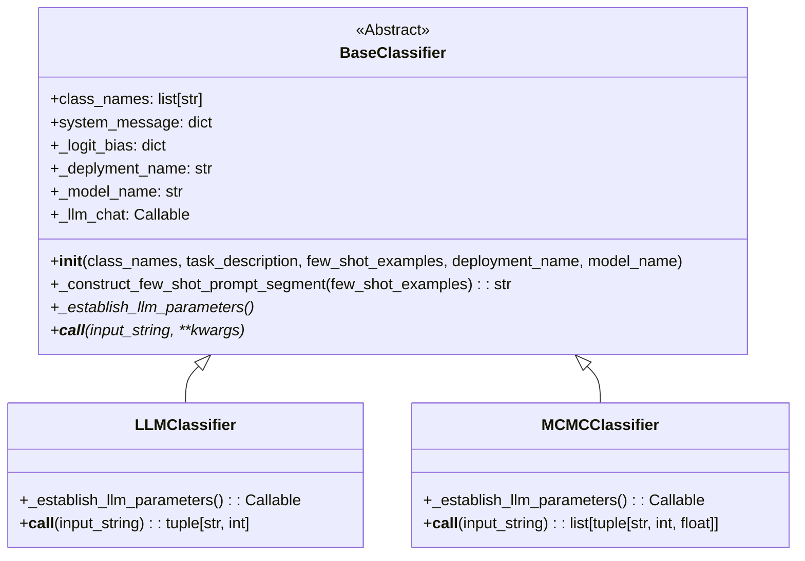
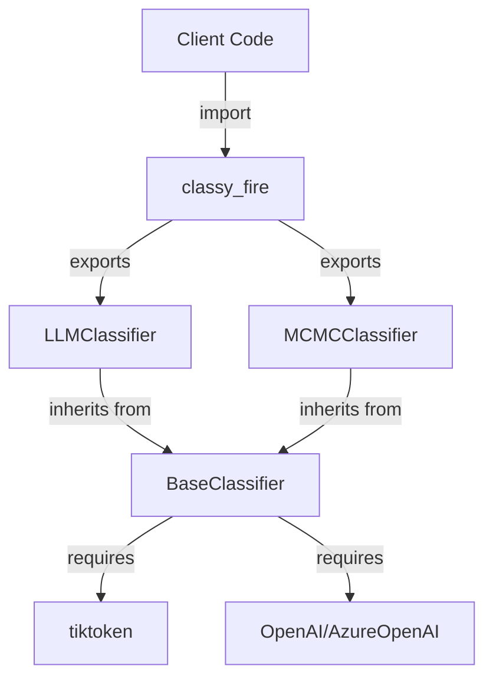
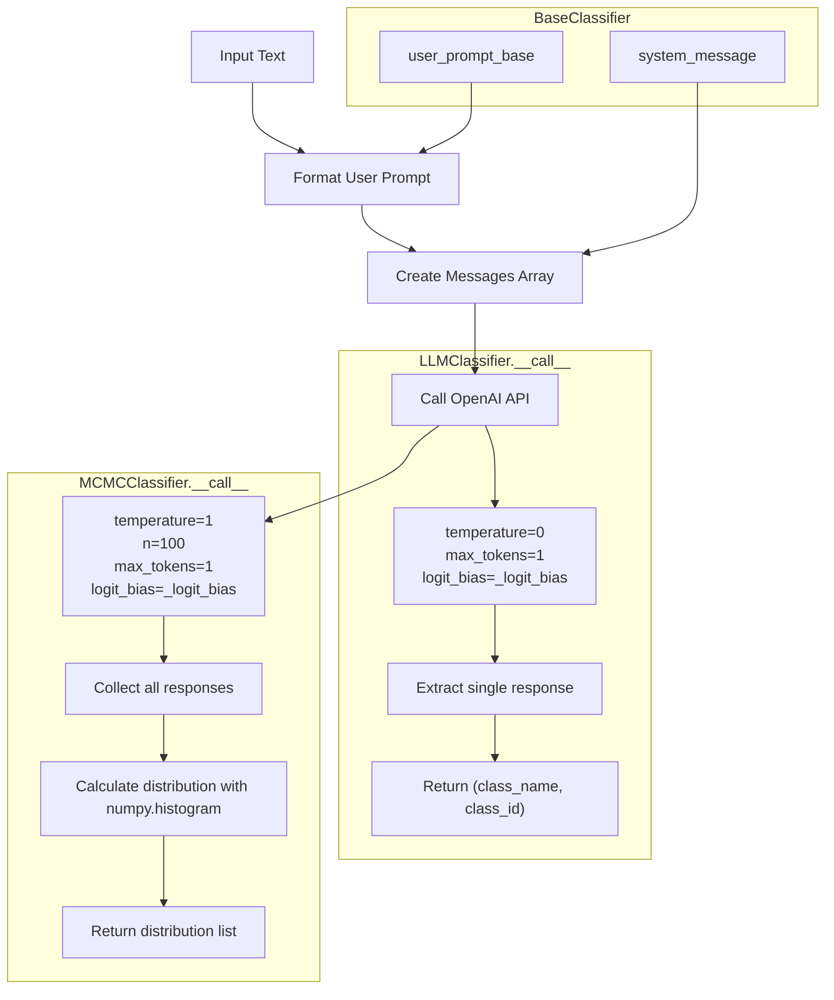
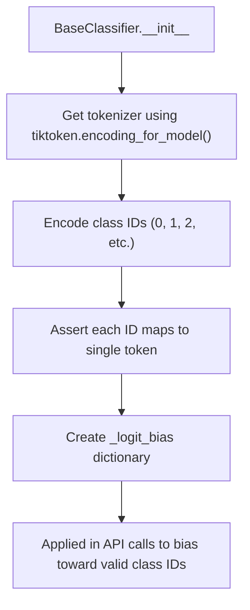

<!-- source: DeepWiki mcp.deepwiki.com · repo microsoft/classy-fire · page 6 API Reference · fetched 2026-10-26 -->

# API Reference

<details>
<summary>Relevant source files</summary>

The following files were used as context for generating this wiki page:

- [classy_fire/__init__.py](classy_fire/__init__.py)
- [classy_fire/base_classifier.py](classy_fire/base_classifier.py)
- [classy_fire/llm_classifier.py](classy_fire/llm_classifier.py)
- [classy_fire/mcmc_classifier.py](classy_fire/mcmc_classifier.py)

</details>


This document provides a comprehensive technical reference for all public classes and methods in the classy-fire library. It is intended for developers who need detailed information about the library's APIs and their usage patterns. For usage examples, see [Usage Examples](#4). For installation and setup information, see [Installation](#1.1).

## Class Hierarchy



Sources: [classy_fire/base_classifier.py:10-95](), [classy_fire/llm_classifier.py:8-48](), [classy_fire/mcmc_classifier.py:7-49]()

## Module Structure



Sources: [classy_fire/__init__.py:1-2]()

## BaseClassifier

`BaseClassifier` is an abstract base class that provides the foundation for all classifiers in the library. It cannot be instantiated directly.

### Constructor

```python
def __init__(
    self,
    class_names: list[str],
    task_description: str = "",
    few_shot_examples: str = "",
    deployment_name: str = "gpt-35-turbo-0301",
    model_name: str = "gpt-3.5-turbo",
) -> None
```

**Parameters:**
- `class_names`: List of class names to classify into
- `task_description`: Description of the task (context provided to the LLM)
- `few_shot_examples`: Examples demonstrating classification (optional)
- `deployment_name`: Azure OpenAI deployment name
- `model_name`: Model name for tokenization

The constructor initializes the classifier with the specified classes and configures token biasing to improve classification accuracy.

Sources: [classy_fire/base_classifier.py:34-80]()

### Class Attributes

| Attribute | Type | Description |
|-----------|------|-------------|
| `MAX_TOKEN_PRIOR` | `int` | Token bias value (10) |
| `system_prompt_base` | `str` | Template for system prompt |
| `user_prompt_base` | `str` | Template for user prompt |

Sources: [classy_fire/base_classifier.py:23-32]()

### Methods

#### `_construct_few_shot_prompt_segment`

```python
@staticmethod
def _construct_few_shot_prompt_segment(few_shot_examples: str) -> str
```

Formats few-shot examples for inclusion in the prompt.

**Returns:** Formatted few-shot examples string.

Sources: [classy_fire/base_classifier.py:82-87]()

#### `_establish_llm_parameters`

```python
@abstractmethod
def _establish_llm_parameters(self) -> Callable[[list[Dict[str, str]]], Any]
```

Abstract method that subclasses must implement to configure LLM parameters.

**Returns:** Callable function that communicates with the OpenAI API.

Sources: [classy_fire/base_classifier.py:89-91]()

#### `__call__`

```python
@abstractmethod
def __call__(self, input_string: str, **kwargs) -> Any
```

Abstract method that subclasses must implement to perform classification.

**Parameters:**
- `input_string`: Text to classify
- `**kwargs`: Additional arguments for classification

Sources: [classy_fire/base_classifier.py:93-95]()

## LLMClassifier

`LLMClassifier` provides deterministic classification, returning a single predicted class for each input.

### Constructor

Inherits constructor from `BaseClassifier`.

### Methods

#### `_establish_llm_parameters`

```python
def _establish_llm_parameters(self) -> Callable[[list[Dict[str, str]]], Any]
```

Configures the LLM with deterministic parameters (temperature=0).

**Returns:** Function that calls the OpenAI API with deterministic settings.

Sources: [classy_fire/llm_classifier.py:21-30]()

#### `__call__`

```python
def __call__(self, input_string: str, **kwargs) -> tuple[str, int]
```

Classifies the input string.

**Parameters:**
- `input_string`: Text to classify
- `**kwargs`: Additional arguments (unused)

**Returns:** Tuple containing:
- Class name (string)
- Class ID (integer)

Sources: [classy_fire/llm_classifier.py:32-48]()

## MCMCClassifier

`MCMCClassifier` provides probabilistic classification using a Monte Carlo approach, returning a probability distribution across all classes.

### Constructor

Inherits constructor from `BaseClassifier`.

### Methods

#### `_establish_llm_parameters`

```python
def _establish_llm_parameters(self) -> Callable[[list[Dict[str, str]]], Any]
```

Configures the LLM for stochastic sampling (temperature=1, n=100).

**Returns:** Function that calls the OpenAI API with stochastic settings.

Sources: [classy_fire/mcmc_classifier.py:20-30]()

#### `__call__`

```python
def __call__(self, input_string: str, **kwargs) -> list[tuple[str, int, float]]
```

Classifies the input string and estimates probability distribution.

**Parameters:**
- `input_string`: Text to classify
- `**kwargs`: Additional arguments (unused)

**Returns:** List of tuples, each containing:
- Class name (string)
- Class ID (integer)
- Probability (float)

Sources: [classy_fire/mcmc_classifier.py:32-49]()

## Classification Process



Sources: [classy_fire/llm_classifier.py:32-48](), [classy_fire/mcmc_classifier.py:32-49]()

## Token Biasing Mechanism



Sources: [classy_fire/base_classifier.py:50-71]()

## Common Usage Patterns

### Basic Classification

```python
from classy_fire import LLMClassifier

# Define classes
class_names = ["Positive", "Negative", "Neutral"]

# Create classifier
classifier = LLMClassifier(
    class_names=class_names,
    task_description="Classify sentiment in text",
    few_shot_examples="Input: I love this product!\nResponse: 0\nInput: This is terrible\nResponse: 1"
)

# Classify text
class_name, class_id = classifier("The product works as expected")
print(f"Class: {class_name}, ID: {class_id}")
```

### Probabilistic Classification

```python
from classy_fire import MCMCClassifier

# Define classes
class_names = ["Positive", "Negative", "Neutral"]

# Create classifier
classifier = MCMCClassifier(
    class_names=class_names,
    task_description="Classify sentiment in text"
)

# Classify text with probabilities
results = classifier("The product works as expected")
for class_name, class_id, probability in results:
    print(f"Class: {class_name}, ID: {class_id}, Probability: {probability:.2f}")
```

## Environment Variables

The following environment variables are required:

| Variable | Description | Required For |
|----------|-------------|-------------|
| `OPENAI_API_TYPE` | Set to "azure" or "openai" | All classifiers |
| `OPENAI_API_KEY` | API key for authentication | All classifiers |
| `OPENAI_API_VERSION` | API version | Azure OpenAI only |
| `OPENAI_API_BASE` | API endpoint URL | Azure OpenAI only |

Sources: [classy_fire/base_classifier.py:75-80]()

## Return Type Reference

| Classifier | Method | Return Type | Description |
|------------|--------|-------------|-------------|
| `LLMClassifier` | `__call__` | `tuple[str, int]` | (class_name, class_id) |
| `MCMCClassifier` | `__call__` | `list[tuple[str, int, float]]` | List of (class_name, class_id, probability) |

Sources: [classy_fire/llm_classifier.py:32-48](), [classy_fire/mcmc_classifier.py:32-49]()

## Notes and Limitations

1. There is a typo in the BaseClassifier code: `self._deplyment_name` should be `self._deployment_name`, but this is kept as-is for consistency with the codebase.

2. The maximum number of classes is limited by the number of tokens that can be represented by single tokens in the model's tokenizer, as token biasing requires each class ID to map to a single token.

3. For MCMCClassifier, the number of samples (n=100) is hardcoded and cannot be configured through the public API.

4. The library currently only supports OpenAI and Azure OpenAI API providers.

---

