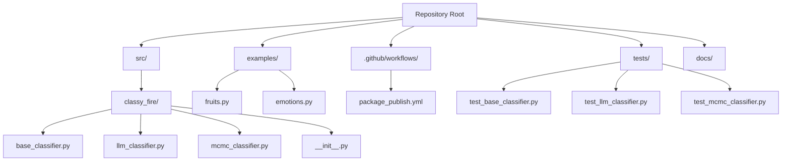
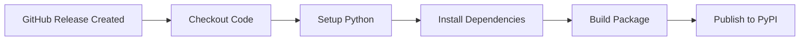
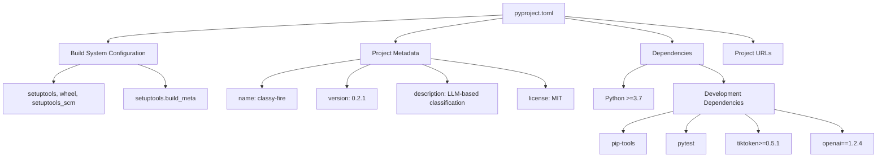
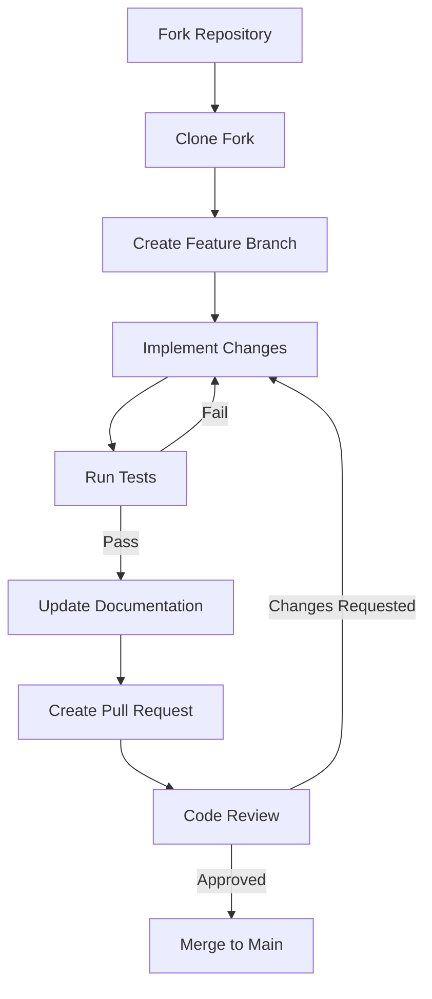

<!-- source: DeepWiki mcp.deepwiki.com · repo microsoft/classy-fire · page 7 Development · fetched 2026-10-26 -->

# Development

<details>
<summary>Relevant source files</summary>

The following files were used as context for generating this wiki page:

- [.github/workflows/package_publish.yml](.github/workflows/package_publish.yml)
- [CONTRIBUTING.md](CONTRIBUTING.md)
- [pyproject.toml](pyproject.toml)

</details>


This page provides essential information for developers who want to contribute to the classy-fire project. It covers the project structure, development environment setup, build processes, and contribution guidelines. For information about using the library in your own projects, see [Overview](#1) and [Quick Start](#1.2).

## Project Structure

The classy-fire repository is organized as follows:



The project follows a standard Python package structure with the main implementation in the `src/classy_fire` directory. The core components of the library are:

- **Base Classifier**: Abstract base class defining the classifier interface
- **LLM Classifier**: Deterministic classifier implementation
- **MCMC Classifier**: Probabilistic classifier implementation using Markov Chain Monte Carlo

Examples demonstrating the library usage are stored in the `examples/` directory, while tests reside in the `tests/` directory.

Sources: [pyproject.toml:5-27]()

## Development Environment Setup

To set up your development environment for classy-fire, follow these steps:

1. Clone the repository:
   ```bash
   git clone https://github.com/microsoft/classy-fire.git
   cd classy-fire
   ```

2. Create and activate a virtual environment:
   ```bash
   python -m venv venv
   source venv/bin/activate  # On Windows: venv\Scripts\activate
   ```

3. Install development dependencies:
   ```bash
   pip install -e ".[dev]"
   ```

The development dependencies include:

| Dependency | Purpose |
|------------|---------|
| pip-tools  | Dependency management |
| pytest     | Testing framework |
| tiktoken   | Token counting for OpenAI models |
| openai     | OpenAI API client |

Sources: [pyproject.toml:23-24]()

## Building and Testing

### Building the Package Locally

To build the package locally for testing:

```bash
pip install build
python -m build
```

This will create distribution packages in the `dist/` directory.

### Running Tests

To run the test suite:

```bash
pytest
```

For development, you'll need to configure Azure OpenAI credentials in your environment variables or in a `.env` file at the repository root.

Sources: [pyproject.toml:23-24]()

## Building and Publishing Process

The classy-fire package is automatically built and published to PyPI when a new release is created on GitHub. This process is managed by a GitHub Actions workflow.



The workflow performs the following steps:
1. Triggered when a new release is published on GitHub
2. Checks out the repository code
3. Sets up Python environment
4. Installs build dependencies
5. Builds the package using `python -m build`
6. Publishes the package to PyPI using the PyPI API token

To create a new release:
1. Update the version number in `pyproject.toml`
2. Create and push a new tag
3. Create a new release on GitHub based on that tag

Sources: [.github/workflows/package_publish.yml:1-36](), [pyproject.toml:7]()

## Package Configuration

The package metadata and dependencies are defined in the `pyproject.toml` file:



The package uses:
- **Build system**: setuptools with wheel support
- **Python requirement**: Python 3.7 or higher
- **Optional dependencies**: Development tools listed under the `dev` extra

Sources: [pyproject.toml:1-27]()

## Contributing Guidelines

When contributing to the classy-fire project, please follow these guidelines:

1. **Contributor License Agreement (CLA)**: Contributors must sign a Microsoft Contributor License Agreement. When you submit a pull request, a CLA-bot will automatically determine if you need to provide a CLA.

2. **Code of Conduct**: This project has adopted the Microsoft Open Source Code of Conduct. All contributors are expected to adhere to this code of conduct.

3. **Pull Request Process**:
   - Fork the repository
   - Create a new branch for your feature or bug fix
   - Make your changes and ensure tests pass
   - Submit a pull request to the main repository

4. **Development Best Practices**:
   - Follow the existing code style
   - Add tests for new functionality
   - Update documentation to reflect changes
   - Keep pull requests focused on a single concern

For questions or assistance, contact the project maintainers or open an issue on GitHub.

Sources: [CONTRIBUTING.md:1-14]()

## Development Workflow

The typical development workflow for contributing to classy-fire is as follows:



This workflow ensures that all contributions are properly tested, documented, and reviewed before being merged into the main codebase.

Sources: [CONTRIBUTING.md:1-14]()

---

