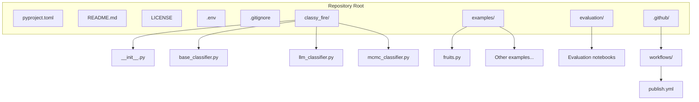
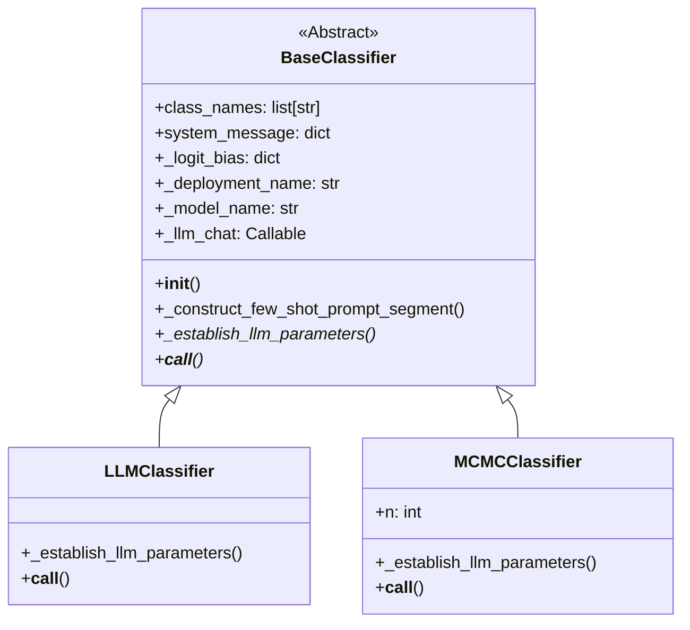
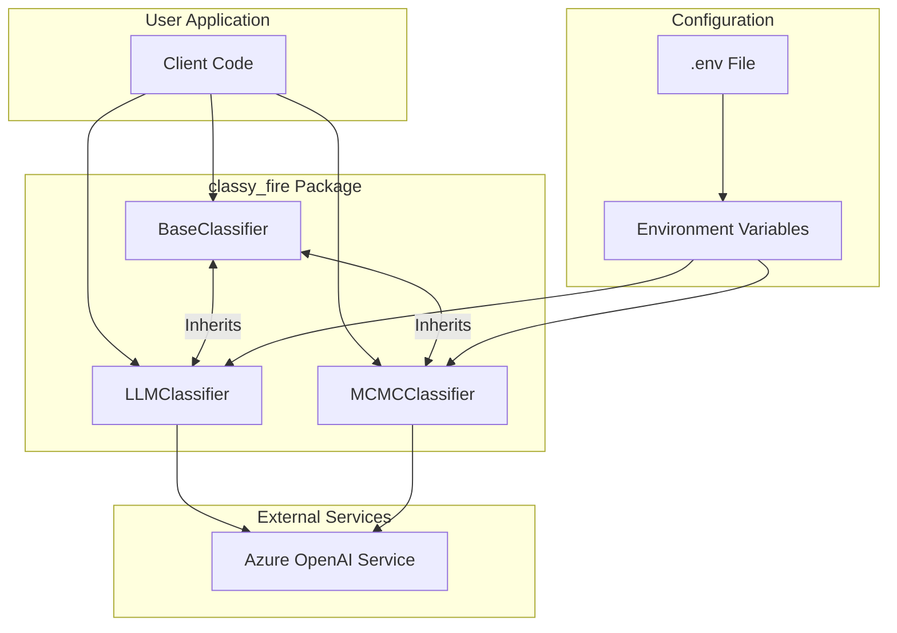
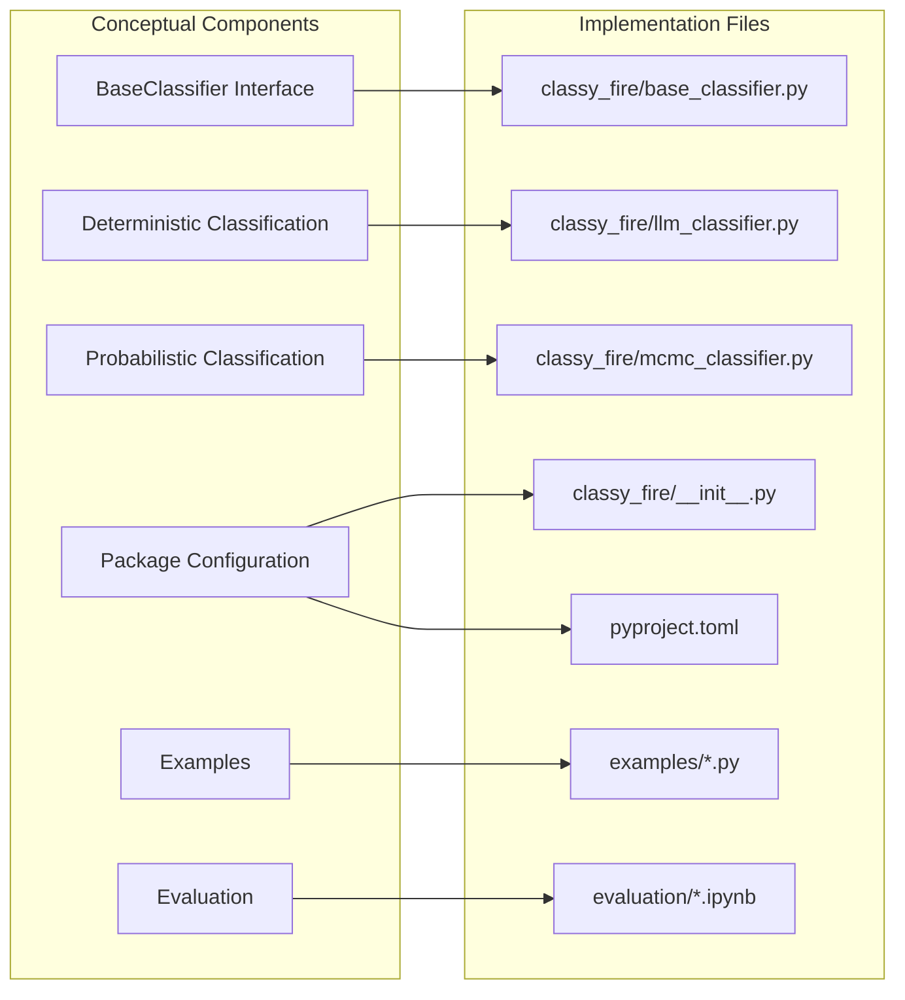
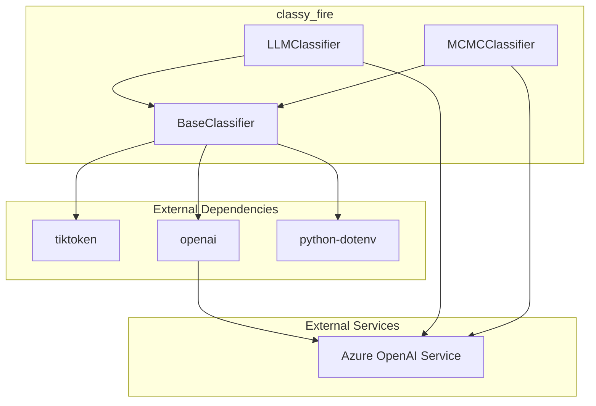

<!-- source: DeepWiki mcp.deepwiki.com · repo microsoft/classy-fire · page 7.1 Project Structure · fetched 2026-10-26 -->

# Project Structure

Relevant source files

The following files were used as context for generating this wiki page:

- [.gitignore](.gitignore)
- [pyproject.toml](pyproject.toml)

This document provides a comprehensive overview of the classy-fire repository's organization, components, and their relationships. It explains the codebase structure to help developers understand how the different parts of the system fit together. For information about building and publishing the package, see [Building and Publishing](#7.2), and for contribution guidelines, see [Contributing Guidelines](#7.3).

## Repository Organization

The classy-fire repository follows a standard Python package structure with a clear separation between source code, examples, configuration, and development tools.

Sources: [.gitignore](), [pyproject.toml]()

## Package Structure

The core functionality of classy-fire is implemented in the `classy_fire` package, which contains several Python modules. The package follows a clean, hierarchical design with clear separation of concerns.

Sources: [.gitignore:3-6]()

### Key Modules

1. **__init__.py**: Package initialization and exported interface
2. **base_classifier.py**: Contains the `BaseClassifier` abstract class that defines the common interface and functionality for all classifiers
3. **llm_classifier.py**: Implements the `LLMClassifier` for deterministic classification
4. **mcmc_classifier.py**: Implements the `MCMCClassifier` for probabilistic classification using Markov Chain Monte Carlo sampling

## Configuration and Dependencies

The project's configuration and dependencies are defined in the `pyproject.toml` file, which follows modern Python packaging standards. The file specifies build requirements, project metadata, dependencies, and package information.

### Key Configuration Details

| Configuration | Description |
|---------------|-------------|
| Package Name | classy-fire |
| Version | 0.2.1 |
| Python Required | >=3.7 |
| Primary Dependencies | None (direct dependencies are kept minimal) |
| Development Dependencies | pip-tools, pytest, tiktoken, openai |
| Homepage | https://github.com/microsoft/classy-fire |

Sources: [pyproject.toml:1-27]()

## Component Relationships

The following diagram illustrates how the different components of the system interact with each other, from the user application to the external Azure OpenAI service.

Sources: [.gitignore:1](), [pyproject.toml:18-20]()

## Development Environment

The repository includes configuration files for development environment setup and continuous integration/continuous deployment (CI/CD) workflows.

### Key Development Files

1. **.gitignore**: Specifies files and directories to be ignored by Git, including environment files, Python cache files, and other temporary files
2. **.env**: Local environment variables file for development (not tracked in Git)
3. **.github/workflows**: Contains GitHub Actions workflow definitions for automated processes such as package publishing

## Code to File Mapping

The following diagram maps conceptual components to specific files in the repository, providing a clear link between the codebase architecture and implementation files.

Sources: [.gitignore:2-7](), [pyproject.toml:5-21]()

## Repository File Structure Summary

| Directory/File | Purpose |
|----------------|---------|
| `classy_fire/` | Core package containing the implementation of all classifiers |
| `examples/` | Example applications demonstrating usage of the library |
| `evaluation/` | Notebooks and scripts for evaluating classifier performance |
| `.github/` | GitHub-specific configurations, including CI/CD workflows |
| `pyproject.toml` | Python package configuration and metadata |
| `README.md` | Project overview, installation instructions, and basic usage examples |
| `LICENSE` | Project license (MIT) |
| `.env` | Local environment variables (not tracked in Git) |
| `.gitignore` | Git ignore configuration |

Sources: [.gitignore](), [pyproject.toml:5-27]()

## Project Dependencies Flow

The following diagram illustrates the dependency relationships between the main components of the classy-fire project and external libraries/services.

Sources: [pyproject.toml:18-24]()

This project structure follows a clean, modular design that separates abstract interfaces from concrete implementations, making it easy to understand, maintain, and extend the codebase. The hierarchical classifier design provides a consistent interface while allowing for different classification strategies.

---

