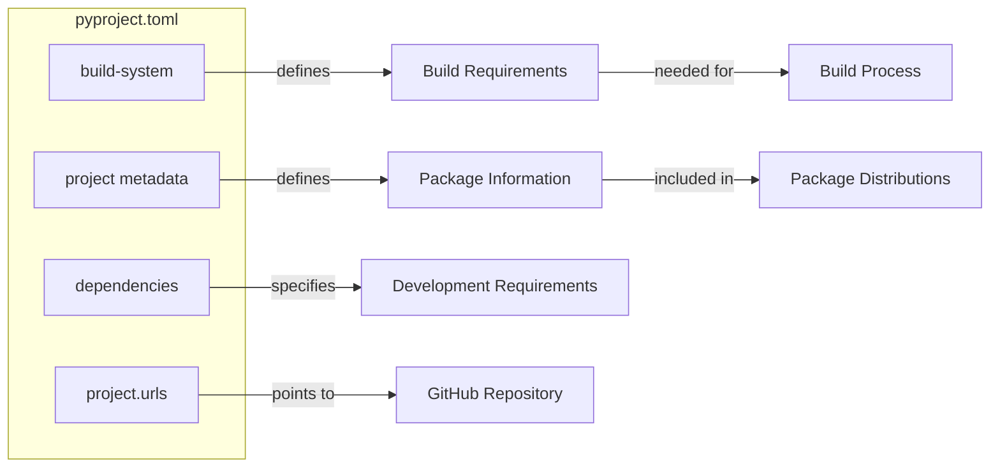
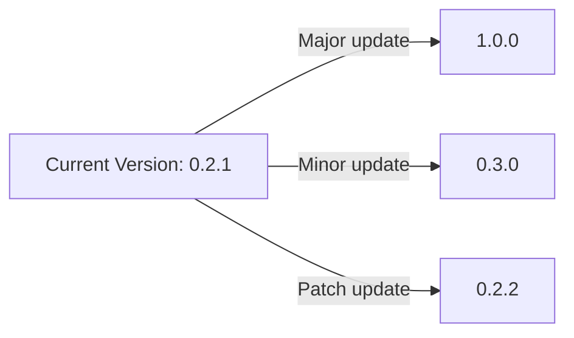
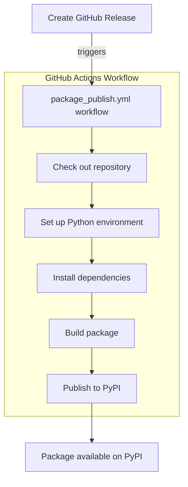
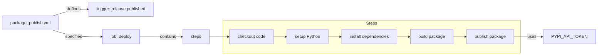
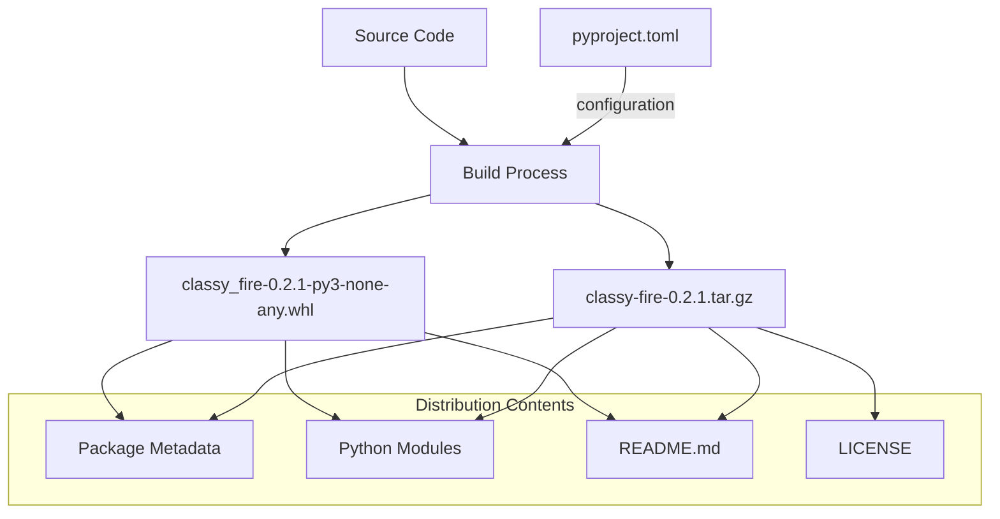

<!-- source: DeepWiki mcp.deepwiki.com · repo microsoft/classy-fire · page 7.2 Building and Publishing · fetched 2026-10-26 -->

# Building and Publishing

<details>
<summary>Relevant source files</summary>

The following files were used as context for generating this wiki page:

- [.github/workflows/package_publish.yml](.github/workflows/package_publish.yml)
- [pyproject.toml](pyproject.toml)

</details>


This document explains how to build the Classy-Fire package from source and publish it to the Python Package Index (PyPI). It is primarily intended for maintainers and contributors who need to create new releases of the package. For information about the general project structure, see [Project Structure](#7.1), and for contribution guidelines, refer to [Contributing Guidelines](#7.3).

## Package Configuration

The Classy-Fire package is configured using the `pyproject.toml` file, which follows PEP 621 standards for Python package metadata.



The configuration includes:

| Component | Description | File Location |
|-----------|-------------|--------------|
| Build system | Specifies build tools (setuptools, wheel) | [pyproject.toml:1-3]() |
| Package metadata | Name, version, description, authors | [pyproject.toml:5-17]() |
| Python requirements | Minimum Python version (3.7+) | [pyproject.toml:21]() |
| Development dependencies | Testing and development tools | [pyproject.toml:23-24]() |
| Project URLs | Repository homepage | [pyproject.toml:26-27]() |

Sources: [pyproject.toml:1-28]()

## Version Management

The package version is explicitly defined in the `pyproject.toml` file and must be updated manually before creating a new release:



Sources: [pyproject.toml:7]()

## Building Locally

To build the package locally for testing:

1. Install build dependencies:
   ```bash
   pip install build setuptools wheel
   ```

2. Run the build command from the repository root:
   ```bash
   python -m build
   ```

3. This creates distribution packages in the `dist/` directory:
   - Source distribution (`.tar.gz`)
   - Wheel distribution (`.whl`)

Sources: [pyproject.toml:2](), [.github/workflows/package_publish.yml:30-31]()

## Automated Publishing Workflow

Classy-Fire uses GitHub Actions to automate the publishing process when a new release is created on GitHub.

### Publishing Flow



Sources: [.github/workflows/package_publish.yml:1-36]()

### Workflow Configuration

The GitHub Actions workflow is defined in `.github/workflows/package_publish.yml` and includes:

- **Trigger**: Executes when a release is published on GitHub
- **Environment**: Uses Ubuntu with Python 3.x
- **Authentication**: Uses a PyPI API token stored as a GitHub secret
- **Build**: Uses the Python `build` package to create distributions
- **Publish**: Uses the official PyPA action to upload to PyPI



Sources: [.github/workflows/package_publish.yml:6-36]()

## Complete Release Process

To release a new version of Classy-Fire:

1. Update the version number in `pyproject.toml`
2. Commit and push your changes to the repository
3. Create a new GitHub release with appropriate tags
4. The GitHub Actions workflow will automatically:
   - Build the package distributions
   - Publish them to PyPI

### Release Example

| Step | Action | Details |
|------|--------|---------|
| 1 | Update version | Change version in `pyproject.toml` from "0.2.1" to "0.2.2" |
| 2 | Commit changes | `git commit -am "Bump version to 0.2.2"` |
| 3 | Create release | Use GitHub UI to create new release with tag "v0.2.2" |
| 4 | Automated publish | GitHub Actions workflow publishes to PyPI |

Sources: [pyproject.toml:7](), [.github/workflows/package_publish.yml:6-8]()

## Build Artifacts

The build process creates two types of distribution packages:



Sources: [pyproject.toml:1-28](), [.github/workflows/package_publish.yml:30-31]()

## Troubleshooting

### Common Publishing Issues

| Issue | Possible Cause | Solution |
|-------|---------------|----------|
| Version conflict | Version already exists on PyPI | Update version in `pyproject.toml` |
| Authentication failure | Invalid or expired PyPI token | Update the `PYPI_API_TOKEN` secret in GitHub repository settings |
| Build failure | Missing dependencies | Check the build log and ensure all requirements are installed |

Sources: [.github/workflows/package_publish.yml:32-36](), [pyproject.toml:7]()

---

