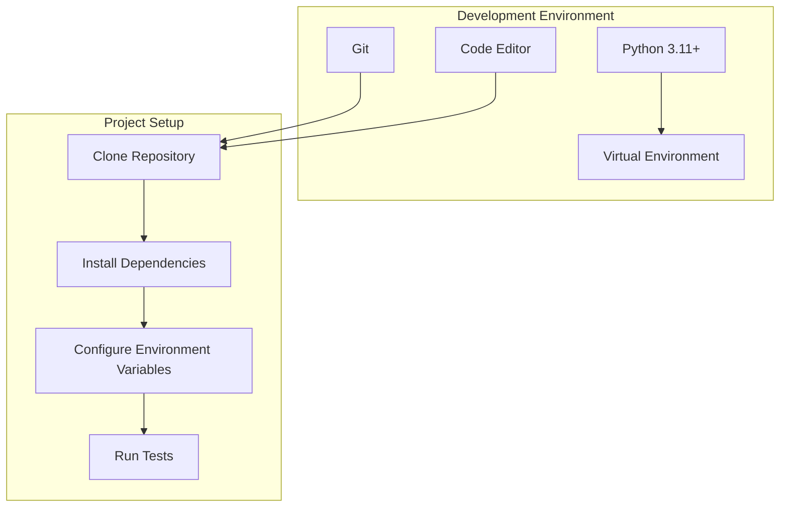
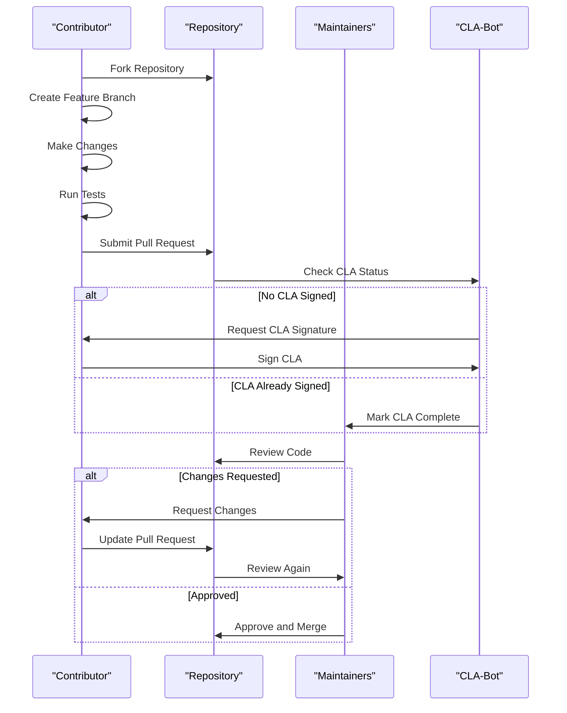
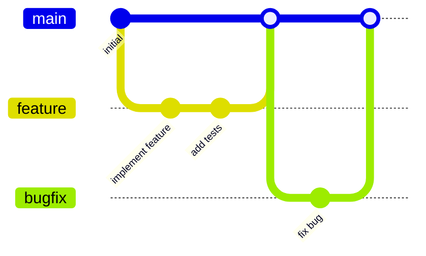
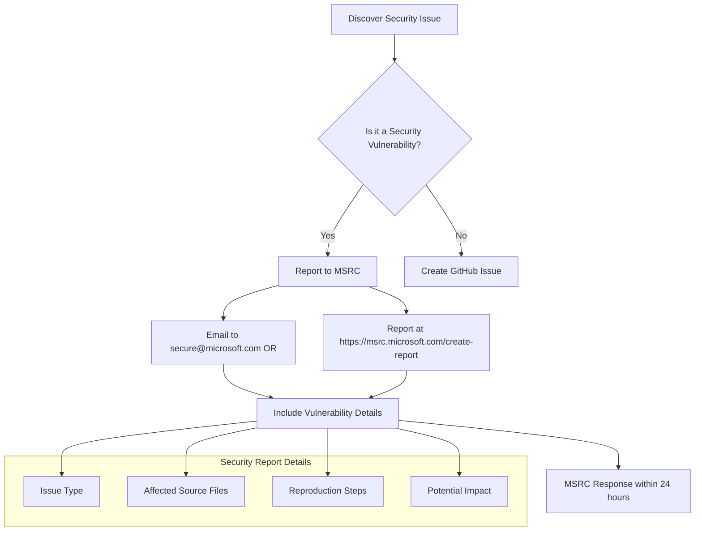

<!-- source: DeepWiki mcp.deepwiki.com · repo microsoft/classy-fire · page 7.3 Contributing Guidelines · fetched 2026-10-26 -->

# Contributing Guidelines

<details>
<summary>Relevant source files</summary>

The following files were used as context for generating this wiki page:

- [CODE_OF_CONDUCT.md](CODE_OF_CONDUCT.md)
- [CONTRIBUTING.md](CONTRIBUTING.md)
- [SECURITY.md](SECURITY.md)

</details>


This document outlines the guidelines and processes for contributing to the classy-fire project. It covers how to submit contributions, coding standards, and the workflow for getting your changes integrated into the repository. For information about the project structure, see [Project Structure](#7.1), and for details on building and publishing, see [Building and Publishing](#7.2).

## Table of Contents

- [Code of Conduct](#code-of-conduct)
- [Getting Started](#getting-started)
- [Contribution Process](#contribution-process)
- [Development Workflow](#development-workflow)
- [Contributor License Agreement](#contributor-license-agreement)
- [Security Guidelines](#security-guidelines)

## Code of Conduct

The classy-fire project has adopted the Microsoft Open Source Code of Conduct. All contributors are expected to adhere to this code of conduct in all interactions related to the project.

Sources: [CODE_OF_CONDUCT.md:1-9]()

## Getting Started

Before contributing to classy-fire, you should set up your development environment and familiarize yourself with the project structure.

### Development Environment Setup

The following diagram illustrates the components needed for a working development environment:



1. **Clone the repository**: 
   ```bash
   git clone https://github.com/microsoft/classy-fire.git
   cd classy-fire
   ```

2. **Create and activate a virtual environment**:
   ```bash
   python -m venv venv
   source venv/bin/activate  # On Windows: venv\Scripts\activate
   ```

3. **Install dependencies**:
   ```bash
   pip install -e ".[dev]"
   ```

4. **Configure environment variables**:
   Create a `.env` file with your Azure OpenAI API credentials.

Sources: [CONTRIBUTING.md:1-14]()

## Contribution Process

The following diagram illustrates the standard contribution workflow for the classy-fire project:



### Finding Issues to Work On

1. Check the GitHub issues tab for tasks labeled "good first issue" or "help wanted"
2. Comment on an issue you'd like to work on to indicate your interest
3. Discuss your approach with maintainers if needed

### Making Changes

1. Create a new branch from `main` with a descriptive name
2. Make focused changes addressing a specific issue or feature
3. Follow the project's coding style and conventions
4. Include appropriate tests for your changes
5. Update documentation as needed

### Submitting Pull Requests

1. Push your changes to your fork
2. Create a pull request against the `main` branch
3. Provide a clear description of the changes and reference any related issues
4. Respond to feedback from code reviews

Sources: [CONTRIBUTING.md:3-10]()

## Development Workflow

The following diagram illustrates the development workflow and branching strategy:



### Coding Standards

When contributing code to classy-fire, please adhere to the following standards:

| Category | Guidelines |
|----------|------------|
| Python Version | Python 3.11+ |
| Style Guide | Follow PEP 8 |
| Docstrings | Use Google-style docstrings |
| Imports | Group imports: standard library, third-party, local |
| Testing | Write unit tests for new functionality |
| Type Hints | Use type hints for all function signatures |

### Testing

Before submitting a pull request, ensure all tests pass:

```bash
pytest
```

Consider adding new tests for any features or bug fixes you implement.

## Contributor License Agreement

This project uses a Contributor License Agreement (CLA) to ensure that contributions can be legally accepted. When you submit a pull request, a CLA-bot will automatically determine whether you need to sign the CLA and will guide you through the process if necessary.

Sources: [CONTRIBUTING.md:3-10]()

## Security Guidelines

### Reporting Security Issues

**Do not report security vulnerabilities through public GitHub issues.** Instead, report them to the Microsoft Security Response Center (MSRC).

The following diagram illustrates the security vulnerability reporting process:



When reporting security vulnerabilities, include as much of the following information as possible:
- Type of issue
- Full paths of source files related to the issue
- Location of affected source code
- Steps to reproduce the issue
- Proof-of-concept code (if possible)
- Potential impact and how an attacker might exploit the issue

Sources: [SECURITY.md:3-41]()

## Acknowledgments

Contributors who submit accepted pull requests will be acknowledged in the project's documentation and release notes. We appreciate all contributions, whether they're code, documentation, bug reports, or feature suggestions.

By following these guidelines, you help maintain the quality and sustainability of the classy-fire project. Thank you for your contributions!

Sources: [CONTRIBUTING.md:1-14](), [CODE_OF_CONDUCT.md:1-9](), [SECURITY.md:3-41]()