# Page: Overview

# Overview

<details>
<summary>Relevant source files</summary>

The following files were used as context for generating this wiki page:

- [LICENSE](LICENSE)
- [README.md](README.md)
- [SUPPORT.md](SUPPORT.md)
- [pyproject.toml](pyproject.toml)

</details>


This document provides an introduction to classy-fire, a lightweight yet powerful library for multiclass text classification using Large Language Models (LLMs). Classy-fire offers an elegant approach to classification tasks by leveraging LLMs through strategic prompt engineering and parameter tuning, without requiring labeled training data.

For installation instructions, see [Installation](#1.1).  
For a quick example of how to use the library, see [Quick Start](#1.2).

## What is classy-fire?

Classy-fire is a text classification library that leverages Azure OpenAI's LLM APIs to classify text inputs into predefined categories. The library provides optimized parameter tuning and prompting strategies to ensure efficient and accurate classifications without the need for fine-tuning the underlying model.

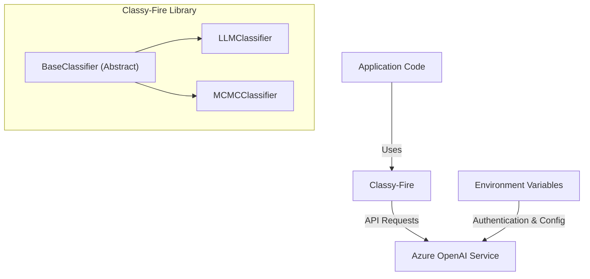

Sources: [README.md:1-3](), [pyproject.toml:5-11]()

## Key Features

Classy-fire addresses common challenges in LLM-based classification:

- **Deterministic Classification**: Provides consistent, reliable outputs for the same input
- **Token Biasing**: Maps class names to tokens and applies a strong probability bias for accurate classification
- **No Training Required**: Works out-of-the-box with predefined classes
- **Flexible Classification Options**: Choose between deterministic (single best answer) or probabilistic (distribution of confidence across classes) classification
- **Efficient Inference**: Optimized for faster response times by generating single token outputs
- **Customizable Context**: Support for task descriptions and few-shot examples to improve accuracy

Sources: [README.md:4-11](), [README.md:55-59]()

## Classification Framework

Classy-fire provides two main classifiers built on a common foundation:

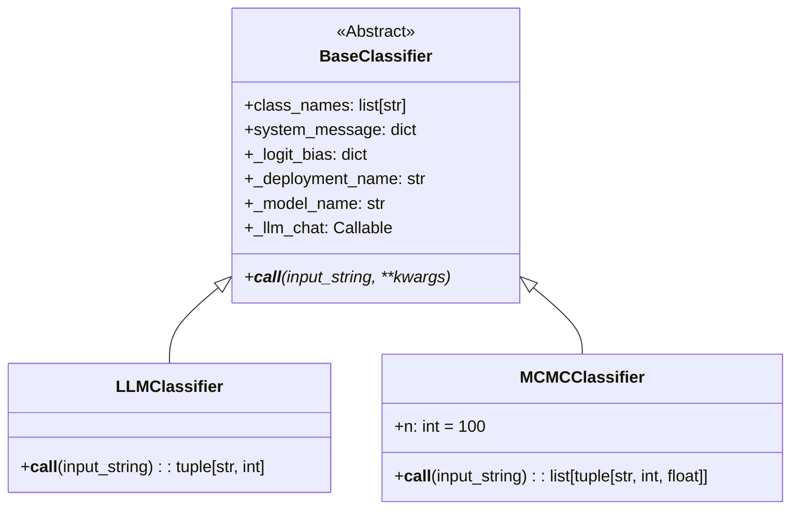

- **BaseClassifier**: Abstract class that handles token biasing and prompt construction
- **LLMClassifier**: Deterministic classifier that returns the single most likely class
- **MCMCClassifier**: Probabilistic classifier that returns a distribution of confidence across all classes

Sources: [README.md:19-34](), [README.md:68-70]()

## Classification Process

The classification process in classy-fire involves several key steps:

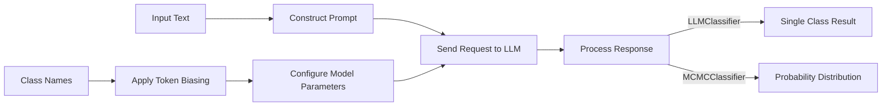

1. **Input Processing**: The text to be classified is formatted into a prompt
2. **Token Biasing**: Class names are mapped to tokens with enhanced probabilities
3. **LLM Inference**: The system queries the LLM with optimized parameters
4. **Output Processing**: Results are processed to provide either a single classification or probability distribution

Sources: [README.md:60-70]()

## Technical Foundation

Classy-fire operates on a principled mathematical foundation:

Given an input string $x_i$ and a set of $k$ classes $C=(C_1, ..., C_k)$, classy-fire determines:

$argmax_j Pr[x_i \in C_j | C, \Theta]$

Where $\Theta$ represents the knowledge encoded in the language model.

- **LLMClassifier**: Deterministically selects the class with the highest probability by setting temperature to 0
- **MCMCClassifier**: Estimates the full posterior distribution over classes using a Markov Chain Monte Carlo approach

Sources: [README.md:61-70]()

## Performance

Preliminary evaluation on the tweet_eval dataset shows promising results, with classy-fire achieving competitive performance against state-of-the-art methods:

| Metric | Score |
|--------|-------|
| Accuracy | 0.83 |
| Macro Avg F1 | 0.74 |
| Weighted Avg F1 | 0.82 |

For detailed evaluation information and metrics, see [Evaluation](#5).

Sources: [README.md:72-87]()

## System Requirements

Classy-fire requires:

- Python 3.7+
- Azure OpenAI Service credentials
- Environment variables for authentication

See the [Installation](#1.1) page for detailed setup instructions.

Sources: [README.md:37-51](), [pyproject.toml:18-24]()

## License

Classy-fire is available under the MIT License.

Sources: [LICENSE:1-22]()

---

# Page: Installation

# Installation

<details>
<summary>Relevant source files</summary>

The following files were used as context for generating this wiki page:

- [LICENSE](LICENSE)
- [README.md](README.md)
- [SUPPORT.md](SUPPORT.md)
- [pyproject.toml](pyproject.toml)

</details>


This page provides instructions for installing the classy-fire library and configuring the necessary environment variables to access Azure OpenAI services. For information about how to use the library after installation, see [Quick Start](#1.2).

## Prerequisites

Before installing classy-fire, ensure you meet the following requirements:

- Python 3.7 or higher
- Access to Azure OpenAI API service (or OpenAI API)
- Appropriate authentication credentials

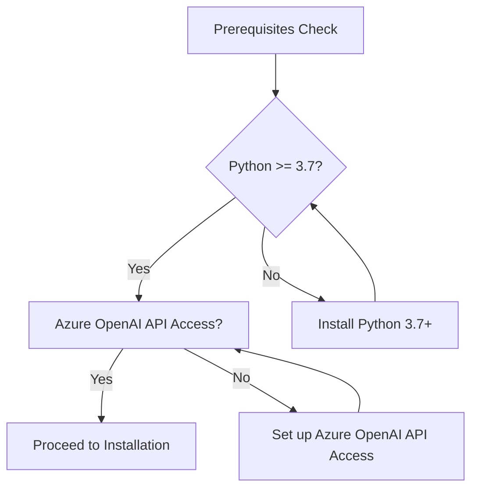

Sources: [pyproject.toml:21-21](), [README.md:37-38]()

## Installation Methods

### Standard Installation

The simplest way to install classy-fire is using pip:

```bash
pip install classy-fire
```

This will install the core package with minimal dependencies.

### Development Installation

For development purposes or to run the evaluation examples, install with additional dependencies:

```bash
pip install classy-fire[dev]
```

This installs additional packages such as tiktoken, openai, pytest, and pip-tools.

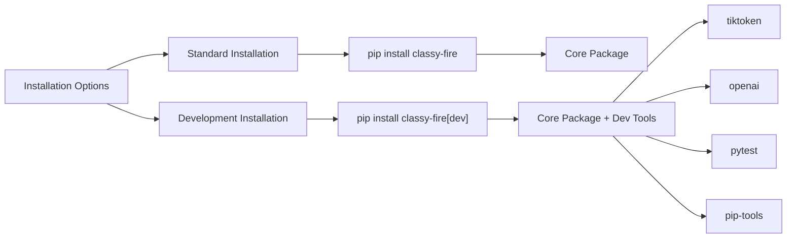

Sources: [README.md:16-18](), [pyproject.toml:24-24]()

## Environment Configuration

classy-fire requires several environment variables to authenticate with Azure OpenAI service. Set up the following variables:

| Environment Variable | Description | Example Value |
|---------------------|-------------|---------------|
| `OPENAI_API_BASE` | Azure OpenAI endpoint URL | https://your-resource-name.openai.azure.com/ |
| `OPENAI_API_VERSION` | API version to use | 2023-05-15 |
| `OPENAI_API_TYPE` | Type of API (azure or openai) | azure |
| `OPENAI_API_KEY` | Your API authentication key | sk-... |

### Setting Up Environment Variables

#### Method 1: Using a .env file (Recommended)

1. Create a file named `.env` in your project directory
2. Add the following content, replacing the placeholders with your actual values:

```
OPENAI_API_BASE=https://<endpoint>/
OPENAI_API_VERSION=2023-05-15
OPENAI_API_TYPE=azure  # or openai
OPENAI_API_KEY=<private key guid>
```

3. Install the python-dotenv package:

```bash
pip install python-dotenv
```

4. Load the environment variables in your Python script:

```python
from dotenv import load_dotenv
load_dotenv()
```

#### Method 2: Setting Environment Variables Directly

You can also set environment variables directly in your system:

```bash
# Linux/macOS
export OPENAI_API_BASE=https://<endpoint>/
export OPENAI_API_VERSION=2023-05-15
export OPENAI_API_TYPE=azure
export OPENAI_API_KEY=<private key guid>

# Windows (Command Prompt)
set OPENAI_API_BASE=https://<endpoint>/
set OPENAI_API_VERSION=2023-05-15
set OPENAI_API_TYPE=azure
set OPENAI_API_KEY=<private key guid>

# Windows (PowerShell)
$env:OPENAI_API_BASE = "https://<endpoint>/"
$env:OPENAI_API_VERSION = "2023-05-15"
$env:OPENAI_API_TYPE = "azure"
$env:OPENAI_API_KEY = "<private key guid>"
```

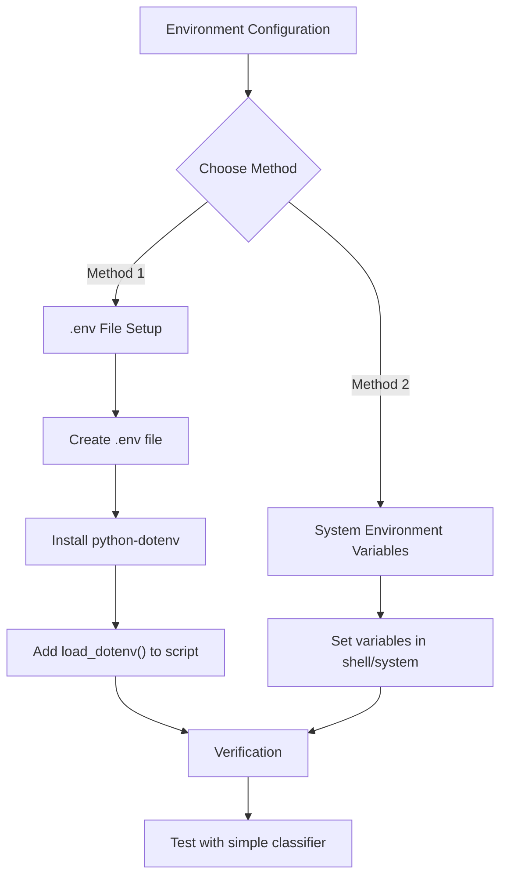

Sources: [README.md:38-51]()

## Model Deployment Configuration

By default, classy-fire expects an Azure OpenAI deployment of GPT-3.5 Turbo with the name `gpt-35-turbo-0301`. If your deployment has a different name, you will need to specify it when creating a classifier:

```python
classifier = LLMClassifier(
    class_names=["Banana", "Watermelon", "Apple", "Grape"],
    deployment_name="your-deployment-name",
    model_name="your-model-name"
)
```

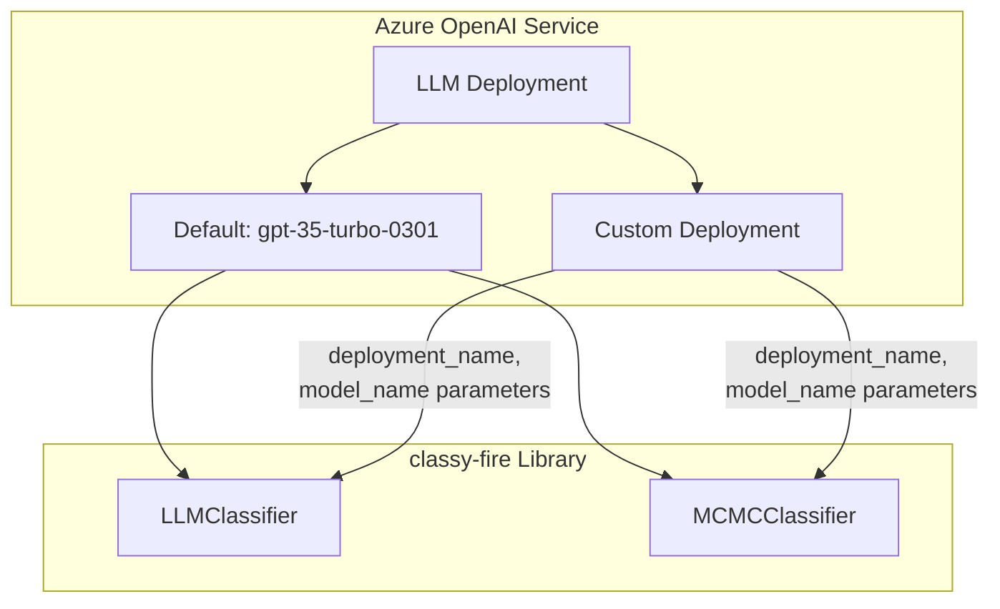

Sources: [README.md:37-38]()

## Verifying Installation

To verify that classy-fire is installed correctly and can access the Azure OpenAI API, run a simple test:

```python
from classy_fire import LLMClassifier
from dotenv import load_dotenv
import os

# Load environment variables from .env file
load_dotenv()

# Check if environment variables are set
required_vars = ['OPENAI_API_BASE', 'OPENAI_API_VERSION', 'OPENAI_API_TYPE', 'OPENAI_API_KEY']
missing_vars = [var for var in required_vars if not os.getenv(var)]
if missing_vars:
    print(f"Error: Missing environment variables: {', '.join(missing_vars)}")
    exit(1)

# Create a simple classifier
try:
    classifier = LLMClassifier(["Red", "Blue", "Green"])
    result = classifier("The sky on a clear day")
    print(f"Classification result: {result}")
    print("Installation verified successfully!")
except Exception as e:
    print(f"Error during verification: {e}")
```

If the script runs without errors and returns a classification result, your installation is correctly set up.

Sources: [README.md:19-35]()

## Troubleshooting

### Common Issues

| Issue | Possible Solution |
|-------|-------------------|
| Missing environment variables | Ensure all required variables are set in your .env file or system environment |
| Authentication errors | Check that your OPENAI_API_KEY is correct and not expired |
| Module not found errors | Verify installation with `pip list \| grep classy-fire` |
| Deployment not found | Ensure your Azure OpenAI model is deployed and the deployment name matches what you're using |

If you encounter persistent issues, check the [project GitHub repository](https://github.com/microsoft/classy-fire) or create an issue for support.

Sources: [README.md:37-51](), [SUPPORT.md:1-13]()

---

# Page: Quick Start

# Quick Start

<details>
<summary>Relevant source files</summary>

The following files were used as context for generating this wiki page:

- [LICENSE](LICENSE)
- [README.md](README.md)
- [SUPPORT.md](SUPPORT.md)
- [examples/fruits.py](examples/fruits.py)

</details>


This guide provides a rapid introduction to using the Classy-Fire library for text classification. It covers the essential steps to get you up and running quickly with basic classification tasks. For more detailed information about the classification framework, see [Classification Framework](#2).

## Prerequisites

Before using Classy-Fire, you need to set up your Azure OpenAI service credentials. The library requires the following environment variables:

```
OPENAI_API_BASE=https://<endpoint>/
OPENAI_API_VERSION=2023-05-15
OPENAI_API_TYPE=azure  # or openai
OPENAI_API_KEY=<private key guid>
```

The simplest way to set these up is by creating a `.env` file in your project directory and loading it in your script:

```python
from dotenv import load_dotenv
load_dotenv()  # Load environment variables from .env file
```

Sources: [README.md:37-51]()

## Installation

Install Classy-Fire using pip:

```bash
pip install classy-fire
```

You'll also need to install the python-dotenv package to load environment variables:

```bash
pip install python-dotenv
```

Sources: [README.md:16-18]()

## Basic Classification with LLMClassifier

The `LLMClassifier` provides deterministic classification, returning a single best match from your defined classes.

```python
from dotenv import load_dotenv
from classy_fire import LLMClassifier

# Load environment variables
load_dotenv()

# Initialize the classifier with your classes
classifier = LLMClassifier(["Banana", "Watermelon", "Apple", "Grape"])

# Classify a text
result = classifier("Has an elongated shape")
print(result)
# Output: ('Banana', 0)  # (class_name, class_id)
```

In this example, the classifier correctly identifies "Banana" as the fruit with an elongated shape.

Sources: [README.md:22-28](), [examples/fruits.py:13-21]()

## Basic Classification Workflow

Here's a diagram showing the basic workflow of text classification with Classy-Fire:

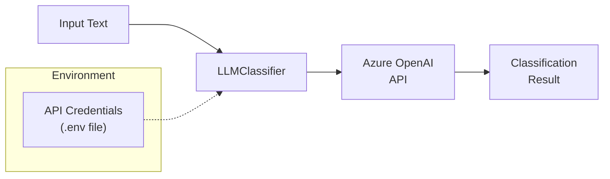

Sources: [README.md:37-51](), [examples/fruits.py:13-21]()

## Probabilistic Classification with MCMCClassifier

For cases where you need to understand the distribution of probabilities across different classes, use the `MCMCClassifier`:

```python
from dotenv import load_dotenv
from classy_fire import MCMCClassifier

# Load environment variables
load_dotenv()

# Initialize the MCMC classifier
mcmc_classifier = MCMCClassifier(["Banana", "Watermelon", "Apple", "Grape"])

# Classify a text and get probability distribution
result = mcmc_classifier("Has an oval or spherical shape")
print(result)
# Output: [('Banana', 0, 0.0), ('Watermelon', 1, 0.02), ('Apple', 2, 0.81), ('Grape', 3, 0.17)]
# Format: [(class_name, class_id, probability), ...]
```

The output is a list of tuples, each containing:
- Class name
- Class ID (index)
- Probability value

In this example, "Apple" has the highest probability (0.81) of matching the description "Has an oval or spherical shape".

Sources: [README.md:30-33](), [examples/fruits.py:23-31]()

## Classifier Comparison

```mermaid
classDiagram
    class "BaseClassifier" {
        <<Abstract>>
        +class_names: list[str]
        +__call__(input_string)
    }
    
    class "LLMClassifier" {
        +__call__(input_string): tuple[str, int]
    }
    
    class "MCMCClassifier" {
        +n: int = 100
        +__call__(input_string): list[tuple[str, int, float]]
    }
    
    "BaseClassifier" <|-- "LLMClassifier"
    "BaseClassifier" <|-- "MCMCClassifier"
    
    note for "LLMClassifier" "Returns a single best class\nwith deterministic results"
    note for "MCMCClassifier" "Returns probability distribution\nacross all classes"
```

Sources: [README.md:20-33](), [examples/fruits.py:13-31]()

## Using Additional Parameters

Both classifiers accept optional parameters to improve classification performance:

```python
# Add a task description and few-shot examples
classifier = LLMClassifier(
    class_names=["Banana", "Watermelon", "Apple", "Grape"],
    task_description="Classify fruits based on their physical description.",
    few_shot_examples="""
    Input: Red and round with a stem at the top.
    Output: Apple
    
    Input: Green on the outside, red on the inside, and has black seeds.
    Output: Watermelon
    """
)
```

The `task_description` parameter provides context about the classification task, while `few_shot_examples` helps ground the model with example inputs and outputs.

Sources: [README.md:55-58]()

## Classification Process

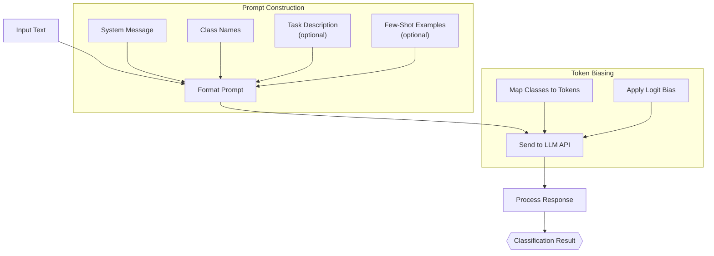

Sources: [README.md:61-70]()

## Next Steps

Now that you have the basics, you might want to explore:

- [Base Classifier](#2.1) - Understanding the core classification interface
- [Prompt Engineering](#3.1) - How to craft effective prompts for better results
- [Token Biasing](#3.2) - How Classy-Fire optimizes classification accuracy
- [Usage Examples](#4) - More complex classification examples

For a complete evaluation of the classification performance, see [Evaluation](#5).

Sources: [README.md:72-87]()

---

# Page: Classification Framework

# Classification Framework

<details>
<summary>Relevant source files</summary>

The following files were used as context for generating this wiki page:

- [LICENSE](LICENSE)
- [README.md](README.md)
- [SUPPORT.md](SUPPORT.md)
- [classy_fire/__init__.py](classy_fire/__init__.py)
- [classy_fire/base_classifier.py](classy_fire/base_classifier.py)

</details>


## Purpose and Scope

The Classification Framework is the core architecture that powers the Classy-Fire library. This document describes the overall design of the classification system, including the component hierarchy, classification workflow, and the relationships between different classifiers. For specific details about individual classifiers, see [Base Classifier](#2.1), [LLM Classifier](#2.2), and [MCMC Classifier](#2.3).

Sources: [README.md:60-70](), [classy_fire/base_classifier.py:10-21]()

## Classification Framework Architecture

The Classification Framework is designed around an inheritance-based architecture that allows for multiple classification strategies while sharing common functionality. It leverages Large Language Models (LLMs) to perform text classification by using sophisticated token biasing and prompt engineering techniques.

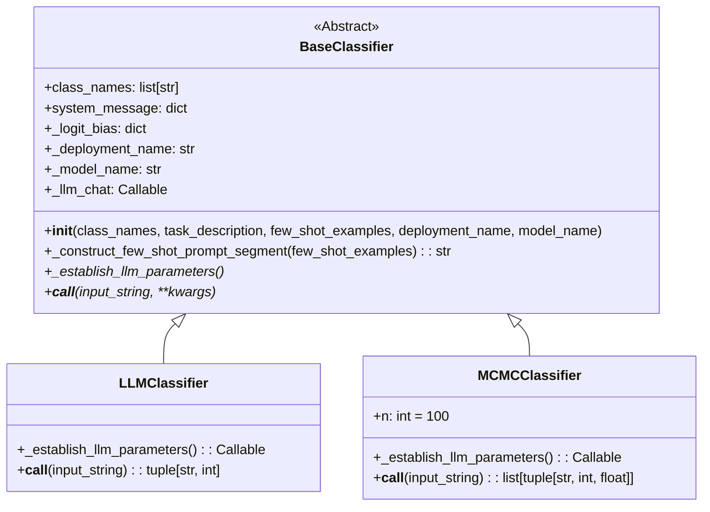

Sources: [classy_fire/base_classifier.py:10-95](), [classy_fire/__init__.py:1-2]()

## Key Components

The Classification Framework consists of three main components:

1. **BaseClassifier**: An abstract base class that implements common functionality such as prompt construction, token biasing, and communication with the LLM API.

2. **LLMClassifier**: A concrete implementation that provides deterministic classification results, returning a single best class and its corresponding index.

3. **MCMCClassifier**: A concrete implementation that uses Markov Chain Monte Carlo to estimate probability distributions across all possible classes.

Sources: [README.md:20-34](), [classy_fire/base_classifier.py:10-21]()

## Classification Workflow

The classification process follows these steps:

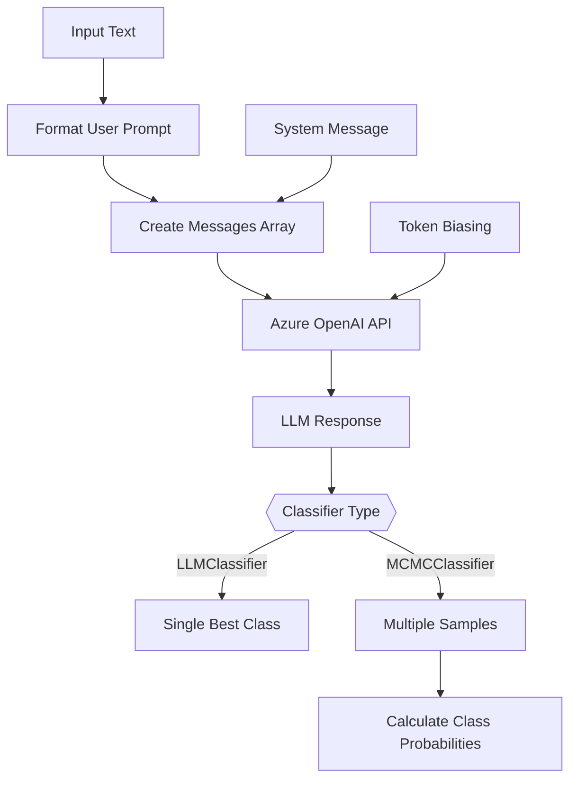

The framework processes input text through the following stages:

1. **Input Formatting**: The user input is formatted according to the predefined prompt template.
2. **Message Construction**: System and user messages are combined to create the final prompt.
3. **API Call**: The formatted messages are sent to the Azure OpenAI API.
4. **Response Processing**: The response is parsed to extract the classification result.
5. **Output Generation**: Depending on the classifier type, either a single best class or probability distribution is returned.

Sources: [classy_fire/base_classifier.py:33-95](), [README.md:60-70]()

## Prompt Engineering and Token Biasing

The Classification Framework uses two key techniques to improve classification accuracy:

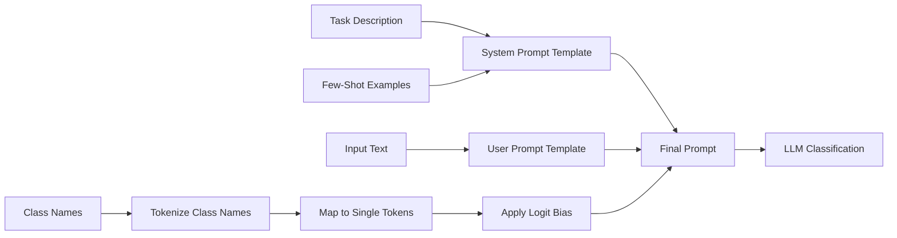

1. **Prompt Engineering**: The system uses carefully crafted prompts that include:
   - A base system prompt that instructs the model to select from specific options
   - Task description that provides context about the classification task
   - Optional few-shot examples to demonstrate expected behavior
   - A user prompt template that formats the input text

2. **Token Biasing**: The framework applies a logit bias to increase the probability of the model generating valid class IDs:
   - Class names are mapped to numerical identifiers (0, 1, 2, etc.)
   - These identifiers are mapped to single tokens in the model's vocabulary
   - A high logit bias is applied to these tokens to ensure the model selects from the predefined classes

Sources: [classy_fire/base_classifier.py:23-87](), [README.md:68-69]()

## Comparison of Classifiers

| Feature | LLMClassifier | MCMCClassifier |
|---------|---------------|----------------|
| **Return Type** | Tuple of (class_name, class_index) | List of tuples (class_name, class_index, probability) |
| **Determinism** | Deterministic (temperature=0) | Probabilistic |
| **Use Case** | When a single best class is needed | When understanding uncertainty or class distribution is important |
| **Performance** | Faster (single API call) | Slower (multiple samples) |
| **Configuration** | Minimal | Configurable sample size (n parameter) |

Sources: [README.md:20-34](), [README.md:68-70]()

## Configuration Options

The BaseClassifier (and by extension, both LLMClassifier and MCMCClassifier) accepts the following parameters during initialization:

- **class_names**: List of strings representing the possible classification categories
- **task_description**: Optional string providing context for the classification task
- **few_shot_examples**: Optional string containing example inputs and their expected classifications
- **deployment_name**: Name of the Azure OpenAI deployment (default: "gpt-35-turbo-0301")
- **model_name**: Name of the model to use (default: "gpt-3.5-turbo")

Example configuration:

```python
# Basic configuration
classifier = LLMClassifier(["Banana", "Watermelon", "Apple", "Grape"])

# Advanced configuration with task description and few-shot examples
classifier = LLMClassifier(
    class_names=["Positive", "Negative", "Neutral"],
    task_description="Classify the sentiment of customer feedback.",
    few_shot_examples="Input: The service was excellent!\nResponse: 0\n\nInput: I hate this product.\nResponse: 1",
    deployment_name="gpt-4",
    model_name="gpt-4"
)
```

Sources: [classy_fire/base_classifier.py:33-49](), [README.md:55-58]()

## Mathematical Foundation

The Classification Framework is based on the following formal definition:

Given a string instance $x_i$ and a set of $k$ classes provided as strings, $C=(C_1, ..., C_k)$, Classy-Fire determines:

$argmax_j Pr[x_i \in C_j | C, \Theta]$

Where $\Theta$ represents the parameters (knowledge of the world) of the language model.

The LLMClassifier implements this by deterministically selecting the class with the highest probability, while the MCMCClassifier estimates the entire probability distribution across all classes.

Sources: [README.md:60-70]()

## Environment Requirements

The Classification Framework requires the following environment variables to be set for connecting to the Azure OpenAI Service:

- `OPENAI_API_BASE`: The Azure OpenAI endpoint URL
- `OPENAI_API_VERSION`: The API version (e.g., "2023-05-15")
- `OPENAI_API_TYPE`: "azure" or "openai"
- `OPENAI_API_KEY`: The API key for authentication

Sources: [README.md:37-51](), [classy_fire/base_classifier.py:75-80]()

## Integration with Other Components

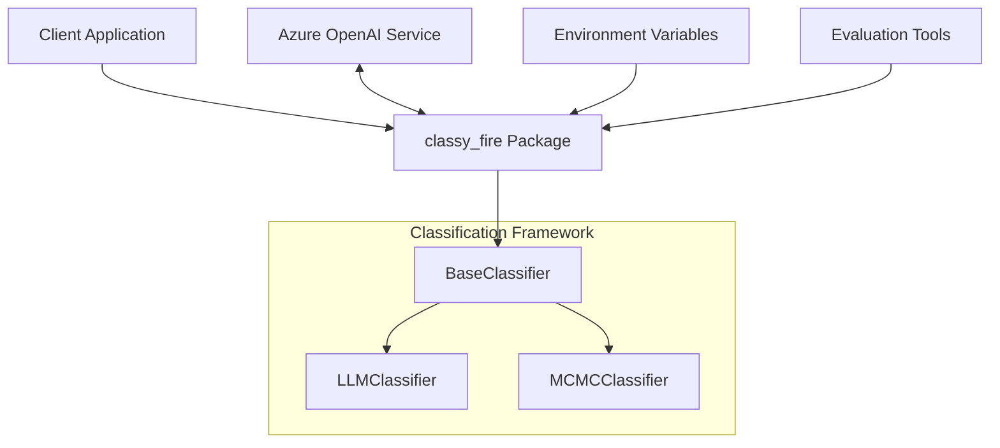

The Classification Framework serves as the foundation for the entire Classy-Fire library. It interfaces with:

1. **Client Applications**: Applications that need text classification capabilities
2. **Azure OpenAI Service**: The underlying LLM provider
3. **Evaluation Tools**: Tools for assessing classifier performance

Sources: [README.md:1-19](), [classy_fire/__init__.py:1-2]()

---

# Page: Base Classifier

# Base Classifier

<details>
<summary>Relevant source files</summary>

The following files were used as context for generating this wiki page:

- [classy_fire/base_classifier.py](classy_fire/base_classifier.py)

</details>


## Purpose

This document details the BaseClassifier abstract class, which serves as the foundation for all classifiers in the classy-fire library. The BaseClassifier provides core functionality for LLM-based classification, including prompt engineering, token biasing, and the interface for classifier implementations. For specific implementations, see [LLM Classifier](#2.2) and [MCMC Classifier](#2.3).

## Class Overview

BaseClassifier is an abstract base class that defines the common structure and behavior for all classifiers in the system. It handles the construction of prompts, management of class names, and configuration of the underlying LLM.

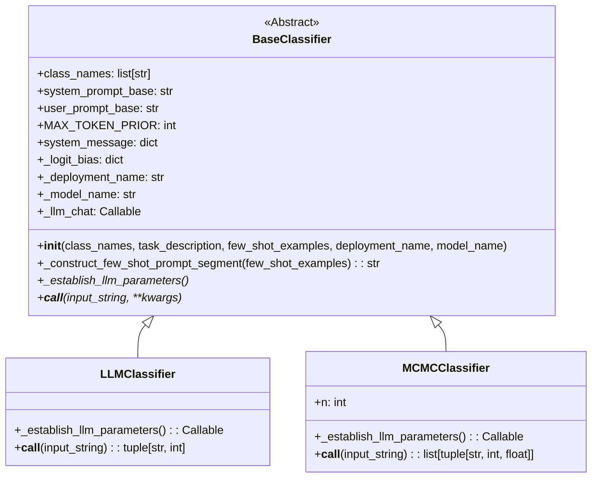

Sources: [classy_fire/base_classifier.py:10-96]()

## Initialization Process

The BaseClassifier initialization process sets up the essential components needed for classification:

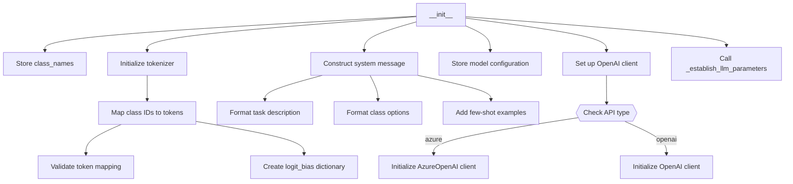

Sources: [classy_fire/base_classifier.py:34-80]()

## Key Components

### Prompt Construction

The BaseClassifier builds structured prompts for the LLM using a template-based approach. This standardizes the format across different classification tasks.

#### System Prompt

The system prompt provides context and instructions to the LLM. It contains:

1. Task description (context)
2. Available class options
3. Few-shot examples (if provided)

```
You are an AI assistant. Select for the following human input the most related item from 
the following set of <options> and leveraging information given in <context>. Respond with the number corresponding to the selected option.
<context>
{context_string}
</context>
<options>
{options_string}
</options>
{few_shot_prompt_segment}
###
```

#### User Prompt

The user prompt wraps the input text to be classified:

```
<Input>
{user_prompt}
</Input>
Response: 
```

Sources: [classy_fire/base_classifier.py:25-32]()

### Token Biasing

Token biasing is a technique to influence the LLM's output probabilities. The BaseClassifier uses this to increase the likelihood that the model will respond with a valid class ID number.

The process works as follows:

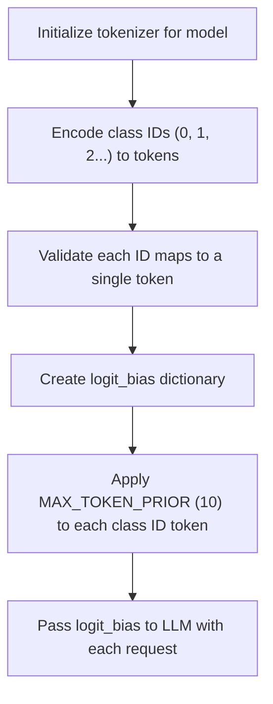

This ensures that the model's responses are constrained to the valid set of class identifiers.

Sources: [classy_fire/base_classifier.py:50-71]()

### Few-Shot Examples

The BaseClassifier supports few-shot learning through examples provided during initialization. These examples demonstrate the expected input-output behavior for the classifier.

```python
@staticmethod
def _construct_few_shot_prompt_segment(few_shot_examples: str) -> str:
    if len(few_shot_examples) > 0:
        return f"Here are some examples of how to respond:\n{few_shot_examples}\n"
    else:
        return ""
```

Few-shot examples should be formatted as a string demonstrating input-output pairs.

Sources: [classy_fire/base_classifier.py:82-87]()

## Abstract Methods

BaseClassifier defines two abstract methods that must be implemented by subclasses:

| Method | Purpose | Signature |
|--------|---------|-----------|
| `_establish_llm_parameters` | Configure the LLM API parameters | `() -> Callable[[list[Dict[str, str]]], Any]` |
| `__call__` | Process an input string and return classification results | `(input_string: str, **kwargs) -> Any` |

These methods allow different classifier implementations to customize how they interact with the LLM and process its responses.

Sources: [classy_fire/base_classifier.py:89-95]()

## Usage Flow

The following diagram illustrates how BaseClassifier is used in a typical classification flow:

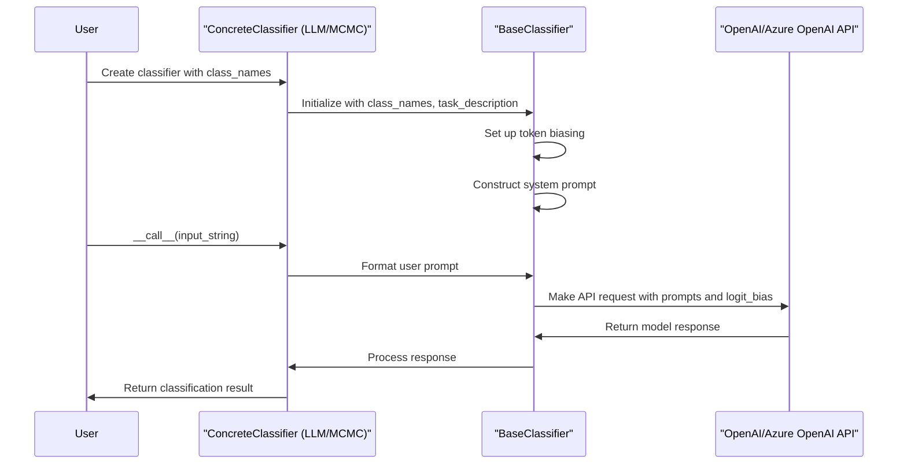

Sources: [classy_fire/base_classifier.py:10-96]()

## Client Configuration

The BaseClassifier automatically determines which OpenAI client to initialize based on the environment variables:

```python
if os.environ["OPENAI_API_TYPE"] == "azure":
    self.client = AzureOpenAI(
        api_key = os.environ["OPENAI_API_KEY"],
        api_version = os.environ["OPENAI_API_VERSION"],
        azure_endpoint = os.environ["OPENAI_API_BASE"]
    )
else:
    self.client = OpenAI(api_key = os.environ["OPENAI_API_KEY"])
```

Required environment variables:
- `OPENAI_API_TYPE`: "azure" or "openai"
- `OPENAI_API_KEY`: Your API key
- For Azure:
  - `OPENAI_API_VERSION`: API version
  - `OPENAI_API_BASE`: Azure endpoint URL

Sources: [classy_fire/base_classifier.py:75-80]()

## Implementation Considerations

When extending the BaseClassifier:

1. The `_establish_llm_parameters` method should return a callable that handles communication with the LLM API.
2. The `__call__` method should implement the classification logic and return results in a format appropriate for the specific classifier type.
3. Subclasses should leverage the prompt engineering and token biasing mechanisms provided by the base class.

For concrete implementations, refer to [LLM Classifier](#2.2) and [MCMC Classifier](#2.3).

---

# Page: LLM Classifier

# LLM Classifier

<details>
<summary>Relevant source files</summary>

The following files were used as context for generating this wiki page:

- [LICENSE](LICENSE)
- [README.md](README.md)
- [SUPPORT.md](SUPPORT.md)
- [classy_fire/llm_classifier.py](classy_fire/llm_classifier.py)

</details>


The LLM Classifier is a deterministic classifier that leverages Azure OpenAI's Large Language Models to categorize text inputs into predefined classes. This document explains how the LLM Classifier works, its implementation, and how to use it effectively. For probabilistic classification that provides distributions over classes, see [MCMC Classifier](#2.3).

## Overview

The LLM Classifier is a core component of the classy-fire framework that implements deterministic classification - given a text input, it returns a single best-matching class from a set of predefined options. It works by carefully configuring an LLM to output only valid class identifiers using token biasing techniques.

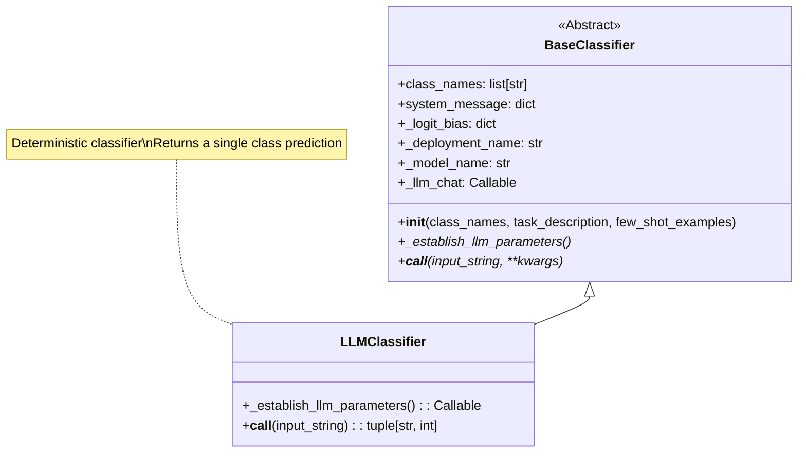

Sources: [classy_fire/llm_classifier.py:8-48](), [README.md:22-28]()

## Basic Usage

The LLM Classifier is easy to set up and use with just a few lines of code:

```python
from classy_fire import LLMClassifier

# Initialize with the class names
classifier = LLMClassifier(["Banana", "Watermelon", "Apple", "Grape"])

# Classify a text
result = classifier("Has an elongated shape")
print(result)
# Output: ('Banana', 0)
```

The classifier returns a tuple containing the predicted class name (string) and its corresponding index (integer) in the class_names list.

Sources: [README.md:22-28](), [classy_fire/llm_classifier.py:32-48]()

## Classification Process

The following diagram illustrates how the LLM Classifier processes an input text to produce a classification result:

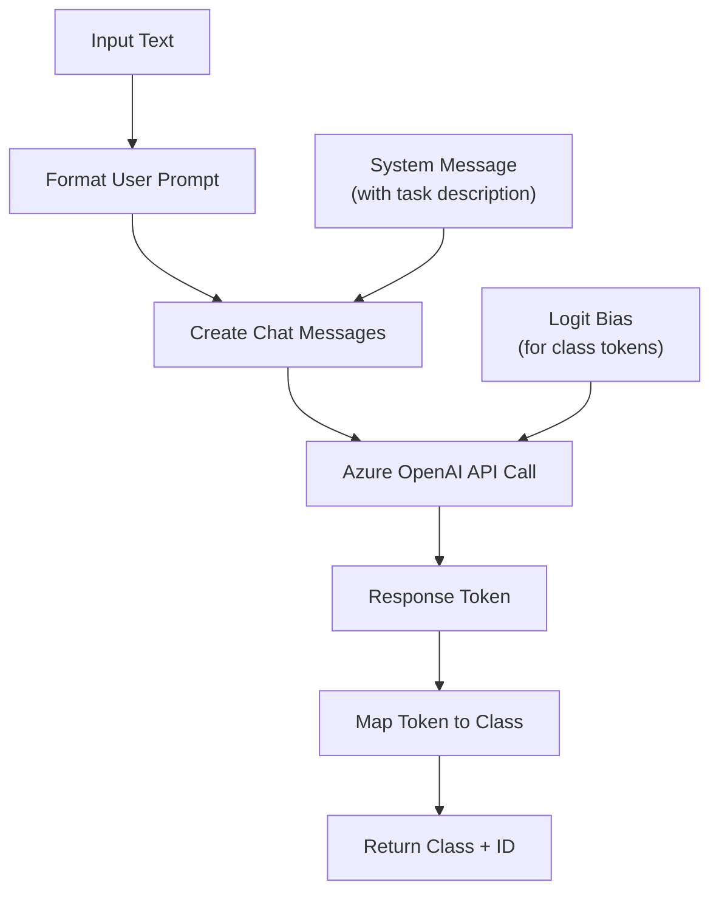

Sources: [classy_fire/llm_classifier.py:32-48]()

## Implementation Details

The LLM Classifier inherits from the BaseClassifier class and implements two key methods:

1. `_establish_llm_parameters()`: Configures the LLM with optimal parameters for classification
2. `__call__()`: Processes the input text and returns a classification

### Key Parameter Configuration

The LLM Classifier uses carefully chosen parameters to ensure reliable classifications:

| Parameter | Value | Purpose |
|-----------|-------|---------|
| temperature | 0 | Ensures deterministic outputs |
| max_tokens | 1 | Forces the model to generate only a single token |
| logit_bias | Dictionary | Increases probability of valid class tokens |

Sources: [classy_fire/llm_classifier.py:21-30]()

### Classification Flow

When you call the classifier with an input string, the following happens:

1. The system message (containing task description and class options) and user message (containing the input text) are combined
2. The combined prompt is sent to the Azure OpenAI API with the configured parameters
3. The response token is parsed to extract the class ID
4. The corresponding class name and ID are returned as a tuple

```mermaid
sequenceDiagram
    participant User
    participant LLMClassifier
    participant AzureOpenAI as "Azure OpenAI Service"
    
    User->>LLMClassifier: __call__("Has an elongated shape")
    LLMClassifier->>LLMClassifier: Format messages
    LLMClassifier->>AzureOpenAI: chat.completions.create()
    Note over LLMClassifier,AzureOpenAI: temperature=0, max_tokens=1, logit_bias
    AzureOpenAI->>LLMClassifier: Return class ID token
    LLMClassifier->>LLMClassifier: Convert to class name
    LLMClassifier->>User: Return ("Banana", 0)
```

Sources: [classy_fire/llm_classifier.py:32-48]()

## Deterministic Classification

The LLM Classifier is designed to be deterministic, meaning it will always return the same result for the same input, making it reliable for production systems. This is achieved by:

1. Setting temperature to 0, eliminating randomness in the LLM's output
2. Using logit bias to heavily weight the model toward outputting only valid class identifiers
3. Restricting the output to a single token that corresponds to a class ID

```mermaid
flowchart LR
    A["Input Text"] --> B["LLM Classifier"]
    B --> C["Single Best Class"]
    
    subgraph "Model Configuration"
        D["temperature = 0"]
        E["max_tokens = 1"]
        F["logit_bias = {...}"]
    end
    
    Model --> B
```

Sources: [classy_fire/llm_classifier.py:21-30](), [README.md:67-69]()

## When to Use LLM Classifier

The LLM Classifier is ideal when:

- You need a single, confident classification rather than a distribution
- You want consistent, reproducible results
- Your application requires quick, deterministic decisions
- You need to integrate with systems that expect a definitive answer

For cases where understanding the model's uncertainty is important, consider using the [MCMC Classifier](#2.3) instead.

Sources: [README.md:67-70]()

## Advanced Configuration

The LLM Classifier can be customized with additional parameters:

```python
classifier = LLMClassifier(
    class_names=["Banana", "Watermelon", "Apple", "Grape"],
    task_description="Classify fruits based on their descriptions",
    few_shot_examples="Input: Yellow and curved\nOutput: 0\n\nInput: Red and round\nOutput: 2",
    deployment_name="your-deployment-name",
    model_name="your-model-name"
)
```

| Parameter | Description |
|-----------|-------------|
| class_names | List of class names for classification |
| task_description | Provides context for the classification task |
| few_shot_examples | Example input-output pairs to guide the model |
| deployment_name | Azure OpenAI deployment name |
| model_name | The model to use (default: gpt-35-turbo-0301) |

Sources: [README.md:55-59](), [classy_fire/llm_classifier.py:8-19]()

## Implementation Code

The core implementation of the LLM Classifier is straightforward:

```python
def _establish_llm_parameters(self) -> Callable[[list[Dict[str, str]]], Any]:
    def _llm_chat(messages: list[Dict[str, str]]):
        return self.client.chat.completions.create(
                messages = messages,
                model = self._deplyment_name,
                temperature = 0,
                max_tokens = 1,
                logit_bias = self._logit_bias
            )
    return _llm_chat

def __call__(self, input_string: str, **kwargs) -> Any:
    """
    The function takes a string and returns a tuple containing the classified class name (string) and corresponding class id (int).
    param input_string: The string to classify.
    """
    response = self._llm_chat(
        [
            self.system_message,
            {
             "role": "user",
             "content": self.user_prompt_base.format(user_prompt=input_string)
            },
        ]
    )
    predicted_class_id = int(response.choices[0].message.content)

    return self.class_names[predicted_class_id], predicted_class_id
```

Sources: [classy_fire/llm_classifier.py:21-48]()

## Environment Setup

The LLM Classifier requires Azure OpenAI credentials to be configured as environment variables:

```
OPENAI_API_BASE=https://<endpoint>/
OPENAI_API_VERSION=2023-05-15
OPENAI_API_TYPE=azure
OPENAI_API_KEY=<private key guid>
```

You can set these by creating a `.env` file and loading it with `python-dotenv` or setting them directly in your environment.

Sources: [README.md:37-51]()

## Related Components

The LLM Classifier is one of two classifier implementations in classy-fire:

```mermaid
graph TD
    A["BaseClassifier"] --> B["LLMClassifier"]
    A --> C["MCMCClassifier"]
    
    B --> D["Deterministic\nSingle Class Output"]
    C --> E["Probabilistic\nClass Distribution"]
    
    style B fill:#f9f9f9,stroke:#333,stroke-width:2px
```

For probabilistic classification with uncertainty estimates, see the [MCMC Classifier](#2.3) documentation.

Sources: [README.md:22-34](), [README.md:67-70]()

---

# Page: MCMC Classifier

# MCMC Classifier

<details>
<summary>Relevant source files</summary>

The following files were used as context for generating this wiki page:

- [LICENSE](LICENSE)
- [README.md](README.md)
- [SUPPORT.md](SUPPORT.md)
- [classy_fire/mcmc_classifier.py](classy_fire/mcmc_classifier.py)

</details>


The MCMCClassifier is a specialized classification component in the Classy-Fire library that implements a Markov Chain Monte Carlo approach for estimating probability distributions across classification options. Unlike the deterministic [LLM Classifier](#2.2) which returns a single best class, MCMCClassifier provides the full posterior probability distribution over all available classes.

## Overview

The MCMCClassifier extends the BaseClassifier to provide probabilistic outputs rather than deterministic ones, enabling users to understand the model's uncertainty and confidence levels across all possible classification options.

```mermaid
classDiagram
    class BaseClassifier {
        <<Abstract>>
        +class_names: list[str]
        +system_message: dict
        +_logit_bias: dict
        +_deployment_name: str
        +_model_name: str
        +_llm_chat: Callable
        +__init__(class_names, task_description, few_shot_examples)
        +_construct_few_shot_prompt_segment(): str
        +_establish_llm_parameters()* 
        +__call__(input_string, **kwargs)*
    }
    
    class MCMCClassifier {
        +_establish_llm_parameters(): Callable
        +__call__(input_string): list[tuple[str, int, float]]
    }
    
    BaseClassifier <|-- MCMCClassifier
```

Sources: [classy_fire/mcmc_classifier.py:7-18](), [README.md:22-24]()

## Implementation Details

The MCMCClassifier implementation consists of two key methods that override the BaseClassifier functionality:

1. `_establish_llm_parameters()`: Configures the LLM with temperature=1 and n=100 to generate multiple diverse samples
2. `__call__()`: Processes the input, collects multiple responses, and calculates the probability distribution using numpy's histogram function

```mermaid
flowchart TD
    InputString["input_string"] --> FormatPrompt["Format system_message and user_prompt"]
    FormatPrompt --> LLMChat["_llm_chat()"]
    LLMChat --> GenerateSamples["Generate 100 samples (n=100)"]
    GenerateSamples --> CollectResponses["Collect response.choices[].message.content"]
    CollectResponses --> CalculateHistogram["np.histogram(results, bins=range(len(class_names)+1))"]
    CalculateHistogram --> ReturnDistribution["Return list[tuple[class_name, class_id, probability]]"]
    
    subgraph "MCMCClassifier.__call__ implementation"
        FormatPrompt
        LLMChat
        CollectResponses
        CalculateHistogram
    end
```

Sources: [classy_fire/mcmc_classifier.py:20-49]()

The key configuration parameters that differentiate MCMCClassifier from LLMClassifier are:

1. **Temperature=1**: While LLMClassifier uses temperature=0 for deterministic responses, MCMCClassifier uses temperature=1 to allow for sampling from the model's full probability distribution.

2. **n=100**: The classifier requests 100 completions simultaneously, leveraging the OpenAI API's batch sampling parameter for efficient sampling.

3. **Distribution Calculation**: After collecting all responses, it uses numpy's histogram function to calculate the frequency distribution:
   ```python
   distribution = np.histogram(results, bins=range(len(self.class_names)+1), density=True)[0]
   ```

## Working Mechanism

The MCMCClassifier operates through this sequence:

```mermaid
sequenceDiagram
    participant Client as "Client Code"
    participant MCMC as "MCMCClassifier.__call__()"
    participant LLMChat as "_llm_chat()"
    participant OpenAI as "OpenAI API"
    
    Client->>MCMC: input_string
    MCMC->>MCMC: Create system_message and user_prompt
    MCMC->>LLMChat: messages=[system_message, user_message]
    LLMChat->>OpenAI: chat.completions.create(temperature=1, n=100)
    OpenAI->>LLMChat: response (with 100 completions)
    LLMChat->>MCMC: response object
    MCMC->>MCMC: results = [res.message.content for res in response.choices]
    MCMC->>MCMC: distribution = np.histogram(results)
    MCMC->>MCMC: result_list = zip(class_names, ids, distribution)
    MCMC->>Client: list[tuple[str, int, float]]
```

Sources: [classy_fire/mcmc_classifier.py:32-49]()

When the client calls the classifier with an input string:
1. The same careful prompt construction occurs as with BaseClassifier
2. A request is sent to the OpenAI API with temperature=1 and n=100
3. 100 different responses are collected from the API
4. A histogram is calculated to determine the frequency distribution
5. The result is returned as a list of (class_name, class_id, probability) tuples

## Usage Example

Here's how to initialize and use the MCMCClassifier:

```python
from classy_fire import MCMCClassifier

# Initialize classifier with class names
mcmc_classifier = MCMCClassifier(
    class_names=["Banana", "Watermelon", "Apple", "Grape"],
    task_description="Classify fruits based on their descriptions",
    few_shot_examples="Description: Yellow and curved\nClass: Banana\n\nDescription: Red and round\nClass: Apple"
)

# Classify a text and get probability distribution
result = mcmc_classifier("Has an oval or spherical shape")
print(result)
# Output: [('Banana', 0, 0.0), ('Watermelon', 1, 0.02), ('Apple', 2, 0.81), ('Grape', 3, 0.17)]
```

Sources: [README.md:30-33]()

The output provides a probability distribution across all classes, showing the model is 81% confident the description matches an Apple, with 17% probability for Grape, and 2% for Watermelon.

## Practical Applications

The MCMCClassifier is particularly valuable in scenarios where:

1. **Uncertainty Quantification**: When you need to measure the model's confidence level
2. **Threshold-Based Decision Making**: For implementing confidence thresholds before taking actions
3. **Ambiguity Detection**: When handling potentially ambiguous inputs
4. **Edge Case Analysis**: For identifying where the model is uncertain between multiple classes

Example of threshold-based application:

```python
# Implement confidence threshold for action
result = mcmc_classifier("Red and juicy")
highest_prob_class = max(result, key=lambda x: x[2])
class_name, class_id, confidence = highest_prob_class

if confidence > 0.8:
    # High confidence - take automatic action
    process_fruit(class_name)
else:
    # Low confidence - require human review
    queue_for_review(input_text, result)
```

## Comparison with LLMClassifier

| Feature | LLMClassifier | MCMCClassifier |
|---------|---------------|----------------|
| Return type | `tuple[str, int]` | `list[tuple[str, int, float]]` |
| Temperature | 0 | 1 |
| API parameter n | 1 | 100 |
| Primary method | Argmax selection | Distribution estimation |
| Compute efficiency | Higher (single prediction) | Lower (multiple samples) |
| API cost | Lower | Higher (100x more tokens) |

Sources: [classy_fire/mcmc_classifier.py:20-30](), [README.md:69-70]()

## When to Use

- Use **LLMClassifier** when you need a deterministic, single best answer classification
- Use **MCMCClassifier** when:
  - You need to understand model uncertainty
  - You want to implement confidence thresholds
  - You're analyzing model behavior on ambiguous cases
  - You need to detect low-confidence predictions for human review

The MCMCClassifier provides richer information at the cost of increased API usage (100 completions vs. 1) and slightly longer processing time.

---

# Page: Advanced Topics

# Advanced Topics

<details>
<summary>Relevant source files</summary>

The following files were used as context for generating this wiki page:

- [LICENSE](LICENSE)
- [README.md](README.md)
- [SUPPORT.md](SUPPORT.md)
- [classy_fire/base_classifier.py](classy_fire/base_classifier.py)

</details>


This page covers advanced aspects of the Classy-Fire library that enable its efficient and accurate classification capabilities. Here we explore the underlying mechanisms that make the classification framework effective, particularly focusing on prompt engineering strategies and token biasing techniques.

For basic usage information, see [Overview](#1) and [Quick Start](#1.2). For details about the specific classifier implementations, see [Classification Framework](#2).

## Understanding the Prompt Architecture

Prompt engineering is fundamental to Classy-Fire's effectiveness. The library constructs specialized prompts that guide the LLM to produce consistent, reliable classification outputs.

### Prompt Construction Flow

```mermaid
flowchart TD
    A["Constructor Parameters"] --> B["System Prompt"]
    A --> C["User Prompt"]
    
    subgraph "SystemPromptComponents"
        D["system_prompt_base"]
        E["task_description"]
        F["class_options"]
        G["few_shot_examples"]
    end
    
    B --> D
    E --> B
    F --> B
    G --> B
    
    C --> H["user_prompt_base"]
    
    B --> I["system_message"]
    H --> J["Formatted User Message"]
    
    I --> K["Azure OpenAI API Request"]
    J --> K
    K --> L["Classification Result"]
```

Sources: [base_classifier.py:25-33](), [base_classifier.py:55-66]()

### System Prompt Anatomy

The system prompt in Classy-Fire is carefully structured to maximize classification accuracy:

```
You are an AI assistant. Select for the following human input the most related item from 
the following set of <options> and leveraging information given in <context>. Respond with the number corresponding to the selected option.
<context>
{context_string}
</context>
<options>
{options_string}
</options>
{few_shot_prompt_segment}
###
```

Key components:
- **Role definition**: Sets the model as an assistant with a specific task
- **Task instruction**: Explicitly requests selection from options and numeric response
- **Context section**: Contains the `task_description` parameter
- **Options section**: Lists all class names with their numeric indices
- **Few-shot examples**: Optional examples demonstrating expected input/output patterns
- **Delimiter**: The `###` separates the system prompt from user inputs

Sources: [base_classifier.py:25-31]()

### User Prompt Format

For each classification request, the user input is formatted as:

```
<Input>
{user_prompt}
</Input>
Response: 
```

This structured format:
- Clearly delineates the input text being classified
- Provides a consistent prefix for the model's response
- Helps maintain the expected response format

Sources: [base_classifier.py:32]()

## Token Biasing Technique

Token biasing is a critical technique that improves classification accuracy by manipulating the probability of specific tokens in the model's output.

### How Token Biasing Works

```mermaid
flowchart TD
    A["class_names"] --> B["Tokenization"]
    B --> C["class_id_tokens"]
    C --> D["_logit_bias dictionary"]
    D --> E["API Parameters"]
    E --> F["Constrained LLM Output"]
    
    G["Class ID Numbers (0,1,2...)"] --> C
    
    H["MAX_TOKEN_PRIOR (10)"] --> D
```

Sources: [base_classifier.py:49-71](), [README.md:68-69]()

### Token Biasing Implementation

The token biasing process involves several key steps:

1. Each class is assigned a numeric identifier (0, 1, 2, etc.)
2. The `tiktoken` tokenizer encodes each numeric identifier into a token
3. A logit bias dictionary is created, mapping each class token to a high prior value (10)
4. This dictionary is passed to the Azure OpenAI API, boosting the probability of generating valid class identifiers

The code implementation:

```python
# Create tokenizer for the specified model
tokenizer = tiktoken.encoding_for_model(model_name)

# Encode each class index (0, 1, 2...) as tokens
class_id_tokens = [tokenizer.encode(str(i)) for i in range(len(class_names))]

# Ensure each class ID maps to exactly one token
assert all(len(token_list) == 1 for token_list in class_id_tokens)

# Create the logit bias dictionary
self._logit_bias = {
    token_list[0]: BaseClassifier.MAX_TOKEN_PRIOR
    for token_list in class_id_tokens
}
```

This technique ensures that:
- The model's response is constrained to the set of valid class identifiers
- Invalid or out-of-distribution outputs are highly unlikely
- Classification is efficient, requiring only a single token to be generated

Sources: [base_classifier.py:49-71](), [README.md:68]()

## Deterministic vs. Probabilistic Classification

Classy-Fire provides two classification approaches with different use cases and output characteristics.

```mermaid
flowchart LR
    A["Input Text"] --> B["BaseClassifier"]
    B --> C["LLMClassifier"]
    B --> D["MCMCClassifier"]
    
    C --> E["Single Class Result: ('class_name', index)"]
    D --> F["Probability Distribution: [('class1', idx1, prob1), ('class2', idx2, prob2), ...]"]
    
    G["temperature=0"] --> C
    H["sampling (n=100)"] --> D
```

Sources: [README.md:22-33](), [README.md:68-70]()

### Deterministic Classification (LLMClassifier)

The `LLMClassifier` provides deterministic classification results:

- **Implementation**: Sets temperature=0 to disable randomness
- **Behavior**: Returns the class with highest probability according to the model
- **Output format**: Tuple of `(class_name, class_index)`
- **Use case**: When consistent, reproducible results are needed

### Probabilistic Classification (MCMCClassifier)

The `MCMCClassifier` uses a Markov Chain Monte Carlo approach:

- **Implementation**: Generates multiple samples (default n=100) for the same input
- **Behavior**: Counts frequency of each class in the samples to estimate probabilities
- **Output format**: List of tuples `[(class_name, class_index, probability), ...]`
- **Use case**: When uncertainty information is valuable for decision-making

Example output difference:
```python
# Deterministic (single best answer)
result = llm_classifier("Has an oval or spherical shape")
print(result)  # ('Apple', 2)

# Probabilistic (distribution over classes)
result = mcmc_classifier("Has an oval or spherical shape")
print(result)  # [('Banana', 0, 0.0), ('Watermelon', 1, 0.02), ('Apple', 2, 0.81), ('Grape', 3, 0.17)]
```

Sources: [README.md:22-33](), [README.md:68-70]()

## Advanced Parameter Tuning

### Task Description Parameter

The `task_description` parameter provides context to guide the model's understanding:

- **Purpose**: Provides domain knowledge and classification criteria
- **Location**: Inserted into the `<context>` section of the system prompt
- **Examples**:
  - Fruit classification: "Classify fruits based on their physical characteristics like shape, color, and texture."
  - Sentiment analysis: "Determine whether text expresses positive, negative, or neutral sentiment, focusing on emotional tone."

Effective task descriptions should:
- Be concise but informative
- Define boundaries between classes
- Specify what characteristics are relevant for classification

Sources: [base_classifier.py:37](), [base_classifier.py:57-59]()

### Few-Shot Examples Parameter

Few-shot examples demonstrate to the model how to handle specific inputs:

- **Purpose**: Show expected input-output pairs to guide the model
- **Format**: Formatted as `<Input>...\n</Input>\nResponse: X` sequences
- **Implementation**: Converted to a prompt segment by `_construct_few_shot_prompt_segment`

Example of effective few-shot examples:
```
<Input>
This fruit is yellow and elongated.
</Input>
Response: 0

<Input>
This fruit is small, round, and purple.
</Input>
Response: 3
```

Few-shot examples are particularly useful for:
- Handling edge cases
- Illustrating boundary conditions between similar classes
- Demonstrating format expectations

Sources: [base_classifier.py:38](), [base_classifier.py:82-87]()

## Performance Optimization

### Token Efficiency

Classy-Fire is designed to be token-efficient:

- **Single-token response**: Classification results require only one token to generate
- **Reused system prompt**: System message is created once during initialization
- **Minimal API calls**: Classification requires only one API call (LLMClassifier) or batched requests (MCMCClassifier)

This token efficiency translates to:
- Lower API costs
- Faster classification responses
- Simplified result parsing

Sources: [README.md:68](), [base_classifier.py:52-54]()

### Sampling Parameters for MCMCClassifier

The MCMCClassifier can be tuned by adjusting the `n` parameter:

| n Value | Precision | Token Usage | Use Case |
|---------|-----------|-------------|----------|
| 10-20   | Low       | Low         | Quick estimation, limited budget |
| 50-100  | Medium    | Medium      | Balance of accuracy and cost (default) |
| 200+    | High      | High        | High-precision probability estimates |

The `n` parameter leverages the OpenAI API's batch generation capability, making multiple samples cost-effective.

Sources: [README.md:70]()

## Best Practices and Recommendations

1. **Choose descriptive class names**: Class names should be intuitive and semantically distinct.

2. **Limit the number of classes**: While theoretically the system could handle many classes, 2-20 classes typically work best.

3. **Test different prompting strategies**: Experiment with different task descriptions and few-shot examples.

4. **Use domain-specific context**: Include relevant domain terminology in your task description.

5. **Balance MCMCClassifier sample size**: Start with the default n=100 and adjust based on your precision needs.

6. **Evaluate systematically**: Benchmark your classifier against representative examples.

Sources: [README.md:87-90]()

## Known Limitations

1. **Class count constraints**: Each class ID must map to a single token, which may limit the maximum number of classes.

2. **Environment dependency**: Requires properly configured Azure OpenAI service credentials.

3. **Model dependency**: Performance is tied to the capabilities of the underlying language model.

4. **Classification scope**: Best suited for classifying text into discrete categories rather than regression tasks.

Sources: [base_classifier.py:52-54](), [README.md:37-51]()

---

# Page: Prompt Engineering

# Prompt Engineering

<details>
<summary>Relevant source files</summary>

The following files were used as context for generating this wiki page:

- [LICENSE](LICENSE)
- [README.md](README.md)
- [SUPPORT.md](SUPPORT.md)
- [classy_fire/base_classifier.py](classy_fire/base_classifier.py)

</details>


## Purpose and Scope

This document provides a comprehensive guide to prompt engineering within the classy-fire library. It covers the structure of prompts, how to customize them effectively, and best practices for optimizing classification performance. For information about token biasing techniques, see [Token Biasing](#3.2).

Sources: [README.md:55-63](), [classy_fire/base_classifier.py:25-32]()

## Prompt Structure Overview

The classy-fire library uses a carefully designed prompt structure to guide the LLM in performing text classification tasks. The prompt consists of two main components: the system message and the user message, which work together to frame the classification task.

### Prompt Components Diagram

```mermaid
flowchart TD
    subgraph "System Message"
        A["Role Definition"] --> B["Task Instruction"]
        B --> C["Context Section"]
        C --> D["Options Section"]
        D --> E["Few-shot Examples"]
    end
    
    subgraph "User Message"
        F["Input Wrapper"] --> G["Response Prompt"]
    end
    
    E --> H["Classification Request"]
    G --> H
    H --> I["LLM Response"]
    
    A["Role Definition"]:::nocolor
    B["Task Instruction"]:::nocolor
    C["Context Section"]:::nocolor
    D["Options Section"]:::nocolor
    E["Few-shot Examples"]:::nocolor
    F["Input Wrapper"]:::nocolor
    G["Response Prompt"]:::nocolor
    H["Classification Request"]:::nocolor
    I["LLM Response"]:::nocolor
    
    classDef nocolor fill:white,stroke:black;
```

Sources: [classy_fire/base_classifier.py:25-32](), [classy_fire/base_classifier.py:55-67]()

## System Prompt Structure

The system prompt is constructed using a template defined in `BaseClassifier.system_prompt_base`. It contains several key elements that guide the model:

```
You are an AI assistant. Select for the following human input the most related item from 
the following set of <options> and leveraging information given in <context>. Respond with the number corresponding to the selected option.
<context>
{context_string}
</context>
<options>
{options_string}
</options>
{few_shot_prompt_segment}
###
```

### System Prompt Element Breakdown

| Element | Purpose | Source Parameter |
|---------|---------|------------------|
| Role Definition | Establishes the model's role as an AI assistant | Hardcoded |
| Task Instruction | Directs the model to select from options and respond with a number | Hardcoded |
| Context Section | Provides task-specific information to guide classification | `task_description` parameter |
| Options Section | Lists the available class options with their numeric indices | Generated from `class_names` parameter |
| Few-shot Examples | Optional examples demonstrating expected behavior | `few_shot_examples` parameter |
| Delimiter | Separates the system instructions from user input | Hardcoded |

Sources: [classy_fire/base_classifier.py:25-32](), [classy_fire/base_classifier.py:55-67]()

## User Prompt Structure

The user prompt is simpler and wraps the input text to be classified:

```
<Input>
{user_prompt}
</Input>
Response: 
```

This structure clearly delineates the input text and prompts the model to provide a response.

Sources: [classy_fire/base_classifier.py:32]()

## Prompt Construction Process

```mermaid
sequenceDiagram
    participant "Client Code" as Client
    participant "BaseClassifier" as BC
    participant "LLMClassifier" as LLC
    participant "Azure OpenAI" as Azure
    
    Client->>BC: "__init__(class_names, task_description, few_shot_examples)"
    BC->>BC: "Format system_message"
    BC->>BC: "Configure logit_bias"
    Client->>LLC: "__call__(input_string)"
    LLC->>LLC: "Format user_prompt"
    LLC->>Azure: "Send system_message + user_prompt"
    Azure->>LLC: "Return class index response"
    LLC->>Client: "Return (class_name, class_index)"
```

Sources: [classy_fire/base_classifier.py:34-87](), [README.md:20-28]()

## Customizing Prompts

The classy-fire library allows for customization of prompts through several parameters during classifier initialization:

### Task Description

The `task_description` parameter allows you to provide context and instructions for the classification task. This is inserted into the `<context>` section of the system prompt.

#### Best Practices for Task Descriptions:

1. **Be specific about the domain**: Include relevant context about the type of data being classified
2. **Define class boundaries**: Explain what distinguishes one class from another
3. **Provide classification criteria**: List the features or attributes that determine class membership
4. **Keep it concise but complete**: Include necessary information without overwhelming the model

Example task description for fruit classification:
```
Classify descriptions of fruits based on their physical characteristics, taste, and typical uses. 
Consider attributes like shape, color, texture, sweetness, and whether they're typically eaten raw or cooked.
```

Sources: [README.md:55-58](), [classy_fire/base_classifier.py:43-44]()

### Few-Shot Examples

The `few_shot_examples` parameter allows you to provide example inputs and their expected classifications. This demonstrates the desired classification behavior to the model.

```mermaid
graph TD
    subgraph "Few-Shot Examples Construction"
        A["Input Examples"] --> B["_construct_few_shot_prompt_segment()"]
        B --> C["Formatted Few-Shot Section"]
    end
    
    subgraph "Example Format"
        D["Input: {example input}
Response: {class index}"]
    end
    
    C --> E["Complete System Prompt"]
    
    A["Input Examples"]:::nocolor
    B["_construct_few_shot_prompt_segment()"]:::nocolor
    C["Formatted Few-Shot Section"]:::nocolor
    D["Example Format"]:::nocolor
    E["Complete System Prompt"]:::nocolor
    
    classDef nocolor fill:white,stroke:black;
```

#### Best Practices for Few-Shot Examples:

1. **Cover edge cases**: Include examples that demonstrate boundary conditions
2. **Represent all classes**: Provide at least one example for each class
3. **Use balanced examples**: Avoid biasing the model with too many examples of one class
4. **Format consistently**: Follow a consistent structure for all examples
5. **Use challenging examples**: Include cases that might be difficult to classify

Example few-shot examples for fruit classification:
```
Input: Round, red or green, crunchy, sweet but sometimes tart
Response: 2

Input: Yellow, curved, soft when ripe, sweet
Response: 0

Input: Large, oval or round, juicy, sweet, red inside with black seeds
Response: 1

Input: Small, round, purple or green, sweet-tart, grows in clusters
Response: 3
```

Sources: [classy_fire/base_classifier.py:82-87](), [README.md:55-58]()

## Prompt Engineering and Token Biasing Integration

A key feature of classy-fire is the integration of prompt engineering with token biasing to enhance classification accuracy. This approach helps ensure the model responds with valid class indices.

```mermaid
flowchart TD
    A["Classifier Initialization"] --> B["Encode Class Indices as Tokens"]
    B --> C["Apply Token Biasing"]
    D["Prompt Construction"] --> E["LLM API Request"]
    C --> E
    E --> F["Classification Result"]
    
    A["Classifier Initialization"]:::nocolor
    B["Encode Class Indices as Tokens"]:::nocolor
    C["Apply Token Biasing"]:::nocolor
    D["Prompt Construction"]:::nocolor
    E["LLM API Request"]:::nocolor
    F["Classification Result"]:::nocolor
    
    classDef nocolor fill:white,stroke:black;
```

The system:
1. Encodes class indices as tokens using the model's tokenizer
2. Applies a biasing factor (`MAX_TOKEN_PRIOR`) to these tokens
3. Combines this with the constructed prompt
4. Ensures the model responds with one of the valid class indices

Sources: [classy_fire/base_classifier.py:49-54](), [classy_fire/base_classifier.py:68-71](), [README.md:68-70]()

## Practical Examples

### Basic Classification Example

```python
from classy_fire import LLMClassifier

# Simple classifier with only class names
classifier = LLMClassifier(["Banana", "Watermelon", "Apple", "Grape"])

# Classify a simple input
result = classifier("Has an elongated shape")
print(result)  # ('Banana', 0)
```

### Enhanced Classification with Task Description

```python
from classy_fire import LLMClassifier

# Add task description for better context
task_description = """
Classify fruits based on their physical characteristics.
Consider shape, size, color, and texture in your classification.
"""

classifier = LLMClassifier(
    ["Banana", "Watermelon", "Apple", "Grape"],
    task_description=task_description
)

result = classifier("Round and crunchy with a stem")
print(result)  # ('Apple', 2)
```

### Classification with Few-Shot Examples

```python
from classy_fire import LLMClassifier

task_description = "Classify fruits based on their characteristics."

few_shot_examples = """
Input: Yellow curved fruit with a soft texture
Response: 0

Input: Large green oval fruit with watery red flesh
Response: 1

Input: Round red or green fruit with a core containing seeds
Response: 2
"""

classifier = LLMClassifier(
    ["Banana", "Watermelon", "Apple", "Grape"],
    task_description=task_description,
    few_shot_examples=few_shot_examples
)

result = classifier("Small purple fruit that grows in bunches")
print(result)  # ('Grape', 3)
```

Sources: [README.md:20-33]()

## Best Practices Summary

| Aspect | Recommendation |
|--------|----------------|
| Task Description | Be specific, define boundaries, provide criteria, be concise |
| Few-Shot Examples | Cover edge cases, represent all classes, use balanced examples, format consistently |
| Class Names | Use clear, distinct names that don't overlap semantically |
| Input Formatting | Structure inputs consistently between training and inference |
| Number of Classes | Keep under the model's context window limits |
| Biasing Strength | Use default `MAX_TOKEN_PRIOR` unless you have specific reasons to adjust |

Sources: [classy_fire/base_classifier.py:23-95](), [README.md:55-70]()

## Common Pitfalls to Avoid

1. **Ambiguous class definitions**: Ensure classes have clear, non-overlapping definitions
2. **Inconsistent example formatting**: Maintain the same structure across all examples
3. **Overloading the context**: Keep task descriptions focused and relevant
4. **Ignoring edge cases**: Include examples that cover boundary situations
5. **Class imbalance in examples**: Provide a balanced set of examples across classes

Sources: [README.md:4-10](), [README.md:89-90]()

---

# Page: Token Biasing

# Token Biasing

<details>
<summary>Relevant source files</summary>

The following files were used as context for generating this wiki page:

- [LICENSE](LICENSE)
- [README.md](README.md)
- [SUPPORT.md](SUPPORT.md)
- [classy_fire/base_classifier.py](classy_fire/base_classifier.py)

</details>


Token biasing is a core technique in the classy-fire library that significantly improves the efficiency and accuracy of LLM-based classification. This page explains how token biasing works, how it's implemented, and why it's crucial to the performance of the classifiers. For information about the broader classification framework, see [Classification Framework](#2).

## What is Token Biasing?

Token biasing is a technique that manipulates the probability distribution of tokens that a language model might generate. In the context of classy-fire, it's used to ensure that the model outputs only tokens that represent valid class IDs, effectively constraining the output space.

The technique works by:
1. Mapping each class to a numeric ID (0, 1, 2, etc.)
2. Ensuring these numeric IDs correspond to single tokens in the model's vocabulary
3. Applying a positive "logit bias" to these tokens, dramatically increasing their likelihood of being generated

```mermaid
flowchart TD
    A["Input Text"] --> B["LLM Processing"]
    B --> C["Output Token Distribution"]
    
    subgraph "Without Token Biasing"
        C --> D["Unconstrained Output: <br>Could be any token in vocabulary"]
    end
    
    subgraph "With Token Biasing"
        C --> E["Positive Bias Applied to Class Tokens"]
        E --> F["Constrained Output: <br>Highly likely to be a class ID token"]
    end
```

Sources: [README.md:67-70](), [classy_fire/base_classifier.py:68-71]()

## Implementation in classy-fire

In classy-fire, token biasing is implemented in the `BaseClassifier` class. When a classifier is instantiated with a list of class names, the system:

1. Tokenizes each possible class ID number (0, 1, 2, ...) using the model's tokenizer
2. Verifies each ID maps to exactly one token to ensure efficient processing
3. Creates a `_logit_bias` dictionary where keys are token IDs and values are the bias value

```mermaid
sequenceDiagram
    participant User as "User Code"
    participant BC as "BaseClassifier"
    participant Tokenizer as "tiktoken Tokenizer"
    participant LLM as "LLM API"
    
    User->>BC: "Create classifier with class_names"
    BC->>Tokenizer: "Encode class IDs (0,1,2,...)"
    Tokenizer-->>BC: "Token IDs for each class"
    BC->>BC: "Create _logit_bias dictionary"
    
    Note over BC: "Verify each class ID<br>maps to single token"
    
    User->>BC: "__call__(input_string)"
    BC->>LLM: "Request with messages and logit_bias"
    Note over LLM: "Processing with<br>biased token probabilities"
    LLM-->>BC: "Response (biased toward class tokens)"
    BC-->>User: "Class name and ID"
```

Sources: [classy_fire/base_classifier.py:34-81]()

## Technical Details

### Tokenization Process

The tokenization is handled by the `tiktoken` library, which is the same tokenizer used by OpenAI models. This ensures compatibility between the tokens identified in the code and the tokens understood by the model.

```python
tokenizer = tiktoken.encoding_for_model(model_name)
class_id_tokens = [tokenizer.encode(str(i)) for i in range(len(class_names))]
```

The system then verifies that each class ID maps to a single token:

```python
assert all(
    len(token_list) == 1 for token_list in class_id_tokens
), f"A class id number did not map to a single token, maybe too many classes in list: {len(class_names)}"
```

This check is important because if a class ID required multiple tokens, it would complicate the response parsing and potentially reduce the effectiveness of the biasing technique.

Sources: [classy_fire/base_classifier.py:50-54]()

### Logit Bias Configuration

The logit bias is implemented as a dictionary mapping token IDs to bias values:

```python
self._logit_bias = {
    token_list[0]: BaseClassifier.MAX_TOKEN_PRIOR
    for token_list in class_id_tokens
}
```

The `MAX_TOKEN_PRIOR` constant is set to 10, which significantly increases the probability of generating the biased tokens. This value was likely determined experimentally to be sufficient to ensure class ID tokens are selected without completely eliminating the model's ability to consider the semantic content of the input.

Sources: [classy_fire/base_classifier.py:23](), [classy_fire/base_classifier.py:68-71]()

## Benefits of Token Biasing

Token biasing in classy-fire provides several key benefits:

| Benefit | Description |
|---------|-------------|
| **Efficiency** | By constraining the model to generate only single-token responses (class IDs), the system minimizes token usage and reduces API costs |
| **Determinism** | With strong token biasing and temperature set to 0 (in LLMClassifier), the system produces consistent and deterministic outputs |
| **Accuracy** | By limiting the model's responses to valid class IDs, the system eliminates problems with parsing or interpreting free-text responses |
| **Speed** | Single-token generation is faster than generating multiple tokens for a full textual response |

```mermaid
graph TD
    subgraph "Technical Architecture"
        A["BaseClassifier"] -->|"implements"| B["Token Biasing"]
        B -->|"influences"| C["LLM API Request"]
        C -->|"contains"| D["logit_bias parameter"]
        D -->|"increases probability of"| E["Class ID Tokens"]
    end
    
    subgraph "Outcome Benefits"
        B -->|"leads to"| F["Efficiency"]
        B -->|"enables"| G["Determinism"]
        B -->|"improves"| H["Accuracy"]
        B -->|"enhances"| I["Speed"]
    end
```

Sources: [README.md:62-70]()

## Relation to Prompt Engineering

Token biasing works in conjunction with prompt engineering in classy-fire. The system prompt instructs the model to respond with a number corresponding to the selected option, and the token biasing ensures the model actually outputs that number as a single token.

This combination of explicit instruction and technical constraint creates a robust classification system that:

1. Clearly understands what it's being asked to do (via prompt)
2. Is technically guided toward the desired behavior (via token biasing)

For more information about prompt engineering in classy-fire, see [Prompt Engineering](#3.1).

Sources: [classy_fire/base_classifier.py:25-32]()

## Limitations and Considerations

While token biasing is powerful, it comes with some technical constraints:

1. **Class Count Limitation**: Since each class ID must map to a single token, there may be practical limits to how many classes can be supported (though this limit is likely in the hundreds or thousands).

2. **Token Mapping Variation**: Different models may tokenize numbers differently, so the exact behavior might vary slightly between model versions.

3. **API Dependency**: The technique relies on the logit_bias parameter being supported by the LLM API. If this functionality changes, the approach may need to be updated.

4. **Balance of Bias Value**: The bias value (MAX_TOKEN_PRIOR = 10) must be high enough to strongly guide the model but not so high that it completely overrides the semantic analysis.

Sources: [classy_fire/base_classifier.py:52-54]()

## Conclusion

Token biasing is a cornerstone technique in classy-fire that enables efficient, accurate, and deterministic classification by leveraging the internal mechanics of large language models. By guiding the model to output single-token class IDs rather than free-form text, classy-fire achieves superior performance for classification tasks.

This technical approach demonstrates a sophisticated understanding of how to combine prompt engineering with model parameter manipulation to achieve optimal results for specific tasks.

---

# Page: Usage Examples

# Usage Examples

<details>
<summary>Relevant source files</summary>

The following files were used as context for generating this wiki page:

- [LICENSE](LICENSE)
- [README.md](README.md)
- [SUPPORT.md](SUPPORT.md)
- [examples/fruits.py](examples/fruits.py)

</details>


This page provides practical examples of how to use the classy-fire library for various text classification tasks. The examples demonstrate both the `LLMClassifier` for deterministic classification and the `MCMCClassifier` for probabilistic classification. For an overview of the classification framework and its components, see [Classification Framework](#2).

## Basic Usage Examples

The following examples demonstrate the basic usage of the classy-fire library classifiers. These examples assume you have already set up your environment variables as described in the [Installation](#1.1) page.

### Simple LLMClassifier Example

The simplest way to use classy-fire is with the `LLMClassifier` class, which performs deterministic classification by returning the most likely class for a given input text:

```python
from classy_fire import LLMClassifier

# Initialize the classifier with a list of class names
classifier = LLMClassifier(["Banana", "Watermelon", "Apple", "Grape"])

# Classify a text input
result = classifier("Has an elongated shape")
print(result)
# Output: ('Banana', 0)
```

The output is a tuple containing the predicted class name and its corresponding index in the class list.

Sources: [README.md:19-28](), [examples/fruits.py:13-21]()

### MCMCClassifier Example

The `MCMCClassifier` provides probabilistic classification, returning probabilities for each class:

```python
from classy_fire import MCMCClassifier

# Initialize the classifier with a list of class names
mcmc_classifier = MCMCClassifier(["Banana", "Watermelon", "Apple", "Grape"])

# Classify a text input
result = mcmc_classifier("Has an oval or spherical shape")
print(result)
# Output: [('Banana', 0, 0.0), ('Watermelon', 1, 0.02), ('Apple', 2, 0.81), ('Grape', 3, 0.17)]
```

The output is a list of tuples, each containing a class name, its index, and the estimated probability.

Sources: [README.md:30-34](), [examples/fruits.py:23-31]()

## Classifier Workflow

The following diagram illustrates the classification process flow for both types of classifiers:

```mermaid
flowchart LR
    A["Input Text"] --> B["Classifier"]
    
    subgraph "Classification Process"
        B --> C["Format Prompt"]
        C --> D["Apply Token Biasing"]
        D --> E["Send to LLM API"]
        E --> F["Process Response"]
    end
    
    F --> G1["LLMClassifier\nOutput\n(Single Class)"]
    F --> G2["MCMCClassifier\nOutput\n(Probability Distribution)"]
```

Sources: [README.md:60-70](), [examples/fruits.py:13-31]()

## Advanced Usage Examples

The classifiers can be customized with additional parameters to improve classification accuracy and provide more context.

### Using Task Descriptions

Adding a task description helps the model understand the classification context:

```python
from classy_fire import LLMClassifier

# Add a task description to provide context
classifier = LLMClassifier(
    class_names=["Banana", "Watermelon", "Apple", "Grape"],
    task_description="Classify the given text into one of the fruit categories based on the description of physical characteristics."
)

result = classifier("Has a red or green skin with white flesh inside")
print(result)
# Output: ('Watermelon', 1)
```

Sources: [README.md:55-58]()

### Using Few-Shot Examples

Few-shot examples can significantly improve the classification performance by providing the model with examples of the expected behavior:

```python
from classy_fire import LLMClassifier

# Add few-shot examples to guide the model
few_shot_examples = """
Input: Yellow fruit with a curved shape
Output: Banana

Input: Large fruit with green rind and red flesh
Output: Watermelon
"""

classifier = LLMClassifier(
    class_names=["Banana", "Watermelon", "Apple", "Grape"],
    task_description="Classify fruits based on their descriptions.",
    few_shot_examples=few_shot_examples
)

result = classifier("Small fruit that grows in bunches")
print(result)
# Output: ('Grape', 3)
```

Sources: [README.md:55-58]()

### Customizing Model Parameters

You can specify which Azure OpenAI deployment and model to use:

```python
from classy_fire import LLMClassifier

classifier = LLMClassifier(
    class_names=["Banana", "Watermelon", "Apple", "Grape"],
    deployment_name="gpt-4",
    model_name="gpt-4-1106-preview"
)
```

Sources: [README.md:38]()

## Comparison of Classifiers

The following diagram illustrates the main differences between the two classifier types provided by classy-fire:

```mermaid
classDiagram
    class "BaseClassifier" {
        <<Abstract>>
        +class_names
        +system_message
        +_logit_bias
        +_deployment_name
        +_model_name
        +_llm_chat
    }
    
    class "LLMClassifier" {
        __call__(input_string) tuple[str, int]
    }
    
    class "MCMCClassifier" {
        +n: int = 100
        __call__(input_string) list[tuple[str, int, float]]
    }
    
    BaseClassifier <|-- LLMClassifier
    BaseClassifier <|-- MCMCClassifier
    
    note for LLMClassifier "Returns a single class prediction"
    note for MCMCClassifier "Returns probability distribution across classes"
```

Sources: [README.md:60-70]()

## Real-World Examples

### Fruit Classification Example

This example demonstrates a complete fruit classification implementation:

```mermaid
flowchart TD
    A["Input Text Description"] --> B["LLMClassifier"]
    A --> C["MCMCClassifier"]
    
    B --> D["Single Fruit\nClassification"]
    C --> E["Probability Distribution\nAcross Fruits"]
    
    D --> F["'Banana', 0"]
    E --> G["[('Banana', 0, 0.0),\n('Watermelon', 1, 0.02),\n('Apple', 2, 0.81),\n('Grape', 3, 0.17)]"]
```

For a complete implementation of the fruit classification example, see the examples directory in the repository. The example demonstrates:

1. Setting up both classifier types with fruit class names
2. Classifying a fruit based on its description
3. Interpreting the results from each classifier type

Sources: [examples/fruits.py:1-32]()

### Tweet Emotion Classification

The classy-fire library can be used to classify the emotions expressed in tweets. As mentioned in the README, preliminary experiments on the [tweet_eval dataset](https://huggingface.co/datasets/tweet_eval/viewer/emotion/train) showed promising results:

```python
from classy_fire import LLMClassifier

# Define emotion classes
emotion_classifier = LLMClassifier(
    class_names=["anger", "joy", "optimism", "sadness"],
    task_description="Classify the emotional tone of the given tweet."
)

# Example tweets
tweets = [
    "I can't believe they canceled my favorite show! This is ridiculous!",
    "Just got promoted at work! Best day ever!",
    "Things will get better, we just need to keep pushing forward.",
    "Missing my old friends. Those were simpler times."
]

# Classify each tweet
for tweet in tweets:
    emotion, idx = emotion_classifier(tweet)
    print(f"Tweet: {tweet}\nEmotion: {emotion}\n")
```

The evaluation results showed impressive performance:

| Emotion   | Precision | Recall | F1-score | Support |
|-----------|-----------|--------|----------|---------|
| anger     | 0.97      | 0.81   | 0.88     | 42      |
| joy       | 0.74      | 0.92   | 0.82     | 25      |
| optimism  | 1.00      | 0.25   | 0.40     | 8       |
| sadness   | 0.75      | 1.00   | 0.86     | 21      |
| accuracy  |           |        | 0.83     | 96      |
| macro avg | 0.87      | 0.74   | 0.74     | 96      |
| weighted avg | 0.87   | 0.83   | 0.82     | 96      |

For more details on the evaluation, see the [Evaluation](#5) page.

Sources: [README.md:72-87]()

## Best Practices

When using classy-fire for your classification tasks, consider the following best practices:

1. **Class Names**: Choose clear, distinctive class names that don't overlap conceptually.
   
2. **Task Description**: Provide a clear and specific task description that explains the classification context.
   
3. **Few-Shot Examples**: Include representative examples for each class to guide the model, especially for nuanced classifications.

4. **Classifier Selection**:
   - Use `LLMClassifier` when you need a definitive answer 
   - Use `MCMCClassifier` when you need to understand the model's confidence or when dealing with ambiguous cases

5. **Environment Setup**: Ensure your Azure OpenAI API credentials are properly configured before running the classifiers.

```mermaid
flowchart LR
    A["Classification Task"] --> B{"Input Type?"}
    B -->|"Simple/Clear Input"| C["LLMClassifier"]
    B -->|"Ambiguous Input"| D["MCMCClassifier"]
    
    C --> E["Single Class Prediction"]
    D --> F["Probability Distribution"]
    
    G["Improve Results"] --> H["Add Task Description"]
    G --> I["Add Few-Shot Examples"]
    G --> J["Refine Class Names"]
```

Sources: [README.md:55-70]()

---

# Page: Fruit Classification

# Fruit Classification

<details>
<summary>Relevant source files</summary>

The following files were used as context for generating this wiki page:

- [examples/fruits.py](examples/fruits.py)

</details>


## Purpose and Scope

This page demonstrates how to use the classy-fire library for classifying text descriptions of fruits. It walks through the examples in the fruits.py file and explains how to use both deterministic and probabilistic classification approaches. For information about classifying emotions in tweets, see [Tweet Emotion Classification](#4.2).

## Overview

The fruit classification example is a simple demonstration that shows how to classify text descriptions into fruit categories using both the LLMClassifier and MCMCClassifier. This example serves as an easy-to-understand introduction to text classification with the classy-fire library.

Sources: [examples/fruits.py:1-32]()

## Classification Setup

The example defines four fruit classes:
- Banana
- Watermelon
- Apple
- Grape

These classes are used by both classifier types to categorize textual descriptions of fruits.

```mermaid
graph TD
    subgraph "Classification Setup"
        A["Text Description"] --> B["Classifier"]
        B --> C["Fruit Class"]
        
        D["Class List"] --> B
        D --> |"Index 0"| E["Banana"]
        D --> |"Index 1"| F["Watermelon"]
        D --> |"Index 2"| G["Apple"]
        D --> |"Index 3"| H["Grape"]
    end
```

Sources: [examples/fruits.py:15-15](), [examples/fruits.py:25-25]()

## Using LLMClassifier

The LLMClassifier provides deterministic classification, returning a single best-matching fruit class for a given description.

### Implementation

```python
from classy_fire.llm_classifier import LLMClassifier

llm_classifier = LLMClassifier(["Banana", "Watermelon", "Apple", "Grape"])

result = llm_classifier("Has an elongated shape")
print(result)
# Output: ('Banana', 0)
```

### How It Works

When the LLMClassifier is initialized with the fruit classes, it creates a system with token biasing to ensure the model returns one of the specified classes. The classifier returns a tuple containing the class name and its index in the class list.

```mermaid
sequenceDiagram
    participant User
    participant LLMClassifier as "LLMClassifier"
    participant BaseClassifier as "BaseClassifier"
    participant LLM as "Azure OpenAI Service"
    
    User->>LLMClassifier: Create classifier with fruit classes
    LLMClassifier->>BaseClassifier: Initialize with classes
    BaseClassifier->>BaseClassifier: Set up token biasing
    
    User->>LLMClassifier: Classify("Has an elongated shape")
    LLMClassifier->>BaseClassifier: Construct prompt
    BaseClassifier->>LLM: Send request with biased tokens
    LLM->>LLMClassifier: Return response
    LLMClassifier->>User: Return ('Banana', 0)
```

Sources: [examples/fruits.py:13-21]()

## Using MCMCClassifier

The MCMCClassifier provides probabilistic classification, returning a probability distribution across all possible fruit classes.

### Implementation

```python
from classy_fire.mcmc_classifier import MCMCClassifier

mcmc_classifier = MCMCClassifier(["Banana", "Watermelon", "Apple", "Grape"])

result = mcmc_classifier("Has an oval or spherical shape")
print(result)
# Output: [('Banana', 0, 0.0), ('Watermelon', 1, 0.02), ('Apple', 2, 0.81), ('Grape', 3, 0.17)]
```

### How It Works

The MCMCClassifier uses a Monte Carlo Markov Chain approach to sample the model multiple times and create a probability distribution across all possible fruit classes. The result is a list of tuples, each containing the class name, its index, and the estimated probability.

```mermaid
sequenceDiagram
    participant User
    participant MCMCClassifier as "MCMCClassifier"
    participant BaseClassifier as "BaseClassifier"
    participant LLM as "Azure OpenAI Service"
    
    User->>MCMCClassifier: Create classifier with fruit classes
    MCMCClassifier->>BaseClassifier: Initialize with classes
    BaseClassifier->>BaseClassifier: Set up token biasing
    
    User->>MCMCClassifier: Classify("Has an oval or spherical shape")
    MCMCClassifier->>BaseClassifier: Construct prompt
    loop Multiple samples (default n=100)
        MCMCClassifier->>LLM: Send request with biased tokens
        LLM->>MCMCClassifier: Return response
        MCMCClassifier->>MCMCClassifier: Update distribution
    end
    MCMCClassifier->>User: Return distribution
```

Sources: [examples/fruits.py:23-31]()

## Classification Flow

The following diagram illustrates how the text description flows through the classification system to determine the fruit class.

```mermaid
graph TD
    A["Text Description"] --> B["Classifier Input"]
    
    subgraph "Classification Process"
        B --> C{"Classifier Type"}
        C -->|"LLMClassifier"| D["Single Deterministic Classification"]
        C -->|"MCMCClassifier"| E["Multiple Samples"]
        E --> F["Probability Distribution"]
    end
    
    D --> G["Single Fruit Result"]
    F --> H["Probabilistic Fruit Results"]
    
    I["Examples"] --> J["Has an elongated shape"]
    I --> K["Has an oval or spherical shape"]
    
    J --> L["Banana (100%)"]
    K --> M["Apple (81%), Grape (17%), Watermelon (2%), Banana (0%)"]
```

Sources: [examples/fruits.py:15-31]()

## Natural Language to Fruit Class Mapping

This diagram illustrates how descriptive text about fruits maps to the fruit classes in the classification system:

```mermaid
graph LR
    subgraph "Natural Language Space"
        D1["Has an elongated shape"]
        D2["Has an oval or spherical shape"]
        D3["Is red and crunchy"]
        D4["Has a thick green rind"]
        D5["Comes in bunches"]
        D6["Small and purple"]
    end
    
    subgraph "LLMClassifier/MCMCClassifier Code Entity Space"
        C["class_names Array"]
        C --> C0["class_names[0]: Banana"]
        C --> C1["class_names[1]: Watermelon"]
        C --> C2["class_names[2]: Apple"]
        C --> C3["class_names[3]: Grape"]
    end
    
    D1 --> C0
    D2 --> C2
    D3 --> C2
    D4 --> C1
    D5 --> C0
    D6 --> C3
```

Sources: [examples/fruits.py:15-15](), [examples/fruits.py:25-25]()

## Code Structure

The following diagram shows how the fruit classification example code is structured within the classy-fire library:

```mermaid
graph TD
    subgraph "examples/fruits.py"
        A["Import Libraries"]
        B["Initialize LLMClassifier"]
        C["Classify Elongated Shape"]
        D["Initialize MCMCClassifier"]
        E["Classify Oval/Spherical Shape"]
        
        A --> B
        B --> C
        A --> D
        D --> E
    end
    
    subgraph "classy_fire Library"
        F["BaseClassifier"]
        G["LLMClassifier"]
        H["MCMCClassifier"]
        
        F --> G
        F --> H
    end
    
    B --> G
    D --> H
```

Sources: [examples/fruits.py:13-31]()

## Example Results Table

Here's a comparison of the results from both classifiers:

| Input Description | Classifier Type | Result |
|-------------------|-----------------|--------|
| "Has an elongated shape" | LLMClassifier | ('Banana', 0) |
| "Has an oval or spherical shape" | MCMCClassifier | [('Banana', 0, 0.0), ('Watermelon', 1, 0.02), ('Apple', 2, 0.81), ('Grape', 3, 0.17)] |

Sources: [examples/fruits.py:17-21](), [examples/fruits.py:27-31]()

## Additional Usage Tips

1. **Input Descriptions**: The more detailed and specific your description, the more accurate the classification will be.
2. **Choosing a Classifier**:
   - Use `LLMClassifier` when you need a single definitive answer
   - Use `MCMCClassifier` when you want to understand the probability distribution and uncertainty
3. **Class Names**: The order of class names in the initialization array determines their indices in the results.
4. **Classification Parameters**: Both classifiers inherit parameters from `BaseClassifier`, such as `task_description` and `few_shot_examples`, which can be used to improve classification accuracy. For more information on these parameters, see [Base Classifier](#2.1).

Sources: [examples/fruits.py:15-15](), [examples/fruits.py:25-25]()

## Summary

The fruits.py example demonstrates a simple yet effective way to classify text descriptions into predefined fruit categories using both deterministic and probabilistic approaches. This example showcases the core functionality of the classy-fire library and can serve as a template for more complex classification tasks.

---

# Page: Tweet Emotion Classification

# Tweet Emotion Classification

<details>
<summary>Relevant source files</summary>

The following files were used as context for generating this wiki page:

- [LICENSE](LICENSE)
- [README.md](README.md)
- [SUPPORT.md](SUPPORT.md)
- [evaluate.ipynb](evaluate.ipynb)

</details>


This page documents how to use the Classy-Fire library for classifying tweets by emotional content. The implementation showcases how to apply Classy-Fire's classification framework to analyze emotional sentiments in social media text, specifically tweets.

For general classification concepts, see [Classification Framework](#2). For understanding probabilistic classifications, see [MCMC Classifier](#2.3).

## Overview

Tweet emotion classification uses Classy-Fire's classifiers to categorize tweets into distinct emotional categories without requiring custom model training. As demonstrated in the evaluation notebook, this approach achieves competitive performance compared to specialized models.

## Implementation

The Classy-Fire framework can be used to classify tweets into emotional categories by configuring the `LLMClassifier` or `MCMCClassifier` with appropriate emotion class labels and task description. The implementation uses the tweet_eval dataset from Hugging Face for evaluation.

Diagram: Tweet Emotion Classification Architecture

```mermaid
flowchart TD
    A["Tweet Text"] --> B["LLMClassifier.__call__"]
    
    subgraph "Classifier Configuration"
        D["class_names: ['anger', 'joy', 'optimism', 'sadness']"]
        E["task_description: 'The input is a tweet and the options are emotions that would best match the tweet.'"]
        F["_logit_bias: {emotion_token_ids: bias_values}"]
    end
    
    D --> B
    E --> B
    F --> B
    
    B --> G["Azure OpenAI API Request"]
    G --> H["LLM Response"]
    H --> I["Parse Response"]
    I --> J["Return (emotion_label, class_index)"]
```

Sources: [evaluate.ipynb:85-101]()

## Classifier Setup

The tweet emotion classifier is initialized with emotion classes and a task description to guide the language model:

```mermaid
classDiagram
    class BaseClassifier {
        <<Abstract>>
        +class_names: list[str]
        +system_message: dict
        +_logit_bias: dict
        +__call__(input_string, **kwargs)*
    }
    
    class LLMClassifier {
        +_establish_llm_parameters(): Callable
        +__call__(input_string): tuple[str, int]
    }
    
    class TweetEmotionClassifier {
        +class_names: ["anger", "joy", "optimism", "sadness"]
        +task_description: "The input is a tweet and the options are emotions that would best match the tweet."
    }
    
    BaseClassifier <|-- LLMClassifier
    LLMClassifier -- TweetEmotionClassifier: instantiates as
```

Sources: [evaluate.ipynb:85-101]()

## Classification Process

The process of classifying a tweet involves several key steps that transform raw tweet text into an emotional classification:

```mermaid
flowchart LR
    A["Tweet Text"] --> B["Prompt Construction"]
    B --> C["Token Biasing"]
    C --> D["LLM Classification"]
    D --> E["Result Parsing"]
    
    subgraph "Natural Language Space"
        A
        F["Emotion Categories: anger, joy, optimism, sadness"]
        G["Classified Emotion (e.g., 'joy')"]
    end
    
    subgraph "Code Entity Space"
        B["BaseClassifier._construct_few_shot_prompt_segment()"]
        C["BaseClassifier._establish_llm_parameters()"]
        D["LLMClassifier.__call__()"]
        E["LLMClassifier output tuple parsing"]
    end
    
    F --> B
    E --> G
```

Sources: [evaluate.ipynb:85-101](), [README.md:61-70]()

## Example Usage

The evaluation notebook demonstrates how to classify tweets for emotional content:

1. Initialize with emotion classes and task description
2. Call the classifier with tweet text
3. Receive a tuple containing the emotion label and its class index

Example classifications from the evaluation notebook:
- "That is the funniest thing I have ever heard!" → ('joy', 1)
- "I miss you!" → ('sadness', 3)

Sources: [evaluate.ipynb:120-142]()

For batch processing multiple tweets:

```mermaid
flowchart TD
    A["Random Tweets Sample"] --> B["Input Validation"]
    B --> C["Classifier Processing Loop"]
    C --> D["Collect Results"]
    D --> E["Calculate Performance Metrics"]
    
    C --> F["Exception Handling for Invalid Tweets"]
    F --> G["Skip and Continue"]
    
    C --> H["y_true, y_pred Lists"]
    H --> E
```

Sources: [evaluate.ipynb:180-191]()

## Performance Evaluation

The tweet emotion classifier has been evaluated on a sample from the tweet_eval dataset with the following results:

| Emotion   | Precision | Recall | F1-score | Support |
|-----------|-----------|--------|----------|---------|
| anger     | 0.97      | 0.81   | 0.88     | 42      |
| joy       | 0.74      | 0.92   | 0.82     | 25      |
| optimism  | 1.00      | 0.25   | 0.40     | 8       |
| sadness   | 0.75      | 1.00   | 0.86     | 21      |
|           |           |        |          |         |
| accuracy  |           |        | 0.83     | 96      |
| macro avg | 0.87      | 0.74   | 0.74     | 96      |
| weighted avg | 0.87   | 0.83   | 0.82     | 96      |

According to the evaluation documentation, these results are competitive with or exceed state-of-the-art approaches on the Hugging Face leaderboard for the tweet_eval emotion task.

Sources: [evaluate.ipynb:196-220](), [README.md:72-86]()

## Limitations and Considerations

The implementation has several limitations to be aware of:

1. **Content Restrictions**: Some tweets containing offensive language may be rejected by the underlying LLM, as demonstrated in the evaluation output:

   ```
   The following input failed: My mother-in-law, in a fit of #rage, referred to someone as a 'yo-yo'.\n#yoyo #motherinlaw #amirite #fitofrage
   The following input failed: 2Chainz my nigga 😊
   ```

2. **Class Imbalance**: Performance varies by emotion class, with 'optimism' showing high precision (1.00) but low recall (0.25) in testing.

3. **API Dependency**: Classification quality and performance depend on the specific Azure OpenAI model and deployment used.

Sources: [evaluate.ipynb:153-169]()

## Integration with Classy-Fire

The tweet emotion classification approach demonstrates how Classy-Fire's general-purpose classification framework can be applied to specific domains with minimal configuration. By leveraging the token biasing and prompt engineering capabilities of the base classifiers, we can achieve high-quality results for specialized classification tasks.

For more information on:
- Token biasing technique, see [Token Biasing](#3.2)
- Configuring prompts for classification, see [Prompt Engineering](#3.1)
- Using the probabilistic classifier for emotion distribution, see [MCMC Classifier](#2.3)

Sources: [README.md:61-70](), [evaluate.ipynb:85-101]()

---

# Page: Evaluation

# Evaluation

<details>
<summary>Relevant source files</summary>

The following files were used as context for generating this wiki page:

- [LICENSE](LICENSE)
- [README.md](README.md)
- [SUPPORT.md](SUPPORT.md)
- [evaluate.ipynb](evaluate.ipynb)

</details>


This document covers the methodology and implementation details for evaluating classifiers created with the Classy-Fire library. It explains how to measure classification performance, interpret evaluation results, and implement evaluation workflows for both `LLMClassifier` and `MCMCClassifier`.

## Evaluation Workflow

The evaluation process in Classy-Fire follows a standard machine learning assessment workflow, connecting the classification output to quantitative performance metrics.

### Evaluation Process Overview

```mermaid
flowchart TD
    A["Dataset Selection"] --> B["Dataset Loading"]
    B --> C["Classifier Initialization<br>LLMClassifier/MCMCClassifier"]
    C --> D["Prediction Generation"]
    D --> E["Metrics Calculation<br>via sklearn.metrics"]
    E --> F["Results Analysis"]

    classDef default stroke-width:1px;
```

Sources: [evaluate.ipynb:84-191](), [README.md:73-87]()

## Setting Up an Evaluation Environment

To evaluate Classy-Fire classifiers, you'll need to prepare the following components:

1. **Dataset**: A labeled dataset with text inputs and ground-truth class labels
2. **Classifier**: A properly configured `LLMClassifier` or `MCMCClassifier`
3. **Metrics**: Evaluation metrics from scikit-learn or similar library
4. **Environment Variables**: Azure OpenAI API credentials for the classifier

The standard evaluation setup follows this pattern:

```mermaid
classDiagram
    class EvaluationSetup {
        +load_dataset()
        +initialize_classifier()
        +generate_predictions()
        +calculate_metrics()
    }
    
    class ExternalDependencies {
        +datasets
        +sklearn.metrics
        +openai
        +dotenv
    }
    
    class ClassyFireComponents {
        +LLMClassifier
        +MCMCClassifier
    }
    
    EvaluationSetup --> ExternalDependencies: uses
    EvaluationSetup --> ClassyFireComponents: evaluates
```

Sources: [evaluate.ipynb:1-86]()

### Required Dependencies

To run evaluations, you'll need to install these packages:

```
pip install datasets scikit-learn openai python-dotenv
```

### Sample Evaluation Code Structure

The core evaluation workflow typically involves:

1. Loading environment variables and datasets
2. Initializing a classifier
3. Running predictions on test data
4. Calculating performance metrics

```python
# Step 1: Setup environment and load dataset
from datasets import load_dataset
from classy_fire import LLMClassifier
from sklearn.metrics import classification_report
from dotenv import load_dotenv
import random

load_dotenv()  # Load API credentials
dataset = load_dataset("dataset_name")  # Load labeled dataset
test_set = dataset["test"]  # Get test split

# Step 2: Initialize classifier
classifier = LLMClassifier(
    test_set.features["label"].names,
    task_description="Classification task description"
)

# Step 3: Generate predictions
y_true, y_pred = [], []
for sample in random.choices(test_set, k=100):  # Evaluate on 100 random samples
    text, true_label = sample["text"], sample["label"]
    pred_label = classifier(text)[1]  # Index 1 contains class index
    y_true.append(true_label)
    y_pred.append(pred_label)

# Step 4: Calculate metrics
print(classification_report(
    y_true, 
    y_pred, 
    target_names=test_set.features["label"].names
))
```

Sources: [evaluate.ipynb:85-220]()

## Case Study: Tweet Emotion Classification

The `evaluate.ipynb` notebook demonstrates evaluation on the Tweet Emotion Classification task, which serves as a reference implementation for Classy-Fire evaluation.

### Dataset and Classifier Configuration

```mermaid
flowchart TD
    A["tweet_eval Dataset<br>from Hugging Face"] --> B["Test Split<br>Emotion Classification"]
    B --> C["Labels: anger, joy, optimism, sadness"]
    
    C --> D["LLMClassifier"]
    D --> E["task_description=<br>'The input is a tweet and the options<br>are emotions that would match the tweet'"]
    
    B --> F["Random Sampling<br>k=100"]
    F --> G["Classifier Prediction<br>classifier(txt)[1]"]
    
    H["Classification Report<br>sklearn.metrics.classification_report"] --> I["Precision, Recall, F1-Score"]
    
    G --> H
    
    classDef default stroke-width:1px;
```

Sources: [evaluate.ipynb:84-102](), [evaluate.ipynb:180-191]()

### Evaluation Implementation

The implementation involves:

1. Loading the "tweet_eval" dataset with "emotion" configuration
2. Creating an `LLMClassifier` with the dataset's label names
3. Sampling test data and generating predictions
4. Handling OpenAI API errors with try/except blocks
5. Calculating classification metrics using scikit-learn

```python
# Sample 100 tweets from test set with fixed random seed
random.seed(42)
for smpl in random.choices(ds, k=100):
    txt, y = smpl['text'], smpl['label']
    try:
        yhat = classifier(txt)[1]
    except InvalidRequestError:
        print(f'The following input failed: {txt}')
        continue
    y_true.append(y)
    y_pred.append(yhat)
```

Sources: [evaluate.ipynb:180-191]()

### Evaluation Results

The Tweet Emotion Classification evaluation yielded the following results:

| Class | Precision | Recall | F1-score | Support |
|-------|-----------|--------|----------|---------|
| anger | 0.97 | 0.81 | 0.88 | 42 |
| joy | 0.74 | 0.92 | 0.82 | 25 |
| optimism | 1.00 | 0.25 | 0.40 | 8 |
| sadness | 0.75 | 1.00 | 0.86 | 21 |
| | | | | |
| accuracy | | | 0.83 | 96 |
| macro avg | 0.87 | 0.74 | 0.74 | 96 |
| weighted avg | 0.87 | 0.83 | 0.82 | 96 |

According to the README, these results reportedly exceed state-of-the-art performance on this dataset according to the Hugging Face leaderboard.

Sources: [README.md:73-87](), [evaluate.ipynb:217-228]()

## Interpreting Evaluation Metrics

When analyzing Classy-Fire classifier performance, consider these evaluation metrics:

| Metric | Description | Interpretation |
|--------|-------------|----------------|
| Precision | True positives / (True positives + False positives) | How many of the predicted class instances are correct |
| Recall | True positives / (True positives + False negatives) | How many of the actual class instances were identified |
| F1-score | 2 × (Precision × Recall) / (Precision + Recall) | Harmonic mean of precision and recall |
| Support | Number of actual occurrences of the class | Dataset class distribution |
| Accuracy | (True positives + True negatives) / Total instances | Overall correctness across all classes |

### Key Performance Patterns

The Tweet Emotion Classification results reveal important patterns:

1. **High precision, lower recall** (e.g., optimism at 1.00/0.25): The classifier is conservative in assigning this class, but accurate when it does
2. **Lower precision, high recall** (e.g., sadness at 0.75/1.00): The classifier identifies most instances of this class but may overpredict it
3. **Balanced precision/recall** (e.g., anger at 0.97/0.81): The classifier performs well overall on this class

Sources: [evaluate.ipynb:217-220]()

## Evaluating MCMCClassifier

For evaluating `MCMCClassifier`, which returns probability distributions instead of single predictions, you need to adapt the standard evaluation process:

```mermaid
flowchart TD
    A["MCMCClassifier"] --> B["Returns List of<br>(class_name, class_idx, probability)"]
    B --> C["Extract Most Likely Class<br>or"]
    B --> D["Analyze Full Distribution"]
    C --> E["Standard Metrics<br>classification_report()"]
    D --> F["Probabilistic Metrics<br>log-likelihood, calibration"]
    
    classDef default stroke-width:1px;
```

Sources: [README.md:30-33](), [README.md:70]()

### Sample MCMCClassifier Evaluation Code

```python
from classy_fire import MCMCClassifier

mcmc_classifier = MCMCClassifier(
    test_set.features["label"].names,
    task_description="Classification task description"
)

# For deterministic evaluation (using most likely class)
y_true, y_pred = [], []
for sample in test_samples:
    distribution = mcmc_classifier(sample["text"])
    # Sort by probability (descending) and take the highest
    top_class = sorted(distribution, key=lambda x: x[2], reverse=True)[0]
    y_true.append(sample["label"])
    y_pred.append(top_class[1])  # Class index

# For probabilistic evaluation
y_true, y_distributions = [], []
for sample in test_samples:
    distribution = mcmc_classifier(sample["text"])
    y_true.append(sample["label"])
    y_distributions.append(distribution)
```

Sources: [README.md:30-33]()

## Best Practices for Evaluation

When evaluating Classy-Fire classifiers, consider these recommended practices:

1. **Use a representative dataset** that matches your target application domain
2. **Set a random seed** for reproducibility when sampling test data
3. **Handle API errors** that may occur with problematic inputs
4. **Compare task descriptions and few-shot examples** to optimize performance
5. **Examine failed classifications** to identify patterns and improve prompts
6. **Report both overall and per-class metrics** for comprehensive evaluation
7. **Consider using MCMCClassifier** when uncertainty quantification is important

Sources: [evaluate.ipynb:84-191](), [README.md:88-91]()

## Extending Evaluation

You can extend the standard evaluation process in several ways:

1. **Cross-validation**: Split your dataset into multiple folds for more robust evaluation
2. **Custom metrics**: Implement domain-specific metrics beyond standard classification metrics
3. **Confusion matrix analysis**: Identify specific class confusions using `sklearn.metrics.confusion_matrix`
4. **Few-shot example tuning**: Evaluate the impact of different few-shot examples on performance
5. **Task description variations**: Compare different task descriptions to optimize classifier behavior
6. **Benchmark against other methods**: Compare performance against other classification approaches

Sources: [README.md:88-91]()

## Conclusion

Proper evaluation is essential for understanding and improving Classy-Fire classifier performance. By following the methodology outlined in this document, you can reliably assess classification quality, identify areas for improvement, and optimize your classifiers for specific applications.

---

# Page: API Reference

# API Reference

<details>
<summary>Relevant source files</summary>

The following files were used as context for generating this wiki page:

- [classy_fire/__init__.py](classy_fire/__init__.py)
- [classy_fire/base_classifier.py](classy_fire/base_classifier.py)
- [classy_fire/llm_classifier.py](classy_fire/llm_classifier.py)
- [classy_fire/mcmc_classifier.py](classy_fire/mcmc_classifier.py)

</details>


This document provides a comprehensive technical reference for all public classes and methods in the classy-fire library. It is intended for developers who need detailed information about the library's APIs and their usage patterns. For usage examples, see [Usage Examples](#4). For installation and setup information, see [Installation](#1.1).

## Class Hierarchy

```mermaid
classDiagram
    class BaseClassifier {
        <<Abstract>>
        +class_names: list[str]
        +system_message: dict
        +_logit_bias: dict
        +_deplyment_name: str
        +_model_name: str
        +_llm_chat: Callable
        +__init__(class_names, task_description, few_shot_examples, deployment_name, model_name)
        +_construct_few_shot_prompt_segment(few_shot_examples): str
        +_establish_llm_parameters()* 
        +__call__(input_string, **kwargs)*
    }
    
    class LLMClassifier {
        +_establish_llm_parameters(): Callable
        +__call__(input_string): tuple[str, int]
    }
    
    class MCMCClassifier {
        +_establish_llm_parameters(): Callable
        +__call__(input_string): list[tuple[str, int, float]]
    }
    
    BaseClassifier <|-- LLMClassifier
    BaseClassifier <|-- MCMCClassifier
```

Sources: [classy_fire/base_classifier.py:10-95](), [classy_fire/llm_classifier.py:8-48](), [classy_fire/mcmc_classifier.py:7-49]()

## Module Structure

```mermaid
flowchart TD
    A["Client Code"] -->|"import"| B["classy_fire"]
    B -->|"exports"| C["LLMClassifier"]
    B -->|"exports"| D["MCMCClassifier"]
    
    C -->|"inherits from"| E["BaseClassifier"]
    D -->|"inherits from"| E
    
    E -->|"requires"| F["tiktoken"]
    E -->|"requires"| G["OpenAI/AzureOpenAI"]
```

Sources: [classy_fire/__init__.py:1-2]()

## BaseClassifier

`BaseClassifier` is an abstract base class that provides the foundation for all classifiers in the library. It cannot be instantiated directly.

### Constructor

```python
def __init__(
    self,
    class_names: list[str],
    task_description: str = "",
    few_shot_examples: str = "",
    deployment_name: str = "gpt-35-turbo-0301",
    model_name: str = "gpt-3.5-turbo",
) -> None
```

**Parameters:**
- `class_names`: List of class names to classify into
- `task_description`: Description of the task (context provided to the LLM)
- `few_shot_examples`: Examples demonstrating classification (optional)
- `deployment_name`: Azure OpenAI deployment name
- `model_name`: Model name for tokenization

The constructor initializes the classifier with the specified classes and configures token biasing to improve classification accuracy.

Sources: [classy_fire/base_classifier.py:34-80]()

### Class Attributes

| Attribute | Type | Description |
|-----------|------|-------------|
| `MAX_TOKEN_PRIOR` | `int` | Token bias value (10) |
| `system_prompt_base` | `str` | Template for system prompt |
| `user_prompt_base` | `str` | Template for user prompt |

Sources: [classy_fire/base_classifier.py:23-32]()

### Methods

#### `_construct_few_shot_prompt_segment`

```python
@staticmethod
def _construct_few_shot_prompt_segment(few_shot_examples: str) -> str
```

Formats few-shot examples for inclusion in the prompt.

**Returns:** Formatted few-shot examples string.

Sources: [classy_fire/base_classifier.py:82-87]()

#### `_establish_llm_parameters`

```python
@abstractmethod
def _establish_llm_parameters(self) -> Callable[[list[Dict[str, str]]], Any]
```

Abstract method that subclasses must implement to configure LLM parameters.

**Returns:** Callable function that communicates with the OpenAI API.

Sources: [classy_fire/base_classifier.py:89-91]()

#### `__call__`

```python
@abstractmethod
def __call__(self, input_string: str, **kwargs) -> Any
```

Abstract method that subclasses must implement to perform classification.

**Parameters:**
- `input_string`: Text to classify
- `**kwargs`: Additional arguments for classification

Sources: [classy_fire/base_classifier.py:93-95]()

## LLMClassifier

`LLMClassifier` provides deterministic classification, returning a single predicted class for each input.

### Constructor

Inherits constructor from `BaseClassifier`.

### Methods

#### `_establish_llm_parameters`

```python
def _establish_llm_parameters(self) -> Callable[[list[Dict[str, str]]], Any]
```

Configures the LLM with deterministic parameters (temperature=0).

**Returns:** Function that calls the OpenAI API with deterministic settings.

Sources: [classy_fire/llm_classifier.py:21-30]()

#### `__call__`

```python
def __call__(self, input_string: str, **kwargs) -> tuple[str, int]
```

Classifies the input string.

**Parameters:**
- `input_string`: Text to classify
- `**kwargs`: Additional arguments (unused)

**Returns:** Tuple containing:
- Class name (string)
- Class ID (integer)

Sources: [classy_fire/llm_classifier.py:32-48]()

## MCMCClassifier

`MCMCClassifier` provides probabilistic classification using a Monte Carlo approach, returning a probability distribution across all classes.

### Constructor

Inherits constructor from `BaseClassifier`.

### Methods

#### `_establish_llm_parameters`

```python
def _establish_llm_parameters(self) -> Callable[[list[Dict[str, str]]], Any]
```

Configures the LLM for stochastic sampling (temperature=1, n=100).

**Returns:** Function that calls the OpenAI API with stochastic settings.

Sources: [classy_fire/mcmc_classifier.py:20-30]()

#### `__call__`

```python
def __call__(self, input_string: str, **kwargs) -> list[tuple[str, int, float]]
```

Classifies the input string and estimates probability distribution.

**Parameters:**
- `input_string`: Text to classify
- `**kwargs`: Additional arguments (unused)

**Returns:** List of tuples, each containing:
- Class name (string)
- Class ID (integer)
- Probability (float)

Sources: [classy_fire/mcmc_classifier.py:32-49]()

## Classification Process

```mermaid
flowchart TD
    A["Input Text"] --> B["Format User Prompt"]
    B --> C["Create Messages Array"]
    
    subgraph "BaseClassifier"
        D["system_message"]
        E["user_prompt_base"]
    end
    
    D --> C
    E --> B
    
    C --> F["Call OpenAI API"]
    
    subgraph "LLMClassifier.__call__"
        F --> G["temperature=0\nmax_tokens=1\nlogit_bias=_logit_bias"]
        G --> H["Extract single response"]
        H --> I["Return (class_name, class_id)"]
    end
    
    subgraph "MCMCClassifier.__call__"
        F --> J["temperature=1\nn=100\nmax_tokens=1\nlogit_bias=_logit_bias"]
        J --> K["Collect all responses"]
        K --> L["Calculate distribution with numpy.histogram"]
        L --> M["Return distribution list"]
    end
```

Sources: [classy_fire/llm_classifier.py:32-48](), [classy_fire/mcmc_classifier.py:32-49]()

## Token Biasing Mechanism

```mermaid
flowchart TD
    A["BaseClassifier.__init__"] --> B["Get tokenizer using tiktoken.encoding_for_model()"]
    B --> C["Encode class IDs (0, 1, 2, etc.)"]
    C --> D["Assert each ID maps to single token"]
    D --> E["Create _logit_bias dictionary"]
    E --> F["Applied in API calls to bias toward valid class IDs"]
```

Sources: [classy_fire/base_classifier.py:50-71]()

## Common Usage Patterns

### Basic Classification

```python
from classy_fire import LLMClassifier

# Define classes
class_names = ["Positive", "Negative", "Neutral"]

# Create classifier
classifier = LLMClassifier(
    class_names=class_names,
    task_description="Classify sentiment in text",
    few_shot_examples="Input: I love this product!\nResponse: 0\nInput: This is terrible\nResponse: 1"
)

# Classify text
class_name, class_id = classifier("The product works as expected")
print(f"Class: {class_name}, ID: {class_id}")
```

### Probabilistic Classification

```python
from classy_fire import MCMCClassifier

# Define classes
class_names = ["Positive", "Negative", "Neutral"]

# Create classifier
classifier = MCMCClassifier(
    class_names=class_names,
    task_description="Classify sentiment in text"
)

# Classify text with probabilities
results = classifier("The product works as expected")
for class_name, class_id, probability in results:
    print(f"Class: {class_name}, ID: {class_id}, Probability: {probability:.2f}")
```

## Environment Variables

The following environment variables are required:

| Variable | Description | Required For |
|----------|-------------|-------------|
| `OPENAI_API_TYPE` | Set to "azure" or "openai" | All classifiers |
| `OPENAI_API_KEY` | API key for authentication | All classifiers |
| `OPENAI_API_VERSION` | API version | Azure OpenAI only |
| `OPENAI_API_BASE` | API endpoint URL | Azure OpenAI only |

Sources: [classy_fire/base_classifier.py:75-80]()

## Return Type Reference

| Classifier | Method | Return Type | Description |
|------------|--------|-------------|-------------|
| `LLMClassifier` | `__call__` | `tuple[str, int]` | (class_name, class_id) |
| `MCMCClassifier` | `__call__` | `list[tuple[str, int, float]]` | List of (class_name, class_id, probability) |

Sources: [classy_fire/llm_classifier.py:32-48](), [classy_fire/mcmc_classifier.py:32-49]()

## Notes and Limitations

1. There is a typo in the BaseClassifier code: `self._deplyment_name` should be `self._deployment_name`, but this is kept as-is for consistency with the codebase.

2. The maximum number of classes is limited by the number of tokens that can be represented by single tokens in the model's tokenizer, as token biasing requires each class ID to map to a single token.

3. For MCMCClassifier, the number of samples (n=100) is hardcoded and cannot be configured through the public API.

4. The library currently only supports OpenAI and Azure OpenAI API providers.

---

# Page: Development

# Development

<details>
<summary>Relevant source files</summary>

The following files were used as context for generating this wiki page:

- [.github/workflows/package_publish.yml](.github/workflows/package_publish.yml)
- [CONTRIBUTING.md](CONTRIBUTING.md)
- [pyproject.toml](pyproject.toml)

</details>


This page provides essential information for developers who want to contribute to the classy-fire project. It covers the project structure, development environment setup, build processes, and contribution guidelines. For information about using the library in your own projects, see [Overview](#1) and [Quick Start](#1.2).

## Project Structure

The classy-fire repository is organized as follows:

```mermaid
graph TD
    root["Repository Root"]
    src["src/"]
    tests["tests/"]
    examples["examples/"]
    workflows[".github/workflows/"]
    docs["docs/"]
    
    root --> src
    root --> tests
    root --> examples
    root --> workflows
    root --> docs
    
    src --> classyfire["classy_fire/"]
    classyfire --> base["base_classifier.py"]
    classyfire --> llm["llm_classifier.py"]
    classyfire --> mcmc["mcmc_classifier.py"]
    classyfire --> init["__init__.py"]
    
    examples --> fruits["fruits.py"]
    examples --> emotions["emotions.py"]
    
    workflows --> publish["package_publish.yml"]
    
    tests --> test_base["test_base_classifier.py"]
    tests --> test_llm["test_llm_classifier.py"]
    tests --> test_mcmc["test_mcmc_classifier.py"]
```

The project follows a standard Python package structure with the main implementation in the `src/classy_fire` directory. The core components of the library are:

- **Base Classifier**: Abstract base class defining the classifier interface
- **LLM Classifier**: Deterministic classifier implementation
- **MCMC Classifier**: Probabilistic classifier implementation using Markov Chain Monte Carlo

Examples demonstrating the library usage are stored in the `examples/` directory, while tests reside in the `tests/` directory.

Sources: [pyproject.toml:5-27]()

## Development Environment Setup

To set up your development environment for classy-fire, follow these steps:

1. Clone the repository:
   ```bash
   git clone https://github.com/microsoft/classy-fire.git
   cd classy-fire
   ```

2. Create and activate a virtual environment:
   ```bash
   python -m venv venv
   source venv/bin/activate  # On Windows: venv\Scripts\activate
   ```

3. Install development dependencies:
   ```bash
   pip install -e ".[dev]"
   ```

The development dependencies include:

| Dependency | Purpose |
|------------|---------|
| pip-tools  | Dependency management |
| pytest     | Testing framework |
| tiktoken   | Token counting for OpenAI models |
| openai     | OpenAI API client |

Sources: [pyproject.toml:23-24]()

## Building and Testing

### Building the Package Locally

To build the package locally for testing:

```bash
pip install build
python -m build
```

This will create distribution packages in the `dist/` directory.

### Running Tests

To run the test suite:

```bash
pytest
```

For development, you'll need to configure Azure OpenAI credentials in your environment variables or in a `.env` file at the repository root.

Sources: [pyproject.toml:23-24]()

## Building and Publishing Process

The classy-fire package is automatically built and published to PyPI when a new release is created on GitHub. This process is managed by a GitHub Actions workflow.

```mermaid
flowchart LR
    release["GitHub Release Created"]
    checkout["Checkout Code"]
    setup["Setup Python"]
    install["Install Dependencies"]
    build["Build Package"]
    publish["Publish to PyPI"]
    
    release --> checkout
    checkout --> setup
    setup --> install
    install --> build
    build --> publish
```

The workflow performs the following steps:
1. Triggered when a new release is published on GitHub
2. Checks out the repository code
3. Sets up Python environment
4. Installs build dependencies
5. Builds the package using `python -m build`
6. Publishes the package to PyPI using the PyPI API token

To create a new release:
1. Update the version number in `pyproject.toml`
2. Create and push a new tag
3. Create a new release on GitHub based on that tag

Sources: [.github/workflows/package_publish.yml:1-36](), [pyproject.toml:7]()

## Package Configuration

The package metadata and dependencies are defined in the `pyproject.toml` file:

```mermaid
graph TD
    pyproject["pyproject.toml"]
    
    pyproject --> build["Build System Configuration"]
    pyproject --> project["Project Metadata"]
    pyproject --> dependencies["Dependencies"]
    pyproject --> urls["Project URLs"]
    
    build --> requires["setuptools, wheel, setuptools_scm"]
    build --> backend["setuptools.build_meta"]
    
    project --> name["name: classy-fire"]
    project --> version["version: 0.2.1"]
    project --> description["description: LLM-based classification"]
    project --> license["license: MIT"]
    
    dependencies --> python["Python >=3.7"]
    dependencies --> dev["Development Dependencies"]
    
    dev --> piptools["pip-tools"]
    dev --> pytest["pytest"]
    dev --> tiktoken["tiktoken>=0.5.1"]
    dev --> openai["openai==1.2.4"]
```

The package uses:
- **Build system**: setuptools with wheel support
- **Python requirement**: Python 3.7 or higher
- **Optional dependencies**: Development tools listed under the `dev` extra

Sources: [pyproject.toml:1-27]()

## Contributing Guidelines

When contributing to the classy-fire project, please follow these guidelines:

1. **Contributor License Agreement (CLA)**: Contributors must sign a Microsoft Contributor License Agreement. When you submit a pull request, a CLA-bot will automatically determine if you need to provide a CLA.

2. **Code of Conduct**: This project has adopted the Microsoft Open Source Code of Conduct. All contributors are expected to adhere to this code of conduct.

3. **Pull Request Process**:
   - Fork the repository
   - Create a new branch for your feature or bug fix
   - Make your changes and ensure tests pass
   - Submit a pull request to the main repository

4. **Development Best Practices**:
   - Follow the existing code style
   - Add tests for new functionality
   - Update documentation to reflect changes
   - Keep pull requests focused on a single concern

For questions or assistance, contact the project maintainers or open an issue on GitHub.

Sources: [CONTRIBUTING.md:1-14]()

## Development Workflow

The typical development workflow for contributing to classy-fire is as follows:

```mermaid
flowchart TD
    fork["Fork Repository"]
    clone["Clone Fork"]
    branch["Create Feature Branch"]
    develop["Implement Changes"]
    test["Run Tests"]
    document["Update Documentation"]
    pr["Create Pull Request"]
    review["Code Review"]
    merge["Merge to Main"]
    
    fork --> clone
    clone --> branch
    branch --> develop
    develop --> test
    test --> |"Pass"| document
    test --> |"Fail"| develop
    document --> pr
    pr --> review
    review --> |"Approved"| merge
    review --> |"Changes Requested"| develop
```

This workflow ensures that all contributions are properly tested, documented, and reviewed before being merged into the main codebase.

Sources: [CONTRIBUTING.md:1-14]()

---

# Page: Project Structure

# Project Structure

<details>
<summary>Relevant source files</summary>

The following files were used as context for generating this wiki page:

- [.gitignore](.gitignore)
- [pyproject.toml](pyproject.toml)

</details>


This document provides a comprehensive overview of the classy-fire repository's organization, components, and their relationships. It explains the codebase structure to help developers understand how the different parts of the system fit together. For information about building and publishing the package, see [Building and Publishing](#7.2), and for contribution guidelines, see [Contributing Guidelines](#7.3).

## Repository Organization

The classy-fire repository follows a standard Python package structure with a clear separation between source code, examples, configuration, and development tools.

```mermaid
graph TD
    subgraph "Repository Root"
        pyproject["pyproject.toml"]
        readme["README.md"]
        license["LICENSE"]
        env[".env"]
        gitignore[".gitignore"]
        core["classy_fire/"]
        examples["examples/"]
        evaluation["evaluation/"]
        github[".github/"]
    end

    core --> init["__init__.py"]
    core --> base["base_classifier.py"]
    core --> llm["llm_classifier.py"]
    core --> mcmc["mcmc_classifier.py"]
    
    examples --> fruits["fruits.py"]
    examples --> other["Other examples..."]
    
    evaluation --> notebooks["Evaluation notebooks"]
    
    github --> workflows["workflows/"]
    workflows --> publish["publish.yml"]
```

Sources: [.gitignore](), [pyproject.toml]()

## Package Structure

The core functionality of classy-fire is implemented in the `classy_fire` package, which contains several Python modules. The package follows a clean, hierarchical design with clear separation of concerns.

```mermaid
classDiagram
    class BaseClassifier {
        <<Abstract>>
        +class_names: list[str]
        +system_message: dict
        +_logit_bias: dict
        +_deployment_name: str
        +_model_name: str
        +_llm_chat: Callable
        +__init__()
        +_construct_few_shot_prompt_segment()
        +_establish_llm_parameters()*
        +__call__()*
    }
    
    class LLMClassifier {
        +_establish_llm_parameters()
        +__call__()
    }
    
    class MCMCClassifier {
        +n: int
        +_establish_llm_parameters()
        +__call__()
    }
    
    BaseClassifier <|-- LLMClassifier
    BaseClassifier <|-- MCMCClassifier
```

Sources: [.gitignore:3-6]()

### Key Modules

1. **__init__.py**: Package initialization and exported interface
2. **base_classifier.py**: Contains the `BaseClassifier` abstract class that defines the common interface and functionality for all classifiers
3. **llm_classifier.py**: Implements the `LLMClassifier` for deterministic classification
4. **mcmc_classifier.py**: Implements the `MCMCClassifier` for probabilistic classification using Markov Chain Monte Carlo sampling

## Configuration and Dependencies

The project's configuration and dependencies are defined in the `pyproject.toml` file, which follows modern Python packaging standards. The file specifies build requirements, project metadata, dependencies, and package information.

### Key Configuration Details

| Configuration | Description |
|---------------|-------------|
| Package Name | classy-fire |
| Version | 0.2.1 |
| Python Required | >=3.7 |
| Primary Dependencies | None (direct dependencies are kept minimal) |
| Development Dependencies | pip-tools, pytest, tiktoken, openai |
| Homepage | https://github.com/microsoft/classy-fire |

Sources: [pyproject.toml:1-27]()

## Component Relationships

The following diagram illustrates how the different components of the system interact with each other, from the user application to the external Azure OpenAI service.

```mermaid
graph TD
    subgraph "User Application"
        client["Client Code"]
    end
    
    subgraph "classy_fire Package"
        base["BaseClassifier"]
        llm["LLMClassifier"]
        mcmc["MCMCClassifier"]
    end
    
    subgraph "Configuration"
        env[".env File"]
        config["Environment Variables"]
    end
    
    subgraph "External Services"
        azure["Azure OpenAI Service"]
    end
    
    client --> base
    client --> llm
    client --> mcmc
    base <-- "Inherits" --> llm
    base <-- "Inherits" --> mcmc
    llm --> azure
    mcmc --> azure
    env --> config
    config --> llm
    config --> mcmc
```

Sources: [.gitignore:1](), [pyproject.toml:18-20]()

## Development Environment

The repository includes configuration files for development environment setup and continuous integration/continuous deployment (CI/CD) workflows.

### Key Development Files

1. **.gitignore**: Specifies files and directories to be ignored by Git, including environment files, Python cache files, and other temporary files
2. **.env**: Local environment variables file for development (not tracked in Git)
3. **.github/workflows**: Contains GitHub Actions workflow definitions for automated processes such as package publishing

## Code to File Mapping

The following diagram maps conceptual components to specific files in the repository, providing a clear link between the codebase architecture and implementation files.

```mermaid
graph LR
    subgraph "Conceptual Components"
        bc["BaseClassifier Interface"]
        llmc["Deterministic Classification"]
        mcmcc["Probabilistic Classification"]
        pkg["Package Configuration"]
        demo["Examples"]
        eval["Evaluation"]
    end
    
    subgraph "Implementation Files"
        base["classy_fire/base_classifier.py"]
        llm["classy_fire/llm_classifier.py"]
        mcmc["classy_fire/mcmc_classifier.py"]
        init["classy_fire/__init__.py"]
        pyproj["pyproject.toml"]
        ex["examples/*.py"]
        evalnb["evaluation/*.ipynb"]
    end
    
    bc --> base
    llmc --> llm
    mcmcc --> mcmc
    pkg --> pyproj
    pkg --> init
    demo --> ex
    eval --> evalnb
```

Sources: [.gitignore:2-7](), [pyproject.toml:5-21]()

## Repository File Structure Summary

| Directory/File | Purpose |
|----------------|---------|
| `classy_fire/` | Core package containing the implementation of all classifiers |
| `examples/` | Example applications demonstrating usage of the library |
| `evaluation/` | Notebooks and scripts for evaluating classifier performance |
| `.github/` | GitHub-specific configurations, including CI/CD workflows |
| `pyproject.toml` | Python package configuration and metadata |
| `README.md` | Project overview, installation instructions, and basic usage examples |
| `LICENSE` | Project license (MIT) |
| `.env` | Local environment variables (not tracked in Git) |
| `.gitignore` | Git ignore configuration |

Sources: [.gitignore](), [pyproject.toml:5-27]()

## Project Dependencies Flow

The following diagram illustrates the dependency relationships between the main components of the classy-fire project and external libraries/services.

```mermaid
flowchart TD
    subgraph "classy_fire"
        BaseClassifier["BaseClassifier"]
        LLMClassifier["LLMClassifier"]
        MCMCClassifier["MCMCClassifier"]
    end
    
    subgraph "External Dependencies"
        tiktoken["tiktoken"]
        openai["openai"]
        dotenv["python-dotenv"]
    end
    
    subgraph "External Services"
        azure["Azure OpenAI Service"]
    end
    
    BaseClassifier --> tiktoken
    BaseClassifier --> openai
    BaseClassifier --> dotenv
    
    LLMClassifier --> BaseClassifier
    MCMCClassifier --> BaseClassifier
    
    openai --> azure
    LLMClassifier --> azure
    MCMCClassifier --> azure
```

Sources: [pyproject.toml:18-24]()

This project structure follows a clean, modular design that separates abstract interfaces from concrete implementations, making it easy to understand, maintain, and extend the codebase. The hierarchical classifier design provides a consistent interface while allowing for different classification strategies.

---

# Page: Building and Publishing

# Building and Publishing

<details>
<summary>Relevant source files</summary>

The following files were used as context for generating this wiki page:

- [.github/workflows/package_publish.yml](.github/workflows/package_publish.yml)
- [pyproject.toml](pyproject.toml)

</details>


This document explains how to build the Classy-Fire package from source and publish it to the Python Package Index (PyPI). It is primarily intended for maintainers and contributors who need to create new releases of the package. For information about the general project structure, see [Project Structure](#7.1), and for contribution guidelines, refer to [Contributing Guidelines](#7.3).

## Package Configuration

The Classy-Fire package is configured using the `pyproject.toml` file, which follows PEP 621 standards for Python package metadata.

```mermaid
flowchart LR
    subgraph "pyproject.toml"
        build["build-system"]
        meta["project metadata"]
        deps["dependencies"]
        urls["project.urls"]
    end
    
    build --> |"defines"| buildReqs["Build Requirements"]
    meta --> |"defines"| packageInfo["Package Information"]
    deps --> |"specifies"| requirements["Development Requirements"]
    urls --> |"points to"| homepage["GitHub Repository"]
    
    buildReqs --> |"needed for"| buildProcess["Build Process"]
    packageInfo --> |"included in"| distributions["Package Distributions"]
```

The configuration includes:

| Component | Description | File Location |
|-----------|-------------|--------------|
| Build system | Specifies build tools (setuptools, wheel) | [pyproject.toml:1-3]() |
| Package metadata | Name, version, description, authors | [pyproject.toml:5-17]() |
| Python requirements | Minimum Python version (3.7+) | [pyproject.toml:21]() |
| Development dependencies | Testing and development tools | [pyproject.toml:23-24]() |
| Project URLs | Repository homepage | [pyproject.toml:26-27]() |

Sources: [pyproject.toml:1-28]()

## Version Management

The package version is explicitly defined in the `pyproject.toml` file and must be updated manually before creating a new release:

```mermaid
flowchart LR
    A["Current Version: 0.2.1"] --> |"Major update"| B["1.0.0"]
    A --> |"Minor update"| C["0.3.0"]
    A --> |"Patch update"| D["0.2.2"]
```

Sources: [pyproject.toml:7]()

## Building Locally

To build the package locally for testing:

1. Install build dependencies:
   ```bash
   pip install build setuptools wheel
   ```

2. Run the build command from the repository root:
   ```bash
   python -m build
   ```

3. This creates distribution packages in the `dist/` directory:
   - Source distribution (`.tar.gz`)
   - Wheel distribution (`.whl`)

Sources: [pyproject.toml:2](), [.github/workflows/package_publish.yml:30-31]()

## Automated Publishing Workflow

Classy-Fire uses GitHub Actions to automate the publishing process when a new release is created on GitHub.

### Publishing Flow

```mermaid
flowchart TD
    A["Create GitHub Release"] --> |"triggers"| B["package_publish.yml workflow"]
    
    subgraph "GitHub Actions Workflow"
        B --> C["Check out repository"]
        C --> D["Set up Python environment"]
        D --> E["Install dependencies"]
        E --> F["Build package"]
        F --> G["Publish to PyPI"]
    end
    
    G --> H["Package available on PyPI"]
```

Sources: [.github/workflows/package_publish.yml:1-36]()

### Workflow Configuration

The GitHub Actions workflow is defined in `.github/workflows/package_publish.yml` and includes:

- **Trigger**: Executes when a release is published on GitHub
- **Environment**: Uses Ubuntu with Python 3.x
- **Authentication**: Uses a PyPI API token stored as a GitHub secret
- **Build**: Uses the Python `build` package to create distributions
- **Publish**: Uses the official PyPA action to upload to PyPI

```mermaid
flowchart LR
    A["package_publish.yml"] --> |"defines"| B["trigger: release published"]
    A --> |"specifies"| C["job: deploy"]
    C --> |"contains"| D["steps"]
    
    subgraph "Steps"
        D1["checkout code"]
        D2["setup Python"]
        D3["install dependencies"]
        D4["build package"]
        D5["publish package"]
    end
    
    D --> D1
    D1 --> D2
    D2 --> D3
    D3 --> D4
    D4 --> D5
    
    D5 --> |"uses"| E["PYPI_API_TOKEN"]
```

Sources: [.github/workflows/package_publish.yml:6-36]()

## Complete Release Process

To release a new version of Classy-Fire:

1. Update the version number in `pyproject.toml`
2. Commit and push your changes to the repository
3. Create a new GitHub release with appropriate tags
4. The GitHub Actions workflow will automatically:
   - Build the package distributions
   - Publish them to PyPI

### Release Example

| Step | Action | Details |
|------|--------|---------|
| 1 | Update version | Change version in `pyproject.toml` from "0.2.1" to "0.2.2" |
| 2 | Commit changes | `git commit -am "Bump version to 0.2.2"` |
| 3 | Create release | Use GitHub UI to create new release with tag "v0.2.2" |
| 4 | Automated publish | GitHub Actions workflow publishes to PyPI |

Sources: [pyproject.toml:7](), [.github/workflows/package_publish.yml:6-8]()

## Build Artifacts

The build process creates two types of distribution packages:

```mermaid
flowchart TD
    A["pyproject.toml"] --> |"configuration"| B["Build Process"]
    C["Source Code"] --> B
    B --> D["classy-fire-0.2.1.tar.gz"]
    B --> E["classy_fire-0.2.1-py3-none-any.whl"]
    
    subgraph "Distribution Contents"
        F["Package Metadata"]
        G["Python Modules"]
        H["README.md"]
        I["LICENSE"]
    end
    
    D --> F
    D --> G
    D --> H
    D --> I
    E --> F
    E --> G
    E --> H
```

Sources: [pyproject.toml:1-28](), [.github/workflows/package_publish.yml:30-31]()

## Troubleshooting

### Common Publishing Issues

| Issue | Possible Cause | Solution |
|-------|---------------|----------|
| Version conflict | Version already exists on PyPI | Update version in `pyproject.toml` |
| Authentication failure | Invalid or expired PyPI token | Update the `PYPI_API_TOKEN` secret in GitHub repository settings |
| Build failure | Missing dependencies | Check the build log and ensure all requirements are installed |

Sources: [.github/workflows/package_publish.yml:32-36](), [pyproject.toml:7]()

---

# Page: Contributing Guidelines

# Contributing Guidelines

<details>
<summary>Relevant source files</summary>

The following files were used as context for generating this wiki page:

- [CODE_OF_CONDUCT.md](CODE_OF_CONDUCT.md)
- [CONTRIBUTING.md](CONTRIBUTING.md)
- [SECURITY.md](SECURITY.md)

</details>


This document outlines the guidelines and processes for contributing to the classy-fire project. It covers how to submit contributions, coding standards, and the workflow for getting your changes integrated into the repository. For information about the project structure, see [Project Structure](#7.1), and for details on building and publishing, see [Building and Publishing](#7.2).

## Table of Contents

- [Code of Conduct](#code-of-conduct)
- [Getting Started](#getting-started)
- [Contribution Process](#contribution-process)
- [Development Workflow](#development-workflow)
- [Contributor License Agreement](#contributor-license-agreement)
- [Security Guidelines](#security-guidelines)

## Code of Conduct

The classy-fire project has adopted the Microsoft Open Source Code of Conduct. All contributors are expected to adhere to this code of conduct in all interactions related to the project.

Sources: [CODE_OF_CONDUCT.md:1-9]()

## Getting Started

Before contributing to classy-fire, you should set up your development environment and familiarize yourself with the project structure.

### Development Environment Setup

The following diagram illustrates the components needed for a working development environment:

```mermaid
flowchart TD
    subgraph "Development Environment"
        Python["Python 3.11+"]
        Git["Git"]
        Editor["Code Editor"]
        VEnv["Virtual Environment"]
    end

    subgraph "Project Setup"
        Clone["Clone Repository"]
        Install["Install Dependencies"]
        EnvSetup["Configure Environment Variables"]
        Testing["Run Tests"]
    end

    Python --> VEnv
    Git --> Clone
    Clone --> Install
    Install --> EnvSetup
    EnvSetup --> Testing
    Editor --> Clone
```

1. **Clone the repository**: 
   ```bash
   git clone https://github.com/microsoft/classy-fire.git
   cd classy-fire
   ```

2. **Create and activate a virtual environment**:
   ```bash
   python -m venv venv
   source venv/bin/activate  # On Windows: venv\Scripts\activate
   ```

3. **Install dependencies**:
   ```bash
   pip install -e ".[dev]"
   ```

4. **Configure environment variables**:
   Create a `.env` file with your Azure OpenAI API credentials.

Sources: [CONTRIBUTING.md:1-14]()

## Contribution Process

The following diagram illustrates the standard contribution workflow for the classy-fire project:

```mermaid
sequenceDiagram
    participant C as "Contributor"
    participant R as "Repository"
    participant M as "Maintainers"
    participant CLA as "CLA-Bot"
    
    C->>R: Fork Repository
    C->>C: Create Feature Branch
    C->>C: Make Changes
    C->>C: Run Tests
    C->>R: Submit Pull Request
    R->>CLA: Check CLA Status
    
    alt No CLA Signed
        CLA->>C: Request CLA Signature
        C->>CLA: Sign CLA
    else CLA Already Signed
        CLA->>M: Mark CLA Complete
    end
    
    M->>R: Review Code
    
    alt Changes Requested
        M->>C: Request Changes
        C->>R: Update Pull Request
        R->>M: Review Again
    else Approved
        M->>R: Approve and Merge
    end
```

### Finding Issues to Work On

1. Check the GitHub issues tab for tasks labeled "good first issue" or "help wanted"
2. Comment on an issue you'd like to work on to indicate your interest
3. Discuss your approach with maintainers if needed

### Making Changes

1. Create a new branch from `main` with a descriptive name
2. Make focused changes addressing a specific issue or feature
3. Follow the project's coding style and conventions
4. Include appropriate tests for your changes
5. Update documentation as needed

### Submitting Pull Requests

1. Push your changes to your fork
2. Create a pull request against the `main` branch
3. Provide a clear description of the changes and reference any related issues
4. Respond to feedback from code reviews

Sources: [CONTRIBUTING.md:3-10]()

## Development Workflow

The following diagram illustrates the development workflow and branching strategy:

```mermaid
gitGraph
    commit id: "initial"
    branch feature
    checkout feature
    commit id: "implement feature"
    commit id: "add tests"
    checkout main
    merge feature
    branch bugfix
    checkout bugfix
    commit id: "fix bug"
    checkout main
    merge bugfix
```

### Coding Standards

When contributing code to classy-fire, please adhere to the following standards:

| Category | Guidelines |
|----------|------------|
| Python Version | Python 3.11+ |
| Style Guide | Follow PEP 8 |
| Docstrings | Use Google-style docstrings |
| Imports | Group imports: standard library, third-party, local |
| Testing | Write unit tests for new functionality |
| Type Hints | Use type hints for all function signatures |

### Testing

Before submitting a pull request, ensure all tests pass:

```bash
pytest
```

Consider adding new tests for any features or bug fixes you implement.

## Contributor License Agreement

This project uses a Contributor License Agreement (CLA) to ensure that contributions can be legally accepted. When you submit a pull request, a CLA-bot will automatically determine whether you need to sign the CLA and will guide you through the process if necessary.

Sources: [CONTRIBUTING.md:3-10]()

## Security Guidelines

### Reporting Security Issues

**Do not report security vulnerabilities through public GitHub issues.** Instead, report them to the Microsoft Security Response Center (MSRC).

The following diagram illustrates the security vulnerability reporting process:

```mermaid
flowchart TD
    A["Discover Security Issue"] --> B{"Is it a Security Vulnerability?"}
    B -->|Yes| C["Report to MSRC"]
    B -->|No| D["Create GitHub Issue"]
    
    C --> E["Email to secure@microsoft.com OR"]
    C --> F["Report at https://msrc.microsoft.com/create-report"]
    
    E --> G["Include Vulnerability Details"]
    F --> G
    
    G --> H["MSRC Response within 24 hours"]
    
    subgraph "Security Report Details"
        I["Issue Type"]
        J["Affected Source Files"]
        K["Reproduction Steps"]
        L["Potential Impact"]
    end
    
    G --> I
    G --> J
    G --> K
    G --> L
```

When reporting security vulnerabilities, include as much of the following information as possible:
- Type of issue
- Full paths of source files related to the issue
- Location of affected source code
- Steps to reproduce the issue
- Proof-of-concept code (if possible)
- Potential impact and how an attacker might exploit the issue

Sources: [SECURITY.md:3-41]()

## Acknowledgments

Contributors who submit accepted pull requests will be acknowledged in the project's documentation and release notes. We appreciate all contributions, whether they're code, documentation, bug reports, or feature suggestions.

By following these guidelines, you help maintain the quality and sustainability of the classy-fire project. Thank you for your contributions!

Sources: [CONTRIBUTING.md:1-14](), [CODE_OF_CONDUCT.md:1-9](), [SECURITY.md:3-41]()