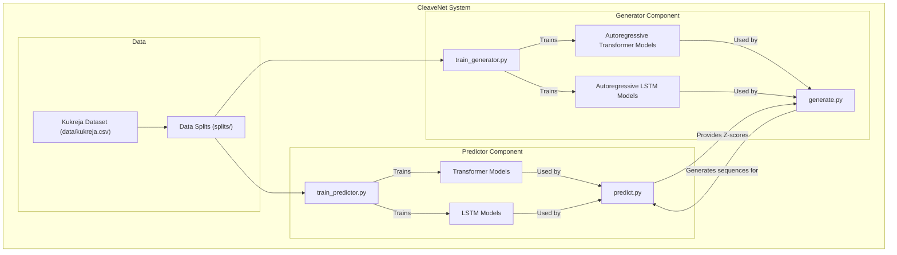
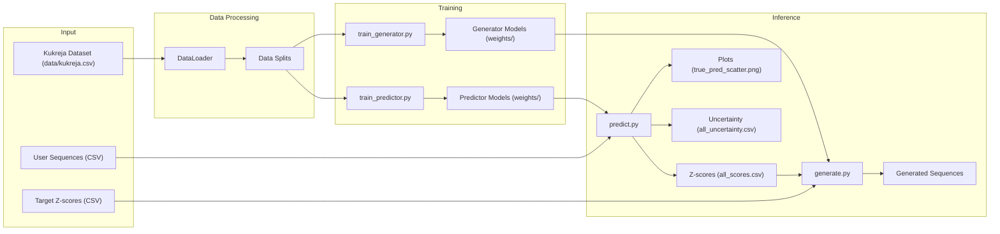
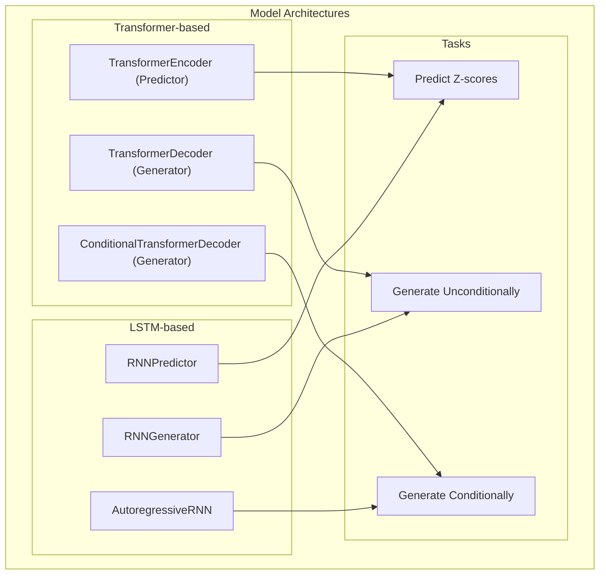
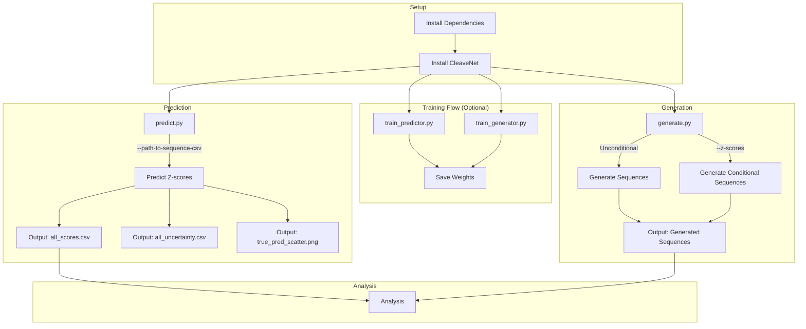

<!-- source: DeepWiki mcp.deepwiki.com · repo microsoft/cleavenet · page 1 Overview · fetched 2026-10-26 -->

# Overview

Relevant source files

The following files were used as context for generating this wiki page:

- [LICENSE](LICENSE)
- [README.md](README.md)

## Purpose and Scope

CleaveNet is an end-to-end AI pipeline for the design and prediction of protease substrates, with a specific focus on matrix metalloproteinases (MMPs). This document provides a high-level introduction to the CleaveNet system, its architecture, and its core components. It explains the purpose of the system, outlines the major components, and describes their interactions.

For detailed installation instructions, see [Installation and Setup](#1.1).
For a quick introduction to using CleaveNet, see [Quick Start Guide](#1.2).
For in-depth information about specific components, see [System Architecture](#2).

Sources: [README.md:1-11]()

## What is CleaveNet?

CleaveNet is a deep learning-based system designed to both predict the cleavage potential of peptide sequences by MMPs and generate new peptide substrates with desired cleavage profiles. The system enhances the scale, tunability, and efficiency of substrate design for proteases, with demonstrated success even in the challenging task of achieving high selectivity for specific MMPs (such as MMP13).

The core innovation of CleaveNet is its ability to not only predict how well peptides will be cleaved by various MMPs but also to generate novel peptide sequences with specified cleavage properties. This enables researchers to design substrates with precise control over their interactions with different proteases.

Sources: [README.md:3-11](), [README.md:20-21]()

## System Overview

CleaveNet consists of two primary components:

1. **Predictor Component**: Estimates the cleavage potential (expressed as Z-scores) of peptide sequences for various MMPs
2. **Generator Component**: Creates novel peptide sequences, either unconditionally or guided by a target cleavage profile

These components work together to enable both the analysis of existing peptide sequences and the design of new ones with specific properties.

Sources: [README.md:26-35](), [README.md:86-98](), [README.md:106-163]()

## Data Flow

The following diagram illustrates the data flow through the CleaveNet system, from training data to prediction and generation:

Sources: [README.md:59-83](), [README.md:100-102](), [README.md:114-126](), [README.md:167-177]()

## Core Components

### Predictor Component

The Predictor component estimates the cleavage potential of peptide sequences for various MMPs. It outputs Z-scores, which represent the likelihood of a peptide being cleaved by a particular MMP, with higher scores indicating a higher likelihood of cleavage.

Key features:
- Supports both Transformer and LSTM model architectures
- Provides uncertainty estimates for predictions
- Capable of evaluating 17 different MMPs: MMP1, MMP2, MMP3, MMP7, MMP8, MMP9, MMP10, MMP11, MMP12, MMP13, MMP14, MMP15, MMP16, MMP17, MMP19, MMP20, and MMP25
- Works with peptide sequences up to 10 residues in length

Sources: [README.md:108-112](), [README.md:156-160]()

### Generator Component

The Generator component creates novel peptide sequences, either unconditionally or guided by a target cleavage profile. It uses autoregressive models to generate sequences character by character.

Key features:
- Supports both conditional and unconditional generation
- Conditional generation creates sequences with desired MMP cleavage profiles
- Provides controls for sampling temperature and repeat penalty to adjust generation diversity
- Outputs sequences that exhibit sound biophysical properties and capture both established and novel cleavage motifs

Sources: [README.md:166-177]()

## Model Architectures

CleaveNet uses two main model architectures, which are implemented for both the Predictor and Generator components:

The Transformer-based models generally provide better performance, while the LSTM-based models can sometimes extrapolate better to unseen protease cleavage patterns, as noted in the paper.

Sources: [README.md:156-160]()

## Usage Workflow

The typical workflow for using CleaveNet involves the following steps:

CleaveNet can be used through both command-line scripts and a Jupyter notebook interface. The command-line scripts provide more flexibility and options, while the Jupyter notebook interface provides a simpler way to get started with the system.

Sources: [README.md:37-39](), [README.md:86-98](), [README.md:106-163](), [README.md:166-177]()

## Available Tools and Interfaces

CleaveNet provides several tools and interfaces for working with the system:

| Tool | Purpose | Location |
|------|---------|----------|
| CleaveNet_Example.ipynb | Jupyter notebook for simplified prediction and generation | notebooks/ |
| train_predictor.py | Script for training Predictor models | src/ |
| train_generator.py | Script for training Generator models | src/ |
| predict.py | Script for predicting cleavage of peptide sequences | src/ |
| generate.py | Script for generating new peptide sequences | src/ |

Sources: [README.md:37-39](), [README.md:86-98](), [README.md:106-163](), [README.md:166-177]()

## Next Steps

This overview has introduced the main components and workflows of the CleaveNet system. For more detailed information, consider exploring these related pages:

- [Installation and Setup](#1.1) - Learn how to install CleaveNet and its dependencies
- [Quick Start Guide](#1.2) - Get started with CleaveNet using simple examples
- [System Architecture](#2) - Dive deeper into the architecture of CleaveNet
- [Predictor Component](#2.1) - Learn more about the Predictor component
- [Generator Component](#2.2) - Learn more about the Generator component
- [Usage Guide](#4) - Explore how to use CleaveNet for different tasks

Sources: [README.md:24-35]()

---

