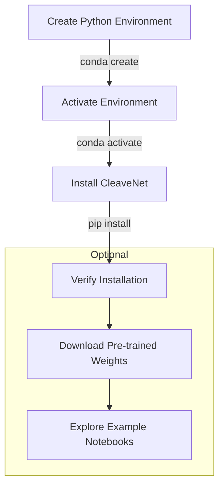
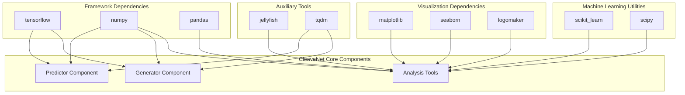
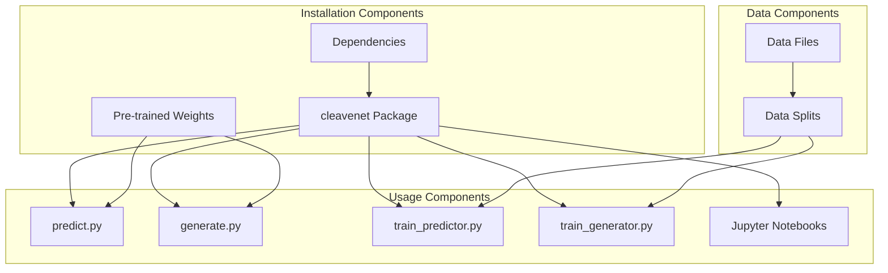

<!-- source: DeepWiki mcp.deepwiki.com · repo microsoft/cleavenet · page 1.1 Installation and Setup · fetched 2026-10-26 -->

# Installation and Setup

<details>
<summary>Relevant source files</summary>

The following files were used as context for generating this wiki page:

- [LICENSE](LICENSE)
- [README.md](README.md)
- [requirements.txt](requirements.txt)
- [setup.py](setup.py)

</details>


This document provides detailed instructions for installing CleaveNet and preparing your environment. CleaveNet is an end-to-end AI pipeline for the design of protease substrates, with a focus on matrix metalloproteinases (MMPs). For a general overview of CleaveNet's purpose and capabilities, see [Overview](#1). For quick usage examples after installation, see [Quick Start Guide](#1.2).

## System Requirements

Before installing CleaveNet, ensure your system meets the following requirements:

- **Python**: Version 3.8 recommended
- **Operating System**: Compatible with Windows, macOS, and Linux
- **Hardware**: While CleaveNet can run on CPU, GPU acceleration is recommended for faster inference, especially for the generator component

## Installation Process

The installation of CleaveNet follows a simple process that involves setting up a Python environment and installing the package.



*Diagram: CleaveNet Installation Process Flow*

Sources: [README.md:44-57]()

### Creating a Python Environment

It's recommended to create a clean environment using conda to avoid dependency conflicts:

```bash
conda create --name cleavenet python=3.8
conda activate cleavenet
```

### Installing CleaveNet

You can install CleaveNet using one of the following methods:

1. **Using pip (Stable Release)**:
   ```bash
   pip install cleavenet
   ```

2. **Directly from GitHub (Latest Development Version)**:
   ```bash
   pip install git+https://github.com/microsoft/cleavenet.git
   ```

Sources: [README.md:50-57](), [setup.py:10-26]()

## Dependencies

CleaveNet relies on several Python packages, which are automatically installed during the pip installation process. Key dependencies include:

| Package | Version | Purpose |
|---------|---------|---------|
| tensorflow | 2.18.0 | Deep learning framework |
| numpy | latest | Numerical computing |
| pandas | 2.2.3 | Data manipulation |
| matplotlib | 3.10.0 | Plotting and visualization |
| scikit_learn | 1.6.1 | Machine learning utilities |
| scipy | 1.15.1 | Scientific computing |
| jellyfish | 1.1.3 | String matching/similarity |
| logomaker | 0.8.6 | Sequence logo visualization |
| seaborn | 0.13.2 | Statistical data visualization |
| tqdm | 4.67.1 | Progress bars |



*Diagram: CleaveNet Dependency Relationships*

Sources: [requirements.txt:1-12]()

## Project Structure

After installation, understanding the project structure is essential for effective use of CleaveNet. The repository is organized as follows:

```mermaid
flowchart TD
    ROOT["cleavenet/"] --> PKG["cleavenet/"]
    ROOT --> DATA["data/"]
    ROOT --> EXAMPLES["examples/"]
    ROOT --> IMG["img/"]
    ROOT --> NOTEBOOKS["notebooks/"]
    ROOT --> SPLITS["splits/"]
    ROOT --> SRC["src/"]
    ROOT --> WEIGHTS["weights/"]
    
    PKG --> MODELS["models.py"]
    PKG --> DATA_PY["data.py"]
    PKG --> ANALYSIS["analysis.py"]
    
    DATA --> KUKREJA["kukreja.csv"]
    DATA --> DESIGN_TXT["cleavenet_design.txt"]
    DATA --> DESIGN_XLSX["cleavenet_design_summary.xlsx"]
    
    SPLITS --> BHATIA["bhatia/"]
    SPLITS --> KUKREJA_SPLIT["kukreja/"]
    SPLITS --> KUKREJA_ROUNDED["kukreja_rounded/"]
    
    SRC --> GENERATE["generate.py"]
    SRC --> PREDICT["predict.py"]
    SRC --> TRAIN_GEN["train_generator.py"]
    SRC --> TRAIN_PRED["train_predictor.py"]
    
    WEIGHTS --> MODEL_ARC["model_arc_ensemble/"]
    WEIGHTS --> TRAINING_SCHEME["training_scheme_model_arc/"]
```



*Diagram: CleaveNet Project Directory Structure*

Sources: [README.md:59-83]()

### Key Components

- **cleavenet/**: Core package functions and modules
- **data/**: Contains datasets used for training and testing
  - `kukreja.csv`: Primary dataset for training/testing models
  - `cleavenet_design.txt`: Sequences tested in the paper
  - `cleavenet_design_summary.xlsx`: Detailed summary of tested sequences
- **examples/**: Example data for testing code from README
- **splits/**: Processed data splits for model training
  - `bhatia/`: Fluorescence test dataset
  - `kukreja/`: mRNA display train/test splits
  - `kukreja_rounded/`: Rounded splits for conditional generation
- **src/**: Scripts for training and inference
  - `generate.py`: For generating peptide sequences
  - `predict.py`: For predicting cleavage of peptide sequences
  - `train_generator.py`: For training the generator model
  - `train_predictor.py`: For training the predictor model
- **weights/**: Pre-trained model weights
- **notebooks/**: Jupyter notebooks for interactive examples

Sources: [README.md:59-83]()

## Verifying Installation

To verify that CleaveNet has been installed correctly, you can run one of the example scripts or notebooks.

### Basic Installation Check

You can verify the installation by importing the package in Python:

```python
import cleavenet
print(cleavenet.__version__)  # Should print the version number
```

### Running Example Notebook

For a more comprehensive check, you can run the example Jupyter notebook:

```bash
jupyter notebook notebooks/CleaveNet_Example.ipynb
```

The notebook should execute without errors, demonstrating basic prediction and generation tasks. It typically takes around 3-5 minutes for the installation and less than 20 minutes to run the entire notebook on CPU.

Sources: [README.md:37-38]()

## Troubleshooting Common Issues

Here are solutions to common installation issues:

1. **TensorFlow Compatibility**: If you encounter TensorFlow installation issues, ensure you have the correct version (2.18.0) installed. CUDA compatibility issues may arise if using GPU acceleration.

2. **Missing Dependencies**: If you see import errors, verify all dependencies are installed:
   ```bash
   pip install -r requirements.txt
   ```

3. **Path Issues**: If modules cannot be found, ensure the CleaveNet package is in your Python path.

4. **Pre-trained Weight Access**: If you cannot access pre-trained weights, check your internet connection or see if the repository was cloned with Git LFS properly.

## System Integration Overview

This diagram illustrates how the installation components fit into the larger CleaveNet system:



*Diagram: CleaveNet System Integration after Installation*

Sources: [README.md:44-83]()

## Next Steps

After completing the installation and setup, you can:

1. Proceed to the [Quick Start Guide](#1.2) to learn basic usage of CleaveNet
2. Explore the example notebooks in the `notebooks/` directory
3. Begin training your own models with the scripts in the `src/` directory
4. Use pre-trained models for prediction and generation tasks

Sources: [README.md:37-38](), [README.md:86-176]()

---

