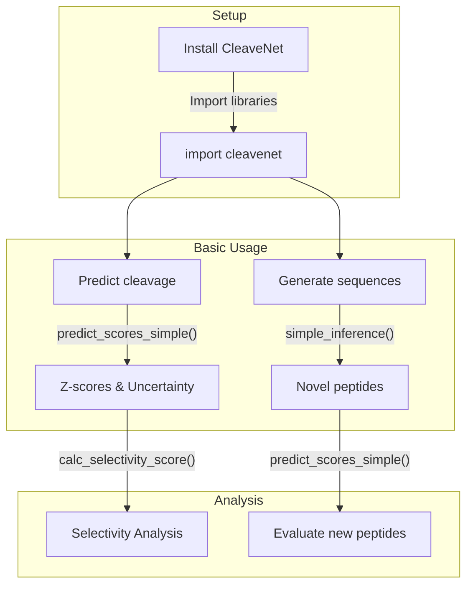
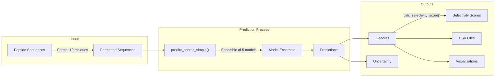
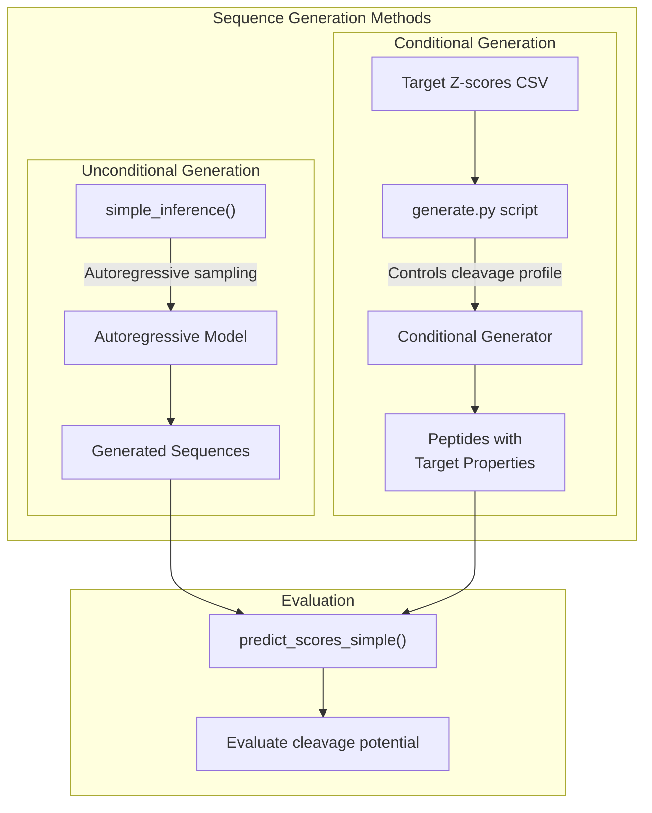
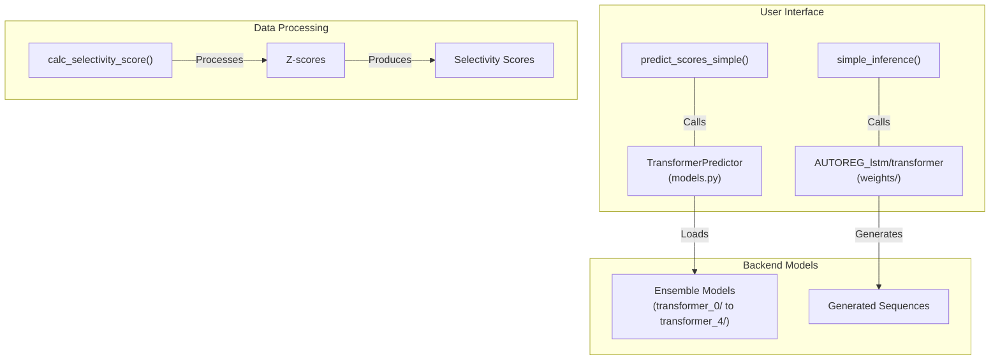

<!-- source: DeepWiki mcp.deepwiki.com · repo microsoft/cleavenet · page 1.2 Quick Start Guide · fetched 2026-10-26 -->

# Quick Start Guide

<details>
<summary>Relevant source files</summary>

The following files were used as context for generating this wiki page:

- [LICENSE](LICENSE)
- [README.md](README.md)
- [notebooks/CleaveNet_Example.ipynb](notebooks/CleaveNet_Example.ipynb)

</details>


This guide provides a quick introduction to using CleaveNet, an end-to-end AI pipeline for predicting protease substrate cleavage and generating novel peptide substrates. It covers basic installation, prediction of cleavage for peptide sequences, and generation of new peptide substrates. For detailed information about the system architecture, see [System Architecture](#2), and for more advanced usage scenarios, refer to the [Usage Guide](#4).

## Installation

CleaveNet requires Python 3.8 and can be installed using pip:

```bash
# Create a new environment (recommended)
conda create --name cleavenet python=3.8
conda activate cleavenet

# Install CleaveNet
pip install cleavenet
```

Alternatively, for the latest development version:

```bash
pip install git+https://github.com/microsoft/cleavenet.git
```

Sources: [README.md:44-57](), [notebooks/CleaveNet_Example.ipynb:15-77]()

## Basic Workflow

The typical CleaveNet workflow involves:

1. Installing the package
2. Predicting cleavage scores for peptide sequences
3. Optionally generating new peptide sequences

### CleaveNet Workflow Diagram



Sources: [README.md:25-35](), [notebooks/CleaveNet_Example.ipynb:100-108]()

## Predicting Cleavage

CleaveNet predicts the cleavage potential (Z-scores) of peptide sequences for various matrix metalloproteinases (MMPs). Higher Z-scores indicate increased likelihood of cleavage.

### Basic Prediction Steps

1. Import the required functions:
```python
from cleavenet.models import predict_scores_simple
from cleavenet.utils import mmps
from cleavenet.analysis import calc_selectivity_score
```

2. Prepare your peptide sequences (each should be 10 residues long):
```python
substrates = [
    '--AAALS---',  # Example of a padded short sequence
    'FMPLNFTASG',  # Full-length sequence
    'LGPYAMTSRG'
]
```

3. Run the prediction:
```python
pred_zscores, unc_scores = predict_scores_simple(
    substrates,
    checkpoint_dir='weights/',  # Path to model weights
    save_dir='outputs/',        # Where to save results
    model_architecture='transformer'  # 'transformer' or 'lstm'
)
```

4. Results will be saved to `save_dir` as:
   - `all_scores.csv`: Z-scores for each sequence and MMP
   - `all_uncertainty.csv`: Uncertainty estimates
   - Visualization plots

### Prediction Process Diagram



### Interpreting Results

CleaveNet predictions include:

1. **Z-scores**: Higher values indicate better substrates
   - Values > 1.0 generally indicate cleavage
   - Values < 0 generally indicate poor substrates

2. **Uncertainty scores**: Lower values indicate higher confidence

3. **Selectivity scores**: Indicate specificity for particular MMPs

Example of analyzing results for MMP13:

```python
# Create a dataframe with predictions
mmp_choice = 'MMP13'
mmp_df = predictions[['sequences', mmp_choice]]
mmp_df = mmp_df.merge(selectivity[['sequences', mmp_choice+'_ss']])
mmp_df = mmp_df.merge(uncertainty[['sequences', mmp_choice+'_unc']])

# Classify as cleaved or not cleaved
z_cutoff = 1.0
mmp_df['Prediction'] = mmp_df[mmp_choice].apply(
    lambda x: 'Cleaved' if x > z_cutoff else 'Not Cleaved'
)
```

Sources: [notebooks/CleaveNet_Example.ipynb:115-637](), [README.md:106-136]()

## Generating Peptide Sequences

CleaveNet can generate novel peptide sequences unconditionally or conditionally based on target Z-scores.

### Unconditional Generation

1. Import the required function:
```python
from cleavenet.models import simple_inference
```

2. Generate sequences:
```python
temperature = 1.0       # Controls diversity (0.7-1.2 recommended)
repeat_penalty = 1.2    # Penalizes repeated amino acids
num_seqs = 10           # Number of sequences to generate

substrate_designs = simple_inference(
    num_seqs, 
    repeat_penalty, 
    temperature
)
```

### Conditional Generation

For conditional generation (generating sequences with specific cleavage properties), use the command-line interface:

```bash
python src/generate.py --num-seqs 400 \
                      --output-dir conditional_generations \
                      --z-scores examples/efficient_conditional_seeds.csv
```

The Z-scores file should contain 18 columns with the MMPs labeled and desired Z-scores for each.

### Generation Process Diagram



Sources: [notebooks/CleaveNet_Example.ipynb:1384-1478](), [README.md:164-178]()

## Example Workflow

Here's a complete example workflow demonstrating both prediction and generation:

```python
import cleavenet
from cleavenet.models import predict_scores_simple, simple_inference
from cleavenet.analysis import calc_selectivity_score
from cleavenet.utils import mmps

# 1. Predict cleavage for existing sequences
substrates = [
    '--AAALS---',
    'FMPLNFTASG',
    'LGPYAMTSRG'
]

pred_zscores, unc_scores = predict_scores_simple(
    substrates,
    checkpoint_dir='weights/',
    save_dir='outputs/',
    model_architecture='transformer'
)

# 2. Analyze results
# Load predictions from CSV files
import pandas as pd
import os

pred_file = os.path.join('outputs/', 'all_scores.csv')
predictions = pd.read_csv(pred_file)

# Calculate selectivity scores
selectivity = calc_selectivity_score(mmps, predictions)

# 3. Generate new sequences
temperature = 1.0
repeat_penalty = 1.2
num_seqs = 10

new_substrates = simple_inference(
    num_seqs, 
    repeat_penalty, 
    temperature
)

# 4. Evaluate new sequences
new_zscores, new_unc = predict_scores_simple(
    new_substrates,
    checkpoint_dir='weights/',
    save_dir='outputs/new_substrates/',
    model_architecture='transformer'
)
```

### Code Entities to Functions Mapping



Sources: [notebooks/CleaveNet_Example.ipynb:100-108](), [notebooks/CleaveNet_Example.ipynb:130-148](), [notebooks/CleaveNet_Example.ipynb:1405-1477]()

## What's Next

After mastering the basics in this Quick Start Guide, you can:

1. Learn about the [Predictor Component](#2.1) and [Generator Component](#2.2) in detail
2. Explore advanced [Training Models](#4.1) options
3. Investigate [Analysis Tools](#4.4) for evaluating results
4. Review the [Example Notebooks](#6) for more complex usage patterns

Sources: [README.md:18-35]()

## Data Format Requirements

### Input Sequence Format

- Sequences should be 10 residues in length
- Shorter sequences can be padded with `-` characters
- Example: `--AAALS---` (a 5-residue sequence `AAALS` padded to 10 positions)

### Z-score CSV Format (for conditional generation)

| MMP1 | MMP10 | MMP12 | ... | MMP9 |
|------|-------|-------|-----|------|
| -3.1 | 1.2   | -2.1  | ... | 0.6  |
| 4.5  | 2.6   | -1.1  | ... | 1.3  |

Sources: [README.md:117-125](), [README.md:174-178]()

---

