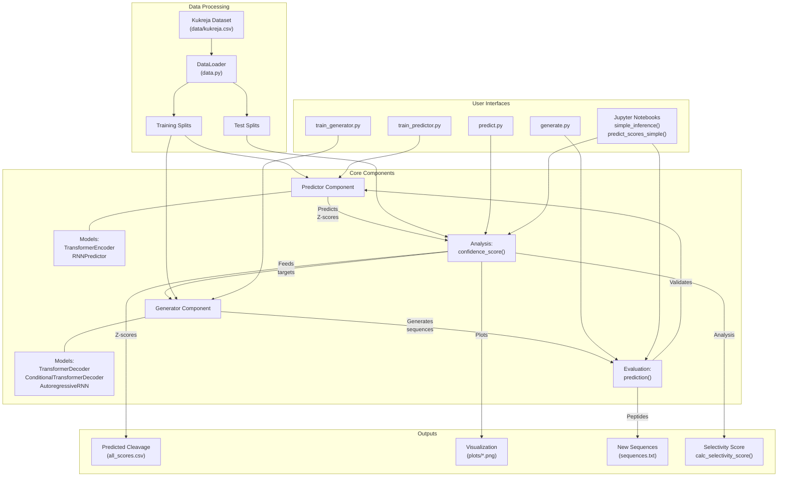
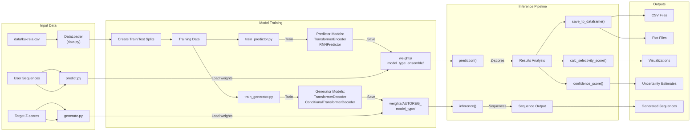
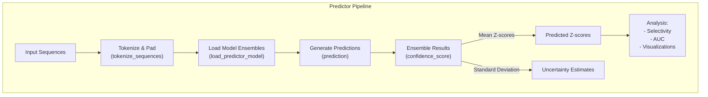
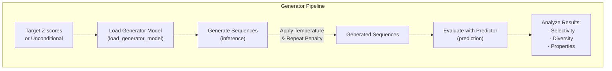
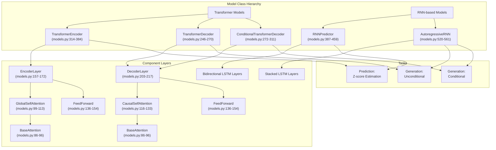
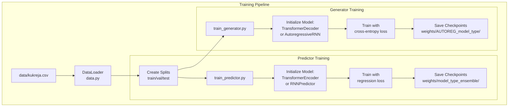
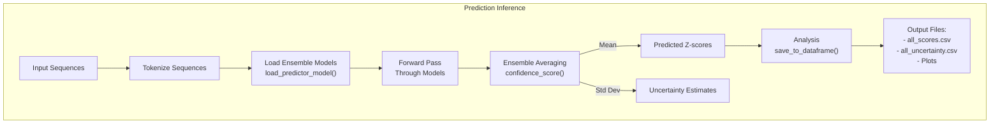
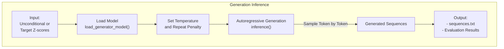
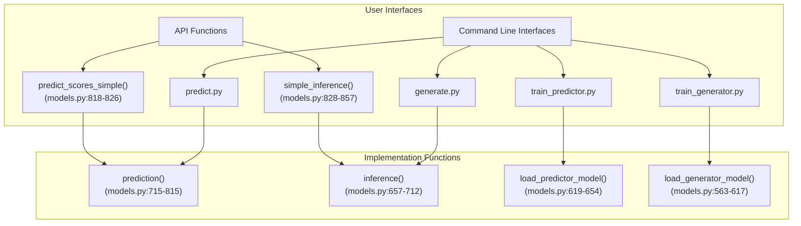

<!-- source: DeepWiki mcp.deepwiki.com · repo microsoft/cleavenet · page 2 System Architecture · fetched 2026-10-26 -->

# System Architecture

Relevant source files

The following files were used as context for generating this wiki page:

- [LICENSE](LICENSE)
- [README.md](README.md)
- [cleavenet/models.py](cleavenet/models.py)

## Purpose and Scope

This document provides a comprehensive overview of CleaveNet's system architecture, explaining the core components and their interactions. It covers the predictor and generator pipelines, model architectures, and data flow throughout the system. For installation instructions, see [Installation and Setup](#1.1). For a quick introduction to using the system, see [Quick Start Guide](#1.2).

## High-Level System Overview

CleaveNet consists of two primary components working together in an end-to-end AI pipeline designed for protease substrate design:

1. **Predictor Component**: Estimates cleavage potential (Z-scores) of peptide sequences for various Matrix Metalloproteinases (MMPs)
2. **Generator Component**: Creates novel peptide sequences with desired cleavage profiles

These components interact with data sources, user interfaces, and each other to enable both analysis and design of protease substrates.

### System Architecture Diagram

Sources: [README.md:3-11](), [cleavenet/models.py:245-460](), [cleavenet/models.py:815-857]()

## Data Flow Pipeline

The CleaveNet system processes data through distinct stages from input to final output, with different paths for prediction and generation tasks.

Sources: [README.md:101-136](), [cleavenet/models.py:657-712](), [cleavenet/models.py:715-815]()

## Core Components

### Predictor Component

The predictor component analyzes peptide sequences to estimate their cleavage potential by various Matrix Metalloproteinases (MMPs). It outputs Z-scores indicating how likely a sequence is to be cleaved by each MMP.

#### Architecture and Models

The predictor uses two main model architectures:

1. **Transformer-based Predictor**:
   - `TransformerEncoder` class from [cleavenet/models.py:314-384]()
   - Uses self-attention mechanisms with positional encoding
   - Supports ensemble prediction for higher accuracy and uncertainty quantification

2. **LSTM-based Predictor**:
   - `RNNPredictor` class from [cleavenet/models.py:387-459]()
   - Uses bidirectional LSTM layers for sequence analysis
   - May have better extrapolation to unseen protease patterns in some cases

#### Prediction Flow

Sources: [cleavenet/models.py:715-815](), [README.md:106-119]()

### Generator Component

The generator component creates new peptide sequences with desired cleavage properties. It can operate in both unconditional and conditional modes, where the latter generates sequences based on target Z-score profiles.

#### Architecture and Models

The generator uses these model architectures:

1. **Transformer-based Generators**:
   - `TransformerDecoder` for unconditional generation from [cleavenet/models.py:246-270]()
   - `ConditionalTransformerDecoder` for conditional generation from [cleavenet/models.py:272-311]()
   - Implements causal self-attention for autoregressive generation

2. **LSTM-based Generator**:
   - `AutoregressiveRNN` from [cleavenet/models.py:520-561]()
   - Uses stacked LSTM layers for sequence generation
   - Supports both conditional and unconditional generation

#### Generation Flow

Sources: [cleavenet/models.py:657-712](), [README.md:166-176]()

## Model Architecture Details

CleaveNet employs both Transformer and LSTM architectures for its prediction and generation tasks. The following diagram shows the relationship between different model types:

Sources: [cleavenet/models.py:86-561]()

### Transformer Architecture

The Transformer models in CleaveNet follow the architecture from the original "Attention is All You Need" paper, with modifications for the specific tasks:

1. **TransformerEncoder**:
   - Global self-attention allows information to flow bi-directionally
   - Positional encoding is added to embeddings to preserve sequence position information
   - Used for prediction tasks with a final dense layer to output Z-scores

2. **TransformerDecoder/ConditionalTransformerDecoder**:
   - Causal self-attention masks future positions during training and generation
   - Autoregressive generation with softmax sampling for token prediction
   - Conditional version accepts Z-score conditioning inputs to guide generation

### LSTM Architecture

The LSTM models use recurrent connections to process sequences:

1. **RNNPredictor**:
   - Two stacked bidirectional LSTM layers
   - Final dense layers for Z-score prediction
   - Dropout and regularization to prevent overfitting

2. **AutoregressiveRNN**:
   - Stacked LSTM layers (default 4)
   - Autoregressive generation similar to the Transformer decoder
   - Temperature sampling and repeat penalties to control generation quality

## Training and Inference Pipeline

### Training Process

The training process involves these key steps:

1. Data loading and preprocessing via `DataLoader`
2. Split creation for training and validation
3. Model instantiation with appropriate hyperparameters
4. Training loop with optimizer and loss functions
5. Checkpoint saving to the `weights/` directory

Sources: [README.md:86-104]()

### Inference Process

The inference process varies between prediction and generation:

#### Prediction Inference

Sources: [cleavenet/models.py:715-815]()

#### Generation Inference

Sources: [cleavenet/models.py:657-712]()

## API and User Interfaces

CleaveNet provides several interfaces for users to interact with the system:

### Command-line Interfaces

1. **Training Scripts**:
   - `train_predictor.py` - Trains the predictor component
   - `train_generator.py` - Trains the generator component

2. **Inference Scripts**:
   - `predict.py` - Predicts cleavage for input sequences
   - `generate.py` - Generates new peptide sequences

### API Functions

For programmatic use, CleaveNet provides simplified interfaces:

1. **Prediction API**:
   - `predict_scores_simple()` - Simple interface for prediction
   - `prediction()` - Full prediction pipeline with analysis

2. **Generation API**:
   - `simple_inference()` - Simple interface for sequence generation
   - `inference()` - Full generation pipeline

Sources: [cleavenet/models.py:657-857](), [README.md:86-176]()

## Summary

CleaveNet's architecture is designed as an end-to-end pipeline for protease substrate design with two primary components: the predictor for estimating cleavage potential and the generator for creating peptide sequences. Both components utilize Transformer and LSTM architectures and can be accessed through command-line interfaces or API functions. The system is designed to be modular, allowing components to be used independently or together in a complete pipeline.

For detailed information about specific components, please refer to:
- [Predictor Component](#2.1)
- [Generator Component](#2.2)
- [Model Architectures](#2.3)

---

