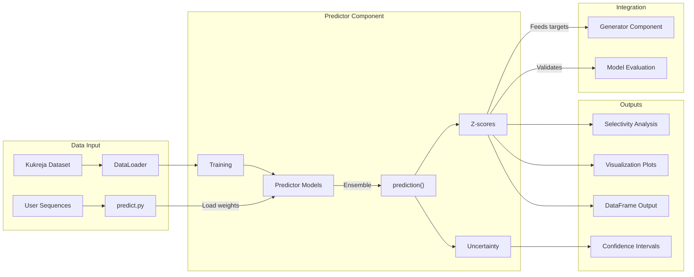
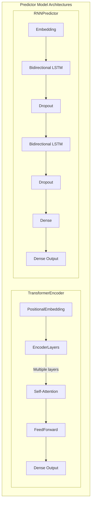
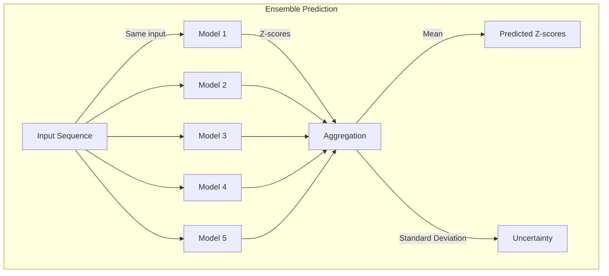
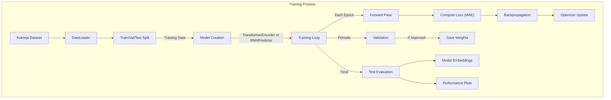
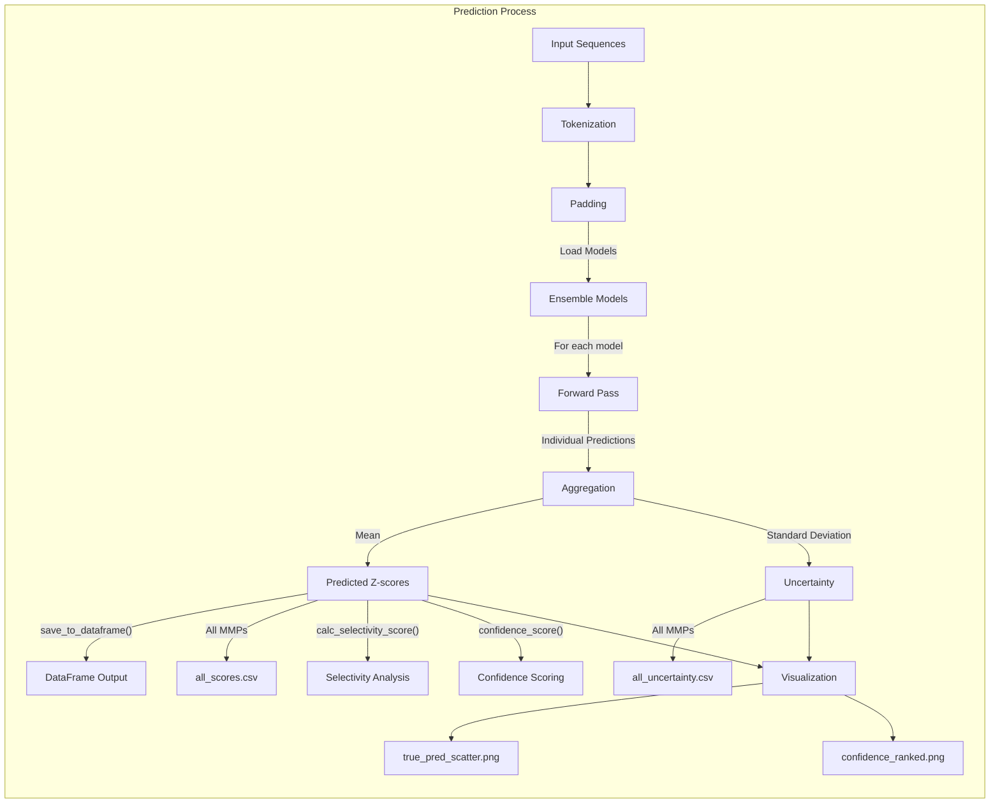

<!-- source: DeepWiki mcp.deepwiki.com · repo microsoft/cleavenet · page 2.1 Predictor Component · fetched 2026-10-26 -->

# Predictor Component

<details>
<summary>Relevant source files</summary>

The following files were used as context for generating this wiki page:

- [LICENSE](LICENSE)
- [README.md](README.md)
- [cleavenet/models.py](cleavenet/models.py)
- [src/predict.py](src/predict.py)
- [src/train_predictor.py](src/train_predictor.py)

</details>


The Predictor Component serves as a core functional element within CleaveNet, responsible for estimating cleavage potential (Z-scores) of peptide sequences for various matrix metalloproteinases (MMPs). This component takes peptide sequences as input and predicts how likely each of 18 different MMPs is to cleave that sequence. These predictions enable substrate specificity analysis and provide targets for the Generator Component (for information about the Generator Component, see [2.2](#2.2)).

## Overview and System Role



The Predictor Component provides a robust foundation for both analysis of existing peptide sequences and generation of new sequences with desired cleavage profiles. It enables users to:

1. Predict cleavage Z-scores for custom peptide sequences
2. Assess confidence in predictions through uncertainty estimation
3. Identify substrates with high specificity for particular MMPs
4. Generate visualization plots for analysis
5. Feed target Z-scores to the Generator Component

Sources: [README.md:103-126](), [cleavenet/models.py:714-815]()

## Model Architectures

The Predictor Component supports two different model architectures:



### Transformer Architecture

The transformer-based predictor uses a `TransformerEncoder` class that implements:

- Positional embedding to encode sequence position information
- Multi-head self-attention mechanisms for capturing relationships between amino acids
- Feed-forward neural networks
- Layer normalization and residual connections
- Final dense layer to output Z-scores for each MMP

This architecture generally provides the best performance and is recommended for most use cases.

Sources: [cleavenet/models.py:314-384](), [src/train_predictor.py:100-115]()

### LSTM Architecture

The LSTM-based predictor uses an `RNNPredictor` class that features:

- Embedding layer to encode amino acid tokens
- Two stacked bidirectional LSTM layers
- Dropout for regularization
- Dense output layers mapping to Z-scores

While the Transformer architecture is generally preferred, the LSTM architecture can sometimes extrapolate better to unseen protease cleavage patterns.

Sources: [cleavenet/models.py:387-459](), [src/train_predictor.py:92-97]()

## Ensemble Prediction

To improve prediction reliability, CleaveNet employs an ensemble approach:



The prediction function loads five separately trained model instances with the same architecture but different random initializations. When making predictions:

1. Each model independently processes the input sequence
2. The final prediction is the mean of all individual model predictions 
3. Uncertainty is calculated as the standard deviation across model predictions

This ensemble approach provides both better accuracy through averaged predictions and a measure of prediction confidence through uncertainty values.

Sources: [cleavenet/models.py:715-773](), [src/predict.py:47-53]()

## Input and Output Format

### Input Format
The Predictor Component accepts peptide sequences up to 10 residues in length. If sequences are shorter, they should be padded with `-` characters:

| Sequence Length | Formatted Example |
|-----------------|-------------------|
| 3 residues      | `---AHA----`      |
| 4 residues      | `---PRVA---`      |
| 5 residues      | `--LRVFL---`      |
| 7 residues      | `--PRVVFLR-`      |
| 10 residues     | `PRVFQLRVFL`      |

The sequences can be provided in a CSV file with one sequence per line.

### Output Format
The Predictor Component outputs:

1. **Z-scores**: Numerical predictions for each of the 18 MMP types (higher values indicate greater cleavage potential)
2. **Uncertainty values**: Standard deviations of predictions across the ensemble
3. **Visualization plots**:
   - True vs. predicted Z-score scatter plots (if true values provided)
   - Confidence-ranked scatter plots
   - Receiver Operating Characteristic (ROC) curves and Area Under Curve (AUC) values
   - Confusion matrices

Sources: [README.md:115-145](), [src/predict.py:9-19]()

## Training Process

The training process for Predictor models is handled by `train_predictor.py`:



Key aspects of the training process:

1. **Data Preparation**: The Kukreja dataset is loaded and split into training, validation, and test sets
2. **Model Creation**: Either a `TransformerEncoder` or `RNNPredictor` is instantiated
3. **Training Loop**: 
   - Forward pass through the model
   - Compute loss (mean absolute error between predicted and true Z-scores)
   - Backpropagation and optimizer update
4. **Validation**: After each epoch, the model is evaluated on validation data
5. **Checkpointing**: Model weights are saved when validation performance improves
6. **Ensemble Creation**: The training process is repeated multiple times with different random seeds to create an ensemble

Sources: [src/train_predictor.py:62-269]()

## Prediction Process

The prediction process is implemented in the `prediction()` function and exposed through the `predict.py` script:



The prediction process involves:

1. **Input Processing**: Tokenizing input sequences and padding to a fixed length
2. **Model Loading**: Loading the ensemble of pretrained model weights
3. **Inference**: Running forward passes through each model in the ensemble
4. **Aggregation**: Computing mean predictions and uncertainty estimates
5. **Analysis**: Calculating selectivity scores and confidence metrics
6. **Output Generation**: Saving predictions to CSV files and generating visualization plots

Sources: [cleavenet/models.py:715-815](), [src/predict.py:41-53]()

## Usage

### Command Line Interface

To predict cleavage Z-scores for a set of peptide sequences:

```bash
python src/predict.py --path-to-sequence-csv sequences.csv --save-dir outputs/
```

Optional arguments:
- `--path-to-zscores`: Path to true Z-scores for comparison
- `--model-architecture`: Choose between 'transformer' (default) or 'lstm'
- `--no-csv-header`: Flag for headerless CSV files

To train a new predictor model:

```bash
python src/train_predictor.py --model-type transformer --num-epochs 50
```

Optional training arguments:
- `--batch-size`: Training batch size (default: 128)
- `--learning-rate`: Learning rate (default: 0.005)
- `--d-model`: Dimension of model (default: 32)
- `--ensemble`: Number of models to train for ensemble (default: 5)

### Python API

For programmatic access, CleaveNet provides a simplified interface through the `predict_scores_simple()` function:

```python
from cleavenet.models import predict_scores_simple

# List of peptide sequences
sequences = ["---AHA----", "---PRVA---", "--LRVFL---"]

# Run prediction
pred_zscores, std_zscores = predict_scores_simple(sequences)
```

Sources: [README.md:106-153](), [cleavenet/models.py:818-826]()

## Model Weights and Performance

Trained model weights are stored in the `weights/` directory:
- Transformer models: `weights/transformer_[0-4]/`
- LSTM models: `weights/lstm_[0-4]/`

The default Transformer-based Predictor achieves state-of-the-art performance on MMP substrate prediction tasks as detailed in the CleaveNet paper.

Sources: [README.md:80-82]()

---

