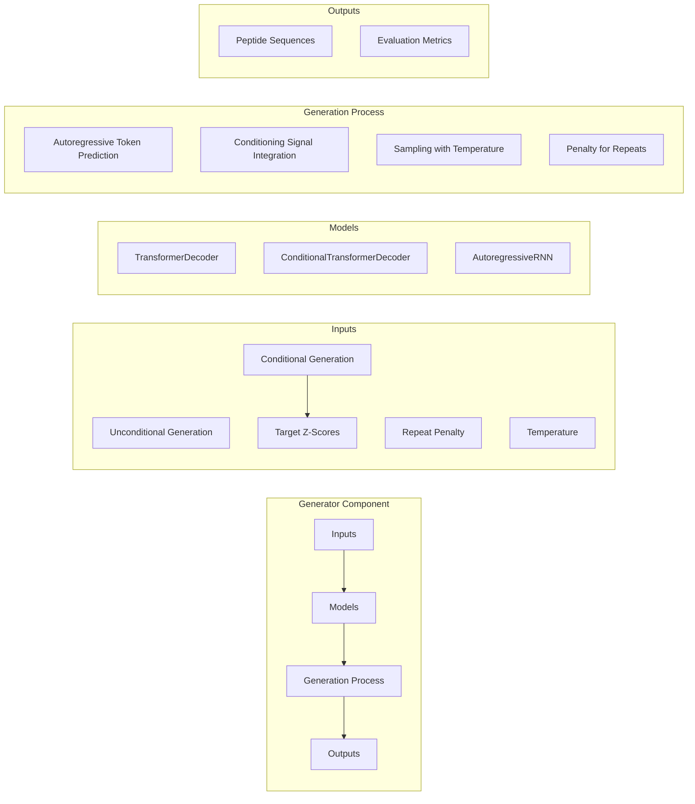
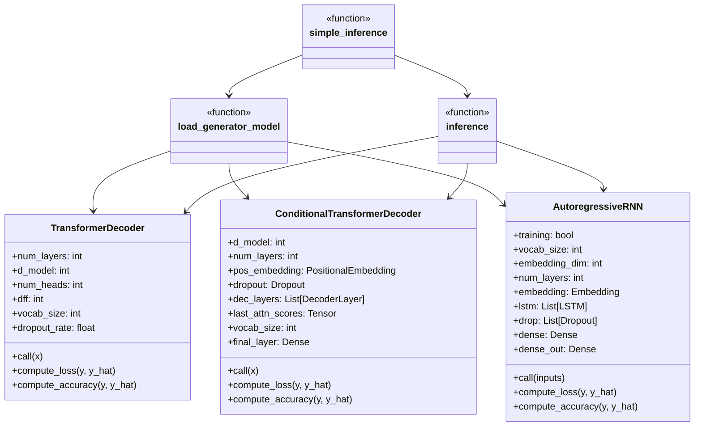
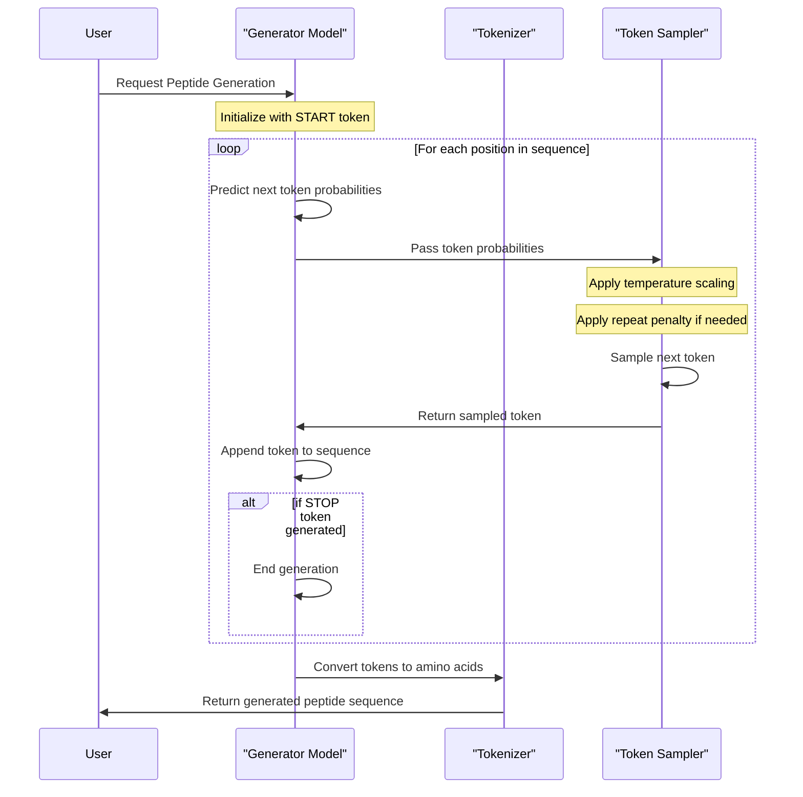
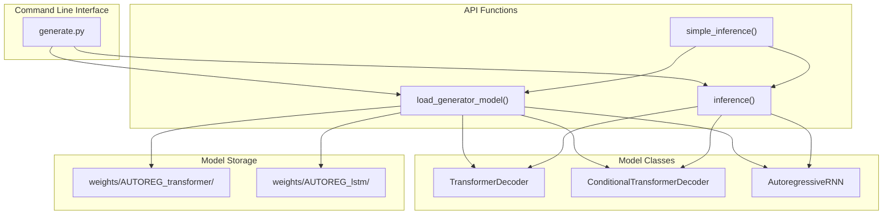

<!-- source: DeepWiki mcp.deepwiki.com · repo microsoft/cleavenet · page 2.2 Generator Component · fetched 2026-10-26 -->

# Generator Component

<details>
<summary>Relevant source files</summary>

The following files were used as context for generating this wiki page:

- [LICENSE](LICENSE)
- [README.md](README.md)
- [cleavenet/models.py](cleavenet/models.py)

</details>


The Generator Component is a key subsystem of CleaveNet that creates peptide sequences with specific cleavage properties. It can operate in two modes: unconditional generation (creating diverse peptide sequences) and conditional generation (creating peptides with targeted cleavage profiles for specific MMPs). This document explains the architecture, functionality, and usage of the Generator Component. For information about predicting cleavage scores of existing sequences, see [Predictor Component](#2.1).

## Overview

The Generator Component uses autoregressive models to generate peptide sequences one amino acid at a time. The models are trained to understand the patterns and structures of valid peptide substrates and can be conditioned on desired cleavage profiles to produce peptides with specific properties.



Sources: [README.md:96-100](), [cleavenet/models.py:245-304](), [cleavenet/models.py:520-561]()

## Generator Model Architectures

The Generator Component can use two different architectural approaches:

### Transformer-based Generators

CleaveNet implements two transformer-based generator models:

1. **TransformerDecoder**: For unconditional generation of peptide sequences
2. **ConditionalTransformerDecoder**: For generating peptides conditioned on target Z-scores

Both models use a decoder-only transformer architecture with causal self-attention to generate sequences autoregressively.

### LSTM-based Generators

CleaveNet also provides LSTM-based alternatives:

1. **RNNGenerator**: A bidirectional LSTM model for learning peptide patterns
2. **AutoregressiveRNN**: An LSTM model specifically designed for autoregressive sequence generation



Sources: [cleavenet/models.py:246-304](), [cleavenet/models.py:520-561](), [cleavenet/models.py:563-617]()

## Generation Process

The generation process in CleaveNet is autoregressive, meaning it generates each amino acid in the sequence one at a time, with each new amino acid conditioned on the previously generated ones.



Sources: [cleavenet/models.py:657-712](), [README.md:165-177]()

### Unconditional Generation

In unconditional generation, the model creates peptide sequences starting with a START token and generates amino acids one by one until reaching a maximum length or generating a STOP token. This mode produces a diverse set of peptides that reflect patterns learned from the training data.

### Conditional Generation

Conditional generation allows control over the cleavage properties of generated peptides. By providing a target Z-score profile (cleavage scores for different MMPs), the generator produces peptides that are predicted to have the desired cleavage behavior.

## Generation Parameters

The generation process can be controlled with two key parameters:

1. **Temperature**: Controls the randomness of generation. Lower values (e.g., 0.5) make generation more deterministic, while higher values (e.g., 1.5) increase diversity.

2. **Repeat Penalty**: Discourages repetition of the same amino acid. A higher value (e.g., 1.5) makes repeats less likely, promoting diversity in the sequence.

## Implementation Details

The Generator Component is implemented through several key functions in the CleaveNet codebase:

### Key Functions

- **`load_generator_model`**: Loads a pre-trained generator model based on specified architecture and training scheme
- **`inference`**: Core function that performs autoregressive generation
- **`simple_inference`**: A high-level wrapper for easy generation of peptides
- **`prediction`**: Evaluates generated sequences using the Predictor Component



Sources: [cleavenet/models.py:563-617](), [cleavenet/models.py:657-712](), [cleavenet/models.py:828-859]()

## Using the Generator Component

### Command Line Usage

The Generator Component can be used through the `generate.py` script:

For unconditional generation:
```
python src/generate.py --num-seqs 20000 --output-dir generations --temperature 1.0 --repeat-penalty 1.2
```

For conditional generation with target Z-scores:
```
python src/generate.py --num-seqs 400 --output-dir conditional_generations --z-scores examples/efficient_conditional_seeds.csv --temperature 1.0 --repeat-penalty 1.2
```

### API Usage

CleaveNet provides a simplified API for generation through the `simple_inference` function:

```python
import cleavenet

# Generate 10 peptide sequences
sequences = cleavenet.models.simple_inference(
    num_seqs=10,           # Number of sequences to generate
    repeat_penalty=1.2,    # Penalty for repeated amino acids
    temperature=1.0        # Sampling temperature
)

# Print generated sequences
for seq in sequences:
    print(seq)
```

## Model Training

The Generator models are trained using the `train_generator.py` script. The models learn from both unconditional (sequence-only) and conditional (with Z-scores) inputs, allowing them to generate both types of outputs. Training data comes from the Kukreja dataset, which contains peptide sequences and their measured cleavage Z-scores for various MMPs.

Training setup and procedure is covered in more detail in the [Training Models](#4.1) section.

Sources: [README.md:94-98](), [README.md:165-177]()

---

