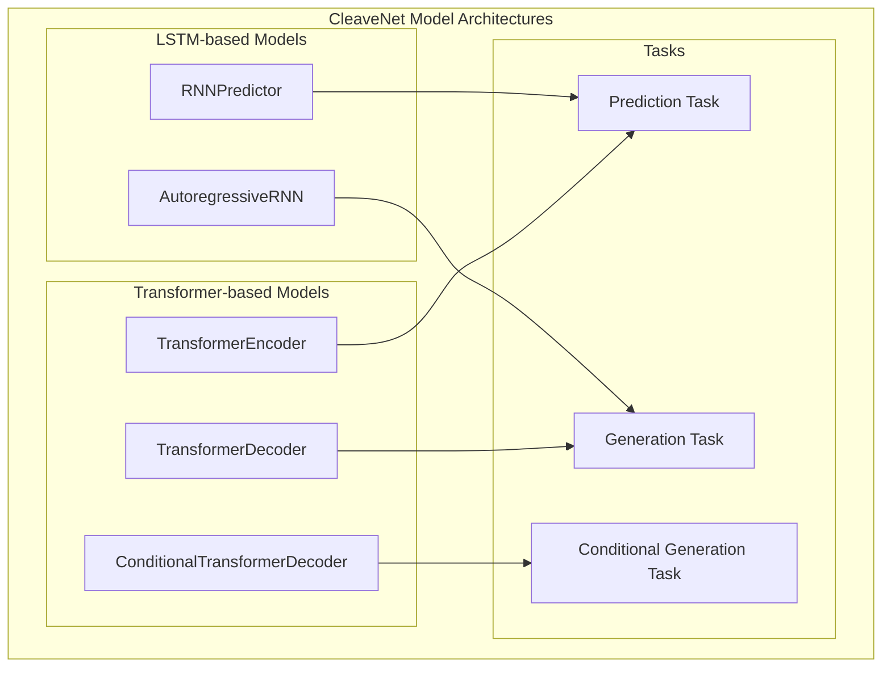
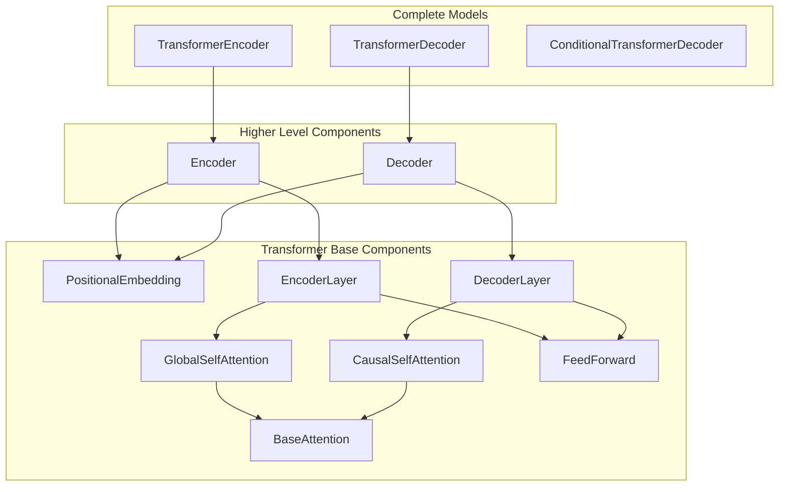
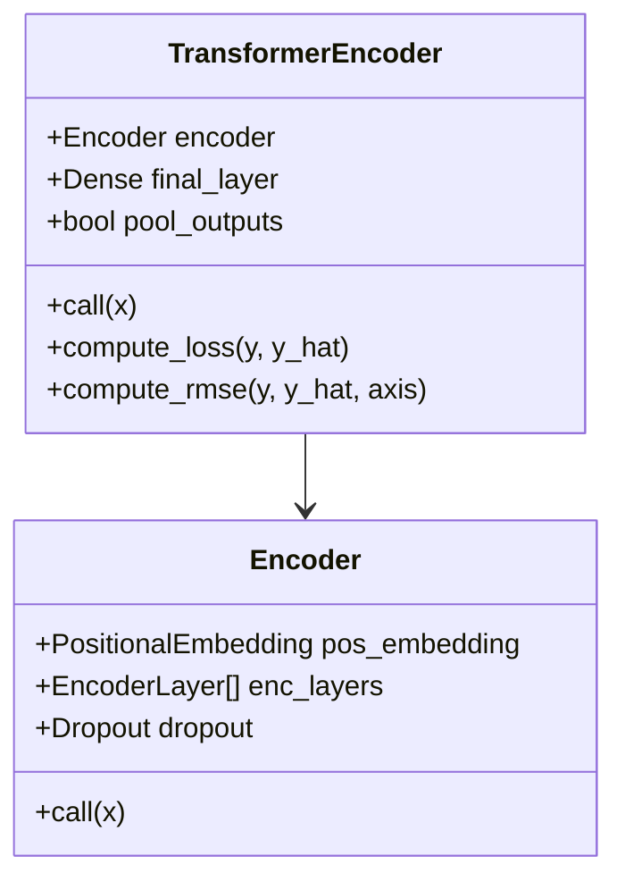
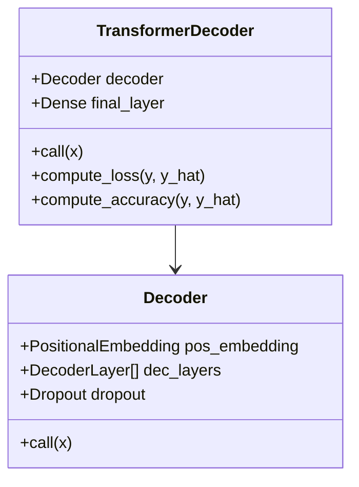
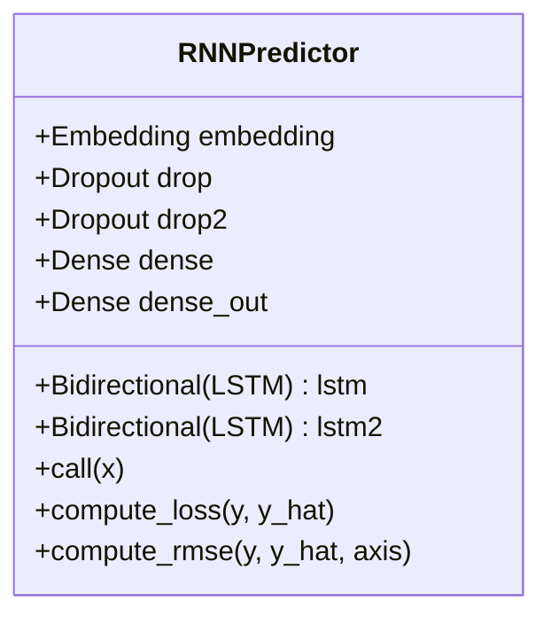
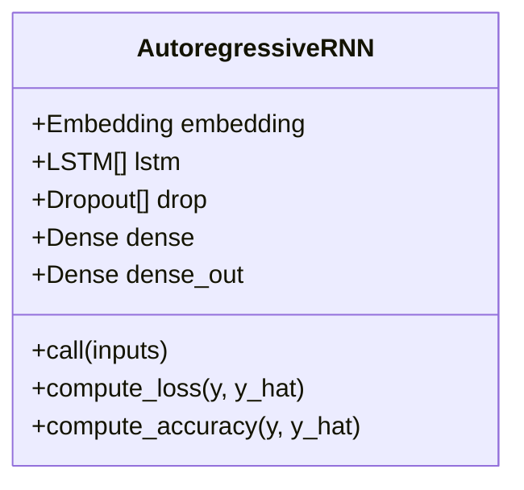
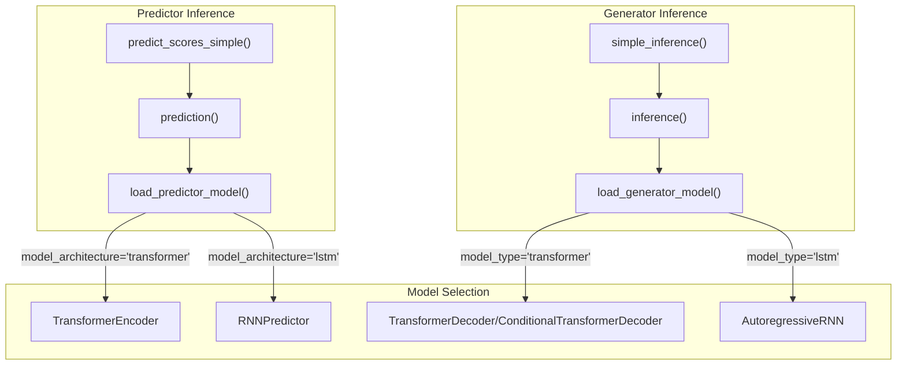
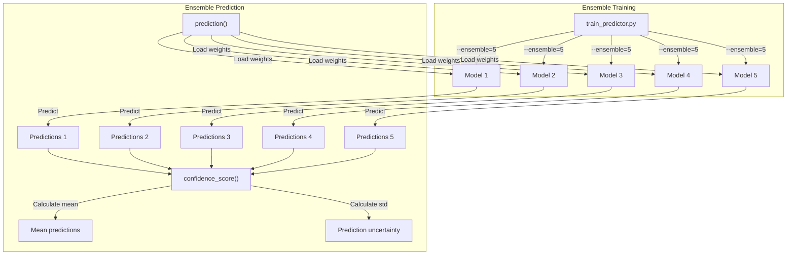

<!-- source: DeepWiki mcp.deepwiki.com · repo microsoft/cleavenet · page 2.3 Model Architectures · fetched 2026-10-26 -->

# Model Architectures

<details>
<summary>Relevant source files</summary>

The following files were used as context for generating this wiki page:

- [cleavenet/models.py](cleavenet/models.py)
- [src/predict.py](src/predict.py)
- [src/train_predictor.py](src/train_predictor.py)

</details>


## Purpose and Scope

This document details the neural network architectures used in CleaveNet for predicting cleavage potential and generating peptide sequences. It covers both Transformer-based and LSTM-based models, their components, and how they're configured for different tasks. For information about how these models are actually used in the prediction and generation workflows, see [Predictor Component](#2.1) and [Generator Component](#2.2).

## Model Architecture Overview

CleaveNet implements two families of model architectures:

1. **Transformer-based models** - Derived from the attention mechanism paper "Attention Is All You Need"
2. **LSTM-based models** - Recurrent neural networks with Long Short-Term Memory cells

Each family has specialized architectures for:
- **Prediction tasks** - Estimating Z-scores for peptide cleavage by MMPs
- **Generation tasks** - Creating new peptide sequences with desired cleavage profiles



Sources: [cleavenet/models.py:245-384](), [cleavenet/models.py:386-460](), [cleavenet/models.py:462-517](), [cleavenet/models.py:520-561]()

## Transformer-based Models

### Transformer Components

The Transformer architecture consists of several key components that are combined to create encoder and decoder models:



Sources: [cleavenet/models.py:11-242]()

#### TransformerEncoder

`TransformerEncoder` is used for the prediction task. It encodes peptide sequences into embeddings that are then used to predict cleavage Z-scores for different MMPs.

**Structure:**
- Encoder with positional embeddings
- Multiple encoder layers with global self-attention and feed-forward networks
- Optional pooling of outputs (taking the first token's representation)
- Final dense layer to produce Z-score predictions

**Implementation:**



Sources: [cleavenet/models.py:314-384](), [src/train_predictor.py:106-115]()

#### TransformerDecoder

`TransformerDecoder` is a decoder-only model used for autoregressive sequence generation.

**Structure:**
- Decoder with positional embeddings
- Multiple decoder layers with causal self-attention and feed-forward networks
- Final dense layer to produce token probabilities

**Implementation:**



Sources: [cleavenet/models.py:246-270]()

#### ConditionalTransformerDecoder

`ConditionalTransformerDecoder` extends the TransformerDecoder to perform conditional generation, where peptide sequences are generated based on desired MMP cleavage profiles.

**Structure:**
- Similar to TransformerDecoder, but with conditional positional embeddings
- Accepts target Z-scores as conditioning input

Sources: [cleavenet/models.py:272-311]()

## LSTM-based Models

CleaveNet also implements LSTM-based models for both prediction and generation tasks, which sometimes offer training or inference advantages compared to Transformer models.

### RNNPredictor

`RNNPredictor` uses bidirectional LSTMs to predict cleavage Z-scores from peptide sequences.

**Structure:**
- Embedding layer for tokenized sequences
- Two stacked bidirectional LSTM layers with dropout
- Dense layers for final prediction

**Implementation:**



Sources: [cleavenet/models.py:387-459](), [src/train_predictor.py:96-97]()

### AutoregressiveRNN

`AutoregressiveRNN` is an LSTM-based model for generating peptide sequences autoregressively.

**Structure:**
- Embedding layer
- Multiple LSTM layers with dropout
- Dense layers for predicting next token probabilities

**Implementation:**



Sources: [cleavenet/models.py:520-561]()

## Model Training and Inference

### Training Configuration

The training configuration for each model type is specified in the training scripts. Key hyperparameters include:

| Model Type | Hyperparameters | Default Values |
|------------|----------------|----------------|
| TransformerEncoder | Number of layers | 4 |
| | Number of heads | 8 |
| | Model dimension | 128 |
| | Dropout rate | 0.01 |
| | Learning rate | Custom schedule |
| RNNPredictor | Embedding dimension | 22 |
| | RNN units | 32 |
| | Dropout rate | 0.25 |
| | Regularization | 0.01 |
| | Learning rate | Fixed (0.005) |

Sources: [src/train_predictor.py:93-117]()

### Inference Functions

CleaveNet provides functions for inference with both predictor and generator models:



Sources: [cleavenet/models.py:563-826]()

#### Prediction Function

The `prediction` function handles the process of running ensemble prediction on sequences, using multiple trained models for better accuracy and uncertainty estimation:

1. Loads an ensemble of trained models
2. Tokenizes input sequences
3. Runs prediction with each model
4. Computes mean predictions and uncertainty estimates
5. Analyzes results and generates visualizations

Sources: [cleavenet/models.py:715-815](), [src/predict.py:47-53]()

#### Inference Function

The `inference` function performs autoregressive generation of peptide sequences:

1. Starts with a seed sequence (e.g., START token or conditioning Z-scores)
2. Iteratively predicts the next token in the sequence
3. Applies optional temperature scaling and repetition penalty
4. Continues until a STOP token is generated or maximum length is reached

Sources: [cleavenet/models.py:657-712]()

## Simplified API

CleaveNet provides simplified API functions to make model usage more accessible:

### predict_scores_simple

```python
def predict_scores_simple(substrates, checkpoint_dir='../weights/', save_dir='outputs/', model_architecture='transformer')
```

This function predicts Z-scores for input peptide sequences using ensemble prediction.

Sources: [cleavenet/models.py:818-826]()

### simple_inference

```python
def simple_inference(num_seqs, repeat_penalty, temperature)
```

This function generates peptide sequences using the transformer-based generator model.

Sources: [cleavenet/models.py:828-859]()

## Ensemble Training and Uncertainty Estimation

CleaveNet uses ensemble training to improve prediction robustness and provide uncertainty estimates:



Sources: [cleavenet/models.py:715-815](), [src/train_predictor.py:58-77]()

---

