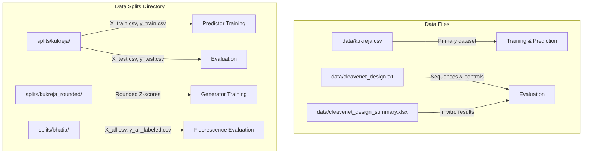
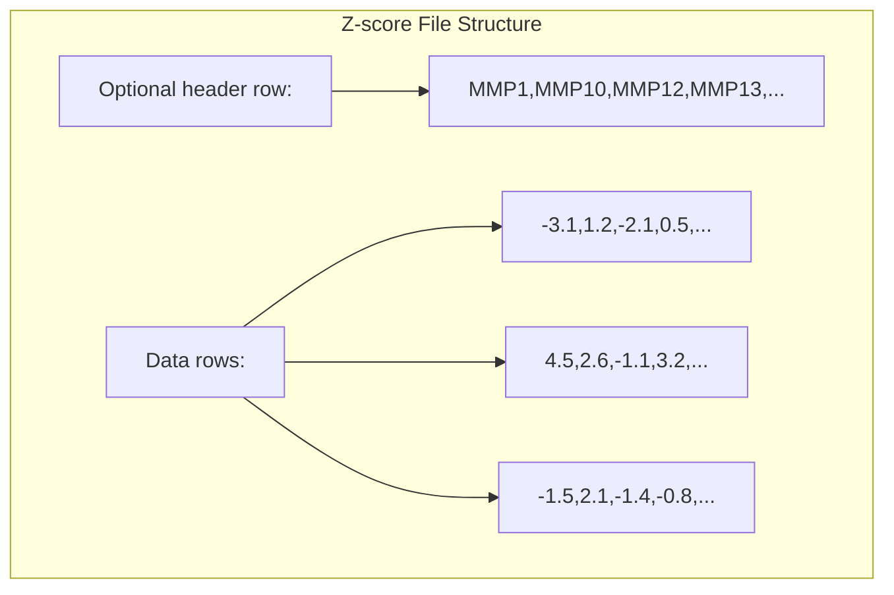
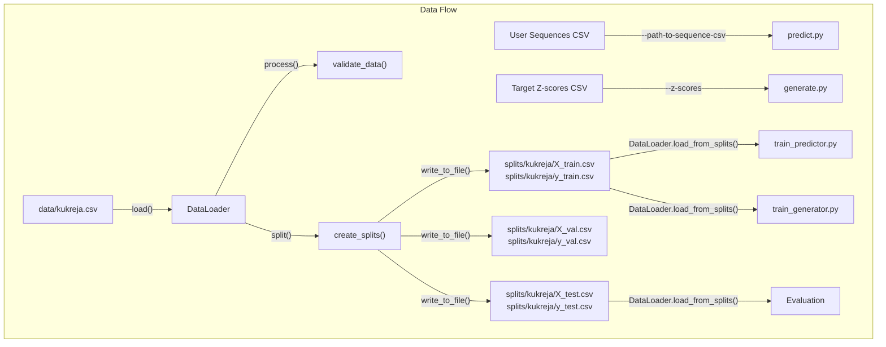
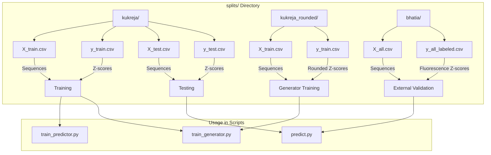
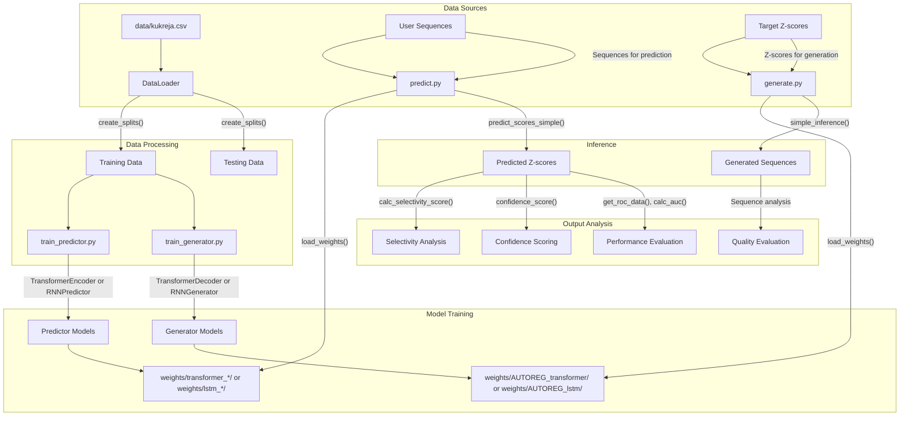

<!-- source: DeepWiki mcp.deepwiki.com · repo microsoft/cleavenet · page 3 Data · fetched 2026-10-26 -->

# Data

<details>
<summary>Relevant source files</summary>

The following files were used as context for generating this wiki page:

- [LICENSE](LICENSE)
- [README.md](README.md)
- [data/cleavenet_design.txt](data/cleavenet_design.txt)
- [data/kukreja.csv](data/kukreja.csv)

</details>


This document provides an overview of the datasets used in CleaveNet and explains how data is structured, processed, and flows through the system. It covers the primary training dataset, validation datasets, and details how to work with data for both training models and inference.

## Dataset Overview

CleaveNet relies on several key datasets for training, validation, and demonstration purposes:

1. **Kukreja Dataset** - The primary dataset used for training and evaluating CleaveNet models, derived from mRNA display experiments
2. **Bhatia Dataset** - A fluorescence-based test dataset used for external validation
3. **CleaveNet Design Dataset** - Sequences generated and tested by CleaveNet, including controls

### Data Directory Structure



Sources: [README.md:63-76]()

## Data Format and Structure

### Peptide Sequence Format

CleaveNet works with peptide sequences up to 10 residues in length. Shorter sequences must be padded with `-` characters on both ends to maintain the fixed 10-residue format.

**Example of properly formatted sequences:**
```
---AHA----
---PRVA---
--LRVFL---
--PRVVFLR-
PRVFQLRVFL
```

### Z-score Format

Z-scores represent cleavage efficiency for different matrix metalloproteinases (MMPs). These are provided in CSV format, with each column representing a different MMP and each row corresponding to a peptide sequence.



Sources: [README.md:113-144]()

## Data Processing Pipeline

CleaveNet uses a `DataLoader` class to handle data validation, processing and split creation. This component provides the bridge between raw data files and the model training process.



Sources: [README.md:100-103]()

## Supported MMPs

CleaveNet models are trained to predict cleavage for 17 different Matrix Metalloproteinases (MMPs):

| MMP ID | Description |
|--------|-------------|
| MMP1   | Collagenase-1 |
| MMP2   | Gelatinase-A |
| MMP3   | Stromelysin-1 |
| MMP7   | Matrilysin |
| MMP8   | Collagenase-2 |
| MMP9   | Gelatinase-B |
| MMP10  | Stromelysin-2 |
| MMP11  | Stromelysin-3 |
| MMP12  | Macrophage Elastase |
| MMP13  | Collagenase-3 |
| MMP14  | MT1-MMP |
| MMP15  | MT2-MMP |
| MMP16  | MT3-MMP |
| MMP17  | MT4-MMP |
| MMP19  | RASI-1 |
| MMP20  | Enamelysin |
| MMP25  | MT6-MMP |

Sources: [README.md:107-110]()

## Working with Custom Data

### For Prediction

To use CleaveNet for predicting cleavage efficiency on custom peptide sequences:

1. Create a CSV file with each sequence on a new line
2. Ensure sequences are 10 residues in length (pad with `-` if necessary)
3. Run the prediction script with your CSV file:

```
python src/predict.py --path-to-sequence-csv your_sequences.csv --save-dir outputs/
```

### For Conditional Generation

To generate sequences with specific cleavage profiles:

1. Create a CSV file with desired Z-scores for each MMP
2. Include header row with MMP names
3. Run the generation script with your Z-scores file:

```
python src/generate.py --num-seqs 400 --output-dir generations --z-scores your_zscores.csv
```

Sources: [README.md:114-127](), [README.md:167-178]()

## Training/Test Data Split Structure

When working with CleaveNet, data is processed into specific directory structures for training and testing. Here is how the data split hierarchy is organized:



Sources: [README.md:67-74]()

## CleaveNet Design Dataset

The `data/cleavenet_design.txt` file contains sequences generated by CleaveNet and control sequences used for experimental validation. The sequences are categorized as follows:

- `top_efficient_unconditional`: Sequences generated unconditionally that were predicted to be efficiently cleaved
- `top_selective_conditional`: Sequences conditionally generated to be selective for specific MMPs
- `sampled baseline + DL (efficient)`: Baseline efficient sequences with deep learning
- `sampled baseline + DL (selective)`: Baseline selective sequences with deep learning
- `sampled_baseline NO DL (efficient)`: Baseline efficient sequences without deep learning
- `sampled_baseline NO DL (selective)`: Baseline selective sequences without deep learning
- `pos controls (efficient)`: Positive control sequences for efficiency
- `pos controls (selective)`: Positive control sequences for selectivity
- `neg controls`: Negative control sequences

This dataset demonstrates CleaveNet's ability to generate peptide sequences with desired cleavage profiles and provides a benchmark for evaluating CleaveNet's performance.

Sources: [data/cleavenet_design.txt:1-104]()

## Data Flow in CleaveNet System

The following diagram shows how data flows through the entire CleaveNet system, from raw data files through processing to training and inference:



Sources: [README.md:80-144](), [README.md:164-178]()

## Custom Data Integration

If you wish to use your own dataset with CleaveNet, there are two main approaches:

1. **Convert to Compatible CSV Format**: Convert your data to match the format of the Kukreja dataset and use with the existing DataLoader
2. **Create Custom DataLoader**: Implement a custom DataLoader class compatible with CleaveNet

For the second approach, refer to `cleavenet/data.py` for an example implementation.

Sources: [README.md:100-103]()

---

