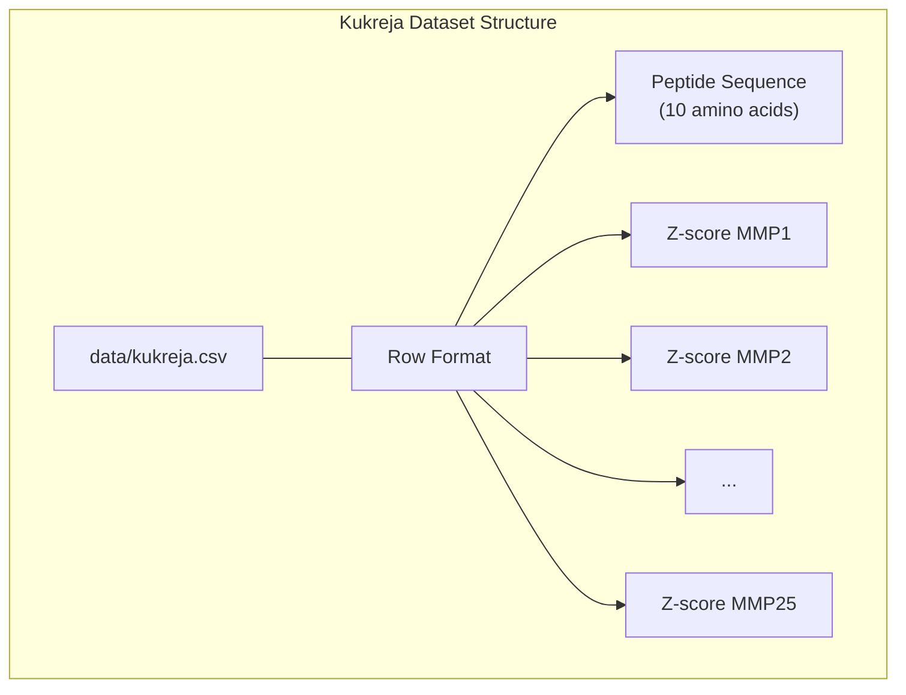
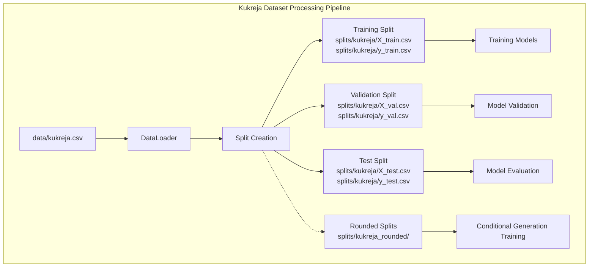
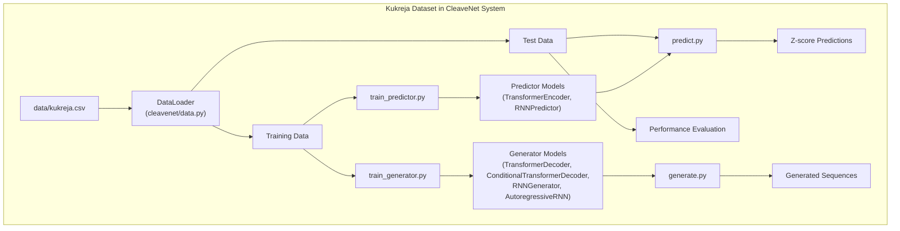

<!-- source: DeepWiki mcp.deepwiki.com · repo microsoft/cleavenet · page 3.1 Kukreja Dataset · fetched 2026-10-26 -->

# Kukreja Dataset

<details>
<summary>Relevant source files</summary>

The following files were used as context for generating this wiki page:

- [LICENSE](LICENSE)
- [README.md](README.md)
- [data/kukreja.csv](data/kukreja.csv)

</details>


This document details the Kukreja Dataset, which serves as the primary training and evaluation dataset for CleaveNet models. This dataset contains peptide sequences and their experimentally determined cleavage Z-scores for various matrix metalloproteinases (MMPs), providing the foundation for training both the predictor and generator components of the CleaveNet system.

## Origin and Citation

The Kukreja Dataset is derived from research published by Kukreja et al. in 2015:

> Kukreja M, Johnston SA, Stafford P. *Immunosignaturing of Protease Abundance and Activity in a Complex Mixture*. High-Throughput. 2015;4(3):362-380.

The original data from this paper was processed and converted into a CSV format (`data/kukreja.csv`) for use in the CleaveNet system. This dataset represents a collection of substrate peptides and their cleavage efficiency measurements against multiple MMPs, determined through mRNA display experiments.

Sources: [README.md:102-102]()

## Dataset Structure and Format

The dataset is stored as a CSV file with the following structure:



Key characteristics of the dataset:
- **Format**: CSV file containing peptide sequences and their corresponding cleavage Z-scores
- **Sequence Length**: 10 amino acids per peptide
- **MMPs Covered**: Includes Z-scores for 17 MMPs (MMP1, MMP2, MMP3, MMP7, MMP8, MMP9, MMP10, MMP11, MMP12, MMP13, MMP14, MMP15, MMP16, MMP17, MMP19, MMP20, and MMP25)
- **Z-scores**: Normalized scores representing cleavage efficiency (higher values indicate more efficient cleavage)

Sources: [README.md:64-64](), [README.md:108-109]()

## Data Processing Pipeline

The raw Kukreja dataset undergoes processing through the CleaveNet DataLoader to prepare it for training and evaluation:



The processed splits are organized as follows:
1. **Training Split**: Used to train both predictor and generator models
2. **Validation Split**: Used for hyperparameter tuning and early stopping
3. **Test Split**: Reserved for final evaluation of model performance
4. **Rounded Splits**: Special processing for conditional generation training where Z-scores are rounded

Sources: [README.md:71-74](), [README.md:100-102]()

## Integration with CleaveNet System

The Kukreja Dataset plays a central role in the CleaveNet workflow:



Key interactions:
- The DataLoader processes the raw Kukreja dataset into training and testing splits
- Training splits are used by `train_predictor.py` and `train_generator.py` to train models
- Test splits are used to evaluate model performance through `predict.py`
- The trained models are then used for prediction and generation tasks

Sources: [README.md:86-96](), [README.md:106-120]()

## Usage Examples

### Predicting Cleavage on Test Data

To use the Kukreja test set for evaluating the predictor model:

```bash
python src/predict.py --path-to-sequence-csv splits/kukreja/X_test.csv \
                     --path-to-zscores splits/kukreja/y_test.csv \
                     --no-csv-header \
                     --save-dir outputs/kukreja_test
```

This command loads the test sequences from the Kukreja dataset, generates predictions using the trained predictor model, and compares them with the true Z-scores.

Sources: [README.md:147-152]()

### Creating Custom DataLoader for Similar Datasets

If you have similar data to the Kukreja dataset, you can:
1. Convert your data to a compatible CSV format
2. Process it through the CleaveNet DataLoader
3. Or write a custom DataLoader following the pattern in `cleavenet/data.py`

Sources: [README.md:102-102]()

## Data Format Requirements

The input sequences for the predictor should:
- Be up to 10 residues in length
- Be padded with `-` tokens on both ends if shorter than 10 residues

Example of properly formatted sequences:

```
---AHA----
---PRVA---
--LRVFL---
--PRVVFLR-
PRVFQLRVFL
```

Sources: [README.md:117-125]()

## Related Pages

For more information about:
- Using the dataset for training models, see [Training Models](#4.1)
- Predicting cleavage with trained models, see [Predicting Cleavage](#4.2)
- Generating sequences with the trained generator, see [Generating Sequences](#4.3)
- Data pipeline architecture, see [System Architecture](#2)

---

