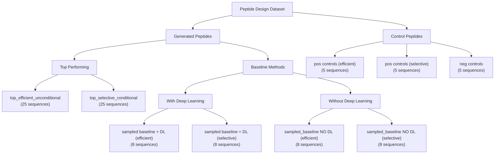
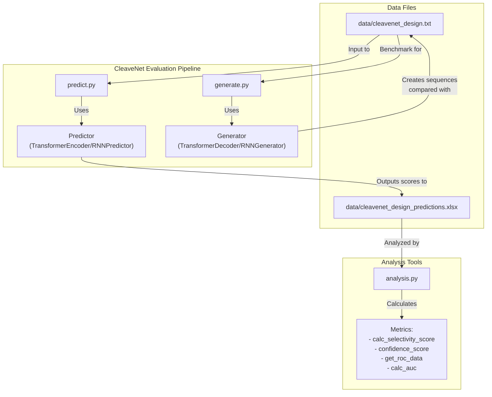
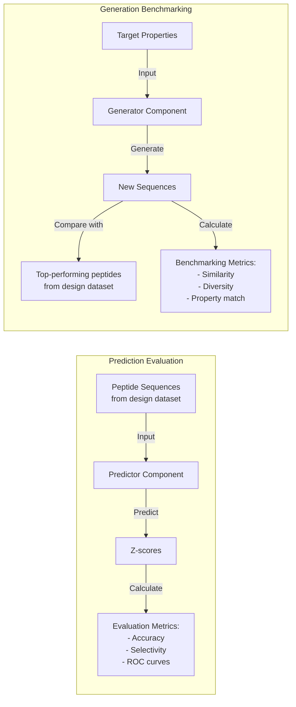

<!-- source: DeepWiki mcp.deepwiki.com · repo microsoft/cleavenet · page 3.2 Peptide Design Data · fetched 2026-10-26 -->

# Peptide Design Data

<details>
<summary>Relevant source files</summary>

The following files were used as context for generating this wiki page:

- [data/cleavenet_design.txt](data/cleavenet_design.txt)
- [data/cleavenet_design_predictions.xlsx](data/cleavenet_design_predictions.xlsx)

</details>


This document describes the peptide design data used for evaluating and demonstrating CleaveNet's capabilities in predicting protease substrate cleavage and generating novel peptide sequences. Unlike the Kukreja dataset (see [Kukreja Dataset](#3.1)) which is used for training, this dataset serves specifically for evaluation and demonstration purposes.

## Dataset Structure

The peptide design dataset consists of 97 peptide sequences organized into 9 distinct categories, stored in `data/cleavenet_design.txt`, with corresponding predictions in `data/cleavenet_design_predictions.xlsx`.



Sources: [data/cleavenet_design.txt:1-104]()

## Peptide Categories in Detail

### Generated Peptides

1. **Top Efficient Unconditional** (25 sequences):
   - High-performing peptides generated by CleaveNet's generator without specific conditions
   - Optimized for efficient cleavage by MMPs generally
   - Example sequences: FMPLNFTASG, LGPYAMTSRG, LGPLGITASG

2. **Top Selective Conditional** (25 sequences):
   - High-performing peptides generated by CleaveNet with specific conditions
   - Optimized for selective cleavage by particular MMPs
   - Example sequences: YGPRAVTASG, SGPRAFWGTA, TPPRAFMDGH

3. **Sampled Baseline with Deep Learning**:
   - **Efficient** (8 sequences): VAPLPMRAWL, LAPLGLTTSK, LGPYAMKAPW, etc.
   - **Selective** (8 sequences): HGPRAVTAAG, VAPRGFVDQG, MMPRAFYDPG, etc.

4. **Sampled Baseline without Deep Learning**:
   - **Efficient** (8 sequences): IPPVALIATG, KATHAIRHKG, NGPFMLHLLR, etc.
   - **Selective** (8 sequences): HIPRWFHSEW, VPPVGVSAGG, HGPRNVTDAW, etc.

### Control Peptides

5. **Positive Controls**:
   - **Efficient** (5 sequences): RMPLGLRAPA, WMPLGMRAGG, GRPADLRTAS, etc.
   - **Selective** (5 sequences): VMPSGFRGKH, MSPKGVTASG, GYPRAFSTAS, etc.

6. **Negative Controls** (5 sequences):
   - Peptides expected to perform poorly in cleavage assays
   - Example sequences: QGRRRRPERG, TSFRMLFRKT, RTYSHLYSSS

Sources: [data/cleavenet_design.txt:1-104]()

## Data Format

### Sequence File Format

The peptide design data in `data/cleavenet_design.txt` follows this format:
- Category headers start with `>` followed by the category name
- Each subsequent line contains a single peptide sequence (typically 10 amino acids)
- Categories are separated by blank lines

Example from the file:
```
>top_efficient_unconditional
FMPLNFTASG
LGPYAMTSRG
LGPLGITASG
...

>top_selective_conditional
YGPRAVTASG
SGPRAFWGTA
TPPRAFMDGH
...
```

### Predictions File Format

The `data/cleavenet_design_predictions.xlsx` file contains:
- Peptide sequences
- Predicted Z-scores for multiple MMPs
- Evaluation metrics like selectivity scores and efficiency scores
- Comparison metrics between different prediction methods

Sources: [data/cleavenet_design.txt:1-104](), [data/cleavenet_design_predictions.xlsx:1-5]()

## Integration with CleaveNet

The peptide design dataset integrates with CleaveNet's evaluation workflow as shown below:



Sources: System overview diagrams, [data/cleavenet_design.txt:1-104](), [data/cleavenet_design_predictions.xlsx:1-5]()

## Usage in Evaluation

### Sample Data Table

Here's a representative sample of the peptide design data:

| Category | Peptide Sequence | Description |
|----------|-----------------|-------------|
| top_efficient_unconditional | FMPLNFTASG | Optimized for efficient cleavage |
| top_selective_conditional | YGPRAVTASG | Optimized for selective cleavage |
| sampled baseline + DL (efficient) | VAPLPMRAWL | Baseline with deep learning (efficient) |
| sampled baseline + DL (selective) | HGPRAVTAAG | Baseline with deep learning (selective) |
| sampled_baseline NO DL (efficient) | IPPVALIATG | Baseline without deep learning (efficient) |
| sampled_baseline NO DL (selective) | HIPRWFHSEW | Baseline without deep learning (selective) |
| pos controls (efficient) | RMPLGLRAPA | Known efficiently cleaved peptide |
| pos controls (selective) | VMPSGFRGKH | Known selectively cleaved peptide |
| neg controls | QGRRRRPERG | Expected poor cleavage performance |

Sources: [data/cleavenet_design.txt:1-104]()

### Evaluation Workflow

The peptide design dataset is used in two primary ways in the CleaveNet evaluation workflow:

1. **Prediction Evaluation**: 
   - Peptide sequences are provided to the Predictor component
   - Z-scores (cleavage potential) for various MMPs are predicted
   - Results are compared with expected outcomes
   - Metrics like selectivity scores and AUC values are calculated

2. **Generation Benchmarking**:
   - The high-performing sequences serve as benchmarks
   - New sequences generated by the Generator component are compared to these benchmarks
   - Similarity, diversity, and performance metrics are used to assess generation quality



Sources: System overview diagrams, [data/cleavenet_design.txt:1-104]()

## Conclusion

The peptide design dataset provides a comprehensive resource for evaluating CleaveNet's capabilities in predicting cleavage potential and generating novel peptide sequences. By including a diverse range of peptide categories—from optimally generated sequences to various baseline methods and controls—this dataset enables rigorous assessment of both the Predictor and Generator components of the CleaveNet system.

---

