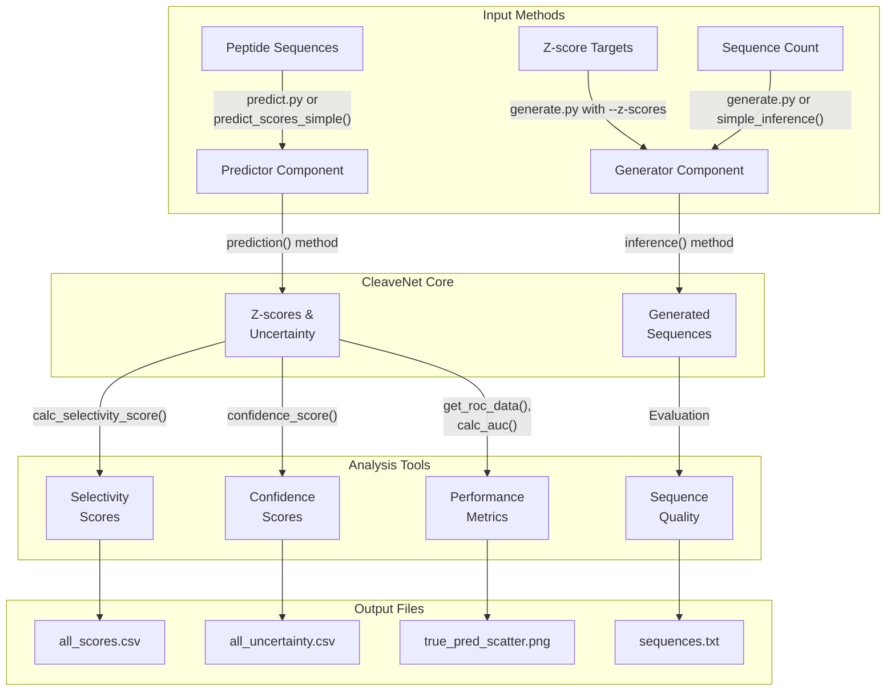
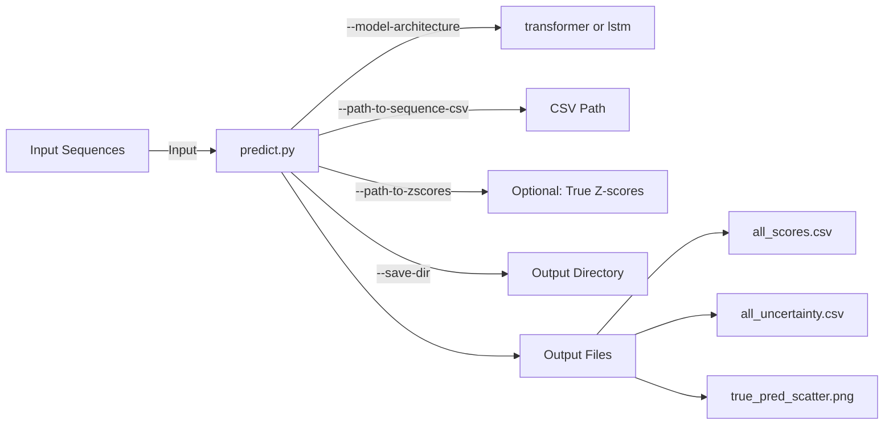
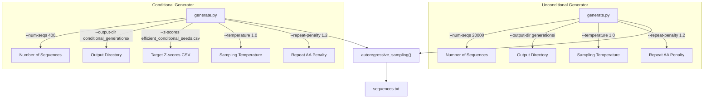
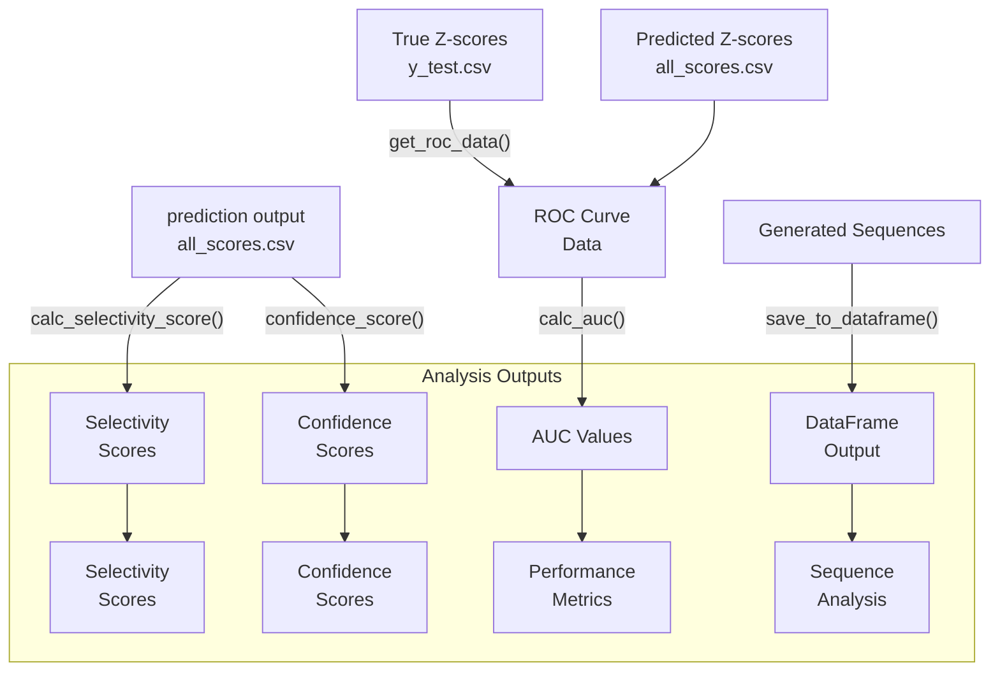
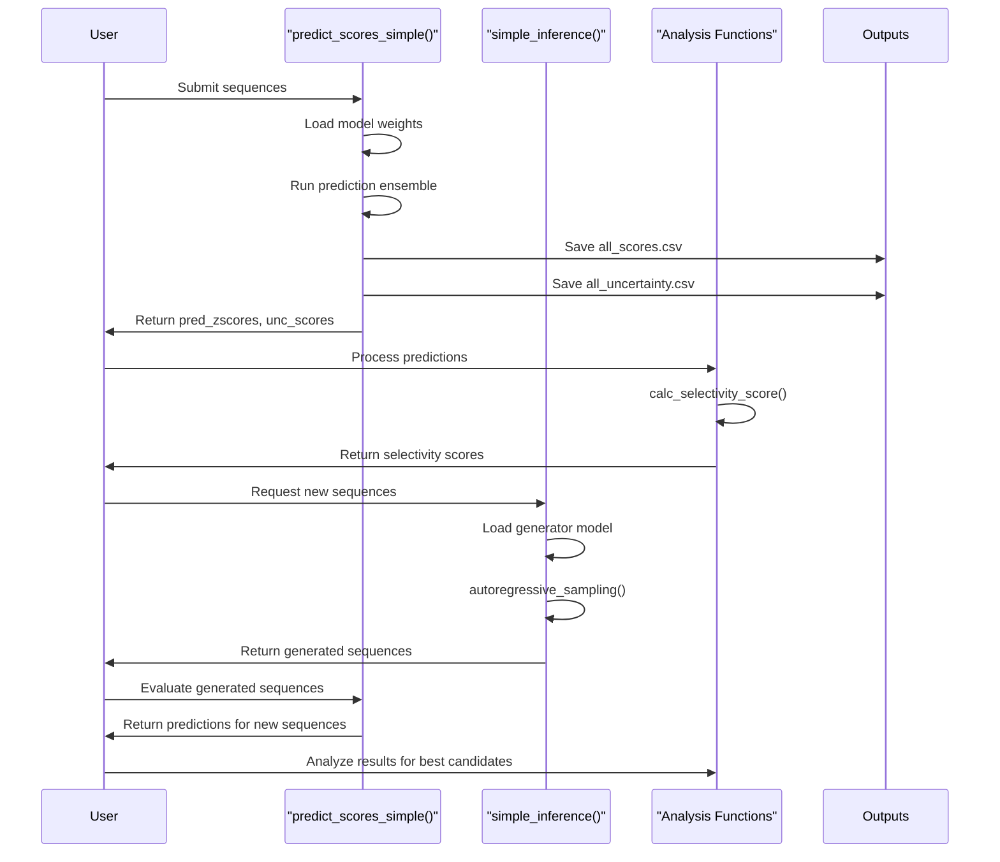

<!-- source: DeepWiki mcp.deepwiki.com · repo microsoft/cleavenet · page 4 Usage Guide · fetched 2026-10-26 -->

# Usage Guide

<details>
<summary>Relevant source files</summary>

The following files were used as context for generating this wiki page:

- [LICENSE](LICENSE)
- [README.md](README.md)
- [notebooks/CleaveNet_Example.ipynb](notebooks/CleaveNet_Example.ipynb)

</details>


This guide provides a detailed overview of how to use the CleaveNet system for peptide cleavage prediction and sequence generation. For information about installation, refer to [Installation and Setup](#1.1). For architectural details, see [System Architecture](#2).

## Overview of CleaveNet Usage Patterns

CleaveNet offers two primary interfaces for utilizing the system:

1. **Command-line scripts** - For batch processing and model training
2. **Python API** - For interactive use in Python scripts or Jupyter notebooks

### Core CleaveNet Components and Interaction



Sources:
- [README.md:18-34]()
- [notebooks/CleaveNet_Example.ipynb:116-121]()

## Predicting Cleavage

CleaveNet can predict cleavage potential (Z-scores) for peptide sequences against various matrix metalloproteinases (MMPs). For training details, see [Training Models](#4.1).

### Command-line Interface for Prediction



Example command:
```
python src/predict.py --path-to-sequence-csv splits/kukreja/X_test.csv --save-dir outputs/
```

Important options:

| Option | Description | Default |
|--------|-------------|---------|
| `--path-to-sequence-csv` | Path to CSV with sequences | Required |
| `--path-to-zscores` | Path to CSV with true Z-scores | Optional |
| `--save-dir` | Output directory | Required |
| `--model-architecture` | `transformer` or `lstm` | `transformer` |
| `--no-csv-header` | Flag for CSV without header | `False` |

Sources:
- [README.md:106-153]()

### Python API for Prediction

```python
from cleavenet.models import predict_scores_simple

# List of peptide sequences
sequences = ['--AAALS---', 'FMPLNFTASG', 'LGPYAMTSRG']

# Predict Z-scores and uncertainty values
pred_zscores, unc_scores = predict_scores_simple(
    sequences, 
    checkpoint_dir='weights/', 
    save_dir='outputs/', 
    model_architecture='transformer'
)

# Access results from dataframes
predictions = pd.read_csv('outputs/all_scores.csv')
uncertainty = pd.read_csv('outputs/all_uncertainty.csv')
```

Sources:
- [notebooks/CleaveNet_Example.ipynb:130-141]()
- [notebooks/CleaveNet_Example.ipynb:632-636]()
- [notebooks/CleaveNet_Example.ipynb:840-846]()

### Sequence Format Requirements

CleaveNet expects peptide sequences to be exactly 10 residues in length. Shorter sequences must be padded with `-` characters:

```
---AHA----  # 3-residue sequence with padding
---PRVA---  # 4-residue sequence with padding
--LRVFL---  # 5-residue sequence with padding
--PRVVFLR-  # 7-residue sequence with padding
PRVFQLRVFL  # 10-residue sequence (no padding needed)
```

Sources:
- [README.md:118-125]()

### Prediction Analysis

The prediction output includes Z-scores and uncertainty estimates that can be analyzed:

```python
# Import analysis functions
from cleavenet.analysis import calc_selectivity_score
from cleavenet.utils import mmps

# Calculate selectivity scores
selectivity = calc_selectivity_score(mmps, predictions)
selectivity.rename(columns=lambda x:x+'_ss', inplace=True)

# Assign binary cleavage predictions using thresholds
z_cutoff = 1.0  # Threshold from paper Table S5
mmp_df['Prediction'] = mmp_df['MMP13'].apply(
    lambda x: 'Cleaved' if x > z_cutoff else 'Not Cleaved'
)
```

Sources:
- [notebooks/CleaveNet_Example.ipynb:1040-1047]()
- [notebooks/CleaveNet_Example.ipynb:1374-1380]()

## Generating Sequences

CleaveNet can generate new peptide sequences using the `generate.py` script or `simple_inference()` function, either unconditionally or with specific cleavage profiles.

### Command-line Interface for Generation



#### Unconditional Generation

```
python src/generate.py --num-seqs 20000 --output-dir generations
```

#### Conditional Generation

```
python src/generate.py --num-seqs 400 --output-dir conditional_generations --z-scores examples/efficient_conditional_seeds.csv
```

Sources:
- [README.md:164-178]()

### Python API for Generation

```python
from cleavenet.models import simple_inference

# Set generation parameters
temperature = 1.0  # Higher = more diverse, lower = less diverse
repeat_penalty = 1.2  # Higher = fewer repeat amino acids
num_seqs = 10  # Number of sequences to generate

# Generate sequences
substrate_designs = simple_inference(
    num_seqs=num_seqs, 
    repeat_penalty=repeat_penalty, 
    temperature=temperature
)

# Example output:
# ['SLPLNLSYEK', 'RPLSHWQATI', 'SLPRYLYDVQ', 'PLAWHYISGI', 'MSLATLWAGW']
```

Sources:
- [notebooks/CleaveNet_Example.ipynb:1405-1411]()
- [notebooks/CleaveNet_Example.ipynb:1421-1441]()
- [notebooks/CleaveNet_Example.ipynb:1456-1468]()

### Generation Parameters

| Parameter | Description | Default | Effect |
|-----------|-------------|---------|--------|
| `temperature` | Sampling temperature | 1.0 | Higher values increase diversity, lower values reduce diversity |
| `repeat_penalty` | Penalty for repeated amino acids | 1.2 | Higher values discourage repeat amino acids |
| `num_seqs` | Number of sequences to generate | - | Controls output quantity |

Sources:
- [README.md:167-169]()
- [notebooks/CleaveNet_Example.ipynb:1405-1411]()

### Conditional Generation Format

For conditional generation, the Z-scores CSV file should contain columns for each MMP with the target Z-scores:

```
MMP1,MMP10,MMP12,...,MMP25
-3.1,1.2,-2.1,...,1.5
4.5,2.6,-1.1,...,-0.8
```

Each row in this file will be used as a condition for generating `--num-seqs` sequences.

Sources:
- [README.md:172-176]()
- [README.md:137-144]()

## Analysis Tools

CleaveNet provides functions in the `analysis` module for processing prediction results and generated sequences.

### Analysis Components and Workflow



Sources:
- [notebooks/CleaveNet_Example.ipynb:1040-1047]()
- [notebooks/CleaveNet_Example.ipynb:1242-1248]()
- [notebooks/CleaveNet_Example.ipynb:1374-1380]()

### Selectivity Analysis

```python
from cleavenet.analysis import calc_selectivity_score
from cleavenet.utils import mmps

# Calculate selectivity scores
selectivity = calc_selectivity_score(mmps, predictions)
selectivity.rename(columns=lambda x:x+'_ss', inplace=True)

# Example output:
#   MMP13_ss  MMP1_ss  MMP2_ss  ...
#   0.258274  1.133106 0.744370 ...
```

Sources:
- [notebooks/CleaveNet_Example.ipynb:1040-1047]()

### Uncertainty Assessment

```python
# Access uncertainty values from file
uncertainty = pd.read_csv('outputs/all_uncertainty.csv')

# Or use values returned by predict_scores_simple
pred_zscores, unc_scores = predict_scores_simple(sequences)

# Example uncertainty values:
#   MMP13_unc  MMP1_unc  MMP2_unc  ...
#   0.119394   0.155442  0.164949  ...
```

Sources:
- [notebooks/CleaveNet_Example.ipynb:1242-1248]()

### Cleavage Classification

```python
# Assign binary cleavage predictions using MMP-specific thresholds
z_cutoff = 1.0  # Threshold varies by MMP, see paper Table S5
mmp_df['Prediction'] = mmp_df['MMP13'].apply(
    lambda x: 'Cleaved' if x > z_cutoff else 'Not Cleaved'
)

# Example output:
#   sequences    MMP13     Prediction
#   FMPLNFTASG   2.459345  Cleaved
#   AARFKKFATE  -0.762877  Not Cleaved
```

Sources:
- [notebooks/CleaveNet_Example.ipynb:1374-1380]()

## End-to-End Usage Workflow



Sources:
- [README.md:3-11]()
- [notebooks/CleaveNet_Example.ipynb:630-637]()
- [notebooks/CleaveNet_Example.ipynb:1040-1047]()
- [notebooks/CleaveNet_Example.ipynb:1421-1477]()

For more information about training your own models, see [Training Models](#4.1). For complete API reference documentation, see [API Reference](#5).

---

