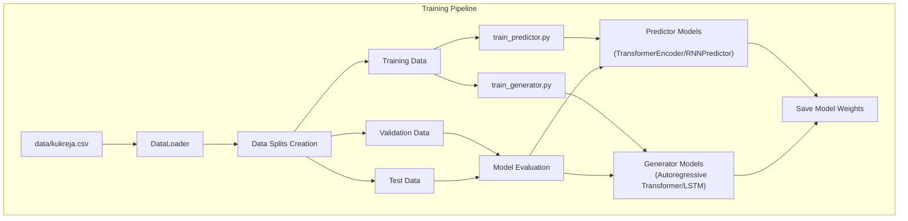
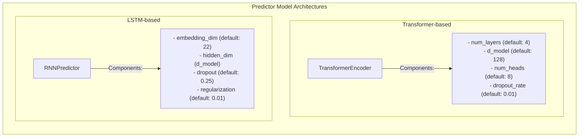
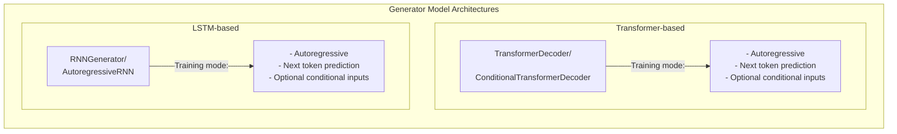
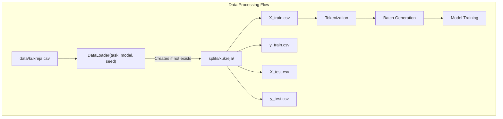

<!-- source: DeepWiki mcp.deepwiki.com · repo microsoft/cleavenet · page 4.1 Training Models · fetched 2026-10-26 -->

# Training Models

<details>
<summary>Relevant source files</summary>

The following files were used as context for generating this wiki page:

- [LICENSE](LICENSE)
- [README.md](README.md)
- [src/predict.py](src/predict.py)
- [src/train_predictor.py](src/train_predictor.py)

</details>


This document explains how to train the two main model types in CleaveNet: the Predictor (which estimates cleavage potential of peptide sequences) and Generator (which creates peptide sequences with desired cleavage profiles). For information about using these trained models for prediction and generation, see [Predicting Cleavage](#4.2) and [Generating Sequences](#4.3).

## Overview of Training Pipeline

CleaveNet's training process involves two separate models that can be trained independently:

1. **Predictor Model** - Estimates cleavage Z-scores for peptide sequences across different MMPs
2. **Generator Model** - Creates peptide sequences either unconditionally or conditioned on target cleavage profiles



Sources: [README.md:86-102](), [src/train_predictor.py:1-270]()

## Prerequisites

Before training models, ensure you have:

1. Installed CleaveNet and its dependencies (see [Installation and Setup](#1.1))
2. Access to the training data (`data/kukreja.csv` by default)
3. Sufficient computational resources (training is faster with GPU acceleration)

The default dataset used is the Kukreja dataset, which is included in the repository. If you wish to use your own data, it should follow the same format as the Kukreja dataset.

Sources: [README.md:44-57](), [README.md:100-102]()

## Training the Predictor Model

The Predictor model estimates cleavage potential (Z-scores) for peptide sequences across various MMPs.

### Command-line Usage

To train the Predictor model with default settings:

```bash
python src/train_predictor.py
```

This will use the default configuration to train a Transformer-based predictor model.

### Command-line Options

The following are key command-line options for `train_predictor.py`:

| Option | Default | Description |
|--------|---------|-------------|
| `--num-epochs` | 50 | Number of training epochs |
| `--model-type` | 'transformer' | Model architecture ('transformer' or 'lstm') |
| `--max-len` | 10 | Maximum sequence length to add to dataset |
| `--batch-size` | 128 | Batch size for training |
| `--learning-rate` | 0.005 | Learning rate (for LSTM, Transformer uses a custom schedule) |
| `--d-model` | 32 | Dimension of model embeddings |
| `--ensemble` | 5 | Number of models to train for ensemble prediction |
| `--split` | 0.8 | Train/validation split ratio |

Sources: [src/train_predictor.py:22-48]()

### Predictor Model Architectures

CleaveNet supports two predictor model architectures:



The default and recommended architecture is the Transformer-based model, which generally offers better performance for most use cases.

Sources: [src/train_predictor.py:92-116]()

### Training Process

The predictor training process follows these steps:

1. **Data loading and preparation**: The Kukreja dataset is loaded and split into training, validation, and test sets
2. **Model initialization**: The model architecture is initialized based on command-line arguments
3. **Training loop**: The model is trained for the specified number of epochs
4. **Validation**: The model is evaluated on the validation set after each epoch
5. **Checkpointing**: The model weights are saved when validation performance improves
6. **Final evaluation**: The best model is evaluated on the test set

The script trains an ensemble of models (default: 5) to improve prediction robustness and provide uncertainty estimates.

Sources: [src/train_predictor.py:63-271]()

### Model Output and Evaluation

During training, the script:

1. Logs loss and RMSE metrics to TensorBoard
2. Saves model weights when validation performance improves
3. Evaluates on a separate test dataset (Bhatia)
4. Generates parity plots comparing predicted vs. true Z-scores
5. Calculates and plots RMSE for each MMP

Model weights are saved to the `weights/` directory with a structure reflecting the model architecture and ensemble member:
- `weights/transformer_X/` for Transformer models
- `weights/lstm_X/` for LSTM models

Where `X` is the ensemble member index (0-4 by default).

Sources: [src/train_predictor.py:170-267]()

## Training the Generator Model

The Generator model creates peptide sequences either unconditionally or conditioned on target cleavage profiles.

### Command-line Usage

To train the Generator model with default settings:

```bash
python src/train_generator.py
```

This trains an autoregressive model that can generate peptide sequences.

### Generator Model Architectures

The Generator supports two autoregressive architectures:



The generator model is autoregressive and trained to predict the next token in a sequence given previous tokens, with optional conditioning on target Z-scores.

Sources: [README.md:97-98]()

### Conditional vs. Unconditional Training

The Generator can be trained in two modes:

1. **Unconditional Generation**: Trained to generate sequences based only on previously generated tokens
2. **Conditional Generation**: Trained to generate sequences based on both previously generated tokens and target Z-scores

Conditional training enables the model to generate peptide sequences with specific cleavage profiles, which is useful for designing selective substrates.

### Model Output

Generator model weights are saved to the `weights/` directory with a structure reflecting the training scheme and model architecture:
- `weights/AUTOREG_transformer/` for autoregressive Transformer models
- `weights/AUTOREG_lstm/` for autoregressive LSTM models

Sources: [README.md:79-82]()

## Data Handling and Splits

Both training scripts use the `DataLoader` class to handle data loading, tokenization, and splitting:



By default, the training scripts will:

1. Use existing splits in the `splits/` directory if present
2. Create new splits from `data/kukreja.csv` if no splits are found
3. Use a 80/20 train/test split by default

To use custom data, you can either:
1. Replace `data/kukreja.csv` with your own data in the same format
2. Create custom splits in the `splits/` directory
3. Implement a custom `DataLoader` class

Sources: [README.md:99-102](), [src/train_predictor.py:64-76]()

## Best Practices and Recommendations

1. **Model Selection**:
   - Use the Transformer-based models for most applications
   - LSTM models may perform better for certain specific tasks or when extrapolating to unseen protease cleavage patterns

2. **Ensemble Size**:
   - The default ensemble size is 5, which provides a good balance between performance and computational cost
   - Larger ensembles provide better uncertainty estimates but require more training time

3. **Training Resources**:
   - GPU acceleration is recommended but not required
   - Training the full ensemble typically takes several hours on a modern GPU

4. **Data Considerations**:
   - CleaveNet has been optimized for peptide sequences of length 10
   - Performance on significantly shorter or longer sequences has not been extensively evaluated

Sources: [README.md:157-159](), [src/train_predictor.py:46-48]()

## Troubleshooting

| Issue | Possible Solution |
|-------|------------------|
| Out of memory errors | Reduce batch size using `--batch-size` |
| Poor convergence | Adjust learning rate using `--learning-rate` |
| Overfitting | Increase regularization or dropout |
| Slow training | Use GPU acceleration if available |
| Model saving errors | Ensure write permissions to the `weights/` directory |

For more complex issues or customizations, see the [API Reference](#5) section.

---

