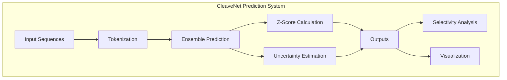
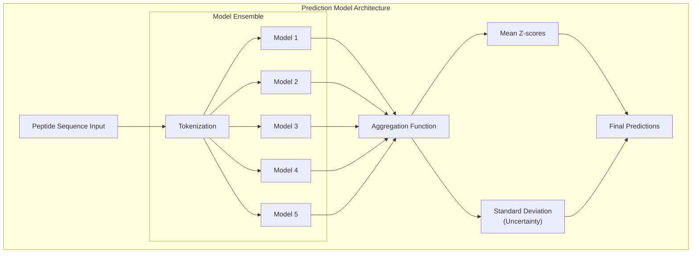
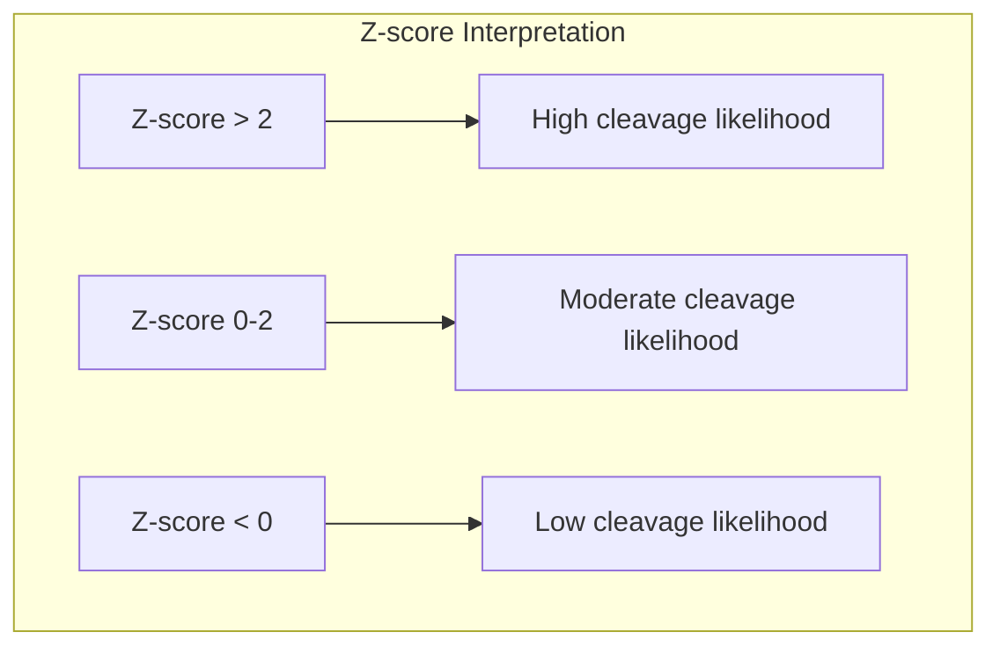
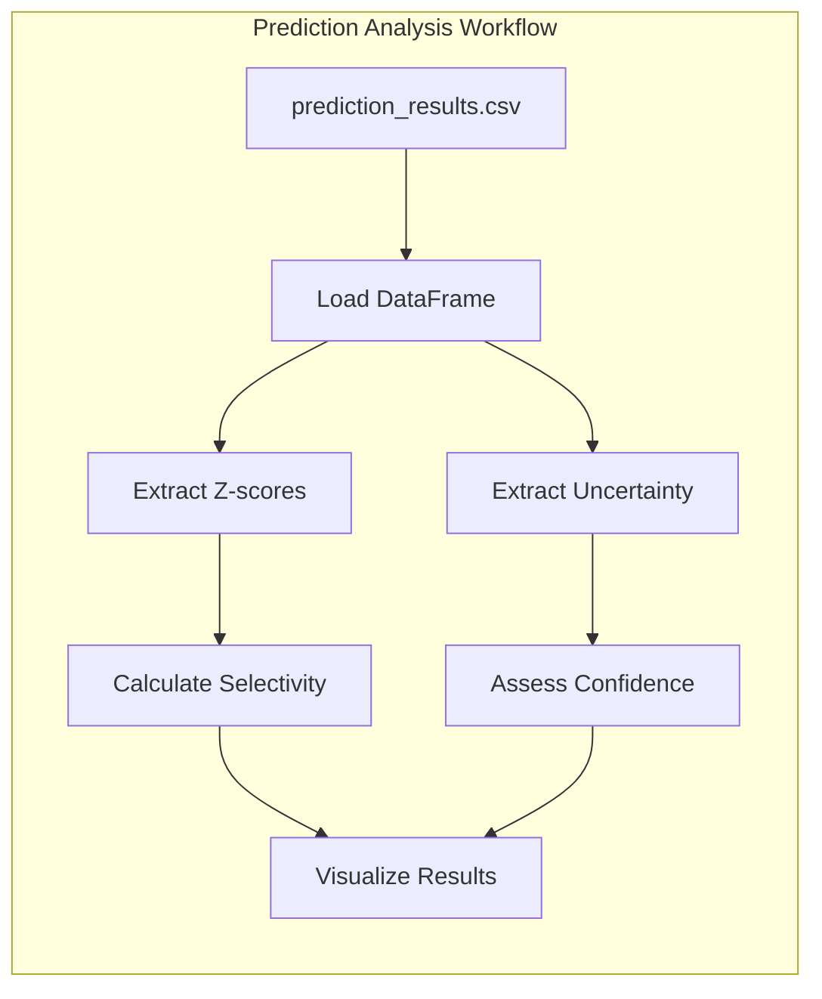
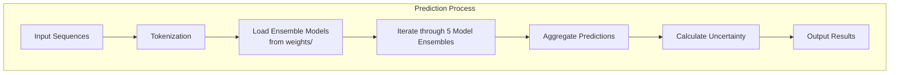

<!-- source: DeepWiki mcp.deepwiki.com · repo microsoft/cleavenet · page 4.2 Predicting Cleavage · fetched 2026-10-26 -->

# Predicting Cleavage

<details>
<summary>Relevant source files</summary>

The following files were used as context for generating this wiki page:

- [LICENSE](LICENSE)
- [README.md](README.md)
- [notebooks/CleaveNet_Example.ipynb](notebooks/CleaveNet_Example.ipynb)
- [src/predict.py](src/predict.py)
- [src/train_predictor.py](src/train_predictor.py)

</details>


This page explains how to use CleaveNet to predict cleavage potential (Z-scores) of peptide sequences for various matrix metalloproteinases (MMPs). For information about generating new peptide sequences with specific cleavage profiles, see [Generating Sequences](#4.3).

## Overview of the Prediction System

CleaveNet uses an ensemble of neural network models to predict how likely a peptide sequence is to be cleaved by various MMPs. The system outputs both Z-scores (indicating cleavage potential) and uncertainty estimates.



Sources: [README.md:105-136](), [src/predict.py:1-53]()

## Prediction Architecture

CleaveNet uses an ensemble approach with either transformer-based or LSTM-based models. By default, it uses an ensemble of 5 transformer models, each trained with different random seeds.



Sources: [src/train_predictor.py:46-68](), [notebooks/CleaveNet_Example.ipynb:100-109]()

### Model Types

CleaveNet supports two types of models for prediction:

| Model Type | Description | When to Use |
|------------|-------------|------------|
| Transformer | Uses self-attention mechanism to capture global dependencies in sequences | Default choice, provides good performance for most uses |
| LSTM | Uses recurrent neural networks to model sequential data | Can extrapolate better to unseen protease cleavage patterns in some cases |

Sources: [README.md:154-159](), [src/train_predictor.py:92-116]()

## Using the Command-Line Interface

The simplest way to predict cleavage is through the command-line interface:

```bash
python src/predict.py --path-to-sequence-csv your_sequences.csv --save-dir outputs/
```

### Required Parameters

| Parameter | Description |
|-----------|-------------|
| `--path-to-sequence-csv` | Path to CSV file containing peptide sequences (one per line) |
| `--save-dir` | Directory to save prediction outputs |

### Optional Parameters

| Parameter | Description | Default |
|-----------|-------------|---------|
| `--path-to-zscores` | Path to CSV with true Z-scores (for evaluation) | None |
| `--model-architecture` | Model type: 'transformer' or 'lstm' | 'transformer' |
| `--no-csv-header` | Flag to indicate no CSV header | False |

Sources: [README.md:107-153](), [src/predict.py:9-22]()

### Input Format Requirements

Sequences should be 10 residues in length. If sequences are shorter, pad them with `-` characters on both ends:

```
---AHA----
---PRVA---
--LRVFL---
--PRVVFLR-
PRVFQLRVFL
```

Sources: [README.md:117-125](), [notebooks/CleaveNet_Example.ipynb:132-141]()

## Using the Programmatic API

For programmatic access or Jupyter notebooks, use the simplified API:

```python
from cleavenet.models import predict_scores_simple

# List of peptide sequences to predict
sequences = [
    "--AAALS---",
    "FMPLNFTASG",
    "LGPYAMTSRG"
]

# Predict Z-scores
pred_zscores, unc_scores = predict_scores_simple(
    sequences, 
    checkpoint_dir="weights/", 
    save_dir="outputs/", 
    model_architecture="transformer"
)
```

Sources: [notebooks/CleaveNet_Example.ipynb:129-149](), [notebooks/CleaveNet_Example.ipynb:631-636]()

## Understanding Prediction Outputs

### Output Files

The prediction process generates several output files in the specified `save_dir`:

| File | Description |
|------|-------------|
| `all_scores.csv` | Predicted Z-scores for each sequence and MMP |
| `all_uncertainty.csv` | Uncertainty estimates for each prediction |
| `true_pred_scatter.png` | Scatter plot of predicted vs. true Z-scores (if provided) |

### Z-score Interpretation



Higher Z-scores indicate greater likelihood of cleavage by the corresponding MMP. Typically:
- Z-scores > 2: High probability of cleavage
- Z-scores 0-2: Moderate probability of cleavage
- Z-scores < 0: Low probability of cleavage

### Uncertainty Estimation

The uncertainty values indicate the model's confidence in its predictions. Lower uncertainty values suggest higher confidence.

```python
# Example of accessing uncertainty data
uncertainty_file = os.path.join(save_dir, 'all_uncertainty.csv')
uncertainty_data = pd.read_csv(uncertainty_file)
```

Sources: [notebooks/CleaveNet_Example.ipynb:1242-1251]()

## Advanced Analysis

### Selectivity Scores

Selectivity scores indicate how selectively a peptide is cleaved by one MMP compared to others:

```python
from cleavenet.analysis import calc_selectivity_score
from cleavenet.utils import mmps

# Calculate selectivity scores
selectivity = calc_selectivity_score(mmps, predictions)
```

Sources: [notebooks/CleaveNet_Example.ipynb:1041-1047]()

### Analyzing Predicted Cleavage Profiles



Example processing of prediction results:

```python
# Load predictions
predictions = pd.read_csv(os.path.join(save_dir, 'all_scores.csv'))

# Determine if sequences are likely to be cleaved by MMP13 (using threshold)
predictions['Cleaved_by_MMP13'] = predictions['MMP13'] > 1.0

# Find highly selective sequences for MMP13
selectivity = calc_selectivity_score(mmps, predictions)
highly_selective = selectivity[selectivity['MMP13_ss'] > 1.0]
```

Sources: [notebooks/CleaveNet_Example.ipynb:841-847](), [notebooks/CleaveNet_Example.ipynb:1042-1047]()

## Implementation Details

### Prediction Process Flow



Internally, the `predict_scores_simple()` function:
1. Tokenizes the input sequences
2. Loads the ensemble models from the checkpoint directory
3. Runs each sequence through all models in the ensemble
4. Aggregates the predictions and calculates uncertainty
5. Returns the results and saves them to the specified directory

Sources: [src/predict.py:27-53](), [notebooks/CleaveNet_Example.ipynb:631-636]()

### Model Specification

The transformer model architecture used for prediction is implemented as:

```python
# From train_predictor.py
model = cleavenet.models.TransformerEncoder(
    num_layers=num_layers,
    d_model=embedding_dim,
    num_heads=num_heads,
    dff=args.d_model,
    vocab_size=vocab_size,
    dropout_rate=dropout,
    output_dim=len(mmps),
    pool_outputs=True,
    mask_zero=True)
```

The LSTM model architecture:

```python
# From train_predictor.py
model = cleavenet.models.RNNPredictor(
    vocab_size, embedding_dim, args.d_model,
    dropout, args.regu, args.max_len, len(mmps), 
    mask_zero=True)
```

Sources: [src/train_predictor.py:92-116]()

## Best Practices and Tips

1. **Sequence Format**: Always ensure sequences are properly padded to 10 residues using the `-` character.

2. **Model Selection**: Use the transformer model for most cases. Consider LSTM if you need better extrapolation to unusual sequence patterns.

3. **Uncertainty Analysis**: Pay attention to the uncertainty values. High uncertainty may indicate that the model is less confident about a prediction.

4. **Thresholds**: While Z-scores > 1 generally indicate cleavage potential, calibrate thresholds based on your specific application.

5. **Visualization**: Use the generated plots in the `save_dir` to visualize prediction results and compare across MMPs.

Sources: [README.md:154-159](), [notebooks/CleaveNet_Example.ipynb:152-154]()

## Related Pages

- For information on training your own predictor models, see [Training Models](#4.1)
- For details on generating sequences with specific cleavage profiles, see [Generating Sequences](#4.3)
- For more information about analyzing prediction results, see [Analysis Tools](#4.4)

---

