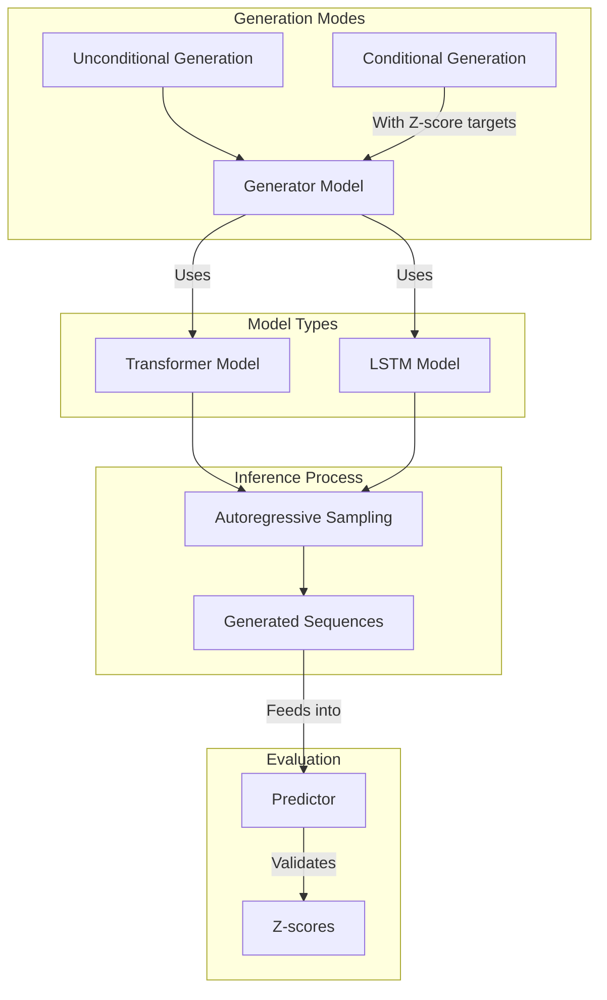
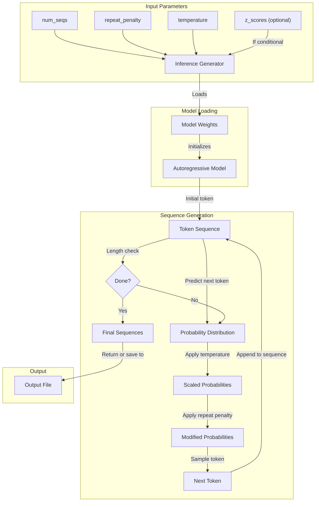
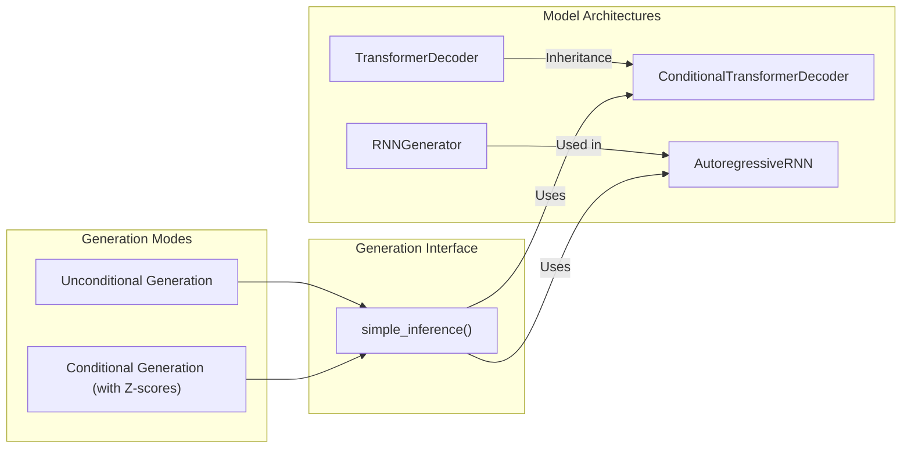
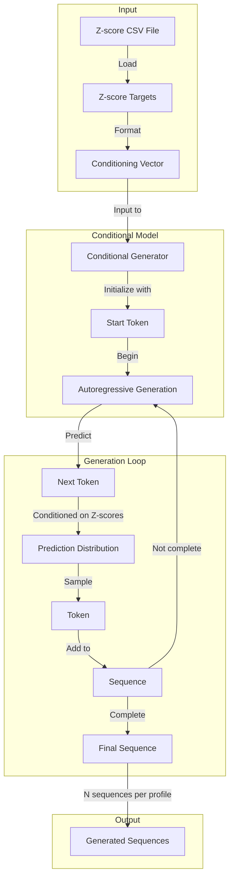

<!-- source: DeepWiki mcp.deepwiki.com · repo microsoft/cleavenet · page 4.3 Generating Sequences · fetched 2026-10-26 -->

# Generating Sequences

<details>
<summary>Relevant source files</summary>

The following files were used as context for generating this wiki page:

- [LICENSE](LICENSE)
- [README.md](README.md)
- [notebooks/CleaveNet_Example.ipynb](notebooks/CleaveNet_Example.ipynb)

</details>


This document explains how to use CleaveNet to generate peptide sequences, including both unconditional generation and conditional generation guided by target cleavage profiles. For information about predicting cleavage of existing sequences, see [Predicting Cleavage](#4.2).

## Overview

CleaveNet's Generator component creates novel peptide sequences through autoregressive generation. The system offers two generation modes:

1. **Unconditional generation**: Creates diverse peptide sequences without specific cleavage requirements
2. **Conditional generation**: Creates peptide sequences optimized for specific cleavage profiles across multiple MMPs (Matrix Metalloproteinases)



*Diagram: CleaveNet Generator Component Overview*

Sources: [README.md:163-179]()

## Generation Methods

CleaveNet provides two primary interfaces for generating sequences:

1. **Command-line interface** using `generate.py`
2. **Programmatic interface** using the `simple_inference()` function

### Command-line Interface

The command-line interface is the most feature-complete way to generate sequences:

```bash
# Unconditional generation
python src/generate.py --num-seqs 20000 --output-dir generations

# Conditional generation
python src/generate.py --num-seqs 400 --output-dir conditional_generations --z-scores examples/efficient_conditional_seeds.csv
```

Key parameters:
- `--num-seqs`: Number of sequences to generate
- `--output-dir`: Directory to save generated sequences
- `--z-scores`: CSV file with target Z-scores for conditional generation
- `--temperature`: Sampling temperature (default: 1.0)
- `--repeat-penalty`: Penalty for repeated amino acids (default: 1.2)

Sources: [README.md:164-179](), [notebooks/CleaveNet_Example.ipynb:1393-1412]()

### Programmatic Interface

For generating sequences within Python code or notebooks, use the `simple_inference()` function:

```python
from cleavenet.models import simple_inference

# Generate 10 sequences with default parameters
sequences = simple_inference(num_seqs=10, repeat_penalty=1.2, temperature=1.0)
```

Sources: [notebooks/CleaveNet_Example.ipynb:1421-1441]()

## Generation Process



*Diagram: Sequence Generation Process Flow*

Sources: [README.md:164-179]()

## Autoregressive Models

CleaveNet uses autoregressive models for sequence generation, with two architectural options:



*Diagram: CleaveNet Generator Model Architecture*

Sources: [README.md:86-99](), [notebooks/CleaveNet_Example.ipynb:1421-1423]()

## Generation Parameters

### Temperature

Temperature controls the randomness of the generation process:

- **Higher temperature** (e.g., 1.2): More diverse but potentially less valid sequences
- **Lower temperature** (e.g., 0.7): Less diverse but more conservative sequences
- **Default**: 1.0

The temperature parameter is applied to the logits before converting to probabilities, effectively sharpening (lower temperature) or flattening (higher temperature) the probability distribution.

### Repeat Penalty

Repeat penalty discourages consecutive identical amino acids:

- **Higher penalty** (e.g., 1.5): Fewer repeated amino acids
- **No penalty** (1.0): Natural frequency of repeated amino acids
- **Default**: 1.2

The repeat penalty is applied by reducing the probability of selecting amino acids that have appeared recently in the sequence.

Sources: [notebooks/CleaveNet_Example.ipynb:1407-1411](), [README.md:170-171]()

## Conditional Generation

Conditional generation creates peptide sequences that target specific cleavage profiles across MMPs.



*Diagram: Conditional Generation Workflow*

Sources: [README.md:172-178]()

### Z-Score Format

The Z-score CSV file must contain one row per desired cleavage profile with 18 columns representing the Z-scores for each MMP. Here's the expected format:

| MMP1 | MMP2 | MMP3 | ... | MMP25 |
|------|------|------|-----|-------|
| 2.5  | -1.0 | 0.8  | ... | 1.2   |
| -0.5 | 3.0  | -1.5 | ... | 0.2   |

Example Z-score profiles are provided in `examples/efficient_conditional_seeds.csv`.

The conditional generation will create `num_seqs` sequences per row in the Z-score file. For example, with 50 Z-score profiles and `--num-seqs 400`, the generator will create 20,000 sequences (400 per profile).

Sources: [README.md:175-178]()

## Example Usage

### Example 1: Quick Unconditional Generation

```python
from cleavenet.models import simple_inference

# Generate 10 sequences
sequences = simple_inference(num_seqs=10, repeat_penalty=1.2, temperature=1.0)
print(sequences)
```

Example output:
```
['SLPLNLSYEK', 
 'RPLSHWQATI', 
 'SLPRYLYDVQ', 
 'PLAWHYISGI', 
 'MSLATLWAGW', 
 'IMARYLYDPW', 
 'LPLASLWSGY', 
 'CAVASLRDWY', 
 'PVPKWITASG', 
 'SPVKWLQSGY']
```

Sources: [notebooks/CleaveNet_Example.ipynb:1425-1478]()

### Example 2: Conditional Generation for MMP13 Selectivity

Generate substrates selective for MMP13:

```bash
python src/generate.py --num-seqs 400 --output-dir mmp13_selective --z-scores mmp13_profile.csv
```

Where `mmp13_profile.csv` might contain:

| MMP1 | MMP2 | ... | MMP13 | ... | MMP25 |
|------|------|-----|-------|-----|-------|
| -1.0 | -1.0 | ... |  3.0  | ... | -1.0  |

Sources: [README.md:172-178]()

## Evaluating Generated Sequences

After generating sequences, you can evaluate them using the Predictor component to validate their cleavage profiles:

```bash
python src/predict.py --path-to-sequence-csv generated_sequences.csv --save-dir evaluation_results
```

This will provide Z-scores and selectivity scores for each generated sequence, allowing you to validate that the generated sequences meet your design criteria.

Sources: [README.md:154-162]()

## Advanced Usage

### Customizing Generator Models

By default, CleaveNet uses the Transformer-based models for generation. To use the LSTM-based models instead, add the `--model-architecture lstm` flag to the `generate.py` command:

```bash
python src/generate.py --num-seqs 20000 --output-dir generations --model-architecture lstm
```

### Batch Generation

For large-scale generation, consider using smaller batches and combining the results:

```bash
# Generate in batches of 5000
for i in {1..4}; do
  python src/generate.py --num-seqs 5000 --output-dir generations_batch$i
done
```

### Performance Considerations

- Generation on GPUs is significantly faster than on CPUs
- Higher temperatures require more computation due to broader sampling
- Conditional generation is more computationally intensive than unconditional generation

Sources: [README.md:164-178]()

---

