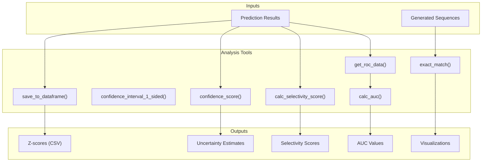
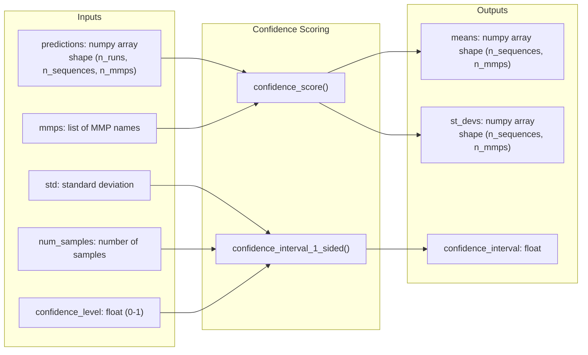
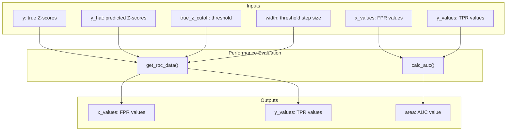
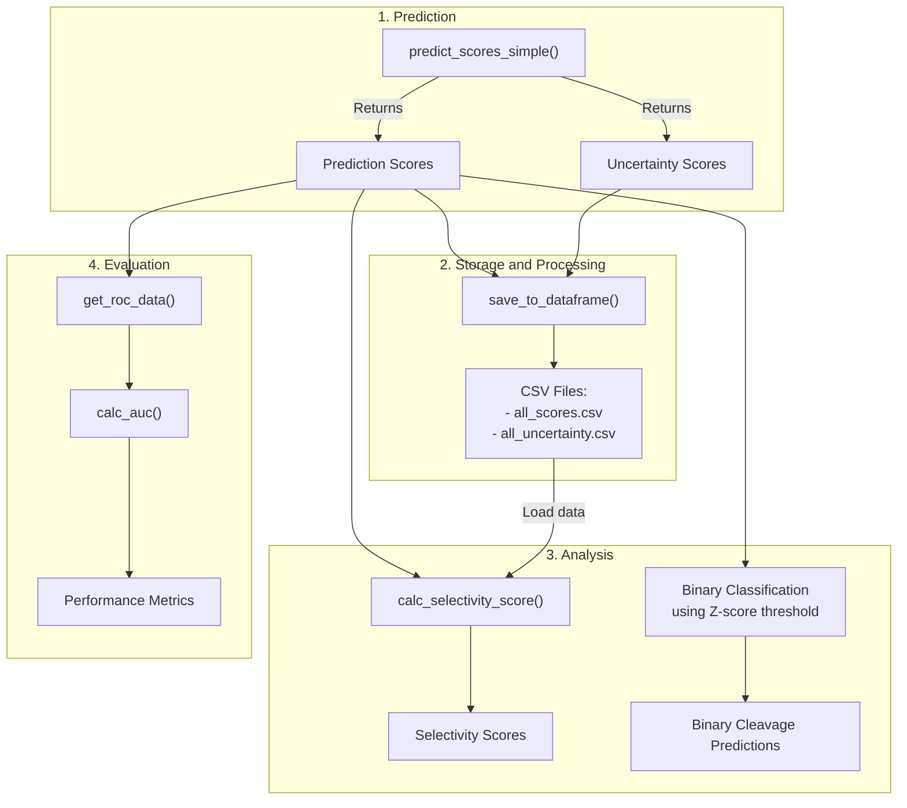
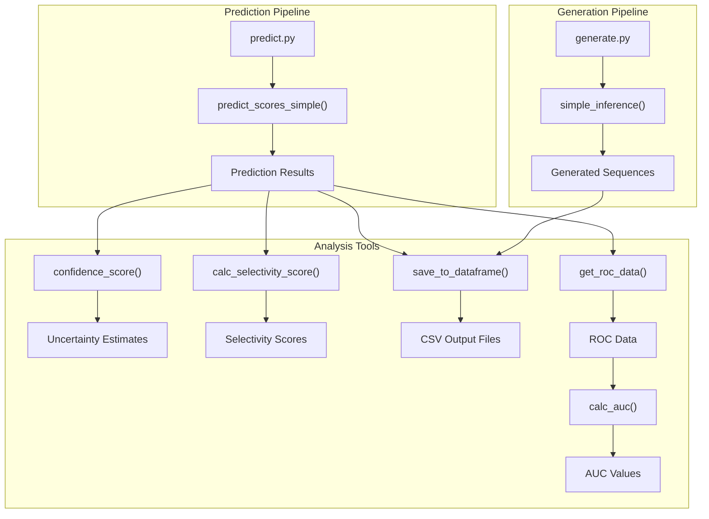

<!-- source: DeepWiki mcp.deepwiki.com · repo microsoft/cleavenet · page 4.4 Analysis Tools · fetched 2026-10-26 -->

# Analysis Tools

<details>
<summary>Relevant source files</summary>

The following files were used as context for generating this wiki page:

- [cleavenet/analysis.py](cleavenet/analysis.py)
- [notebooks/CleaveNet_Example.ipynb](notebooks/CleaveNet_Example.ipynb)

</details>


This page documents the analysis tools in CleaveNet, a collection of utilities that enable users to analyze predictions from the Predictor component and sequences from the Generator component. These tools help interpret and visualize prediction results, evaluate model performance, and analyze generated sequences.

For information about generating sequences, see [Generating Sequences](#4.3). For information about making predictions, see [Predicting Cleavage](#4.2).

## Overview of Analysis Tools

CleaveNet provides several analysis tools to process and interpret the outputs from prediction and generation models. These tools are primarily defined in the `analysis.py` module and can be accessed through command-line interfaces or Jupyter notebooks.



Sources: [cleavenet/analysis.py:1-240]()

## Core Analysis Functions

### Confidence Scoring

The confidence scoring functions help quantify the uncertainty in predictions by calculating means and standard deviations across model runs.



**Key functions:**

- `confidence_score(predictions, mmps)`: Calculates mean and standard deviation of predictions across multiple model runs for each MMP.
- `confidence_interval_1_sided(std, num_samples, confidence_level)`: Calculates one-sided confidence interval using Z-score and standard error.

Sources: [cleavenet/analysis.py:12-27]()

### Data Transformation and Storage

CleaveNet provides functions to transform prediction results into convenient formats for storage and further analysis.

**Key functions:**

- `save_to_dataframe(x_all, y_all, mmp_idx, y_hat_all, uncertainty, ...)`: Saves prediction results to DataFrames and CSV files. This function processes raw predictions and stores them in structured formats, optionally filtering for top-scoring sequences.

- `extract_sequences(x_train, dataloader)`: Extracts sequences from tokenized data.

- `count_by_res(seqs_arr)`: Counts amino acid residues in sequences.

- `normalize(list)`: Normalizes a list of values to sum to 1.

Sources: [cleavenet/analysis.py:30-186]()

### Selectivity Analysis

Selectivity analysis tools help determine how selective a peptide sequence is for one MMP versus others, which is crucial for designing specific protease substrates.

**Key function:**

- `calc_selectivity_score(mmps, df, penalize=[])`: Calculates selectivity scores by comparing the Z-score for one MMP against the mean Z-scores for other MMPs. Higher selectivity scores indicate sequences that are more specifically cleaved by a particular MMP.

Sample usage from the example notebook:

```python
# Convert to selectivity scores
selectivity = calc_selectivity_score(mmps, predictions)
selectivity.rename(columns=lambda x:x+'_ss', inplace=True)
selectivity['sequences'] = sequences
```

Sources: [cleavenet/analysis.py:188-198](), [notebooks/CleaveNet_Example.ipynb:1041-1048]()

### Performance Evaluation

These functions enable evaluation of model performance using ROC curves and AUC calculations.



**Key functions:**

- `get_roc_data(y, y_hat, true_z_cutoff=2, width=0.1)`: Calculates receiver operating characteristic (ROC) curve data points by varying the prediction threshold.
- `calc_auc(x_values, y_values)`: Calculates the area under the ROC curve (AUC) using the trapezoid method.

Sources: [cleavenet/analysis.py:201-240]()

## Working with Analysis Tools

### Typical Analysis Workflow



Sources: [notebooks/CleaveNet_Example.ipynb:631-637](), [notebooks/CleaveNet_Example.ipynb:836-847](), [notebooks/CleaveNet_Example.ipynb:1041-1048]()

### Example: Calculating Selectivity Scores

The notebook demonstrates how to calculate selectivity scores to identify sequences that are specifically cleaved by a particular MMP:

1. Run predictions using `predict_scores_simple()`
2. Load the predictions from the CSV file
3. Calculate selectivity scores using `calc_selectivity_score()`
4. Apply a Z-score threshold to determine binary cleavage predictions

```python
# Convert to selectivity scores
selectivity = calc_selectivity_score(mmps, predictions)
selectivity.rename(columns=lambda x:x+'_ss', inplace=True)
selectivity['sequences'] = sequences

# Applying Z-score threshold
z_cutoff = 1.0
mmp_df['Prediction'] = mmp_df[mmp_choice].apply(lambda x: 'Cleaved' if x > z_cutoff else 'Not Cleaved')
```

The resulting table shows the original Z-scores, selectivity scores, uncertainty values, and binary predictions:

| sequences  | MMP13     | MMP13_ss   | MMP13_unc | Prediction  |
|------------|-----------|------------|-----------|-------------|
| --AAALS--- | 0.151502  | -0.267868  | 0.274281  | Not Cleaved |
| FMPLNFTASG | 2.459345  | 0.258274   | 0.119394  | Cleaved     |
| LGPYAMTSRG | 2.480260  | 0.351411   | 0.231395  | Cleaved     |
| AARFKKFATE | -0.762877 | -0.288384  | 0.335088  | Not Cleaved |

Sources: [notebooks/CleaveNet_Example.ipynb:1041-1082]()

## Data Formats and Output Files

CleaveNet's analysis tools generate several output files:

| File                | Description                                          | Format               |
|---------------------|------------------------------------------------------|----------------------|
| all_scores.csv      | Predicted Z-scores for all sequences across all MMPs | CSV with MMP columns |
| all_uncertainty.csv | Uncertainty estimates for each prediction            | CSV with MMP columns |
| *_top*_cleaved.csv  | Top-scoring sequences for a specific MMP             | CSV with sequence index |
| weighted_all_scores.csv | Selectivity-weighted Z-scores                    | CSV with MMP columns |

Example output structure for the `all_scores.csv` file:

```
sequences,MMP1,MMP10,MMP11,...
--AAALS---,0.089758,0.416106,0.395101,...
FMPLNFTASG,3.285574,3.171740,2.848731,...
```

Sources: [cleavenet/analysis.py:92-108]()

## Integration with Other CleaveNet Components



The analysis tools integrate with both the Predictor and Generator components of CleaveNet:

1. **With Predictor**: Analysis tools process the Z-scores from the Predictor to calculate confidence scores, selectivity scores, and performance metrics.

2. **With Generator**: When used with the Generator, analysis tools help evaluate the properties of generated sequences and their potential for cleavage.

Sources: [cleavenet/analysis.py:1-240](), [notebooks/CleaveNet_Example.ipynb:101-109]()

## Best Practices

1. **Interpreting Z-scores**: Z-scores above 1.0 generally indicate potential for cleavage, but optimal thresholds may vary by MMP.

2. **Using Uncertainty Estimates**: Higher uncertainty values indicate less reliable predictions. Consider filtering predictions with high uncertainty.

3. **Selectivity Analysis**: When designing selective substrates, focus on sequences with both high Z-scores for the target MMP and high selectivity scores.

4. **Data Storage**: Use the `save_to_dataframe()` function to save all prediction results for further analysis rather than relying solely on in-memory processing.

5. **Performance Evaluation**: When evaluating model performance, use both ROC curves and AUC values to get a complete picture of prediction quality.

Sources: [notebooks/CleaveNet_Example.ipynb:1371-1382]()

---

