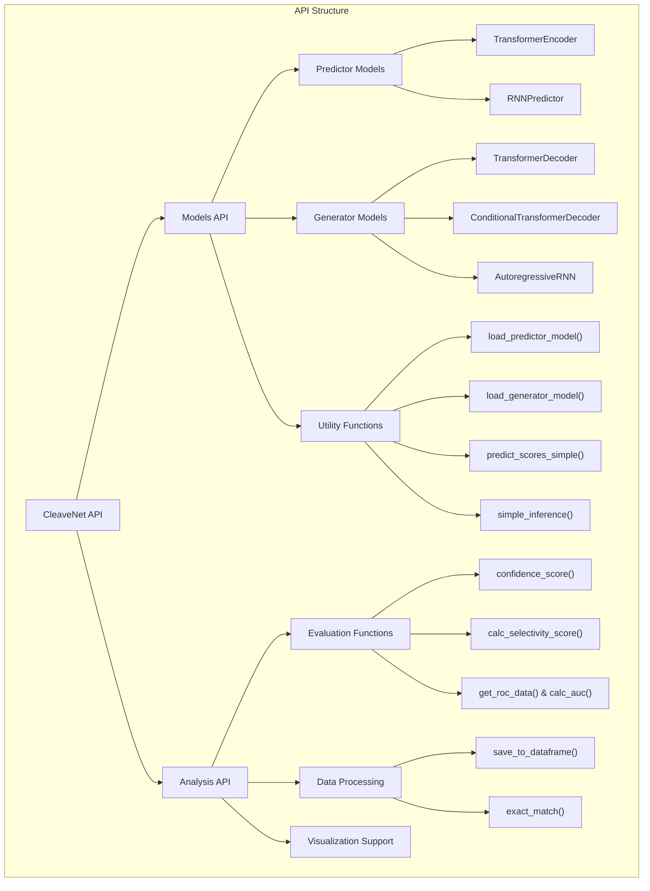
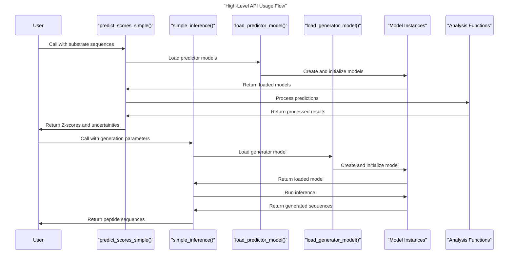
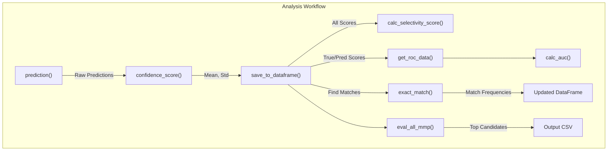

<!-- source: DeepWiki mcp.deepwiki.com · repo microsoft/cleavenet · page 5 API Reference · fetched 2026-10-26 -->

# API Reference

<details>
<summary>Relevant source files</summary>

The following files were used as context for generating this wiki page:

- [cleavenet/analysis.py](cleavenet/analysis.py)
- [cleavenet/models.py](cleavenet/models.py)

</details>


This document provides a comprehensive reference for the CleaveNet API, detailing the key components, classes, and functions that enable prediction and generation of protease substrate cleavage. For a high-level overview of CleaveNet's architecture, see [System Architecture](#2), and for usage examples, see [Usage Guide](#4).

## Overview

CleaveNet's API is organized into two primary modules:

1. **Models API**: Classes and functions for creating, training, and using predictor and generator models
2. **Analysis API**: Functions for evaluating model performance, processing data, and analyzing results

The API provides both low-level access to model components and high-level simplified interfaces for common tasks.



Sources: [cleavenet/models.py:1-827](), [cleavenet/analysis.py:1-240]()

## High-Level API Functions

CleaveNet provides simplified interfaces for common tasks like prediction and generation, allowing users to quickly utilize the system without dealing with underlying model details.

### Prediction Functions

#### `predict_scores_simple(substrates, checkpoint_dir, save_dir, model_architecture)`

Simplified interface for predicting Z-scores for peptide sequences.

- **Parameters**:
  - `substrates`: List of peptide sequences
  - `checkpoint_dir`: Directory containing model weights (default: '../weights/')
  - `save_dir`: Directory to save outputs (default: 'outputs/')
  - `model_architecture`: Model type to use ('transformer' or 'lstm', default: 'transformer')
- **Returns**:
  - `pred_zscores`: Array of predicted Z-scores
  - `std_zscores`: Array of standard deviations for predictions

**Example usage**:
```python
from cleavenet.models import predict_scores_simple

# Predict Z-scores for a list of peptide sequences
sequences = ['PLGLAR', 'AAAMQL', 'RPLALWRS']
z_scores, uncertainties = predict_scores_simple(sequences)
```

Sources: [cleavenet/models.py:818-826]()

#### `prediction(data_path_kukreja, gen_data, generated_dir, true_zscores, true_mmps, checkpoint_dir, predictor_model_type, number_top_candidates)`

Runs prediction with a predictor model (used by `predict_scores_simple`).

- **Parameters**:
  - `data_path_kukreja`: Path to Kukreja dataset
  - `gen_data`: List of sequences to predict scores for
  - `generated_dir`: Directory to save results
  - `true_zscores`: Optional ground truth Z-scores for evaluation
  - `true_mmps`: Optional list of MMPs corresponding to true_zscores
  - `checkpoint_dir`: Directory containing model weights
  - `predictor_model_type`: Type of model to use ('transformer' or 'lstm')
  - `number_top_candidates`: Number of top candidates to save
- **Returns**:
  - `means`: Mean predictions across ensemble
  - `std`: Standard deviations across ensemble

Sources: [cleavenet/models.py:715-815]()

### Generation Functions

#### `simple_inference(num_seqs, repeat_penalty, temperature)`

Simplified interface for generating peptide sequences.

- **Parameters**:
  - `num_seqs`: Number of sequences to generate
  - `repeat_penalty`: Penalty for repeating tokens (higher values reduce repetition)
  - `temperature`: Temperature for sampling (higher values increase diversity)
- **Returns**:
  - List of generated peptide sequences

**Example usage**:
```python
from cleavenet.models import simple_inference

# Generate 5 peptide sequences with moderate diversity
sequences = simple_inference(num_seqs=5, repeat_penalty=2.0, temperature=1.2)
```

Sources: [cleavenet/models.py:828-859]()

#### `inference(model, dataloader, causal, seq_len, penalty, verbose, conditioning_tag, temperature)`

Runs inference with a generator model (used by `simple_inference`).

- **Parameters**:
  - `model`: Generator model instance
  - `dataloader`: DataLoader instance
  - `causal`: Whether to use causal (autoregressive) inference
  - `seq_len`: Maximum sequence length to generate
  - `penalty`: Penalty for repeating tokens
  - `verbose`: Whether to print intermediate steps
  - `conditioning_tag`: Optional conditioning values (Z-scores)
  - `temperature`: Temperature for sampling
- **Returns**:
  - Generated sequence

Sources: [cleavenet/models.py:657-712]()

## Model Loading Functions

CleaveNet provides functions to load trained predictor and generator models from checkpoints.

#### `load_predictor_model(model_type, checkpoint_path, batch_size, mask_zero)`

Loads a trained predictor model from a checkpoint.

- **Parameters**:
  - `model_type`: Type of model ('transformer' or 'lstm')
  - `checkpoint_path`: Path to model checkpoint
  - `batch_size`: Batch size for inference
  - `mask_zero`: Whether to mask zero padding tokens
- **Returns**:
  - Loaded model instance

Sources: [cleavenet/models.py:619-654]()

#### `load_generator_model(model_type, training_scheme, parent_dir)`

Loads a trained generator model from a checkpoint.

- **Parameters**:
  - `model_type`: Type of model ('transformer' or 'lstm')
  - `training_scheme`: Training scheme ('unconditional', 'conditional', 'both', or 'rounded')
  - `parent_dir`: Parent directory for weights
- **Returns**:
  - Loaded model instance and checkpoint path

Sources: [cleavenet/models.py:563-617]()



Sources: [cleavenet/models.py:563-859]()

## Predictor Models

CleaveNet includes two types of predictor models for estimating cleavage potential (Z-scores) of peptide sequences.

### `TransformerEncoder`

Transformer-based model for predicting cleavage potential, using an encoder-only architecture similar to BERT.

- **Key Methods**:
  - `call(x)`: Forward pass through the model
  - `compute_loss(y, y_hat)`: Compute mean absolute error loss
  - `compute_rmse(y, y_hat, axis)`: Compute root mean squared error

Sources: [cleavenet/models.py:314-384]()

### `RNNPredictor`

LSTM-based model for predicting cleavage potential, using bidirectional LSTM layers.

- **Key Methods**:
  - `call(x)`: Forward pass through the model
  - `compute_loss(y, y_hat)`: Compute mean absolute error loss
  - `compute_rmse(y, y_hat, axis)`: Compute root mean squared error

Sources: [cleavenet/models.py:387-459]()

## Generator Models

CleaveNet includes several types of generator models for creating peptide sequences.

### `TransformerDecoder`

Transformer-based model for generating peptide sequences using a decoder-only architecture.

- **Key Methods**:
  - `call(x)`: Forward pass through the model
  - `compute_loss(y, y_hat)`: Compute cross-entropy loss
  - `compute_accuracy(y, y_hat)`: Compute accuracy

Sources: [cleavenet/models.py:246-270]()

### `ConditionalTransformerDecoder`

Transformer-based model for generating peptide sequences conditioned on desired properties (Z-scores).

- **Key Methods**:
  - `call(x)`: Forward pass through the model
  - `compute_loss(y, y_hat)`: Compute cross-entropy loss
  - `compute_accuracy(y, y_hat)`: Compute accuracy

Sources: [cleavenet/models.py:272-311]()

### `RNNGenerator`

LSTM-based model for generating peptide sequences.

- **Key Methods**:
  - `call(x)`: Forward pass through the model
  - `compute_masked_loss(y, y_hat, mask)`: Compute masked loss
  - `compute_masked_accuracy(y, y_hat, mask)`: Compute masked accuracy

Sources: [cleavenet/models.py:463-517]()

### `AutoregressiveRNN`

LSTM-based model for autoregressive generation of peptide sequences.

- **Key Methods**:
  - `call(inputs)`: Forward pass through the model
  - `compute_loss(y, y_hat)`: Compute cross-entropy loss
  - `compute_accuracy(y, y_hat)`: Compute accuracy

Sources: [cleavenet/models.py:520-561]()

```mermaid
classDiagram
    class TransformerEncoder {
        +encoder
        +final_layer
        +call(x)
        +compute_loss(y, y_hat)
        +compute_rmse(y, y_hat, axis)
    }
    
    class RNNPredictor {
        +embedding
        +lstm
        +lstm2
        +dense
        +dense_out
        +call(x)
        +compute_loss(y, y_hat)
        +compute_rmse(y, y_hat, axis)
    }
    
    class TransformerDecoder {
        +decoder
        +final_layer
        +call(x)
        +compute_loss(y, y_hat)
        +compute_accuracy(y, y_hat)
    }
    
    class ConditionalTransformerDecoder {
        +pos_embedding
        +dec_layers
        +final_layer
        +call(x)
        +compute_loss(y, y_hat)
        +compute_accuracy(y, y_hat)
    }
    
    class AutoregressiveRNN {
        +embedding
        +lstm
        +dense
        +dense_out
        +call(inputs)
        +compute_loss(y, y_hat)
        +compute_accuracy(y, y_hat)
    }
    
    TransformerEncoder --|> "Predictor Models"
    RNNPredictor --|> "Predictor Models"
    
    TransformerDecoder --|> "Generator Models"
    ConditionalTransformerDecoder --|> "Generator Models"
    AutoregressiveRNN --|> "Generator Models"
```

Sources: [cleavenet/models.py:246-561]()

## Analysis API

CleaveNet's Analysis API provides functions for evaluating model performance, processing data, and analyzing results.

### Evaluation Functions

#### `confidence_score(predictions, mmps)`

Calculates mean and standard error for predictions across multiple models.

- **Parameters**:
  - `predictions`: Array of predictions from multiple models
  - `mmps`: List of MMP names
- **Returns**:
  - `means`: Mean predictions across models
  - `st_devs`: Standard deviations across models

Sources: [cleavenet/analysis.py:12-21]()

#### `confidence_interval_1_sided(std, num_samples, confidence_level)`

Calculates one-sided confidence intervals for predictions.

- **Parameters**:
  - `std`: Standard deviation
  - `num_samples`: Number of samples
  - `confidence_level`: Confidence level (default: 0.80)
- **Returns**:
  - Confidence interval

Sources: [cleavenet/analysis.py:24-27]()

#### `get_roc_data(y, y_hat, true_z_cutoff, width)`

Gets data for plotting ROC curves.

- **Parameters**:
  - `y`: True labels
  - `y_hat`: Predicted scores
  - `true_z_cutoff`: Z-score cutoff for true positives (default: 2)
  - `width`: Width of threshold range (default: 0.1)
- **Returns**:
  - `x_values`: False positive rates
  - `y_values`: True positive rates

Sources: [cleavenet/analysis.py:201-232]()

#### `calc_auc(x_values, y_values)`

Calculates the area under the ROC curve.

- **Parameters**:
  - `x_values`: False positive rates
  - `y_values`: True positive rates
- **Returns**:
  - Area under the curve

Sources: [cleavenet/analysis.py:235-240]()

### Data Processing Functions

#### `save_to_dataframe(x_all, y_all, mmp_idx, y_hat_all, uncertainty, z_cutoff, write_top_scores, find_matches, dataloader, mmp, save_path, threshold, top)`

Saves prediction results to a DataFrame for analysis.

- **Parameters**:
  - `x_all`: Input sequences
  - `y_all`: True Z-scores (optional)
  - `mmp_idx`: Index of the MMP to analyze
  - `y_hat_all`: Predicted Z-scores
  - `uncertainty`: Uncertainty estimates
  - `z_cutoff`: Z-score cutoff for cleavage
  - `write_top_scores`: Whether to write top scores to file
  - `find_matches`: Whether to find matches with training data
  - `dataloader`: DataLoader instance
  - `mmp`: Name of the MMP
  - `save_path`: Path to save results
  - `threshold`: Uncertainty threshold
  - `top`: Number of top candidates to save
- **Returns**:
  - DataFrame with prediction results

Sources: [cleavenet/analysis.py:30-109]()

#### `calc_selectivity_score(mmps, df, penalize)`

Calculates selectivity scores for predictions across different MMPs.

- **Parameters**:
  - `mmps`: List of MMP names
  - `df`: DataFrame with predictions
  - `penalize`: List of MMPs to penalize (default: [])
- **Returns**:
  - DataFrame with selectivity scores

Sources: [cleavenet/analysis.py:189-198]()



Sources: [cleavenet/analysis.py:1-240]()

## Table of Key Functions

| Function | Module | Purpose | Key Parameters |
|----------|--------|---------|---------------|
| `predict_scores_simple` | models.py | Simplified prediction interface | `substrates`, `checkpoint_dir`, `save_dir`, `model_architecture` |
| `simple_inference` | models.py | Simplified generation interface | `num_seqs`, `repeat_penalty`, `temperature` |
| `load_predictor_model` | models.py | Load trained predictor model | `model_type`, `checkpoint_path`, `batch_size`, `mask_zero` |
| `load_generator_model` | models.py | Load trained generator model | `model_type`, `training_scheme`, `parent_dir` |
| `confidence_score` | analysis.py | Calculate confidence metrics | `predictions`, `mmps` |
| `save_to_dataframe` | analysis.py | Save results to DataFrame | `x_all`, `y_hat_all`, `uncertainty`, etc. |
| `calc_selectivity_score` | analysis.py | Calculate selectivity | `mmps`, `df`, `penalize` |
| `get_roc_data` | analysis.py | Get ROC curve data | `y`, `y_hat`, `true_z_cutoff`, `width` |
| `calc_auc` | analysis.py | Calculate AUC | `x_values`, `y_values` |

Sources: [cleavenet/models.py:563-859](), [cleavenet/analysis.py:12-240]()

## Best Practices and Integration

For the most common use cases, the high-level interfaces `predict_scores_simple()` and `simple_inference()` provide the easiest way to integrate CleaveNet into your workflow. These functions handle the complexity of loading models, running inference, and processing results.

For more advanced use cases requiring custom behavior, you may need to use the lower-level functions like `load_predictor_model()`, `prediction()`, and analysis functions directly.

For detailed examples of CleaveNet API usage, see the [Example Notebooks](#6) section of the documentation.

Sources: [cleavenet/models.py:818-859]()

---

