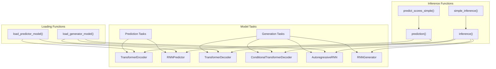
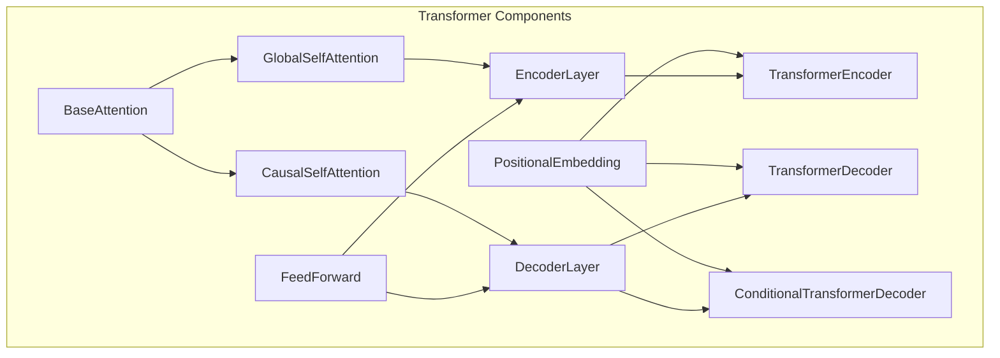
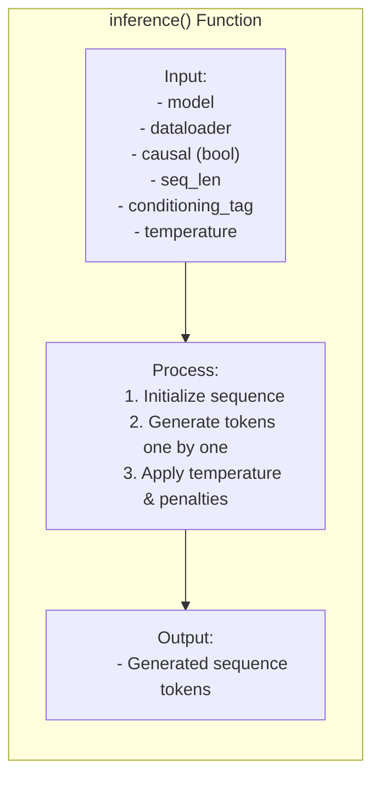
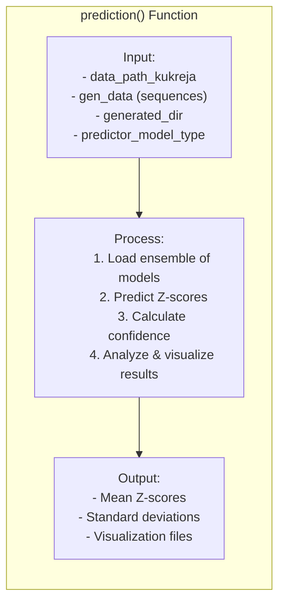

<!-- source: DeepWiki mcp.deepwiki.com · repo microsoft/cleavenet · page 5.1 Models API · fetched 2026-10-26 -->

# Models API

<details>
<summary>Relevant source files</summary>

The following files were used as context for generating this wiki page:

- [cleavenet/models.py](cleavenet/models.py)

</details>


## Purpose and Scope

This document provides a comprehensive reference for the CleaveNet Models API, which includes the model architectures, loading functions, and inference methods used for predicting protease cleavage specificity and generating peptide sequences. The Models API forms the core computational backbone of the CleaveNet system, providing both transformer-based and RNN-based implementations for prediction and generation tasks.

For information about using these models for specific applications, see [Usage Guide](#4). For analysis of model outputs, see [Analysis API](#5.2).

## Model Architecture Overview

CleaveNet implements two primary types of tasks—prediction and generation—each with multiple model architecture options.

### Model Hierarchy

```mermaid
classDiagram
    class "tf.keras.Model" {
        Base Keras Model
    }
    
    "tf.keras.Model" <|-- "TransformerEncoder"
    "tf.keras.Model" <|-- "TransformerDecoder"
    "tf.keras.Model" <|-- "ConditionalTransformerDecoder"
    "tf.keras.Model" <|-- "RNNPredictor"
    "tf.keras.Model" <|-- "RNNGenerator"
    "tf.keras.Model" <|-- "AutoregressiveRNN"
    
    class "TransformerEncoder" {
        Encoder-only transformer
        Prediction of cleavage Z-scores
    }
    
    class "TransformerDecoder" {
        Decoder-only transformer
        Sequence generation
    }
    
    class "ConditionalTransformerDecoder" {
        Conditional generation
        Z-score conditioned sequences
    }
    
    class "RNNPredictor" {
        LSTM-based predictor
        Prediction of cleavage Z-scores
    }
    
    class "RNNGenerator" {
        LSTM-based generator
        Sequence generation
    }
    
    class "AutoregressiveRNN" {
        Autoregressive LSTM
        Sequential generation
    }
```

Sources: [cleavenet/models.py:314-384](), [cleavenet/models.py:246-311](), [cleavenet/models.py:387-459](), [cleavenet/models.py:463-517](), [cleavenet/models.py:520-561]()

### Functional Classification



Sources: [cleavenet/models.py:563-617](), [cleavenet/models.py:619-654](), [cleavenet/models.py:657-712](), [cleavenet/models.py:715-816](), [cleavenet/models.py:818-826](), [cleavenet/models.py:828-859]()

## Transformer-Based Models

### Components

CleaveNet's transformer models are built from modular components following the architecture described in the original "Attention is All You Need" paper.



Sources: [cleavenet/models.py:44-82](), [cleavenet/models.py:86-133](), [cleavenet/models.py:136-154](), [cleavenet/models.py:157-172](), [cleavenet/models.py:175-200](), [cleavenet/models.py:203-217](), [cleavenet/models.py:220-242]()

### TransformerEncoder

The `TransformerEncoder` class implements an encoder-only transformer architecture optimized for predicting Z-scores of peptide cleavage. It takes tokenized peptide sequences as input and outputs predicted Z-scores for multiple MMPs.

Key features:
- Customizable number of layers, dimensions, and attention heads
- Pooling option for regression tasks
- Compute methods for both masked language modeling and regression losses

```python
# Typical initialization
encoder = TransformerEncoder(
    num_layers=2,
    d_model=32,
    num_heads=6,
    dff=32,
    vocab_size=22,
    dropout_rate=0,
    output_dim=18,  # Number of MMPs
    pool_outputs=True
)
```

Sources: [cleavenet/models.py:314-384]()

### TransformerDecoder

The `TransformerDecoder` class implements a decoder-only transformer architecture for autoregressive generation of peptide sequences. It generates sequences one token at a time based on previous tokens.

Key features:
- Causal attention masking to prevent looking at future tokens
- Autoregressive generation capability
- Loss and accuracy computation for training

Sources: [cleavenet/models.py:246-270]()

### ConditionalTransformerDecoder

The `ConditionalTransformerDecoder` extends the basic decoder with the ability to condition sequence generation on Z-scores. It can generate peptides that target specific cleavage profiles.

Key features:
- Accepts Z-score values as conditioning input
- Specialized positional embedding for handling conditions
- Compatible with the standard inference function

Sources: [cleavenet/models.py:272-311]()

## RNN-Based Models

### RNNPredictor

The `RNNPredictor` class implements a bidirectional LSTM architecture for predicting cleavage Z-scores. It processes peptide sequences to predict their cleavage potential across multiple MMPs.

Key features:
- Bidirectional LSTM layers for sequence processing
- Regularization and dropout for preventing overfitting
- Methods for computing loss and RMSE

```python
# Typical initialization
predictor = RNNPredictor(
    vocab_size=21,
    embedding_dim=22,
    rnn_units=32,
    p=0.25,  # Dropout rate
    regu=0.01,  # Regularization
    max_len=10,
    output_len=18  # Number of MMPs
)
```

Sources: [cleavenet/models.py:387-459]()

### RNNGenerator

The `RNNGenerator` class provides a bidirectional LSTM-based architecture for generating peptide sequences. It's primarily used for learning sequence patterns.

Key features:
- Bidirectional LSTM layers with regularization
- Support for masked token prediction
- Embedding scaling for improved training

Sources: [cleavenet/models.py:463-517]()

### AutoregressiveRNN

The `AutoregressiveRNN` class implements an LSTM-based autoregressive model for generating peptide sequences one token at a time.

Key features:
- Multiple LSTM layers with stateful operation
- Support for causal generation
- Methods for computing loss and accuracy

Sources: [cleavenet/models.py:520-561]()

## Model Loading Functions

CleaveNet provides utility functions for loading pre-trained predictor and generator models.

### load_predictor_model()

This function loads a predictor model (either transformer or LSTM-based) with pre-trained weights.

Parameters:
- `model_type`: 'transformer' or 'lstm'
- `checkpoint_path`: Path to the saved model weights
- `batch_size`: Batch size for inference
- `mask_zero`: Whether to mask zero (padding) values

Sources: [cleavenet/models.py:619-654]()

### load_generator_model()

This function loads a generator model with pre-trained weights, supporting both unconditional and conditional generation.

Parameters:
- `model_type`: 'transformer' or 'lstm'
- `training_scheme`: 'unconditional', 'conditional', 'both', or 'rounded'
- `parent_dir`: Optional directory prefix for weight paths

Sources: [cleavenet/models.py:563-617]()

## Inference Functions

### inference()

The `inference()` function performs sequence generation using autoregressive or masked language modeling approaches.



Parameters:
- `model`: The generator model
- `dataloader`: DataLoader instance for tokenization
- `causal`: Whether to use autoregressive generation
- `seq_len`: Maximum sequence length
- `penalty`: Repetition penalty factor
- `verbose`: Whether to print generation steps
- `conditioning_tag`: Optional Z-score values for conditional generation
- `temperature`: Sampling temperature

Sources: [cleavenet/models.py:657-712]()

### prediction()

The `prediction()` function evaluates peptide sequences using an ensemble of predictor models to estimate cleavage Z-scores and uncertainties.



Parameters:
- `data_path_kukreja`: Path to the Kukreja dataset
- `gen_data`: List of peptide sequences to evaluate
- `generated_dir`: Directory for saving outputs
- `true_zscores`, `true_mmps`: Optional ground truth for evaluation
- `checkpoint_dir`: Directory containing model checkpoints
- `predictor_model_type`: 'transformer' or 'lstm'
- `number_top_candidates`: Number of top candidates to report

Sources: [cleavenet/models.py:715-816]()

## Simplified Interfaces

### predict_scores_simple()

A simplified interface to the prediction function that handles model loading and returns predicted Z-scores.

```python
# Example usage
pred_zscores, std_zscores = predict_scores_simple(
    substrates=["AAPLFGSLFG", "GPQGIAGQRG"],
    checkpoint_dir='weights/',
    save_dir='outputs/',
    model_architecture='transformer'
)
```

Sources: [cleavenet/models.py:818-826]()

### simple_inference()

A simplified interface to the inference function for generating peptide sequences.

```python
# Example usage
sequences = simple_inference(
    num_seqs=10,
    repeat_penalty=1.5,
    temperature=0.8
)
```

Sources: [cleavenet/models.py:828-859]()

## Usage Examples

### Example: Predicting Cleavage Scores

```python
# 1. Load the Kukreja dataset
from cleavenet import data, models
data_path = "data/kukreja.csv"
dataloader = data.DataLoader(data_path, seed=0, task='regression', 
                            model='transformer', test_split=0.2)

# 2. Prepare peptide sequences
peptides = ["AAPLFGSLFG", "GPQGIAGQRG"]
x = data.tokenize_sequences(peptides, dataloader)

# 3. Load a predictor model
checkpoint_path = "weights/transformer_0/model.h5"
model = models.load_predictor_model(model_type='transformer', 
                                   checkpoint_path=checkpoint_path,
                                   batch_size=len(peptides))

# 4. Make predictions
predictions = model(x, training=False)
```

### Example: Generating Peptide Sequences

```python
# 1. Load the Kukreja dataset
from cleavenet import data, models
data_path = "data/kukreja.csv"
dataloader = data.DataLoader(data_path, seed=0, task='generator', 
                            model='autoreg', test_split=0.2)

# 2. Load a generator model
model, _ = models.load_generator_model(model_type='transformer', 
                                      training_scheme='unconditional')

# 3. Generate sequences
generated_seq = models.inference(model, dataloader, causal=True, 
                               seq_len=10, penalty=1.2, 
                               temperature=0.8)

# 4. Untokenize the sequence
peptide = data.untokenize_sequences(generated_seq, dataloader)
```

---

