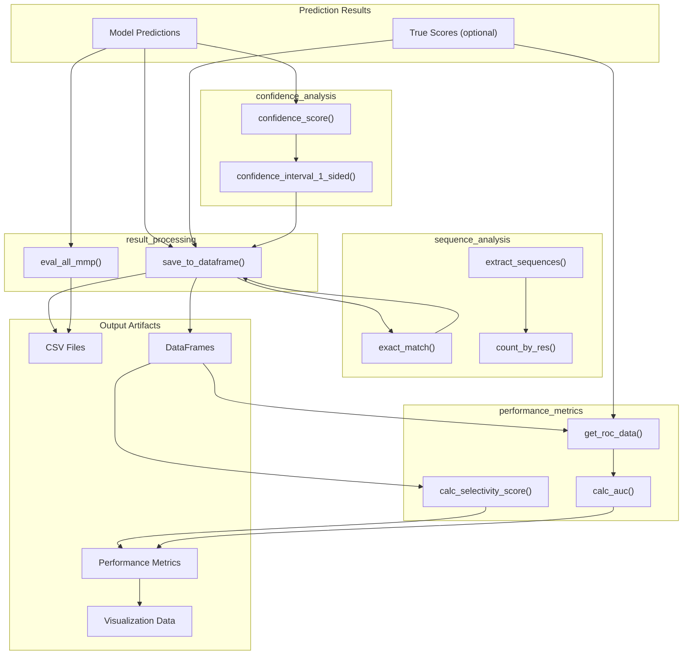
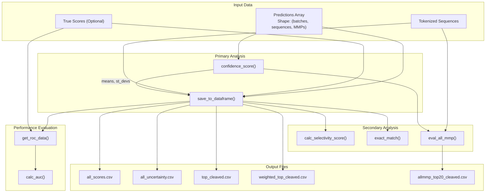
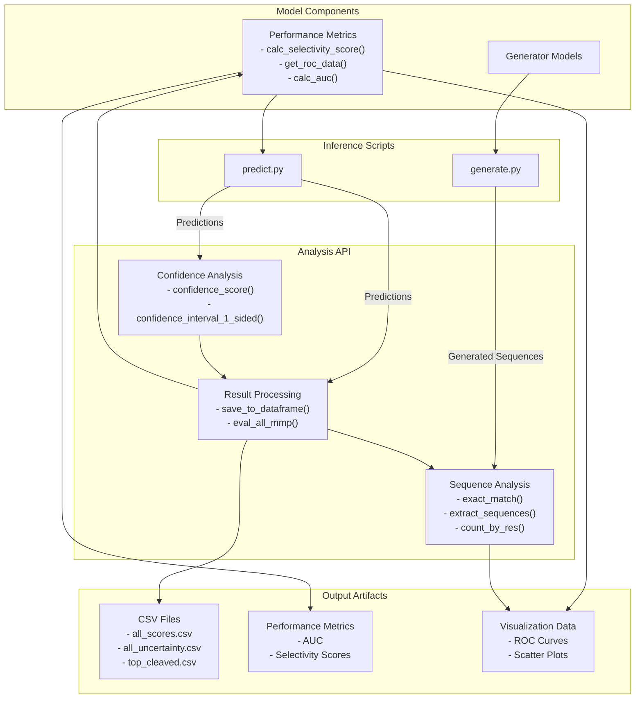

<!-- source: DeepWiki mcp.deepwiki.com · repo microsoft/cleavenet · page 5.2 Analysis API · fetched 2026-10-26 -->

# Analysis API

<details>
<summary>Relevant source files</summary>

The following files were used as context for generating this wiki page:

- [cleavenet/analysis.py](cleavenet/analysis.py)

</details>


The Analysis API provides a comprehensive set of tools for evaluating and analyzing model predictions and generated sequences in CleaveNet. This module primarily focuses on processing prediction scores, calculating evaluation metrics, visualizing results, and performing comparative analysis across different Matrix Metalloproteinases (MMPs).

For information about the underlying models that produce the data being analyzed, see [Models API](#5.1).

## Function Overview

The Analysis API contains functions for different types of analysis tasks:

| Category | Functions | Purpose |
|----------|-----------|---------|
| Confidence Analysis | `confidence_score`, `confidence_interval_1_sided` | Calculate prediction confidence metrics |
| Result Processing | `save_to_dataframe`, `eval_all_mmp` | Process and save prediction results |
| Sequence Analysis | `exact_match`, `extract_sequences`, `count_by_res` | Compare and analyze sequence compositions |
| Performance Metrics | `calc_selectivity_score`, `get_roc_data`, `calc_auc` | Evaluate model performance metrics |
| Utilities | `normalize` | Helper functions for analysis tasks |

Sources: [cleavenet/analysis.py:12-240]()

## Analysis API Architecture



Sources: [cleavenet/analysis.py:12-240]()

## Confidence Analysis Functions

### confidence_score

Calculates the mean and standard deviation of model predictions across multiple batches for each MMP.

**Function Signature**: 
```python
confidence_score(predictions, mmps)
```

**Parameters**:
- `predictions`: NumPy array of predictions with shape (num_batches, num_sequences, num_mmps)
- `mmps`: List of MMP names

**Returns**:
- `means`: Mean predictions across batches (shape: num_sequences, num_mmps)
- `st_devs`: Standard deviations across batches (shape: num_sequences, num_mmps)

**Purpose**: Used to aggregate predictions from multiple model runs and calculate confidence metrics.

Sources: [cleavenet/analysis.py:12-21]()

### confidence_interval_1_sided

Calculates one-sided confidence intervals for prediction values.

**Function Signature**:
```python
confidence_interval_1_sided(std, num_samples, confidence_level=0.80)
```

**Parameters**:
- `std`: Standard deviation of predictions
- `num_samples`: Number of prediction samples
- `confidence_level`: Confidence level (default: 0.80)

**Returns**:
- Confidence interval value

**Purpose**: Provides bounds on the uncertainty of prediction values.

Sources: [cleavenet/analysis.py:24-27]()

## Result Processing Functions

### save_to_dataframe

Processes prediction results and saves them to various DataFrame formats and CSV files.

**Function Signature**:
```python
save_to_dataframe(x_all, y_all, mmp_idx, y_hat_all, uncertainty, z_cutoff=0, 
                  write_top_scores=False, find_matches=False, dataloader=None, 
                  mmp=None, save_path=None, threshold=0, top=50)
```

**Parameters**:
- `x_all`: Tokenized sequences
- `y_all`: True Z-scores (optional)
- `mmp_idx`: Index of the MMP to analyze
- `y_hat_all`: Predicted Z-scores
- `uncertainty`: Uncertainty values for predictions
- `z_cutoff`: Z-score cutoff for classifying cleavage (default: 0)
- `write_top_scores`: Whether to write top scoring sequences to files (default: False)
- `find_matches`: Whether to find matching sequences in training data (default: False)
- `dataloader`: DataLoader object for sequence conversion
- `mmp`: Name of the MMP being analyzed
- `save_path`: Path to save output files
- `threshold`: Uncertainty threshold for filtering (default: 0)
- `top`: Number of top scores to save (default: 50)

**Returns**:
- DataFrame containing scores

**Purpose**: Central function for processing prediction results and generating various output formats, including weighted scores, selective scores, and finding exact matches in training data.

Sources: [cleavenet/analysis.py:30-109]()

### eval_all_mmp

Evaluates predictions across all MMPs and identifies sequences cleaved by multiple MMPs.

**Function Signature**:
```python
eval_all_mmp(means, x_all, dataloader, save_path, z_score_cutoff=0)
```

**Parameters**:
- `means`: Mean prediction scores for each sequence and MMP
- `x_all`: Tokenized sequences
- `dataloader`: DataLoader object for sequence conversion
- `save_path`: Path to save output files
- `z_score_cutoff`: Z-score cutoff for classifying cleavage (default: 0)

**Purpose**: Identifies sequences that are cleaved by multiple MMPs, useful for analyzing substrate promiscuity.

Sources: [cleavenet/analysis.py:145-156]()

## Workflow Diagram: From Predictions to Analysis



Sources: [cleavenet/analysis.py:12-156]()

## Sequence Analysis Functions

### exact_match

Compares generated sequences with training data to identify exact or active site matches.

**Function Signature**:
```python
exact_match(sequences, dataloader)
```

**Parameters**:
- `sequences`: List of sequences to compare
- `dataloader`: DataLoader object containing training sequences

**Returns**:
- `exact_match_freq`: List with counts of exact full matches for each sequence
- `active_match_freq`: List with counts of active site matches for each sequence

**Purpose**: Identifies whether generated sequences are novel or duplicates of training data, with special focus on the active site region (positions 2-7).

Sources: [cleavenet/analysis.py:112-142]()

### extract_sequences

Extracts readable sequences from tokenized data.

**Function Signature**:
```python
extract_sequences(x_train, dataloader)
```

**Parameters**:
- `x_train`: Tokenized sequences
- `dataloader`: DataLoader object for token conversion

**Returns**:
- List of sequence strings

**Purpose**: Converts tokenized sequences back to readable amino acid sequences.

Sources: [cleavenet/analysis.py:158-169]()

### count_by_res

Counts amino acid residue frequencies in sequences.

**Function Signature**:
```python
count_by_res(seqs_arr)
```

**Parameters**:
- `seqs_arr`: Array of sequence strings

**Returns**:
- List of Counter objects with residue counts

**Purpose**: Provides amino acid composition analysis for sequences.

Sources: [cleavenet/analysis.py:172-180]()

## Performance Metrics Functions

### calc_selectivity_score

Calculates selectivity scores for MMPs based on prediction scores.

**Function Signature**:
```python
calc_selectivity_score(mmps, df, penalize=[])
```

**Parameters**:
- `mmps`: List of MMP names
- `df`: DataFrame containing prediction scores
- `penalize`: List of MMPs to penalize in the calculation (default: [])

**Returns**:
- DataFrame with selectivity scores

**Purpose**: Evaluates how selective a sequence is for a specific MMP compared to others, which is crucial for designing MMP-specific substrates.

Sources: [cleavenet/analysis.py:189-198]()

### get_roc_data

Generates Receiver Operating Characteristic (ROC) curve data from prediction results.

**Function Signature**:
```python
get_roc_data(y, y_hat, true_z_cutoff=2, width=0.1)
```

**Parameters**:
- `y`: True Z-scores
- `y_hat`: Predicted Z-scores
- `true_z_cutoff`: Z-score threshold for true positive classification (default: 2)
- `width`: Step size for threshold sampling (default: 0.1)

**Returns**:
- `x_values`: False positive rates
- `y_values`: True positive rates

**Purpose**: Provides data for ROC curves, which are used to evaluate prediction performance across different thresholds.

Sources: [cleavenet/analysis.py:201-232]()

### calc_auc

Calculates the Area Under the Curve (AUC) from ROC data.

**Function Signature**:
```python
calc_auc(x_values, y_values)
```

**Parameters**:
- `x_values`: False positive rates
- `y_values`: True positive rates

**Returns**:
- AUC value

**Purpose**: Provides a single metric for evaluating overall model performance, with values closer to 1 indicating better performance.

Sources: [cleavenet/analysis.py:235-240]()

## Utility Functions

### normalize

Normalizes values in a list to sum to 1.

**Function Signature**:
```python
normalize(list)
```

**Parameters**:
- `list`: List of numerical values

**Returns**:
- Normalized list where values sum to 1

**Purpose**: Helper function for normalizing distributions, particularly useful for sequence composition analysis.

Sources: [cleavenet/analysis.py:183-186]()

## Using the Analysis API

The Analysis API is typically used in the following workflow:

1. **Generate predictions** using the CleaveNet predictor models
2. **Calculate confidence metrics** using `confidence_score()`
3. **Process results** with `save_to_dataframe()` to generate structured dataframes and CSV files
4. **Evaluate performance** using metrics like AUC from `calc_auc()` and selectivity scores from `calc_selectivity_score()`
5. **Analyze sequence properties** using functions like `exact_match()` and `count_by_res()`

The output files and metrics can then be used for further analysis or visualization in the CleaveNet notebook examples.

## Analysis API in CleaveNet System Context



Sources: [cleavenet/analysis.py:12-240]()

## Summary

The Analysis API provides a comprehensive set of tools for analyzing CleaveNet's prediction and generation outputs. The functions range from basic confidence scoring to complex selectivity and performance analysis, enabling detailed evaluation of model performance and sequence properties. This API is critical for interpreting model outputs, identifying promising peptide sequences, and assessing model performance across different MMPs.

---

