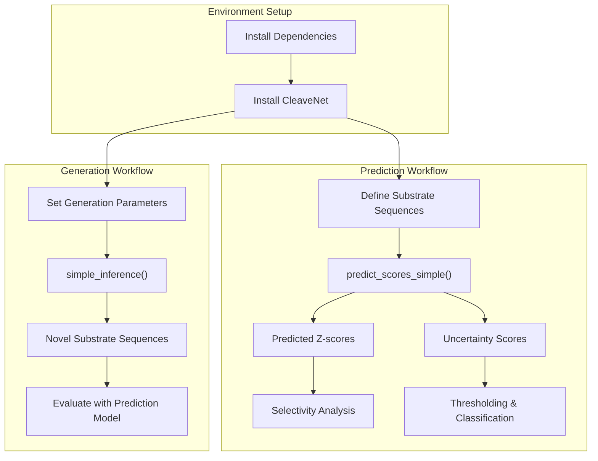
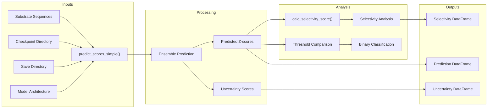
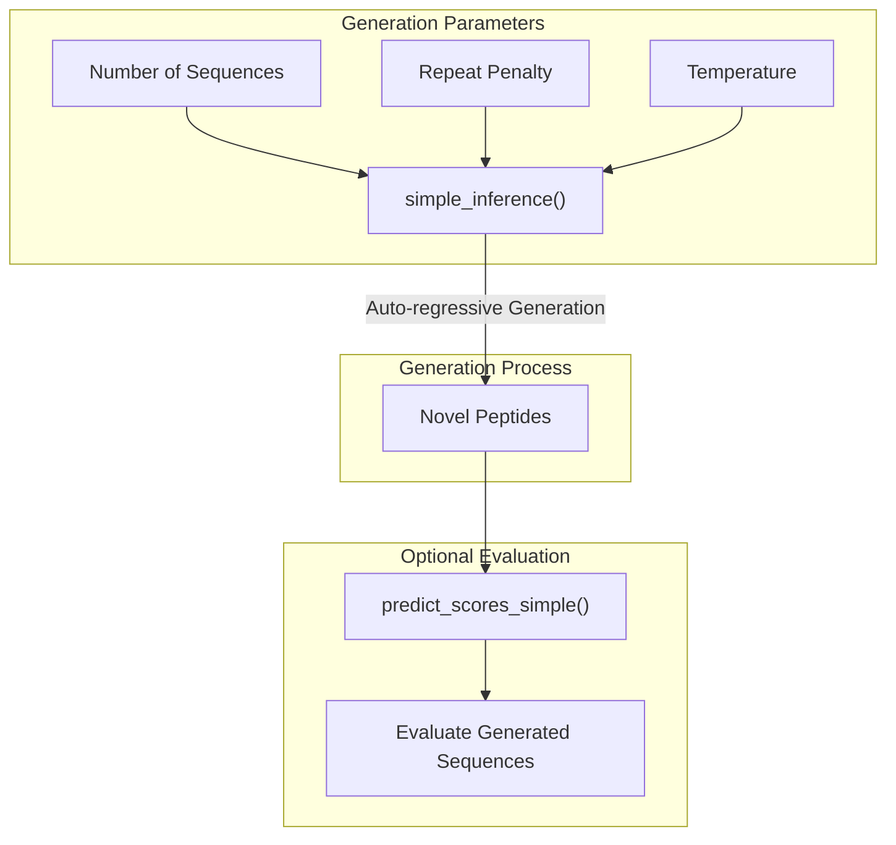
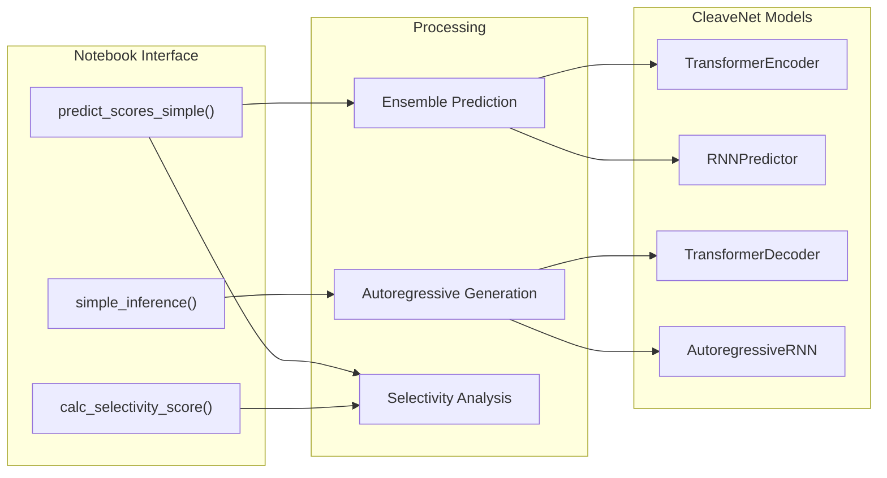

<!-- source: DeepWiki mcp.deepwiki.com · repo microsoft/cleavenet · page 6 Example Notebooks · fetched 2026-10-26 -->

# Example Notebooks

<details>
<summary>Relevant source files</summary>

The following files were used as context for generating this wiki page:

- [notebooks/CleaveNet_Example.ipynb](notebooks/CleaveNet_Example.ipynb)

</details>


This page documents the Jupyter notebook examples included in the CleaveNet repository, which provide interactive demonstrations of the system's key functionalities. These notebooks serve as practical guides for using CleaveNet to predict protease substrate cleavage and generate novel substrate sequences, with a focus on matrix metalloproteinases (MMPs).

For detailed information about the underlying architecture of CleaveNet, see [System Architecture](#2), and for comprehensive API documentation, refer to [API Reference](#5).

## Overview of Available Notebooks

CleaveNet currently includes one comprehensive example notebook that demonstrates the primary functionalities of the system:

```
notebooks/
└── CleaveNet_Example.ipynb - Main example notebook for prediction and generation
```

This notebook covers:
1. Installation and environment setup
2. Predicting substrate cleavage with CleaveNet models
3. Unconditional substrate generation

Sources: [notebooks/CleaveNet_Example.ipynb:6-14]()

## Notebook Workflow

The following diagram illustrates the typical workflow when using the example notebooks:



Sources: [notebooks/CleaveNet_Example.ipynb:17-78](), [notebooks/CleaveNet_Example.ipynb:388-478]()

## Installation and Setup

The notebook begins with instructions for setting up the required environment:

1. Create a clean conda environment with Python 3.8
2. Install TensorFlow
3. Install the CleaveNet package

```python
!pip install tensorflow  # will compile on CPU
!pip install cleavenet
```

After installation, the notebook imports the necessary modules:

```python
import os 
import csv
import pandas as pd

import cleavenet 
from cleavenet.models import predict_scores_simple
from cleavenet.utils import mmps
from cleavenet.analysis import calc_selectivity_score
```

Sources: [notebooks/CleaveNet_Example.ipynb:74-77](), [notebooks/CleaveNet_Example.ipynb:100-108]()

## Predicting Substrate Cleavage

### Prediction Workflow

The substrate cleavage prediction workflow is the primary functionality demonstrated in the example notebook:



Sources: [notebooks/CleaveNet_Example.ipynb:116-121](), [notebooks/CleaveNet_Example.ipynb:129-148](), [notebooks/CleaveNet_Example.ipynb:632-636]()

### Predicting Z-scores

The notebook demonstrates how to predict Z-scores for a list of peptide sequences:

1. Define a list of substrate sequences for prediction
2. Set prediction parameters (save directory, model architecture, checkpoint directory)
3. Call the `predict_scores_simple()` function to get predictions

Example code from the notebook:

```python
# Example substrate sequences
substrates = [
    '--AAALS---',
    'FMPLNFTASG',
    'LGPYAMTSRG',
    'AARFKKFATE',
    'AKPNRLVNSY'
]

# Prediction parameters
save_dir = 'outputs/' 
model_architecture = 'transformer'  # or 'lstm'
checkpoint_dir = 'weights/'

# Run prediction
pred_zscores, unc_scores = predict_scores_simple(substrates, 
                                               checkpoint_dir=checkpoint_dir, 
                                               save_dir=save_dir, 
                                               model_architecture=model_architecture)
```

The `predict_scores_simple()` function loads an ensemble of pretrained models and returns:
1. Z-score predictions for each MMP enzyme (18 MMPs total)
2. Uncertainty scores for each prediction

Sources: [notebooks/CleaveNet_Example.ipynb:129-148](), [notebooks/CleaveNet_Example.ipynb:632-636]()

### Analyzing Prediction Results

The notebook demonstrates three main types of analysis on the prediction results:

1. **Z-score Analysis**: Examining raw Z-scores that indicate cleavage potential
2. **Selectivity Analysis**: Calculating how selective a substrate is for specific MMPs
3. **Uncertainty Analysis**: Evaluating confidence in predictions

The prediction results are saved to CSV files in the specified output directory:
- `all_scores.csv`: Contains predicted Z-scores for each sequence across all MMPs
- `all_uncertainty.csv`: Contains uncertainty values for each prediction

Example of loading and viewing predictions:

```python
# Load prediction results
pred_file = os.path.join(save_dir, 'all_scores.csv')
predictions = pd.read_csv(pred_file)

# Calculate selectivity scores
selectivity = calc_selectivity_score(mmps, predictions)

# Load uncertainty scores
uncertainty_file = os.path.join(save_dir, 'all_uncertainty.csv')
uncertainty = pd.read_csv(uncertainty_file)
```

The notebook also shows how to classify sequences as "Cleaved" or "Not Cleaved" using threshold values:

```python
# Apply threshold to Z-scores
z_cutoff = 1.0
mmp_df['Prediction'] = mmp_df[mmp_choice].apply(
    lambda x: 'Cleaved' if x > z_cutoff else 'Not Cleaved'
)
```

Sources: [notebooks/CleaveNet_Example.ipynb:836-846](), [notebooks/CleaveNet_Example.ipynb:1041-1047](), [notebooks/CleaveNet_Example.ipynb:1372-1381]()

## Generating Novel Substrates

### Generation Workflow

The notebook also demonstrates how to generate novel substrate sequences:



Sources: [notebooks/CleaveNet_Example.ipynb:1388-1396](), [notebooks/CleaveNet_Example.ipynb:1404-1411](), [notebooks/CleaveNet_Example.ipynb:1441]()

### Unconditional Generation

The example notebook demonstrates unconditional generation of new substrate sequences using the `simple_inference()` function:

1. Import the generation function:
   ```python
   from cleavenet.models import simple_inference
   ```

2. Set generation parameters:
   ```python
   temperature = 1      # Controls diversity (0.7-1.2 recommended)
   repeat_penalty = 1.2 # Penalizes repeated amino acids
   num_seqs = 10        # Number of sequences to generate
   ```

3. Generate new sequences:
   ```python
   substrate_designs = simple_inference(num_seqs, repeat_penalty, temperature)
   ```

The function returns a list of generated peptide sequences of length 10 amino acids.

Sources: [notebooks/CleaveNet_Example.ipynb:1421](), [notebooks/CleaveNet_Example.ipynb:1404-1411](), [notebooks/CleaveNet_Example.ipynb:1441]()

### Generation Parameters

The generation process can be customized with several parameters:

| Parameter | Description | Recommended Values |
|-----------|-------------|-------------------|
| `num_seqs` | Number of sequences to generate | Any positive integer |
| `temperature` | Controls sequence diversity - higher values produce more diverse sequences | 0.7 to 1.2 |
| `repeat_penalty` | Penalizes repeated amino acids - higher values reduce repetition | 1.0 (no penalty) to 1.5 |

The notebook notes that for conditional generation (generating sequences with specific cleavage profiles), it's recommended to use the command-line interface as it requires a customized file format for the target Z-scores.

Sources: [notebooks/CleaveNet_Example.ipynb:1388-1396](), [notebooks/CleaveNet_Example.ipynb:1404-1411]()

## Functions Used in the Notebook

The example notebook primarily uses the following functions from the CleaveNet API:

| Function | Module | Purpose |
|----------|--------|---------|
| `predict_scores_simple()` | `cleavenet.models` | Predicts Z-scores for peptide sequences using an ensemble of models |
| `calc_selectivity_score()` | `cleavenet.analysis` | Calculates selectivity scores from Z-score predictions |
| `simple_inference()` | `cleavenet.models` | Generates novel peptide sequences |

The relationship between these notebook functions and the underlying CleaveNet architecture is illustrated below:



Sources: [notebooks/CleaveNet_Example.ipynb:106-108](), [notebooks/CleaveNet_Example.ipynb:632-636](), [notebooks/CleaveNet_Example.ipynb:1421](), [notebooks/CleaveNet_Example.ipynb:1441]()

## Extension Points

The example notebook provides a foundation that can be extended in several ways:

1. **Custom model architectures**: The notebook shows how to switch between transformer and LSTM models, but users can implement custom architectures by modifying the underlying code.

2. **Conditional generation**: While the notebook focuses on unconditional generation, the command-line interface supports conditional generation with target Z-scores.

3. **Analysis customization**: The analysis section can be extended to include additional visualizations or statistical measures.

4. **Batch processing**: The examples can be adapted for batch processing of large datasets.

Sources: [notebooks/CleaveNet_Example.ipynb:144-148](), [notebooks/CleaveNet_Example.ipynb:1388-1396]()

---

