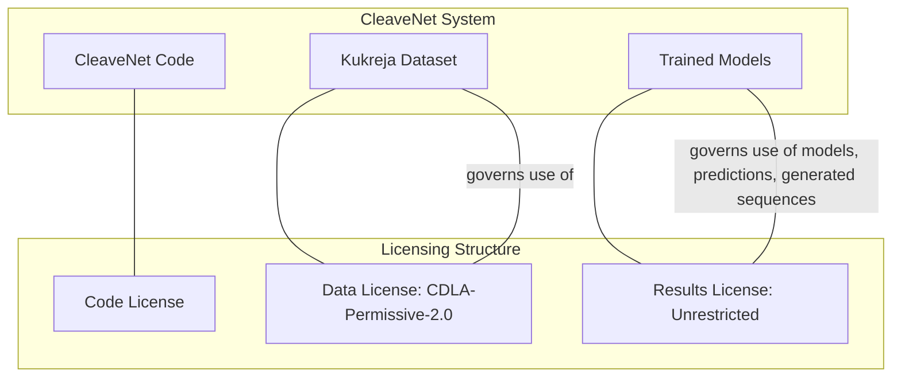
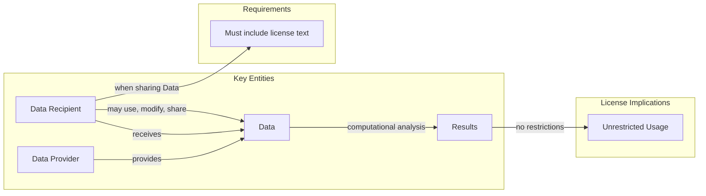
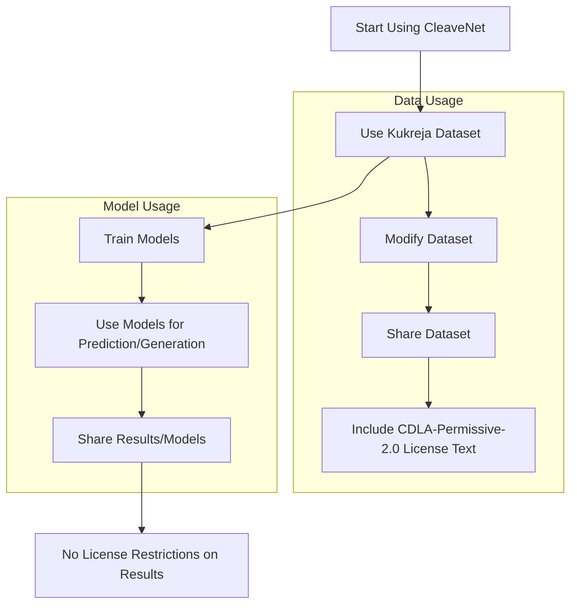

<!-- source: DeepWiki mcp.deepwiki.com · repo microsoft/cleavenet · page 7.1 License Information · fetched 2026-10-26 -->

# License Information

Relevant source files

The following files were used as context for generating this wiki page:

- [data/LICENSE](data/LICENSE)

This page explains the licensing terms for the CleaveNet project, covering both the data used by the system and the codebase itself. Understanding these license terms is essential for users who wish to work with, modify, or distribute the CleaveNet system or its components.

For information on contributing to the project, see [Contributing Guide](#7) and [Security Policy](#7.2).

## Data Licensing

CleaveNet's dataset is licensed under the Community Data License Agreement - Permissive, Version 2.0 (CDLA-Permissive-2.0). This is a permissive data license that allows for broad use, modification, and sharing of the data.

### Key Provisions of the CDLA-Permissive-2.0

The data license includes the following key provisions:

1. **Usage Rights**: Data Recipients may use, modify, and share the Data made available by Data Providers under this agreement.

2. **Sharing Conditions**: When sharing Data (with or without modifications), Data Recipients must include the text of the license agreement with the shared Data.

3. **Results Freedom**: There are no restrictions or obligations on the use, modification, or sharing of Results derived from the Data. This means any models trained on the data, including their insights or outputs, can be used without restrictions.

4. **No Warranty**: The Data is provided "as is" without warranties of any kind.

5. **Limitation of Liability**: Data Providers are not liable for any damages arising from the use of the Data or Results.

The complete license text can be found in [data/LICENSE:1-35]().

Sources: data/LICENSE

## License Relationships

Sources: data/LICENSE

## Data License Terms and Implications

The CDLA-Permissive-2.0 license defines several key roles and terms:

Sources: data/LICENSE

### Definitions Under CDLA-Permissive-2.0

| Term | Definition |
|------|------------|
| **Data** | The material received by a Data Recipient under this agreement |
| **Data Provider** | Any person who is the source of Data provided under this agreement |
| **Data Recipient** | Any person who receives Data directly or indirectly from a Data Provider and agrees to the terms of this agreement |
| **Results** | Any outcome obtained by computational analysis of Data, including machine learning models and models' insights |

Sources: data/LICENSE:29-35

## Implications for CleaveNet Users

CleaveNet users should be aware of the following license implications:

### When Working with the Data

1. You may freely use, modify, and analyze the Kukreja dataset included with CleaveNet.
2. If you redistribute the dataset (original or modified), you must include the CDLA-Permissive-2.0 license text.
3. Public domain portions of the data or usage covered by other legal exceptions are not restricted by this license.

### When Working with Models and Results

1. Any models trained using CleaveNet (whether using the provided training scripts or custom implementations) are considered "Results" under the license.
2. Predictions generated by these models and sequences created by the generator component are also "Results."
3. You may use, modify, distribute, or commercialize these Results without restrictions from the data license.

## License Compliance Workflow

Sources: data/LICENSE:16-17

## Summary

The CleaveNet project utilizes the Community Data License Agreement - Permissive, Version 2.0 for its dataset. This permissive license allows for broad usage rights with minimal restrictions, primarily requiring attribution through inclusion of the license text when sharing the data.

Most importantly for CleaveNet users, any results derived from the data - including trained models, predictions, and generated sequences - are free from restrictions under this license, allowing for flexible use in both research and commercial applications.

Sources: data/LICENSE

---

