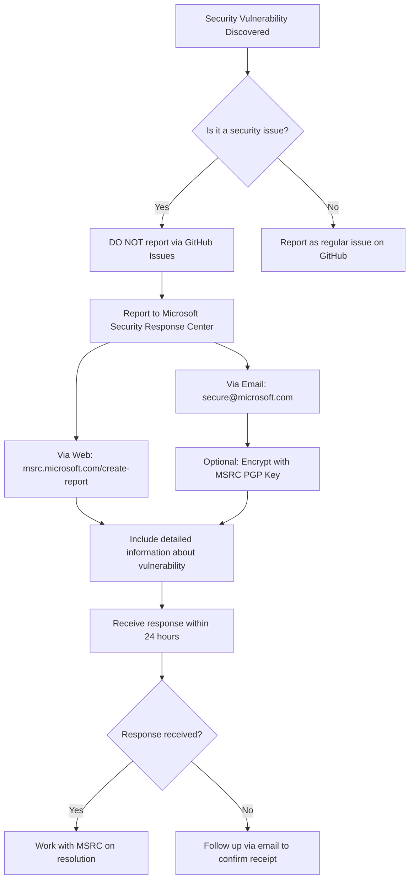
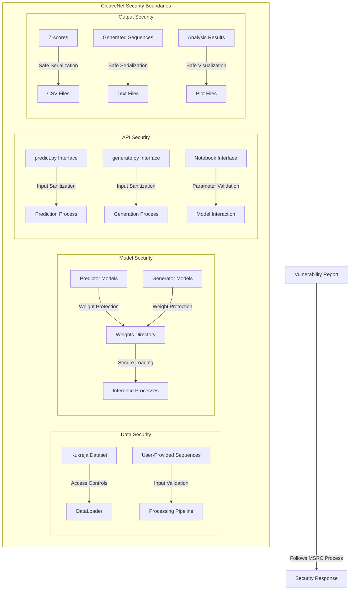
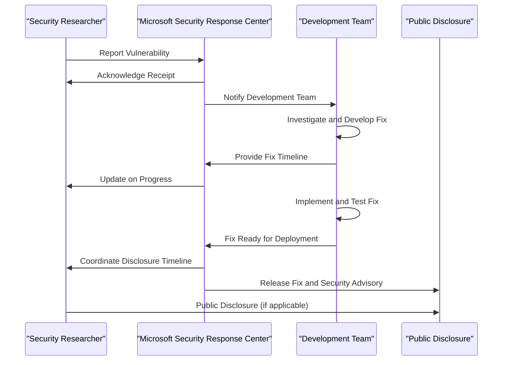

<!-- source: DeepWiki mcp.deepwiki.com · repo microsoft/cleavenet · page 7.2 Security Policy · fetched 2026-10-26 -->

# Security Policy

Relevant source files

The following files were used as context for generating this wiki page:

- [SECURITY.md](SECURITY.md)

## Purpose and Scope

This document outlines the security policy for the CleaveNet repository, detailing how to report security vulnerabilities, what information to include in reports, and the principles Microsoft follows for vulnerability disclosure. This policy applies to all components of the CleaveNet system, including the predictor and generator models, data handling mechanisms, and supporting infrastructure.

For information about contributing to the project in general, see [Contributing Guide](#7).

Sources: [SECURITY.md:3-7]()

## Reporting Security Vulnerabilities

### Proper Channels for Reporting

Security vulnerabilities in CleaveNet should **not** be reported through public GitHub issues. Instead, follow these reporting channels:

1. **Primary Method**: Report to the Microsoft Security Response Center (MSRC) at [https://msrc.microsoft.com/create-report](https://aka.ms/security.md/msrc/create-report).

2. **Alternative Method**: Send an email to [secure@microsoft.com](mailto:secure@microsoft.com). For enhanced security, consider encrypting your message with the MSRC PGP key, which can be downloaded from the [Microsoft Security Response Center PGP Key page](https://aka.ms/security.md/msrc/pgp).

Microsoft typically responds to security reports within 24 hours. If you don't receive a response, follow up via email to ensure your original message was received.

Sources: [SECURITY.md:9-17]()

## Required Information for Security Reports

When reporting a security vulnerability, include as much of the following information as possible:

| Information | Description |
|-------------|-------------|
| Type of issue | Buffer overflow, SQL injection, cross-site scripting, etc. |
| Source file paths | Full paths of files related to the vulnerability |
| Code location | Tag, branch, commit, or direct URL to affected code |
| Special configuration | Any configuration required to reproduce the issue |
| Reproduction steps | Step-by-step instructions to reproduce the issue |
| Proof-of-concept | Exploit code (if possible) |
| Impact assessment | How an attacker might exploit the issue |

Providing comprehensive information helps Microsoft triage and address your report more efficiently. For those reporting under a bug bounty program, more complete reports may contribute to higher bounty awards.

Sources: [SECURITY.md:19-31]()

## CleaveNet Security Considerations

The CleaveNet system handles biological sequence data and machine learning models, which may have specific security considerations:

1. **Data Security**: Ensure proper handling of the Kukreja dataset and any user-provided peptide sequences, especially if they contain proprietary or sensitive biological information.

2. **Model Security**: Protect trained model weights from tampering or unauthorized access, as they represent significant intellectual property.

3. **API Security**: Validate all inputs to the prediction and generation interfaces to prevent potential injection attacks or resource exhaustion.

4. **Output Security**: Ensure that analysis outputs, visualizations, and generated sequences are properly validated before being returned to users.

Sources: [SECURITY.md:3-7]()

## Communication and Response

### Preferred Language

Microsoft prefers all security-related communications to be in English.

### Response Timeline

After submitting a security vulnerability report, you should expect:

1. **Initial response** within 24 hours acknowledging receipt
2. **Triage** of the vulnerability based on severity and complexity
3. **Regular updates** about progress toward resolution
4. **Final resolution** according to the Coordinated Vulnerability Disclosure policy

Sources: [SECURITY.md:33-35]()

## Coordinated Vulnerability Disclosure

Microsoft follows the principle of Coordinated Vulnerability Disclosure (CVD) for handling security vulnerabilities. This approach involves:

1. **Private Reporting**: Security researchers report vulnerabilities directly to Microsoft rather than disclosing them publicly.

2. **Coordinated Resolution**: Microsoft works to validate and address the vulnerability, developing and testing a fix.

3. **Synchronized Disclosure**: The vulnerability is disclosed publicly only after a fix is available, ideally in coordination with the reporter.

This policy maximizes user protection by ensuring vulnerabilities are addressed before potential attackers can exploit them.

Sources: [SECURITY.md:37-39]()

## Bug Bounty Programs

For those reporting vulnerabilities to CleaveNet, Microsoft may provide rewards through its Bug Bounty Programs. The reward amount typically depends on:

- The severity of the vulnerability
- The quality and completeness of the report
- The impact on users and systems

For more information about active bug bounty programs and potential rewards, visit the [Microsoft Bug Bounty Program](https://aka.ms/security.md/msrc/bounty) page.

Sources: [SECURITY.md:31-32]()

## Related Resources

For additional security-related information, refer to:

- [Microsoft's definition of a security vulnerability](https://aka.ms/security.md/definition)
- [Microsoft Security Response Center (MSRC)](https://www.microsoft.com/msrc)
- [Coordinated Vulnerability Disclosure explained](https://aka.ms/security.md/cvd)

For general contribution guidelines, see [Contributing Guide](#7).

Sources: [SECURITY.md:7-40]()