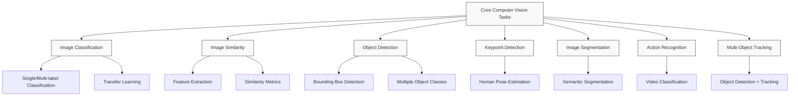
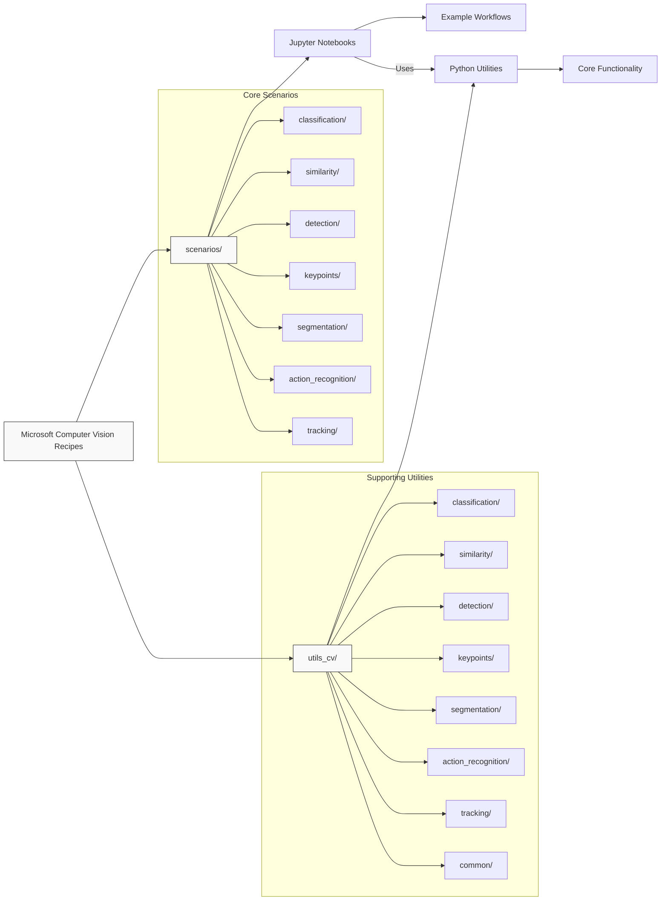
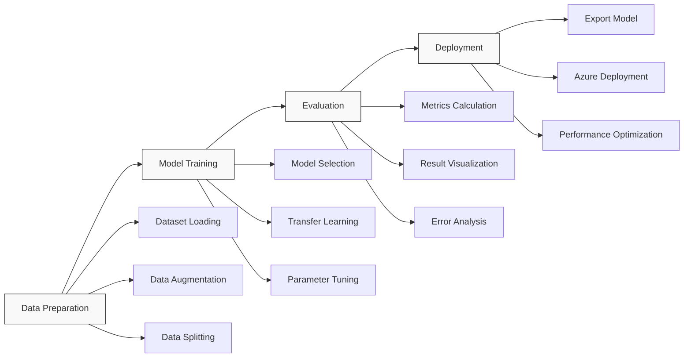
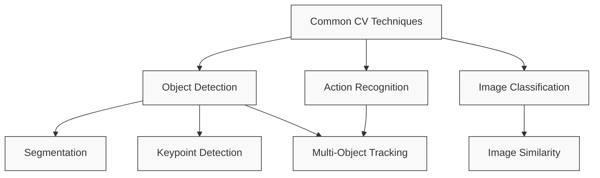

<!-- source: DeepWiki mcp.deepwiki.com · repo microsoft/computervision-recipes · page 2 Core Scenarios · fetched 2026-10-26 -->

# Core Scenarios

Relevant source files

The following files were used as context for generating this wiki page:

- [README.md](README.md)
- [environment.yml](environment.yml)
- [scenarios/README.md](scenarios/README.md)
- [scenarios/classification/README.md](scenarios/classification/README.md)
- [scenarios/media/figures.pptx](scenarios/media/figures.pptx)
- [scenarios/media/intro_ic_vis.jpg](scenarios/media/intro_ic_vis.jpg)
- [scenarios/media/intro_is_vis.jpg](scenarios/media/intro_is_vis.jpg)
- [scenarios/media/intro_iseg_vis.jpg](scenarios/media/intro_iseg_vis.jpg)
- [scenarios/media/intro_kp_vis.jpg](scenarios/media/intro_kp_vis.jpg)
- [scenarios/media/intro_od_vis.jpg](scenarios/media/intro_od_vis.jpg)

The Core Scenarios section provides an overview of the main computer vision tasks supported by the Microsoft Computer Vision Recipes repository. These scenarios represent the fundamental computer vision applications that developers can implement using this codebase. Each scenario includes Jupyter notebooks demonstrating workflows from data preparation through model training to deployment, alongside corresponding utility functions.

This page focuses on the high-level overview of these scenarios. For specific implementation details, refer to the individual scenario pages ([Object Detection](#2.1), [Multi-Object Tracking](#2.2), [Image Classification](#2.3), [Image Similarity](#2.4), [Segmentation](#2.5), and [Action Recognition](#2.6)).

Sources: [README.md:18-60]()(1), [scenarios/README.md:1-11]()

## Supported Computer Vision Tasks

The repository provides comprehensive support for the following core computer vision tasks:

Sources: [README.md:47-60]()(1), [scenarios/README.md:14-38]()

### Image Classification

Image classification involves assigning a label or category to an entire image. The repository supports both single-label classification (one category per image) and multi-label classification (multiple categories per image).

Key characteristics:
- Typically the easiest CV problem to solve
- Works best when objects are reasonably large in the image
- Requires labeled images for training
- Uses transfer learning from pre-trained models for fast adaptation to new datasets

Sources: [README.md:50-53]()(1), [scenarios/README.md:18-20](), [scenarios/classification/README.md:1-3]()

### Image Similarity

Image similarity finds visually similar images within a dataset. Rather than predicting a label, it computes a similarity score between images to identify matches.

Key characteristics:
- Computes similarity scores between image pairs
- Useful for finding visually similar products, duplicates, or related content
- Often uses feature extraction from pre-trained neural networks
- Supports various distance/similarity metrics

Sources: [README.md:53-54]()(1), [scenarios/README.md:23-25]()

### Object Detection

Object detection identifies and locates objects within an image using bounding boxes.

Key characteristics:
- More complex than classification (predicts both labels and locations)
- Can detect small objects within larger images
- More time-consuming to train and annotate than classification models
- Requires bounding box annotations for training

Sources: [README.md:54-55]()(1), [scenarios/README.md:27-29]()

### Keypoint Detection

Keypoint detection identifies specific points of interest on objects, such as joints for human pose estimation.

Key characteristics:
- Builds on object detection (first locating objects, then finding keypoints)
- Includes a pre-trained model for human pose estimation
- Useful for applications like posture analysis or gesture recognition
- Typically combines object detection and keypoint localization

Sources: [README.md:55-56]()(1), [scenarios/README.md:31-33]()

### Image Segmentation

Image segmentation assigns a category to each pixel in an image, providing more detailed object boundaries than bounding boxes.

Key characteristics:
- More detailed than object detection
- Time-intensive training data preparation (pixel-level annotations required)
- Less common in industry due to annotation costs
- Provides precise object boundaries

Sources: [README.md:56-57]()(1), [scenarios/README.md:35-37]()

### Action Recognition

Action recognition classifies activities in video sequences, such as "running" or "drinking."

Key characteristics:
- Works with video input rather than static images
- Identifies actions and their start/end times
- Builds upon frame-based techniques
- Supports both offline video analysis and real-time recognition

Sources: [README.md:57-58]()(1), [scenarios/README.md:10-10]()

### Multi-Object Tracking

Tracking follows objects across video frames over time, maintaining consistent identities.

Key characteristics:
- Combines detection and association techniques
- Maintains object identity across frames
- Handles occlusions and object interactions
- Builds on object detection technology

Sources: [README.md:58-59]()(1), [scenarios/README.md:11-11]()

## Implementation Architecture

The repository organizes code into two main components:

The implementation follows a clear separation of concerns:

1. **Scenarios Folder**: Contains Jupyter notebooks demonstrating end-to-end workflows
2. **Utils_CV Folder**: Contains reusable Python utilities and core implementations
3. **Each Scenario**: Has corresponding notebooks and utility functions in parallel folder structures

This architecture allows users to:
- Learn from notebook examples
- Reuse functionality via the utility libraries
- Customize implementations for specific needs

Sources: [README.md:16-16]()(1)

## Workflow and Development Process

The typical workflow for implementing a computer vision scenario follows these steps:

Each scenario in the repository provides example notebooks that guide users through this workflow, with specific adaptations for the particular computer vision task.

Sources: [README.md:46-59]()(1), [scenarios/classification/README.md:25-38]()

## Relationship Between Scenarios

The core scenarios build upon each other in certain ways, with more complex tasks leveraging techniques from simpler ones:

This relationship highlights how fundamental computer vision techniques are extended and combined to tackle more complex tasks, allowing users to progress from simpler to more advanced scenarios.

Sources: [README.md:45-59]()(1)

## Integration with Azure

The repository supports integration with Azure services for training at scale and model deployment:

| Azure Service | Purpose | Scenario Examples |
|---------------|---------|-------------------|
| Azure Machine Learning | Training, deployment, automation | All core scenarios |
| Azure Container Instances | Lightweight deployments | Classification, Detection |
| Azure Kubernetes Service | Production-scale deployments | Classification, Detection |
| Azure Virtual Machines | GPU-accelerated training | All compute-intensive tasks |

The notebooks include examples of setting up Azure resources, training models on cloud infrastructure, and deploying trained models as web services.

Sources: [README.md:63-79]()(1), [scenarios/classification/README.md:40-52]()

## Getting Started

To begin working with these core scenarios:

1. Set up the compute environment following the Setup Guide
2. Start with the image classification notebooks to learn fundamental concepts
3. Progress to other scenarios based on your use case
4. Use the utilities library for your custom implementations

The repository is designed to significantly reduce the "time to market" by providing ready-to-use examples and best practices for common computer vision tasks.

Sources: [README.md:35-40]()(1)

---

