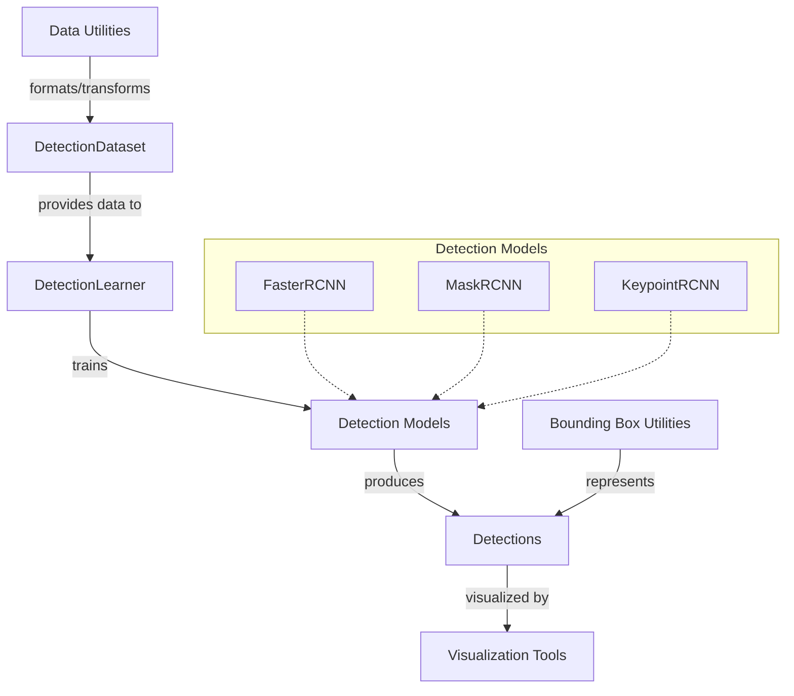
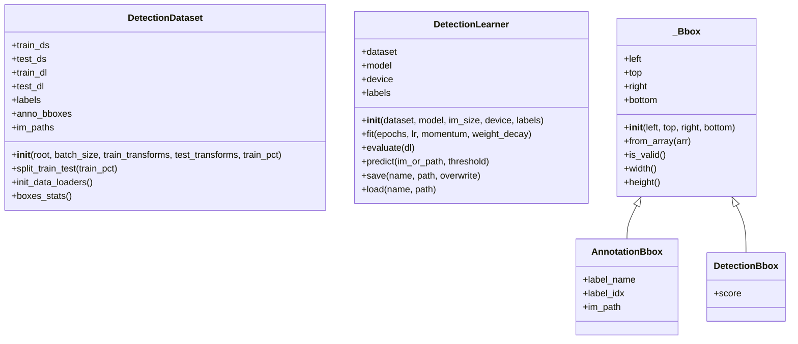
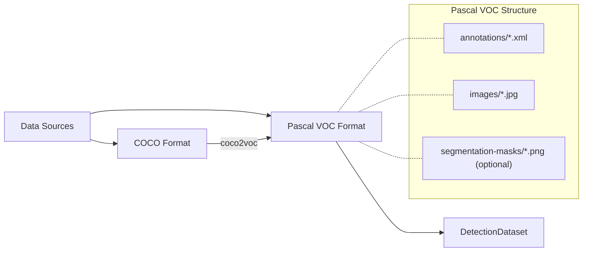
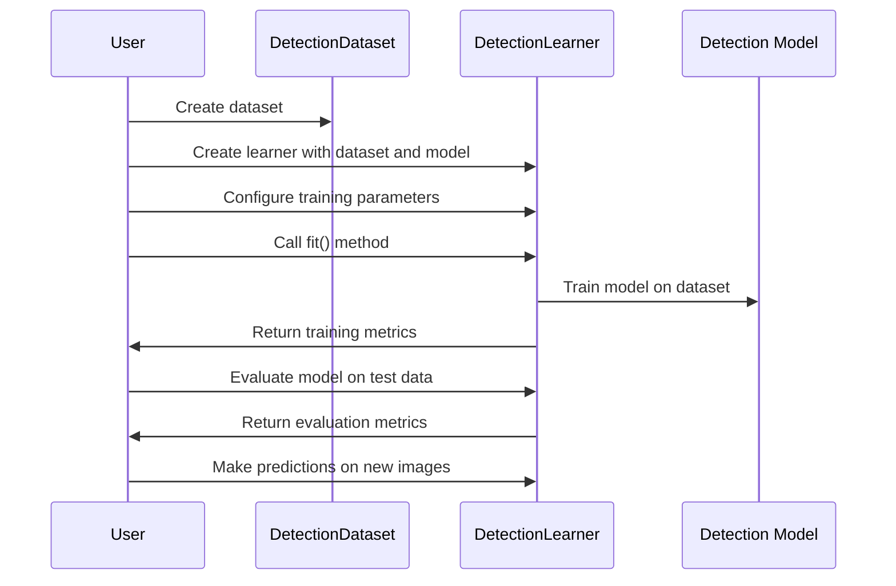
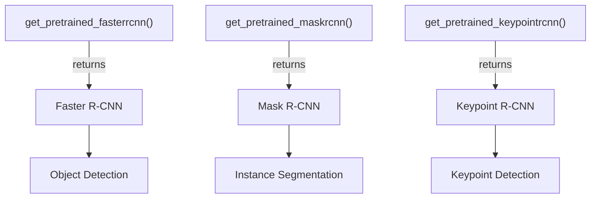
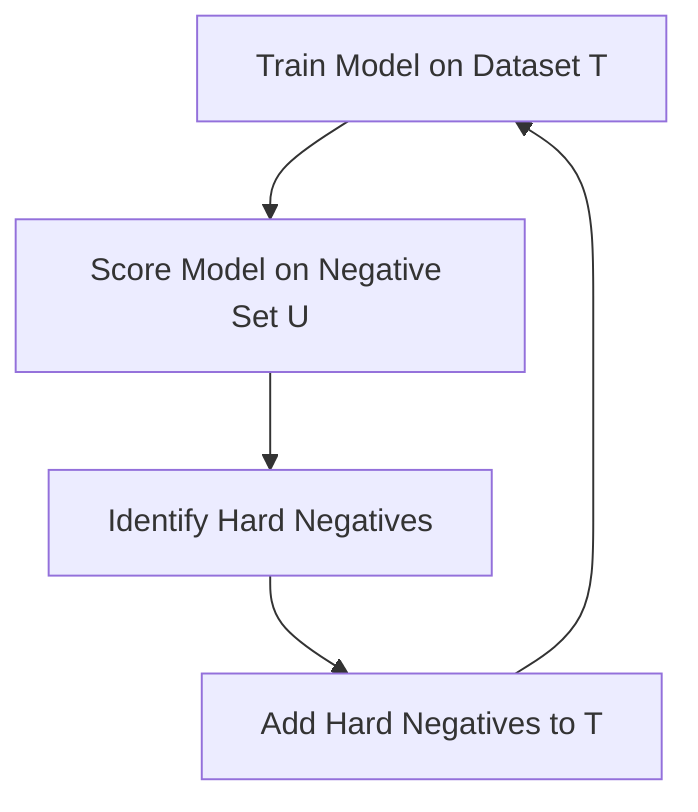
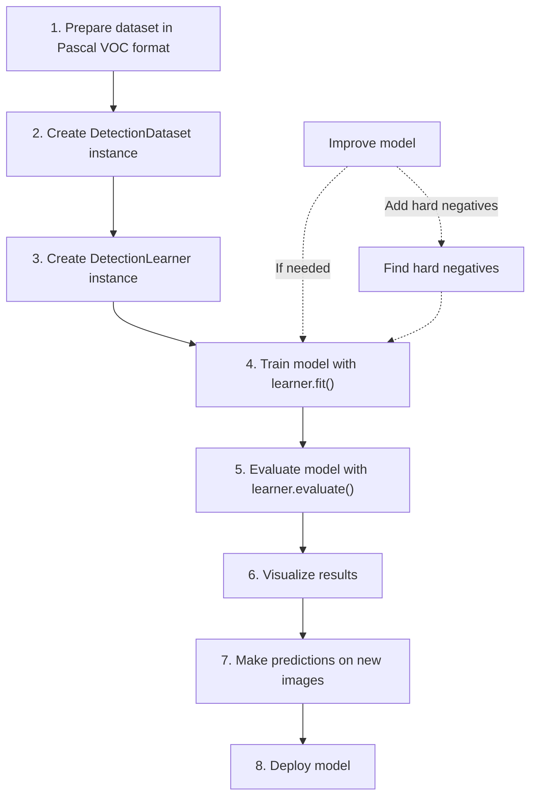

<!-- source: DeepWiki mcp.deepwiki.com · repo microsoft/computervision-recipes · page 2.1 Object Detection · fetched 2026-10-26 -->

# Object Detection

<details>
<summary>Relevant source files</summary>

The following files were used as context for generating this wiki page:

- [scenarios/detection/01_training_introduction.ipynb](scenarios/detection/01_training_introduction.ipynb)
- [scenarios/detection/02_mask_rcnn.ipynb](scenarios/detection/02_mask_rcnn.ipynb)
- [scenarios/detection/03_keypoint_rcnn.ipynb](scenarios/detection/03_keypoint_rcnn.ipynb)
- [scenarios/detection/11_exploring_hyperparameters_on_azureml.ipynb](scenarios/detection/11_exploring_hyperparameters_on_azureml.ipynb)
- [scenarios/detection/12_hard_negative_sampling.ipynb](scenarios/detection/12_hard_negative_sampling.ipynb)
- [scenarios/detection/20_deployment_on_kubernetes.ipynb](scenarios/detection/20_deployment_on_kubernetes.ipynb)
- [scenarios/detection/media/hyperdrive_cluster.jpg](scenarios/detection/media/hyperdrive_cluster.jpg)
- [tests/.ci/run_pytest.py](tests/.ci/run_pytest.py)
- [tests/conftest.py](tests/conftest.py)
- [tests/integration/detection/test_integration_detection.py](tests/integration/detection/test_integration_detection.py)
- [tests/smoke/test_azureml_notebooks.py](tests/smoke/test_azureml_notebooks.py)
- [tests/unit/detection/test_detection_bbox.py](tests/unit/detection/test_detection_bbox.py)
- [tests/unit/detection/test_detection_data.py](tests/unit/detection/test_detection_data.py)
- [tests/unit/detection/test_detection_dataset.py](tests/unit/detection/test_detection_dataset.py)
- [tests/unit/detection/test_detection_mask.py](tests/unit/detection/test_detection_mask.py)
- [tests/unit/detection/test_detection_model.py](tests/unit/detection/test_detection_model.py)
- [tests/unit/detection/test_detection_notebooks.py](tests/unit/detection/test_detection_notebooks.py)
- [tests/unit/detection/test_detection_plot.py](tests/unit/detection/test_detection_plot.py)
- [utils_cv/detection/bbox.py](utils_cv/detection/bbox.py)
- [utils_cv/detection/data.py](utils_cv/detection/data.py)
- [utils_cv/detection/dataset.py](utils_cv/detection/dataset.py)
- [utils_cv/detection/model.py](utils_cv/detection/model.py)
- [utils_cv/detection/plot.py](utils_cv/detection/plot.py)

</details>


The Object Detection module in the Computer Vision Recipes repository provides a comprehensive set of tools for training, evaluating, and deploying object detection models. It offers a streamlined workflow for building detection systems that can identify, locate, and classify objects in images. The module supports various detection model architectures including Faster R-CNN, Mask R-CNN, and Keypoint R-CNN.

For image classification tasks, see [Image Classification](#2.3). For multi-object tracking which builds on detection, see [Multi-Object Tracking](#2.2).

## System Architecture

The object detection system consists of several core components that work together to provide a complete pipeline for object detection tasks.



Sources: [utils_cv/detection/dataset.py], [utils_cv/detection/model.py], [utils_cv/detection/bbox.py], [utils_cv/detection/plot.py]

### Core Components

1. **DetectionDataset**: Manages loading and preprocessing of object detection datasets.
2. **DetectionLearner**: Handles model training, evaluation, and inference.
3. **Detection Models**: Implementations of object detection architectures (Faster R-CNN, Mask R-CNN, Keypoint R-CNN).
4. **Bounding Box Utilities**: Classes for representing detection results.
5. **Visualization Tools**: Functions for visualizing detection results.



Sources: [utils_cv/detection/dataset.py], [utils_cv/detection/model.py], [utils_cv/detection/bbox.py]

## Data Preparation

### Supported Formats

The system supports two popular annotation formats:

1. **Pascal VOC**: XML-based format where each image has a corresponding annotation file.
2. **COCO**: JSON-based format with annotations for multiple images in a single file.



Sources: [utils_cv/detection/data.py], [utils_cv/detection/dataset.py]

### Creating Detection Datasets

The `DetectionDataset` class provides a convenient way to load and prepare detection datasets:

```python
data = DetectionDataset(
    root="path/to/dataset",       # Path to dataset directory
    batch_size=2,                 # Batch size for dataloaders
    train_transforms=None,        # Custom transformations for training
    test_transforms=None,         # Custom transformations for testing
    train_pct=0.75,               # Percentage of data for training
    anno_dir="annotations",       # Directory containing annotations
    im_dir="images",              # Directory containing images
    mask_dir=None,                # Directory containing masks (for instance segmentation)
    allow_negatives=False,        # Whether to allow images without annotations
)
```

The dataset should have the following structure:

```
/dataset
+-- images/
|   +-- image1.jpg
|   +-- image2.jpg
|   +-- ...
+-- annotations/
|   +-- image1.xml
|   +-- image2.xml
|   +-- ...
+-- segmentation-masks/ (optional, for Mask R-CNN)
|   +-- image1.png
|   +-- image2.png
|   +-- ...
```

Sources: [utils_cv/detection/dataset.py], [scenarios/detection/01_training_introduction.ipynb]

### Pascal VOC Annotation Format

Each annotation file follows the Pascal VOC format:

```xml
<annotation>
    <folder>images</folder>
    <filename>image1.jpg</filename>
    <path>../images/image1.jpg</path>
    <source>
        <database>Unknown</database>
    </source>
    <size>
        <width>500</width>
        <height>600</height>
        <depth>3</depth>
    </size>
    <segmented>0</segmented>
    <object>
        <name>person</name>
        <pose>Unspecified</pose>
        <truncated>0</truncated>
        <difficult>0</difficult>
        <bndbox>
            <xmin>100</xmin>
            <ymin>150</ymin>
            <xmax>200</xmax>
            <ymax>400</ymax>
        </bndbox>
    </object>
    <!-- More objects can be defined here -->
</annotation>
```

Sources: [scenarios/detection/01_training_introduction.ipynb]

## Training Models

### Basic Training Workflow



Sources: [scenarios/detection/01_training_introduction.ipynb], [utils_cv/detection/model.py]

### Creating a Detection Learner

```python
# Create a detection dataset
data = DetectionDataset(DATA_PATH, train_pct=0.75)

# Create a detection learner
learner = DetectionLearner(
    dataset=data,              # Detection dataset
    model=None,                # If None, FasterRCNN will be used
    im_size=500,               # Image size for resizing
    device=None,               # If None, will use GPU if available
)

# Train the model
learner.fit(
    epochs=10,                 # Number of training epochs
    lr=0.005,                  # Learning rate
    momentum=0.9,              # Momentum for SGD optimizer
    weight_decay=0.0005,       # Weight decay for regularization
    print_freq=10,             # How often to print training progress
)

# Evaluate the model
results = learner.evaluate()

# Make predictions
detection = learner.predict("path/to/image.jpg", threshold=0.5)
```

Sources: [scenarios/detection/01_training_introduction.ipynb], [utils_cv/detection/model.py]

### Available Model Architectures

The system provides easy access to pre-trained object detection models:



1. **Faster R-CNN**: Standard object detection model that outputs bounding boxes and class labels.
2. **Mask R-CNN**: Extension of Faster R-CNN that also outputs segmentation masks.
3. **Keypoint R-CNN**: Extension of Faster R-CNN that also outputs keypoints (e.g., human pose estimation).

Sources: [utils_cv/detection/model.py], [scenarios/detection/01_training_introduction.ipynb], [scenarios/detection/02_mask_rcnn.ipynb], [scenarios/detection/03_keypoint_rcnn.ipynb]

## Advanced Features

### Instance Segmentation with Mask R-CNN

Mask R-CNN extends Faster R-CNN by adding a branch for predicting segmentation masks for each object.

```python
# Create a model for instance segmentation
model = get_pretrained_maskrcnn(
    num_classes=len(data.labels) + 1,  # +1 for background
    min_size=500,
    max_size=500,
)

# Create a detection learner
learner = DetectionLearner(data, model=model)

# Train the model
learner.fit(EPOCHS)

# Make predictions with masks
detection = learner.predict("path/to/image.jpg", threshold=0.5)
# Output will include 'masks' key
```

Sources: [scenarios/detection/02_mask_rcnn.ipynb], [utils_cv/detection/model.py]

### Keypoint Detection

Keypoint R-CNN is used for tasks like human pose estimation or detecting specific points on objects.

```python
# Define keypoint metadata
keypoint_meta = {
    "labels": ["lid_left_top", "lid_right_top", "lid_left_bottom", "lid_right_bottom", "left_bottom", "right_bottom"],
    "skeleton": [[0, 1], [0, 2], [1, 3], [2, 3], [2, 4], [3, 5], [4, 5]],
    "hflip_inds": [1, 0, 3, 2, 5, 4],  # Indices when horizontally flipped
}

# Create a dataset with keypoint information
data = DetectionDataset(
    DATA_PATH,
    keypoint_meta=keypoint_meta,
)

# Create a keypoint detection model
model = get_pretrained_keypointrcnn(
    num_classes=len(data.labels) + 1,
    num_keypoints=len(keypoint_meta["labels"]),
    min_size=500,
    max_size=500,
)

# Create a detection learner
learner = DetectionLearner(data, model=model)
```

Sources: [scenarios/detection/03_keypoint_rcnn.ipynb], [utils_cv/detection/model.py]

### Hard Negative Sampling

Hard negative sampling improves model robustness by incorporating difficult negative examples:



1. Train a model on dataset T
2. Run inference on a set of negative images U
3. Identify images where the model incorrectly predicts objects
4. Add these "hard negatives" to the training set
5. Retrain the model

Sources: [scenarios/detection/12_hard_negative_sampling.ipynb]

### Hyperparameter Optimization

The system supports hyperparameter optimization using Azure ML:

```python
# Define parameter space
param_sampling = RandomParameterSampling({
    'learning_rate': uniform(0.0005, 0.05),
    'momentum': uniform(0.8, 0.95),
    'weight_decay': uniform(0.0001, 0.001),
    'step_size': choice(5, 10, 15),
    'gamma': uniform(0.05, 0.5),
})

# Create a HyperDriveConfig
hyperdrive_config = HyperDriveConfig(
    run_config=estimator,
    hyperparameter_sampling=param_sampling,
    primary_metric_name='mAP',
    primary_metric_goal=PrimaryMetricGoal.MAXIMIZE,
    max_total_runs=20,
    max_concurrent_runs=4
)
```

Sources: [scenarios/detection/11_exploring_hyperparameters_on_azureml.ipynb]

## Evaluation and Visualization

### Evaluation Metrics

The object detection system uses standard evaluation metrics:

| Metric | Description |
|--------|-------------|
| mAP | Mean Average Precision across all classes |
| AP@0.5 | Average Precision at IoU threshold 0.5 |
| AP@0.75 | Average Precision at IoU threshold 0.75 |
| AP@0.5:0.95 | Average of AP across IoU thresholds from 0.5 to 0.95 |

```python
# Evaluate the model
results = learner.evaluate()
# Compute AP at specific IoU threshold
ap = _calculate_ap(results, iou_thres=0.5)
```

Sources: [utils_cv/detection/model.py]

### Precision-Recall Curves

The system provides visualization of precision-recall curves:

```python
# Plot precision-recall curves
plot_pr_curves(results)
```

Sources: [utils_cv/detection/plot.py]

### Visualizing Detections

The `plot_detections` function visualizes detection results:

```python
# Make a prediction
detection = learner.predict("path/to/image.jpg", threshold=0.5)

# Visualize the detection
plot_detections(detection)
```

Sources: [utils_cv/detection/plot.py]

## Deployment

### Saving and Loading Models

```python
# Save the model
learner.save(
    name="my_model",           # Model name
    path=None,                 # If None, will save in dataset root/models
    overwrite=True,            # Whether to overwrite existing model
)

# Load the model
learner = DetectionLearner(dataset=data)
learner.load(
    name="my_model",           # Model name
    path=None,                 # If None, will look in dataset root/models
)
```

Sources: [utils_cv/detection/model.py]

### Deploying on Kubernetes

The system includes utilities for deploying models on Kubernetes:

1. Create a scoring script (score.py)
2. Define the deployment environment
3. Create a Kubernetes cluster
4. Deploy the model

```python
# Create an inference configuration
inference_config = InferenceConfig(
    entry_script="score.py",
    source_directory="./",
    environment=environment,
)

# Deploy to AKS
aks_target = AksCompute(ws, "my-aks-cluster")
aks_service = Model.deploy(
    workspace=ws,
    name="object-detection-service",
    models=[model],
    inference_config=inference_config,
    deployment_config=aks_config,
    deployment_target=aks_target,
)
```

Sources: [scenarios/detection/20_deployment_on_kubernetes.ipynb]

## Practical Workflow Example

Here's a typical workflow for training and using an object detection model:



Sources: [scenarios/detection/01_training_introduction.ipynb], [scenarios/detection/12_hard_negative_sampling.ipynb]

---

