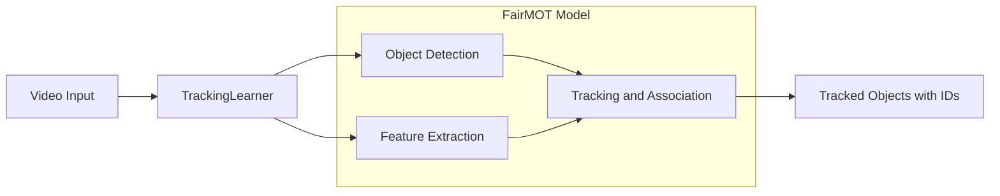
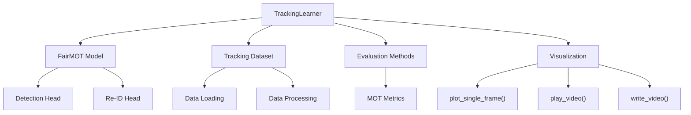
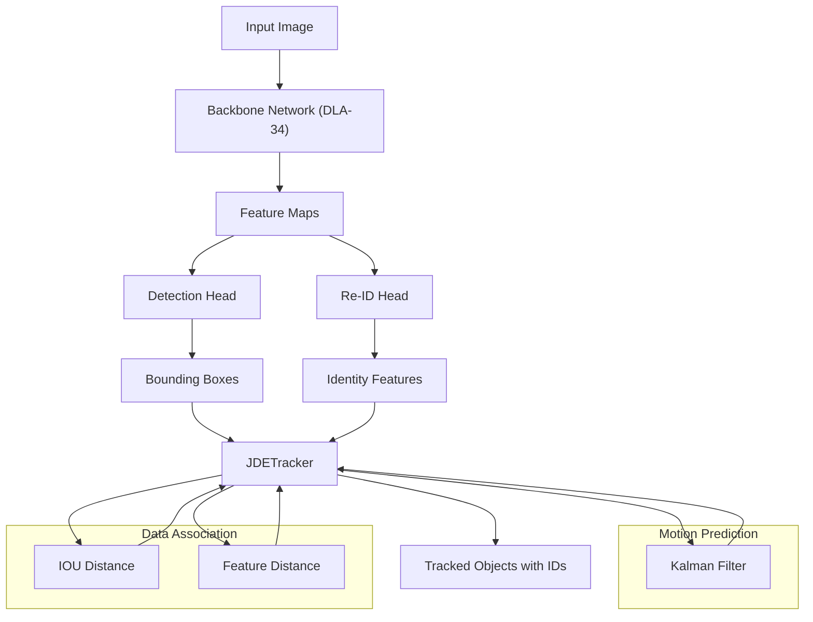
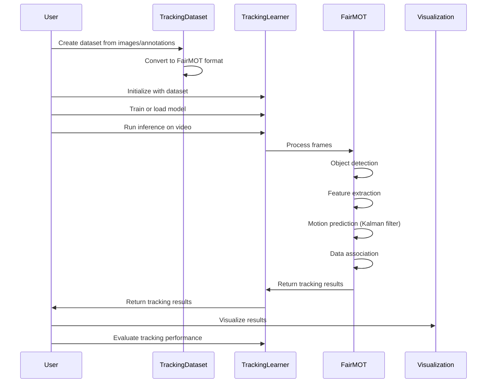

<!-- source: DeepWiki mcp.deepwiki.com · repo microsoft/computervision-recipes · page 2.2 Multi-Object Tracking · fetched 2026-10-26 -->

# Multi-Object Tracking

<details>
<summary>Relevant source files</summary>

The following files were used as context for generating this wiki page:

- [scenarios/tracking/01_training_introduction.ipynb](scenarios/tracking/01_training_introduction.ipynb)
- [scenarios/tracking/FAQ.md](scenarios/tracking/FAQ.md)
- [scenarios/tracking/README.md](scenarios/tracking/README.md)
- [scenarios/tracking/media/carcans_vott_ui.jpg](scenarios/tracking/media/carcans_vott_ui.jpg)
- [scenarios/tracking/media/eqn_idf1.jpg](scenarios/tracking/media/eqn_idf1.jpg)
- [scenarios/tracking/media/eqn_mota.jpg](scenarios/tracking/media/eqn_mota.jpg)
- [scenarios/tracking/media/fig_onlineBatch.jpg](scenarios/tracking/media/fig_onlineBatch.jpg)
- [scenarios/tracking/media/fig_tracksEval.jpg](scenarios/tracking/media/fig_tracksEval.jpg)
- [scenarios/tracking/media/figure_CNNcorrFilters.jpg](scenarios/tracking/media/figure_CNNcorrFilters.jpg)
- [scenarios/tracking/media/figure_DeepSortCNN.jpg](scenarios/tracking/media/figure_DeepSortCNN.jpg)
- [scenarios/tracking/media/figure_LSTM.jpg](scenarios/tracking/media/figure_LSTM.jpg)
- [scenarios/tracking/media/figure_SiameseNetwork.jpg](scenarios/tracking/media/figure_SiameseNetwork.jpg)
- [utils_cv/classification/plot.py](utils_cv/classification/plot.py)
- [utils_cv/tracking/bbox.py](utils_cv/tracking/bbox.py)
- [utils_cv/tracking/data.py](utils_cv/tracking/data.py)
- [utils_cv/tracking/dataset.py](utils_cv/tracking/dataset.py)
- [utils_cv/tracking/model.py](utils_cv/tracking/model.py)
- [utils_cv/tracking/opts.py](utils_cv/tracking/opts.py)
- [utils_cv/tracking/plot.py](utils_cv/tracking/plot.py)
- [utils_cv/tracking/references/README.txt](utils_cv/tracking/references/README.txt)
- [utils_cv/tracking/references/fairmot/datasets/dataset/jde.py](utils_cv/tracking/references/fairmot/datasets/dataset/jde.py)
- [utils_cv/tracking/references/fairmot/tracker/multitracker.py](utils_cv/tracking/references/fairmot/tracker/multitracker.py)
- [utils_cv/tracking/references/fairmot/tracking_utils/evaluation.py](utils_cv/tracking/references/fairmot/tracking_utils/evaluation.py)
- [utils_cv/tracking/references/fairmot/tracking_utils/io.py](utils_cv/tracking/references/fairmot/tracking_utils/io.py)
- [utils_cv/tracking/references/fairmot/tracking_utils/log.py](utils_cv/tracking/references/fairmot/tracking_utils/log.py)
- [utils_cv/tracking/references/fairmot/trains/mot.py](utils_cv/tracking/references/fairmot/trains/mot.py)

</details>


This page explains the multi-object tracking functionality in the Computer Vision Recipes library. The multi-object tracking module enables detection and tracking of objects over time in video sequences, maintaining consistent identity assignments across frames. The implementation is based on the FairMOT algorithm, which provides state-of-the-art tracking performance at reasonable inference speeds.

For information about object detection (without tracking), see [Object Detection](#2.1), and for video-based action recognition, see [Action Recognition](#2.6).

## Overview

Multi-object tracking (MOT) builds on object detection technology to detect and track multiple objects in a dynamic scene over time. Unlike object detection which only outputs bounding boxes for objects in individual frames, MOT assigns consistent identity numbers to each object, allowing them to be tracked across consecutive frames.

The implementation in this codebase is based on the FairMOT tracker, which uses a one-shot approach to detect objects and extract re-identification features simultaneously in a single network. This approach offers several advantages:

1. Efficient computation through shared feature maps for detection and re-ID tasks
2. Reduced ID switches through aligned features for detection and re-ID
3. Fast inference speeds (25+ FPS)
4. State-of-the-art tracking performance on benchmarks like MOT16 and MOT17



Sources: [utils_cv/tracking/model.py](utils_cv/tracking/model.py), [scenarios/tracking/README.md](scenarios/tracking/README.md)

## Key Components

The tracking module consists of several key components:



Sources: [utils_cv/tracking/model.py](utils_cv/tracking/model.py), [utils_cv/tracking/dataset.py](utils_cv/tracking/dataset.py), [utils_cv/tracking/plot.py](utils_cv/tracking/plot.py)

### TrackingLearner

The `TrackingLearner` class serves as the main interface for multi-object tracking. It provides methods for model initialization, training, inference, and evaluation.

```python
learner = TrackingLearner(
    dataset=tracking_dataset,  # Optional: Required for training
    model_path="path/to/model.pth",  # Optional: Path to pretrained model
    arch="dla_34",  # Backbone architecture
    head_conv=256  # Conv layer channels for output head
)
```

Key methods of `TrackingLearner`:

| Method | Description |
|--------|-------------|
| `fit(lr, lr_step, num_epochs)` | Train the tracker on the provided dataset |
| `predict(im_or_video_path, conf_thres, track_buffer, ...)` | Run inference on images or video |
| `evaluate(results, gt_root_path)` | Evaluate tracking performance |
| `eval_mot(conf_thres, track_buffer, data_root, ...)` | Run prediction and evaluation on MOT challenge format data |
| `save(path)` | Save the trained model |
| `plot_training_losses()` | Visualize training losses |

Sources: [utils_cv/tracking/model.py:120-274](utils_cv/tracking/model.py:120-274)

### TrackingDataset

The `TrackingDataset` class handles loading and preprocessing tracking data. It accepts data in Pascal VOC format and converts it to the format required by FairMOT.

```python
dataset = TrackingDataset(
    root="path/to/data",
    name="dataset_name",
    batch_size=4,
    im_dir="images",
    anno_dir="annotations"
)
```

The dataset functionality:
- Reads Pascal VOC format annotations
- Converts annotations to FairMOT format
- Creates FairMOT joint dataset for training
- Initializes dataloaders

Sources: [utils_cv/tracking/dataset.py:26-88](utils_cv/tracking/dataset.py:26-88)

### Visualization Utilities

The tracking module provides several functions for visualizing tracking results:

1. `plot_single_frame()`: Displays tracking results for a specific frame
2. `play_video()`: Shows tracking results as an interactive video
3. `write_video()`: Saves tracking results to a video file

```python
# Display tracking results for a specific frame
plot_single_frame(input_video="video.mp4", frame_id=10, results=tracking_results)

# Play video with tracking results
play_video(results=tracking_results, input_video="video.mp4")

# Save tracking results to a video file
write_video(results=tracking_results, input_video="video.mp4", output_video="output.mp4")
```

Sources: [utils_cv/tracking/plot.py:19-201](utils_cv/tracking/plot.py:19-201)

## FairMOT Architecture

The tracking implementation is based on the FairMOT algorithm, which uses a single network to perform both detection and re-identification.



Key components of the FairMOT architecture:

1. **Backbone Network**: Uses a Deep Layer Aggregation (DLA-34) network to extract features from images
2. **Detection Head**: Predicts object bounding boxes and object centers
3. **Re-ID Head**: Extracts features for object re-identification
4. **Tracker**: Uses a Kalman filter for motion prediction and combines appearance features and spatial information for data association

Sources: [utils_cv/tracking/model.py:166-203](utils_cv/tracking/model.py:166-203), [utils_cv/tracking/references/fairmot/tracker/multitracker.py:166-367](utils_cv/tracking/references/fairmot/tracker/multitracker.py:166-367), [scenarios/tracking/FAQ.md:109-119](scenarios/tracking/FAQ.md:109-119)

## Tracking Workflow

The tracking workflow consists of the following steps:



Sources: [utils_cv/tracking/model.py:370-424](utils_cv/tracking/model.py:370-424), [scenarios/tracking/01_training_introduction.ipynb](scenarios/tracking/01_training_introduction.ipynb)

### Training Process

Training a tracking model involves these steps:

1. **Data Preparation**: Use `TrackingDataset` to load and prepare training data
2. **Model Initialization**: Create a `TrackingLearner` with the dataset
3. **Training**: Call the `fit()` method to train the model

```python
# Load dataset
dataset = TrackingDataset('path/to/data', batch_size=4)

# Create learner
learner = TrackingLearner(dataset=dataset)

# Train model
learner.fit(lr=0.0005, lr_step="20,27", num_epochs=30)

# Save model
learner.save('path/to/save/model.pth')
```

During training, the model optimizes multiple losses:
- Heatmap loss (`hm_loss`): For object center detection
- Width-height loss (`wh_loss`): For bounding box size prediction
- Offset loss (`off_loss`): For precise object localization
- Identity loss (`id_loss`): For feature learning for re-identification

Sources: [utils_cv/tracking/model.py:167-239](utils_cv/tracking/model.py:167-239), [utils_cv/tracking/references/fairmot/trains/mot.py:19-84](utils_cv/tracking/references/fairmot/trains/mot.py:19-84)

### Inference Process

Inference involves these steps:

1. **Model Loading**: Load a trained model with `TrackingLearner`
2. **Prediction**: Call `predict()` on images or video
3. **Visualization**: Use plotting functions to visualize results

```python
# Load model
learner = TrackingLearner(model_path='path/to/model.pth')

# Run inference
results = learner.predict(
    im_or_video_path='path/to/video.mp4',
    conf_thres=0.3,  # Confidence threshold
    track_buffer=30  # Tracking buffer
)

# Visualize results
play_video(results, 'path/to/video.mp4')
```

The inference process is handled by the `JDETracker` class, which:
1. Processes input frames through the FairMOT model
2. Detects objects in each frame
3. Extracts re-identification features
4. Associates detections across frames using appearance and motion information
5. Returns tracked objects with consistent IDs

Sources: [utils_cv/tracking/model.py:370-424](utils_cv/tracking/model.py:370-424), [utils_cv/tracking/references/fairmot/tracker/multitracker.py:226-367](utils_cv/tracking/references/fairmot/tracker/multitracker.py:226-367)

## Evaluation Metrics

The tracking module supports standard MOT evaluation metrics:

| Metric | Description |
|--------|-------------|
| MOTA (Multiple Object Tracking Accuracy) | Overall tracking accuracy, accounting for false positives, false negatives, and ID switches |
| IDF1 (Identity F1 Score) | F1 score for the identity preservation, measuring how long the correct IDs are maintained |
| ID-switch | Number of times a tracked object changes its ID |
| Precision | Ratio of true positives to all detections |
| Recall | Ratio of true positives to all ground truth objects |

Evaluation can be performed using:

```python
# Evaluate tracking results
summary = learner.evaluate(results, gt_root_path='path/to/ground_truth')
print(summary)
```

Sources: [utils_cv/tracking/model.py:277-298](utils_cv/tracking/model.py:277-298), [utils_cv/tracking/references/fairmot/tracking_utils/evaluation.py:10-113](utils_cv/tracking/references/fairmot/tracking_utils/evaluation.py:10-113), [scenarios/tracking/FAQ.md:83-102](scenarios/tracking/FAQ.md:83-102)

## Data Format

### Input Data

The tracking module accepts data in two formats:

1. **Training Data**: Pascal VOC XML format annotations, similar to object detection:
   - Images in a folder (e.g., `images/`)
   - Annotations in XML format in another folder (e.g., `annotations/`)

2. **Evaluation Data**: MOT Challenge format:
   ```
   [frame number] [id number] [bbox left] [bbox top] [bbox width] [bbox height] [confidence] [class] [visibility]
   ```

### Output Data

The tracking results are returned as a dictionary mapping frame IDs to lists of `TrackingBbox` objects:

```python
{
    0: [TrackingBbox(left, top, right, bottom, frame_id=0, track_id=1), ...],
    1: [TrackingBbox(left, top, right, bottom, frame_id=1, track_id=1), ...],
    ...
}
```

The `TrackingBbox` class extends the basic `_Bbox` class from the detection module with frame and track IDs.

Sources: [utils_cv/tracking/dataset.py:88-177](utils_cv/tracking/dataset.py:88-177), [utils_cv/tracking/bbox.py:7-25](utils_cv/tracking/bbox.py:7-25), [scenarios/tracking/FAQ.md:34-59](scenarios/tracking/FAQ.md:34-59)

## Key Parameters

### TrackingLearner Parameters

| Parameter | Description | Default |
|-----------|-------------|---------|
| `dataset` | TrackingDataset object for training | None |
| `model_path` | Path to pretrained model | None (uses default model) |
| `arch` | Model architecture | "dla_34" |
| `head_conv` | Conv layer channels for output head | -1 (defaults to 256) |

### Training Parameters

| Parameter | Description | Default |
|-----------|-------------|---------|
| `lr` | Learning rate | 1e-4 |
| `lr_step` | When to drop learning rate by 10 | "20,27" |
| `num_epochs` | Total training epochs | 30 |

### Inference Parameters

| Parameter | Description | Default |
|-----------|-------------|---------|
| `conf_thres` | Confidence threshold for detections | 0.6 |
| `track_buffer` | How many frames to keep track of lost objects | 30 |
| `min_box_area` | Minimum bounding box area to consider | 200 |
| `frame_rate` | Video frame rate for motion model | 30 |

Sources: [utils_cv/tracking/model.py:120-150](utils_cv/tracking/model.py:120-150), [utils_cv/tracking/model.py:167-239](utils_cv/tracking/model.py:167-239), [utils_cv/tracking/model.py:370-424](utils_cv/tracking/model.py:370-424), [utils_cv/tracking/opts.py:15-111](utils_cv/tracking/opts.py:15-111)

## Example Usage

The typical workflow for using the tracking module is as follows:

```python
# Import required modules
from utils_cv.tracking.dataset import TrackingDataset
from utils_cv.tracking.model import TrackingLearner
from utils_cv.tracking.plot import play_video, write_video

# 1. Load dataset for training
dataset = TrackingDataset(
    root="path/to/data",
    batch_size=4
)

# 2. Create and train learner
learner = TrackingLearner(dataset=dataset)
learner.fit(lr=0.0005, num_epochs=10)

# 3. Save trained model
learner.save("model.pth")

# 4. Load model for inference
inference_learner = TrackingLearner(model_path="model.pth")

# 5. Run inference on video
results = inference_learner.predict(
    im_or_video_path="video.mp4",
    conf_thres=0.3,
    track_buffer=30
)

# 6. Visualize results
play_video(results, "video.mp4")

# 7. Save results to video file
write_video(results, "video.mp4", "output.mp4")

# 8. Evaluate tracking performance
summary = inference_learner.evaluate(results, "path/to/ground_truth")
print(summary)
```

Sources: [scenarios/tracking/01_training_introduction.ipynb](scenarios/tracking/01_training_introduction.ipynb)

## Limitations and Considerations

1. **Platform Support**: The tracking module only runs on Linux due to constraints introduced by the FairMOT repository.

2. **Dependencies**: Requires additional libraries:
   ```
   opencv yacs lap progress cython_bbox motmetrics
   ```

3. **Model Size**: The default model (DLA-34) requires significant memory for training and inference.

4. **Single-class Tracking**: The current implementation primarily supports single-class tracking (e.g., people or vehicles).

5. **Performance Factors**: Tracking performance is affected by:
   - Object size
   - Object occlusion
   - Camera motion
   - Video quality and frame rate

Sources: [scenarios/tracking/README.md:6-21](scenarios/tracking/README.md:6-21), [scenarios/tracking/FAQ.md](scenarios/tracking/FAQ.md)

## Related Pages

- [Object Detection](#2.1): For information about detecting objects in individual images
- [Action Recognition](#2.6): For video-based action recognition
- [Image Classification](#2.3): For classifying images into categories
- [Utilities Library](#3): For information about the shared utilities used across tasks

---

